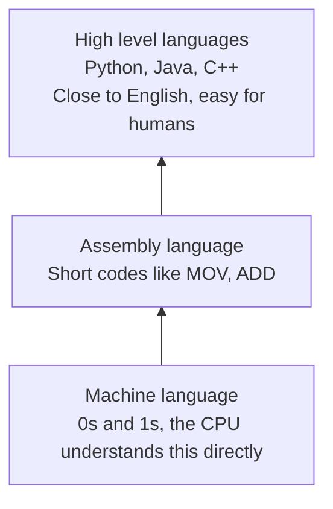
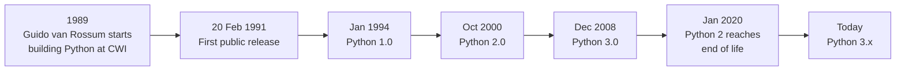
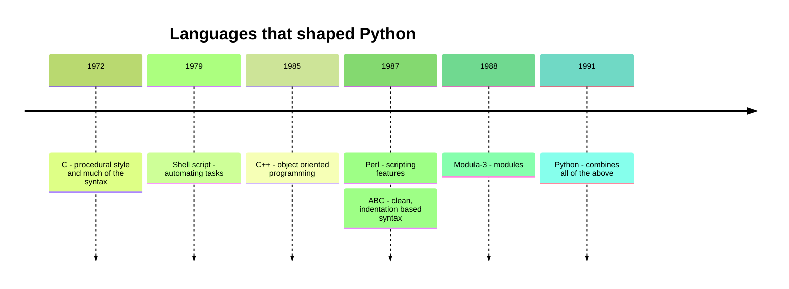
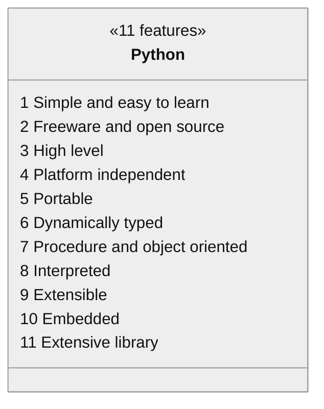
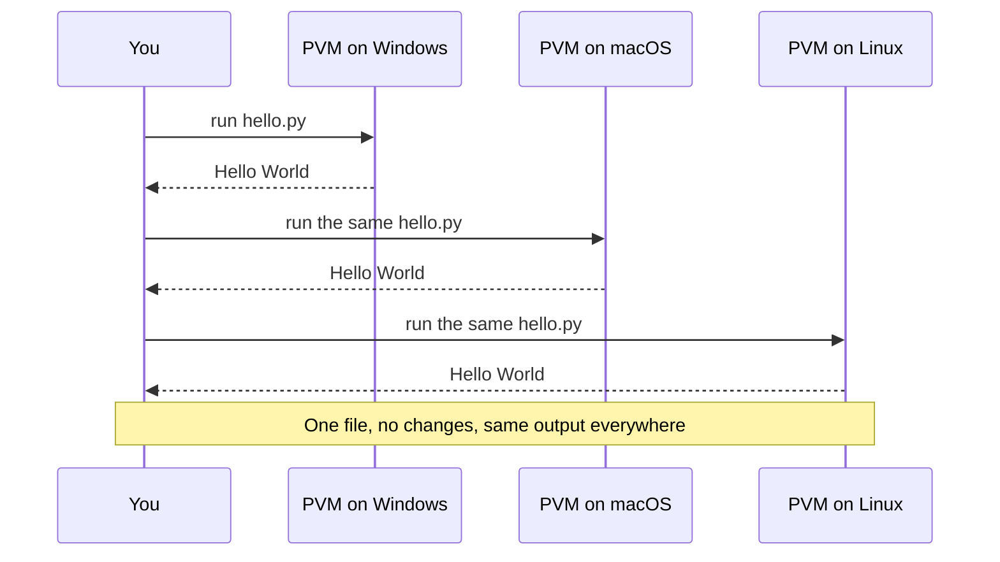
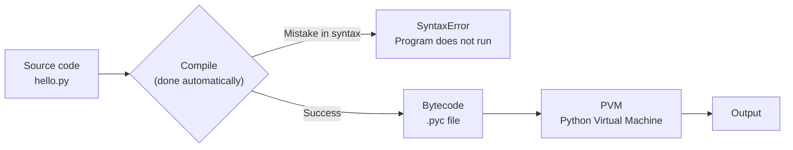
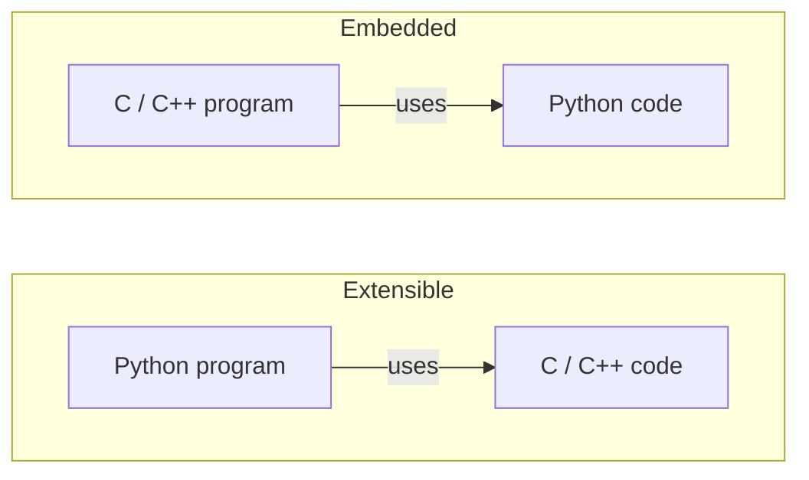
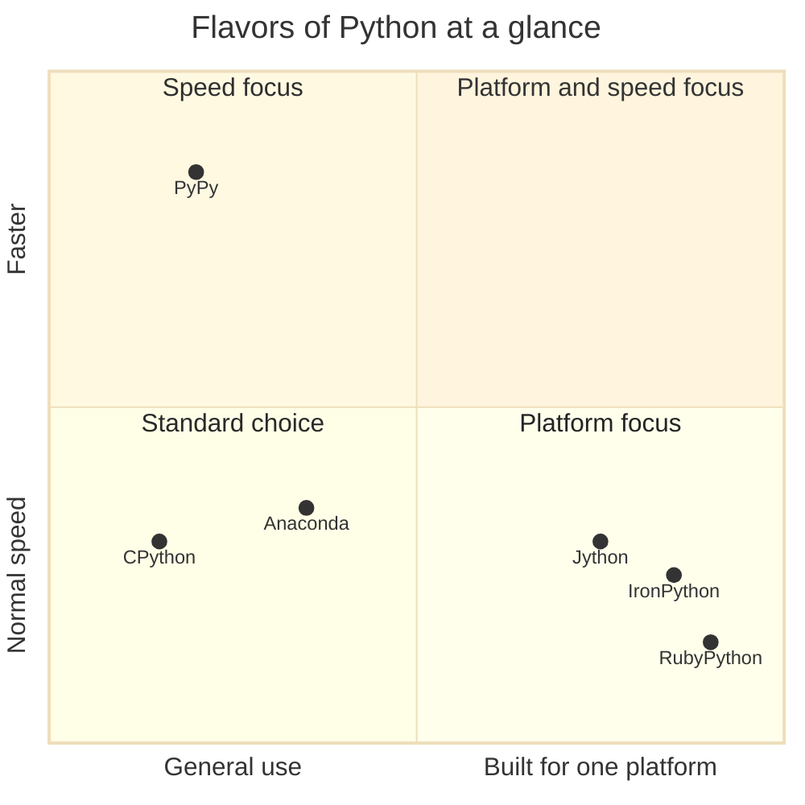

<p align="center">
  
</p>

# 01. Language Fundamentals

This topic answers the first questions every learner has: what Python is, where it came from, why so many people use it, where it is used, and what its strengths and limits are. There is very little code here. The goal is to build a clear picture of the language before you start writing programs.

**In this topic**

1. [What is Python?](#1-what-is-python)
2. [History of Python](#2-history-of-python)
3. [Why the name "Python"?](#3-why-the-name-python)
4. [Python compared with Java and C](#4-python-compared-with-java-and-c)
5. [Where Python's features came from](#5-where-pythons-features-came-from)
6. [Where we can use Python](#6-where-we-can-use-python)
7. [Features of Python](#7-features-of-python)
8. [Limitations of Python](#8-limitations-of-python)
9. [Flavors of Python](#9-flavors-of-python)
10. [Python versions](#10-python-versions)
11. [Quick revision](#11-quick-revision)
12. [Interview questions](#12-interview-questions)
13. [Practice questions](#13-practice-questions)

## 1. What is Python?

> **Python is a general purpose, high level programming language.**

These two words are worth understanding properly:

<table width="100%">
<tr>
<th align="left" width="14%">Term</th>
<th align="left" width="28%">Simple meaning</th>
<th align="left" width="24%">Example</th>
<th align="left" width="16%">Opposite</th>
<th align="left" width="18%">Why it matters</th>
</tr>
<tr><td align="left" valign="top"><b>General purpose</b></td><td align="left" valign="top">Not built for one job only. You can use it to make many kinds of software.</td><td align="left" valign="top">Websites, games, data analysis, automation scripts, machine learning</td><td align="left" valign="top">Special purpose language, such as SQL (only for databases)</td><td align="left" valign="top">Learn one language and use it in many jobs</td></tr>
<tr><td align="left" valign="top"><b>High level</b></td><td align="left" valign="top">Close to human language, far from machine language. The language handles hardware details for you.</td><td align="left" valign="top">You write <code>print("Hi")</code>. You do not manage memory or CPU registers.</td><td align="left" valign="top">Low level language, such as assembly</td><td align="left" valign="top">You focus on the problem, not on the machine</td></tr>
</table>

The levels of programming languages, from the machine up to the programmer:



Python is often recommended as the **first programming language for beginners** because its programs are short and easy to read.

## 2. History of Python

- Python was developed by **Guido van Rossum** in **1989**.
- He was working at the **National Research Institute for Mathematics and Computer Science (CWI)** in the **Netherlands**.
- Python was officially released to the public in **1991**.
- The official date of birth of Python is **20 February 1991**.



## 3. Why the name "Python"?

The name has nothing to do with the snake. Guido van Rossum took the name from the BBC comedy TV show **"Monty Python's Flying Circus"**, which was broadcast from **1969 to 1974**. He wanted a name that was short, unique and a little mysterious.

## 4. Python compared with Java and C

The best way to see why Python is called simple is to write the same program in three languages.

### Example 1: Print "Hello World"

<table width="100%">
<tr>
<th width="33%"><br/>Java</th>
<th width="33%"><br/>C</th>
<th width="34%"><br/>Python</th>
</tr>
<tr>
<td valign="top">

```java
public class HelloWorld
{
    public static void main(String[] args)
    {
        System.out.println("Hello world");
    }
}
```

</td>
<td valign="top">

```c
#include <stdio.h>

void main()
{
    printf("Hello world");
}
```

</td>
<td valign="top">

```python
print("Hello World")
```

</td>
</tr>
<tr>
<td align="center">7 lines</td>
<td align="center">6 lines</td>
<td align="center"><b>1 line</b></td>
</tr>
</table>

In Python, the same program needs no class, no `main` function, no header file and no semicolons.

```python
# Print a message on the screen
print("Hello World")
```

**Output**

```text
Hello World
```

### Example 2: Print the sum of two numbers

<table width="100%">
<tr>
<th width="33%"><br/>Java</th>
<th width="33%"><br/>C</th>
<th width="34%"><br/>Python</th>
</tr>
<tr>
<td valign="top">

```java
public class Add
{
    public static void main(String[] args)
    {
        int a, b;
        a = 10;
        b = 20;
        System.out.println("The Sum:" + (a + b));
    }
}
```

</td>
<td valign="top">

```c
#include <stdio.h>

void main()
{
    int a, b;
    a = 10;
    b = 20;
    printf("The Sum:%d", (a + b));
}
```

</td>
<td valign="top">

```python
a = 10
b = 20
print("The Sum:", (a + b))
```

</td>
</tr>
</table>

The Python version with comments:

```python
# Store the first number in the variable a
a = 10

# Store the second number in the variable b
b = 20

# Add a and b, then print the label and the result
print("The Sum:", (a + b))
```

**Output**

```text
The Sum: 30
```

**How this program runs**


1. Line 1 stores `10` in `a`.
2. Line 2 stores `20` in `b`.
3. Line 3 first works out `a + b`, which is `30`. Then `print()` shows the text `The Sum:` and the number `30`. `print()` puts a space between the two items automatically.

**What to notice:** In Java and C we must say that `a` and `b` are `int` before we use them. In Python we just assign the value. Python works out the type by itself. This is called **dynamic typing** (see [feature 6](#feature-6-dynamically-typed)).

## 5. Where Python's features came from

Guido van Rossum did not invent everything from zero. He took the best ideas from languages that already existed and combined them.



<table width="100%">
<tr>
<th align="left" width="20%">Feature</th>
<th align="left" width="14%">Taken from</th>
<th align="left" width="32%">What it means for you</th>
<th align="left" width="18%">Python example</th>
<th align="left" width="16%">Learn it in</th>
</tr>
<tr><td align="left" valign="top">Functional programming features</td><td align="left" valign="top">C</td><td align="left" valign="top">Write a program as a set of functions, each doing one job</td><td align="left" valign="top"><code>def add(a, b):</code></td><td align="left" valign="top">Topic 10</td></tr>
<tr><td align="left" valign="top">Object oriented programming features</td><td align="left" valign="top">C++</td><td align="left" valign="top">Model real things as classes and objects</td><td align="left" valign="top"><code>class Student:</code></td><td align="left" valign="top">Topics 26 to 29</td></tr>
<tr><td align="left" valign="top">Scripting language features</td><td align="left" valign="top">Perl and Shell Script</td><td align="left" valign="top">Write short programs that automate everyday tasks</td><td align="left" valign="top">A 5-line script that renames files</td><td align="left" valign="top">Topics 13 and 20</td></tr>
<tr><td align="left" valign="top">Modular programming features</td><td align="left" valign="top">Modula-3</td><td align="left" valign="top">Split a big program into small files called modules</td><td align="left" valign="top"><code>import math</code></td><td align="left" valign="top">Topics 11 and 12</td></tr>
<tr><td align="left" valign="top">Most of the syntax</td><td align="left" valign="top">C and ABC</td><td align="left" valign="top">ABC was a teaching language Guido worked on before Python. Its clean, indentation based style shaped Python.</td><td align="left" valign="top"><code>if</code>, <code>while</code>, indentation for blocks</td><td align="left" valign="top">Topic 05</td></tr>
</table>

> **Note:** C is usually called a *procedural* language. The notes call these "functional programming features" because in C you build a program out of functions. Python also has true functional programming tools such as `lambda`, `map()` and `filter()`, which came from languages like Lisp and Haskell. You will learn them in Topics 10 and 10.1.

## 6. Where we can use Python

We can use Python almost everywhere. The most common application areas are:

<table width="100%">
<tr>
<th align="left" width="17%">Area</th>
<th align="left" width="23%">What you build</th>
<th align="left" width="22%">Popular tools</th>
<th align="left" width="22%">Real-world example</th>
<th align="left" width="16%">Course topic</th>
</tr>
<tr><td align="left" valign="top">Desktop applications</td><td align="left" valign="top">Programs with windows and buttons</td><td align="left" valign="top">Tkinter, PyQt</td><td align="left" valign="top">Dropbox desktop client</td><td align="left" valign="top">Extra study</td></tr>
<tr><td align="left" valign="top">Web applications</td><td align="left" valign="top">Websites and web APIs</td><td align="left" valign="top">Django, Flask, FastAPI</td><td align="left" valign="top">Instagram (built on Django)</td><td align="left" valign="top">Extra study</td></tr>
<tr><td align="left" valign="top">Database applications</td><td align="left" valign="top">Programs that store and read data</td><td align="left" valign="top">sqlite3, MySQL and PostgreSQL drivers</td><td align="left" valign="top">Inventory or billing systems</td><td align="left" valign="top">Topic 23</td></tr>
<tr><td align="left" valign="top">Network programming</td><td align="left" valign="top">Programs that talk over a network</td><td align="left" valign="top">socket, requests</td><td align="left" valign="top">Chat servers, API clients</td><td align="left" valign="top">Topic 23.1</td></tr>
<tr><td align="left" valign="top">Games</td><td align="left" valign="top">2D games</td><td align="left" valign="top">Pygame</td><td align="left" valign="top">Small arcade and puzzle games</td><td align="left" valign="top">Extra study</td></tr>
<tr><td align="left" valign="top">Data analysis</td><td align="left" valign="top">Reports, charts and statistics from data</td><td align="left" valign="top">pandas, NumPy, Matplotlib</td><td align="left" valign="top">Sales and finance reports</td><td align="left" valign="top">Extra study</td></tr>
<tr><td align="left" valign="top">Machine learning</td><td align="left" valign="top">Programs that learn from data</td><td align="left" valign="top">scikit-learn, TensorFlow, PyTorch</td><td align="left" valign="top">Movie and product recommendations</td><td align="left" valign="top">Extra study</td></tr>
<tr><td align="left" valign="top">Artificial intelligence</td><td align="left" valign="top">Language, vision and decision systems</td><td align="left" valign="top">PyTorch, Hugging Face libraries</td><td align="left" valign="top">Speech and image recognition</td><td align="left" valign="top">Extra study</td></tr>
<tr><td align="left" valign="top">IoT</td><td align="left" valign="top">Code for small devices and sensors</td><td align="left" valign="top">MicroPython</td><td align="left" valign="top">Home automation with a Raspberry Pi</td><td align="left" valign="top">Extra study</td></tr>
</table>

**Who uses Python?**

- Google and YouTube use Python internally.
- NASA and the New York Stock Exchange have built applications with Python.
- Large software companies such as Google, Microsoft, IBM and Yahoo use Python.

## 7. Features of Python

Python is popular because of these 11 features.



### Feature 1: Simple and easy to learn

- A Python program reads almost like English sentences.
- The syntax is very simple, and there are only about **35 keywords** (reserved words). Java has about 50.
- We can write programs with far fewer lines than in other languages. This gives more **readability** and **simplicity**.
- Fewer lines mean less development time and lower project cost.

Look how close this program is to plain English:

```python
# Create a list of three student names
students = ["Asha", "Ravi", "Meena"]

# Go through the list one name at a time
for name in students:

    # Print a welcome message for the current name
    print("Welcome,", name)
```

**Output**

```text
Welcome, Asha
Welcome, Ravi
Welcome, Meena
```

**How this program runs:** Python takes the first name, `"Asha"`, puts it in `name` and runs the `print()` line. Then it does the same for `"Ravi"` and then for `"Meena"`. When the list has no more names, the loop stops. You can read the code aloud as: *"for each name in students, print welcome and the name."*

You can ask Python itself how many keywords it has:

```python
# Load the built-in keyword module
import keyword

# Count the keywords and print the count
print(len(keyword.kwlist))

# Print the full list of keywords
print(keyword.kwlist)
```

**Output** (Python 3.12)

```text
35
['False', 'None', 'True', 'and', 'as', 'assert', 'async', 'await', 'break', 'class', 'continue', 'def', 'del', 'elif', 'else', 'except', 'finally', 'for', 'from', 'global', 'if', 'import', 'in', 'is', 'lambda', 'nonlocal', 'not', 'or', 'pass', 'raise', 'return', 'try', 'while', 'with', 'yield']
```

> The notes say "30+ keywords". The exact number changes a little between versions. Python 3.12 has 35. You will study keywords in detail in Topic 02.

### Feature 2: Freeware and open source

- **Freeware:** Python is free. You do not need to buy a licence to use it, even for commercial work.
- **Open source:** The source code of Python is open to everyone. Anyone can read it and change it for their needs.

**Example:** Jython is a customised version of Python made to work with Java applications. It was possible to build only because Python is open source.

### Feature 3: High level programming language

Python is a high level language, so it is **programmer friendly**. As a programmer you do not need to manage low level work such as:

- memory management (asking for memory and giving it back)
- security details of the hardware
- CPU registers and memory addresses

Python does this for you, so you can focus on solving the problem.

<table width="100%">
<tr>
<th width="50%">In C you manage memory yourself</th>
<th width="50%">In Python memory is automatic</th>
</tr>
<tr>
<td valign="top">

```c
int *marks = malloc(3 * sizeof(int));
marks[0] = 78;
marks[1] = 85;
marks[2] = 92;
free(marks);
```

</td>
<td valign="top">

```python
marks = [78, 85, 92]
```

</td>
</tr>
</table>

In C, if you forget `free()`, the program wastes memory. In Python you just create the list. Python frees the memory when the list is no longer used.

### Feature 4: Platform independent

You write a Python program **once**, and it runs on **any platform** (Windows, macOS, Linux) without rewriting it. Internally, the **PVM (Python Virtual Machine)** converts the program into a form that the machine understands.



The same `.py` file works everywhere because each operating system has its own PVM. The PVM hides the differences between the systems.

### Feature 5: Portability

Python programs are **portable**. You can move (migrate) a program from one platform to another very easily, and it gives the **same results** on every platform.

> **Platform independent vs portable:** Platform independent means the same code *can* run on any platform. Portable means *moving* the program to another platform is easy and the results stay the same. The two ideas are closely linked.

### Feature 6: Dynamically typed

In Python you do **not** declare the type of a variable. When you assign a value, Python looks at the value and gives the variable the right type automatically. That is why Python is called a **dynamically typed** language.

Java and C are **statically typed** languages, because you must give the type at the beginning.

<table width="100%">
<tr>
<th width="50%">Statically typed (Java)</th>
<th width="50%">Dynamically typed (Python)</th>
</tr>
<tr>
<td valign="top">

```java
int value = 10;
value = "ten";   // Error: a String is not an int
```

</td>
<td valign="top">

```python
value = 10
value = "ten"    # Allowed
```

</td>
</tr>
</table>

```python
# Assign a whole number, so Python makes value an int
value = 10

# Print the value and its type
print(value, type(value))

# Assign text to the same name, so value is now a str
value = "ten"

# Print the new value and its new type
print(value, type(value))
```

**Output**

```text
10 <class 'int'>
ten <class 'str'>
```

**How this program runs:** On line 1, Python sees `10`, which is a whole number, so `value` refers to an `int`. On line 3, we give the same name a piece of text, so now `value` refers to a `str`. We never wrote `int` or `str` ourselves. This flexibility makes coding faster. The cost is that a type mistake shows up only when the program runs, so read your code carefully.

### Feature 7: Both procedure oriented and object oriented

Python supports both styles:

- **Procedure oriented**, like C and Pascal: the program is a set of steps and functions.
- **Object oriented**, like C++ and Java: the program is built from classes and objects.

So we get the benefits of both, for example **security** and **reusability**. Beginners can start with simple procedural code and move to object oriented code later (Topics 26 to 29).

### Feature 8: Interpreted

You do not need to compile a Python program explicitly. The Python interpreter takes care of compilation internally.

- If the compilation fails, the interpreter raises a **syntax error**.
- If the compilation succeeds, the **PVM (Python Virtual Machine)** executes the program.



**Step by step:**

1. You write the source code in a `.py` file.
2. When you run it, Python compiles it into **bytecode**. Bytecode is a simple set of instructions for the PVM, not for the real CPU.
3. The PVM reads the bytecode one instruction at a time and runs it.

You only run one command, `python hello.py`. Steps 2 and 3 happen automatically. That is why Python feels like an interpreted language even though a compile step exists inside it.

### Feature 9: Extensible

We can use programs written in **other languages** (such as C or C++) inside Python. The main advantages are:

1. We can reuse **existing legacy code** that is not written in Python.
2. We can **improve performance**: slow parts can be written in a fast language like C and called from Python.

**Example:** The NumPy library does its heavy maths in C, so Python programs that use NumPy run fast.

### Feature 10: Embedded

This is the opposite of extensible. We can put Python code **inside programs written in other languages**. In other words, we can embed Python anywhere.

**Example:** Tools like Blender (3D graphics) and many games embed Python so users can write scripts to control them.



### Feature 11: Extensive library

Python comes with a rich built-in library, called the **standard library**. You can use it directly, so you do not need to write that functionality yourself. People often say Python comes with *"batteries included"*.

```python
# Load the math module for mathematical functions
import math

# Load the statistics module for averages and similar calculations
import statistics

# Print the square root of 144
print(math.sqrt(144))

# Print 5 factorial, which is 5 x 4 x 3 x 2 x 1
print(math.factorial(5))

# Create a list of marks
marks = [78, 85, 92, 66, 89]

# Print the average of the marks
print(statistics.mean(marks))

# Print the highest mark using the built-in max() function
print(max(marks))
```

**Output**

```text
12.0
120
82
92
```

**How this program runs:** The two `import` lines load ready-made modules. `math.sqrt()` and `math.factorial()` come from the `math` module. `statistics.mean()` adds the marks (410) and divides by the count (5) to get `82`. `max()` is built into Python, so it needs no import. We wrote no maths logic ourselves. The library did all the work.

## 8. Limitations of Python

No language is perfect. Python has two main limitations:

<table width="100%">
<tr>
<th align="left" width="18%">Limitation</th>
<th align="left" width="30%">Why</th>
<th align="left" width="30%">What people do about it</th>
<th align="left" width="22%">Does it matter for a beginner?</th>
</tr>
<tr><td align="left" valign="top"><b>Performance is lower</b> than C or Java</td><td align="left" valign="top">Python is an interpreted language. The PVM runs bytecode step by step, which is slower than running native machine code.</td><td align="left" valign="top">Use libraries written in C (such as NumPy), or use PyPy (see flavors below)</td><td align="left" valign="top">Not really. Learning programs are small, so the speed difference is too small to notice.</td></tr>
<tr><td align="left" valign="top"><b>Not commonly used for mobile applications</b></td><td align="left" valign="top">Android and iOS are built around Java/Kotlin and Swift.</td><td align="left" valign="top">Frameworks such as Kivy and BeeWare can build mobile apps in Python, but they are less common</td><td align="left" valign="top">No. Learn Python for web, data and automation. Pick a mobile language later if needed.</td></tr>
</table>

## 9. Flavors of Python

A **flavor** (also called an **implementation**) is a version of the Python software built for a particular platform or purpose. The language is the same, but the program that runs it is different.



<table width="100%">
<tr>
<th align="left" width="14%">Flavor</th>
<th align="left" width="16%">Built for</th>
<th align="left" width="34%">Key point</th>
<th align="left" width="16%">Runs on</th>
<th align="left" width="20%">Typical user</th>
</tr>
<tr><td align="left" valign="top"><b>CPython</b></td><td align="left" valign="top">C language applications</td><td align="left" valign="top">The <b>standard</b> flavor. When you download Python from python.org, you get CPython.</td><td align="left" valign="top">Windows, macOS, Linux</td><td align="left" valign="top">Almost everyone, including this course</td></tr>
<tr><td align="left" valign="top"><b>Jython</b> or <b>JPython</b></td><td align="left" valign="top">Java applications</td><td align="left" valign="top">Runs on the <b>JVM</b> (Java Virtual Machine)</td><td align="left" valign="top">JVM</td><td align="left" valign="top">Teams that need Python inside Java systems</td></tr>
<tr><td align="left" valign="top"><b>IronPython</b></td><td align="left" valign="top">C# and the .NET platform</td><td align="left" valign="top">Works with .NET libraries</td><td align="left" valign="top">.NET runtime</td><td align="left" valign="top">Teams that build on Microsoft .NET</td></tr>
<tr><td align="left" valign="top"><b>PyPy</b></td><td align="left" valign="top">Speed</td><td align="left" valign="top">Has a <b>JIT (Just In Time) compiler</b> inside its PVM, so programs usually run faster</td><td align="left" valign="top">Windows, macOS, Linux</td><td align="left" valign="top">People with long running, slow Python programs</td></tr>
<tr><td align="left" valign="top"><b>RubyPython</b></td><td align="left" valign="top">Ruby platforms</td><td align="left" valign="top">Lets Ruby programs use Python</td><td align="left" valign="top">Ruby runtime</td><td align="left" valign="top">Ruby developers who need a Python library</td></tr>
<tr><td align="left" valign="top"><b>Anaconda Python</b></td><td align="left" valign="top">Large volumes of data</td><td align="left" valign="top">Specially designed for data processing. It comes with many data science libraries already installed.</td><td align="left" valign="top">Windows, macOS, Linux</td><td align="left" valign="top">Data analysts and data scientists</td></tr>
</table>

> **Note:** Strictly speaking, Anaconda is a *distribution* (CPython plus many extra libraries and tools), and RubyPython is a *bridge* between Ruby and Python. They are listed here because the notes include them.

**What is a JIT compiler?** A normal PVM runs bytecode instruction by instruction every time. A JIT compiler notices code that runs again and again (for example, inside a loop) and converts it into fast machine code while the program is running. The next time, the fast version is used. That is why PyPy is often faster than CPython.

You can check which flavor you are using:

```python
# Load the platform module, which gives details about the system
import platform

# Print the name of the Python implementation in use
print(platform.python_implementation())
```

**Output** (when run with the standard Python from python.org)

```text
CPython
```

## 10. Python versions

<table width="100%">
<tr>
<th align="left" width="15%">Version</th>
<th align="left" width="18%">Released</th>
<th align="left" width="45%">Key change</th>
<th align="left" width="22%">Status today</th>
</tr>
<tr><td align="left" valign="top">Python 1.0</td><td align="left" valign="top">January 1994</td><td align="left" valign="top">First major version with functional tools like <code>lambda</code>, <code>map()</code> and <code>filter()</code></td><td align="left" valign="top">Historic, not used</td></tr>
<tr><td align="left" valign="top">Python 2.0</td><td align="left" valign="top">October 2000</td><td align="left" valign="top">Added list comprehensions and better memory management (garbage collection)</td><td align="left" valign="top">End of life since 1 January 2020</td></tr>
<tr><td align="left" valign="top">Python 3.0</td><td align="left" valign="top">December 2008</td><td align="left" valign="top">Cleaned up the language. <code>print()</code> became a function and text became Unicode by default.</td><td align="left" valign="top">Active. New version every October.</td></tr>
</table>

> **Important:** Python 3 is **not backward compatible** with Python 2. There is no guarantee that a Python 2 program will run in Python 3.

Two common examples of the difference:

<table width="100%">
<tr>
<th align="left" width="14%">Code</th>
<th align="left" width="26%">Python 2</th>
<th align="left" width="28%">Python 3</th>
<th align="left" width="32%">Why it changed</th>
</tr>
<tr><td align="left" valign="top">Printing</td><td align="left" valign="top"><code>print "Hello"</code> (a statement)</td><td align="left" valign="top"><code>print("Hello")</code> (a function, brackets needed)</td><td align="left" valign="top">A function works like every other function and can take options such as <code>sep</code> and <code>end</code></td></tr>
<tr><td align="left" valign="top"><code>7 / 2</code></td><td align="left" valign="top"><code>3</code> (whole number division)</td><td align="left" valign="top"><code>3.5</code> (true division)</td><td align="left" valign="top">Dropping the decimal part surprised beginners and caused bugs. Python 3 uses <code>//</code> for whole number division.</td></tr>
</table>

The Python 3 behaviour:

```python
# Divide 7 by 2 with true division, which keeps the decimal part
print(7 / 2)

# Divide 7 by 2 with floor division, which drops the decimal part
print(7 // 2)
```

**Output**

```text
3.5
3
```

**Current versions:** The notes mention Python 3.6.1 and Python 2.7.13, which were current when the notes were written. Since then:

- Python 2 reached its **end of life on 1 January 2020**. It gets no more updates or security fixes. Do not use it for new work.
- Python 3 has had many new releases, with a new version every October. This course uses **Python 3.12 or newer**. Check [python.org/downloads](https://www.python.org/downloads/) for the latest version.

You can check which version you have:

```python
# Load the sys module, which gives details about the Python interpreter
import sys

# Print the major and minor version numbers
print(sys.version_info.major, sys.version_info.minor)
```

**Output** (on Python 3.12)

```text
3 12
```

## 11. Quick revision

<table width="100%">
<tr>
<th align="left" width="6%">#</th>
<th align="left" width="36%">Question</th>
<th align="left" width="42%">Answer</th>
<th align="left" width="16%">Read again</th>
</tr>
<tr><td align="left" valign="top">1</td><td align="left" valign="top">What type of language is Python?</td><td align="left" valign="top">General purpose, high level programming language</td><td align="left" valign="top"><a href="#1-what-is-python">Section 1</a></td></tr>
<tr><td align="left" valign="top">2</td><td align="left" valign="top">Who developed Python?</td><td align="left" valign="top">Guido van Rossum</td><td align="left" valign="top"><a href="#2-history-of-python">Section 2</a></td></tr>
<tr><td align="left" valign="top">3</td><td align="left" valign="top">When and where?</td><td align="left" valign="top">1989, at CWI (National Research Institute), Netherlands</td><td align="left" valign="top"><a href="#2-history-of-python">Section 2</a></td></tr>
<tr><td align="left" valign="top">4</td><td align="left" valign="top">Official date of birth</td><td align="left" valign="top">20 February 1991</td><td align="left" valign="top"><a href="#2-history-of-python">Section 2</a></td></tr>
<tr><td align="left" valign="top">5</td><td align="left" valign="top">Where does the name come from?</td><td align="left" valign="top">BBC TV show "Monty Python's Flying Circus" (1969 to 1974)</td><td align="left" valign="top"><a href="#3-why-the-name-python">Section 3</a></td></tr>
<tr><td align="left" valign="top">6</td><td align="left" valign="top">Functional programming features from</td><td align="left" valign="top">C</td><td align="left" valign="top"><a href="#5-where-pythons-features-came-from">Section 5</a></td></tr>
<tr><td align="left" valign="top">7</td><td align="left" valign="top">Object oriented features from</td><td align="left" valign="top">C++</td><td align="left" valign="top"><a href="#5-where-pythons-features-came-from">Section 5</a></td></tr>
<tr><td align="left" valign="top">8</td><td align="left" valign="top">Scripting features from</td><td align="left" valign="top">Perl and Shell Script</td><td align="left" valign="top"><a href="#5-where-pythons-features-came-from">Section 5</a></td></tr>
<tr><td align="left" valign="top">9</td><td align="left" valign="top">Modular programming features from</td><td align="left" valign="top">Modula-3</td><td align="left" valign="top"><a href="#5-where-pythons-features-came-from">Section 5</a></td></tr>
<tr><td align="left" valign="top">10</td><td align="left" valign="top">Most of the syntax from</td><td align="left" valign="top">C and ABC</td><td align="left" valign="top"><a href="#5-where-pythons-features-came-from">Section 5</a></td></tr>
<tr><td align="left" valign="top">11</td><td align="left" valign="top">Who runs Python bytecode?</td><td align="left" valign="top">PVM (Python Virtual Machine)</td><td align="left" valign="top"><a href="#7-features-of-python">Section 7</a></td></tr>
<tr><td align="left" valign="top">12</td><td align="left" valign="top">Dynamically typed means</td><td align="left" valign="top">No type declaration; the type comes from the assigned value</td><td align="left" valign="top"><a href="#7-features-of-python">Section 7</a></td></tr>
<tr><td align="left" valign="top">13</td><td align="left" valign="top">Main limitations</td><td align="left" valign="top">Slower performance; not common for mobile apps</td><td align="left" valign="top"><a href="#8-limitations-of-python">Section 8</a></td></tr>
<tr><td align="left" valign="top">14</td><td align="left" valign="top">Standard flavor</td><td align="left" valign="top">CPython</td><td align="left" valign="top"><a href="#9-flavors-of-python">Section 9</a></td></tr>
<tr><td align="left" valign="top">15</td><td align="left" valign="top">Flavor with a JIT compiler</td><td align="left" valign="top">PyPy</td><td align="left" valign="top"><a href="#9-flavors-of-python">Section 9</a></td></tr>
<tr><td align="left" valign="top">16</td><td align="left" valign="top">Is Python 3 backward compatible with Python 2?</td><td align="left" valign="top">No</td><td align="left" valign="top"><a href="#10-python-versions">Section 10</a></td></tr>
</table>

## 12. Interview questions

These are common interview questions on this topic. Try to answer each one aloud first, then click it to see a model answer.

<details>
<summary><b>Q1. What is Python? Name its key features.</b></summary>

Python is a general purpose, high level, interpreted programming language created by Guido van Rossum and released in 1991. Its key features are: simple syntax, free and open source, platform independent, dynamically typed, supports both procedural and object oriented programming, extensible, embeddable, and a large standard library.

</details>

<details>
<summary><b>Q2. Is Python compiled or interpreted?</b></summary>

Both. When you run a program, Python first **compiles** the source code into **bytecode** automatically. Then the **PVM interprets** (runs) that bytecode. Because you never run a separate compile command, Python is usually called an interpreted language.

</details>

<details>
<summary><b>Q3. What is the PVM?</b></summary>

The PVM (Python Virtual Machine) is the part of Python that runs bytecode. It reads one bytecode instruction at a time and carries it out on the real machine. Each operating system has its own PVM, and this is what makes Python platform independent.

</details>

<details>
<summary><b>Q4. What is bytecode? What are .pyc files?</b></summary>

Bytecode is a low level, platform independent set of instructions made from your source code. It is meant for the PVM, not for the CPU. When you import a module, Python saves its bytecode in a `.pyc` file inside a `__pycache__` folder. Next time, Python can skip the compile step if the source has not changed, so the program starts faster.

</details>

<details>
<summary><b>Q5. Python is dynamically typed. Is it also strongly typed?</b></summary>

Yes. **Dynamically typed** means the type is decided at run time from the value, so you never declare it. **Strongly typed** means Python does not silently mix incompatible types. For example, it will not add text and a number:

```python
# Store a whole number in age
age = 25

# Store some text in label
label = "Age: "

# Try to join text and a number, which Python does not allow
print(label + age)
```

**Output** (last line of the error message)

```text
TypeError: can only concatenate str (not "int") to str
```

You must convert the number to text yourself:

```python
# Convert age to text with str(), then join the two pieces of text
print(label + str(age))
```

**Output**

```text
Age: 25
```

</details>

<details>
<summary><b>Q6. What is the difference between Python and CPython?</b></summary>

**Python** is the language: its rules and syntax. **CPython** is the standard program that runs Python code. It is written in C and is what you download from python.org. Other implementations of the same language exist, such as PyPy, Jython and IronPython.

</details>

<details>
<summary><b>Q7. Why is PyPy often faster than CPython?</b></summary>

PyPy has a **JIT (Just In Time) compiler**. While the program runs, it finds code that runs many times, such as loops, and turns it into fast machine code. CPython mostly runs bytecode one instruction at a time, so long running loops are slower.

</details>

<details>
<summary><b>Q8. What are the main differences between Python 2 and Python 3?</b></summary>

- `print` is a statement in Python 2 and a function, `print()`, in Python 3.
- `7 / 2` gives `3` in Python 2 and `3.5` in Python 3.
- Text is Unicode by default in Python 3.
- Python 3 is not backward compatible with Python 2.
- Python 2 reached end of life on 1 January 2020.

</details>

<details>
<summary><b>Q9. How is Python platform independent?</b></summary>

Your `.py` file is compiled into bytecode, and bytecode is the same on every platform. Each operating system has its own PVM that knows how to run that bytecode on that system. So the same program runs on Windows, macOS and Linux without changes.

</details>

<details>
<summary><b>Q10. What is the difference between extensible and embedded?</b></summary>

**Extensible:** a Python program uses code written in another language, such as C. Example: NumPy uses C for fast maths.
**Embedded:** a program written in another language contains and runs Python code. Example: Blender lets users write Python scripts.

</details>

<details>
<summary><b>Q11. What are the limitations of Python?</b></summary>

1. It is slower than compiled languages such as C, because bytecode is interpreted.
2. It is not commonly used for mobile apps.

Also, in CPython the **GIL (Global Interpreter Lock)** lets only one thread run Python bytecode at a time, which limits multi-threaded programs that do heavy calculation. You will learn about this in Topics 25 and 25.1.

</details>

<details>
<summary><b>Q12. Is everything in Python an object?</b></summary>

Yes. Numbers, text, lists, functions and even classes are objects. Every object has a type and can have methods.

```python
# Print the type of the number 10
print(type(10))

# Print the type of the built-in print function
print(type(print))

# Call a method on the number 10: how many bits are needed to store it
print((10).bit_length())
```

**Output**

```text
<class 'int'>
<class 'builtin_function_or_method'>
4
```

**How this program runs:** `type(10)` shows that `10` is an object of the class `int`. `type(print)` shows that even `print` is an object. `(10).bit_length()` calls a method on the number itself. `10` in binary is `1010`, which needs 4 bits.

</details>

<details>
<summary><b>Q13. What does "batteries included" mean?</b></summary>

It means Python comes with a large standard library, so many common tasks work out of the box. You can do maths (`math`), work with dates (`datetime`), read files, use JSON (`json`) and talk to the internet (`urllib`) without installing anything extra.

</details>

<details>
<summary><b>Q14. Why is Python so popular for data science and machine learning?</b></summary>

- The syntax is simple, so analysts and scientists who are not full-time programmers can use it.
- Libraries such as NumPy, pandas, scikit-learn and PyTorch are powerful and written in fast languages under the hood (Python is extensible).
- There is a large community, many tutorials and many ready-made tools.

</details>

<details>
<summary><b>Q15. Who created Python, and where does the name come from?</b></summary>

Guido van Rossum started Python in 1989 at CWI in the Netherlands, and it was released on 20 February 1991. The name comes from the BBC comedy show "Monty Python's Flying Circus", not from the snake.

</details>

## 13. Practice questions

1. Explain the meaning of *general purpose* and *high level* with one example each.
2. Write the "sum of two numbers" program in Python with your own two numbers. What output do you get?
3. Python is called *dynamically typed*. Write a three-line program that proves it using `type()`.
4. What is the difference between *extensible* and *embedded*?
5. What does the PVM do? Draw the steps from a `.py` file to the output.
6. Name two limitations of Python and one way to reduce each.
7. Which flavor of Python would you choose to work with Java code? Which one for faster execution?
8. Why might a program written for Python 2 fail in Python 3? Give two examples.
9. Run `import platform` and `print(platform.python_implementation())` on your computer. What flavor do you have?

<p align="center">
  <a href="../README.md">Back to course home</a> &nbsp;|&nbsp; <a href="../01.1%20Setup%20and%20first%20program/README.md">Next: 01.1 Setup and first program</a>
</p>
