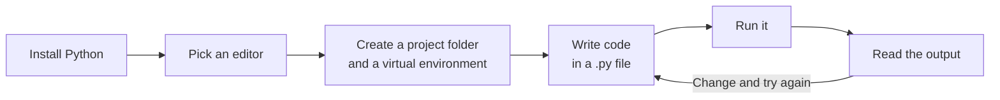
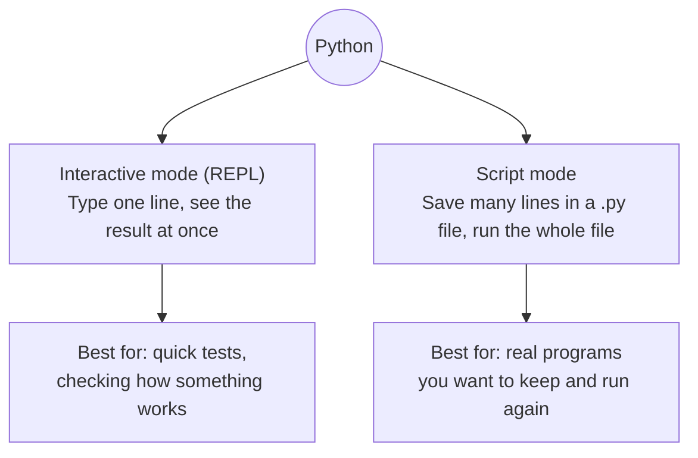
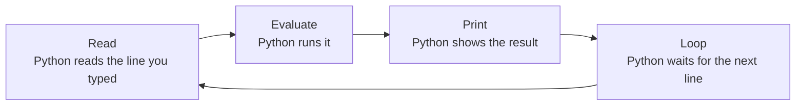
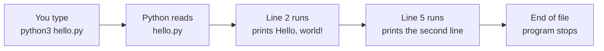
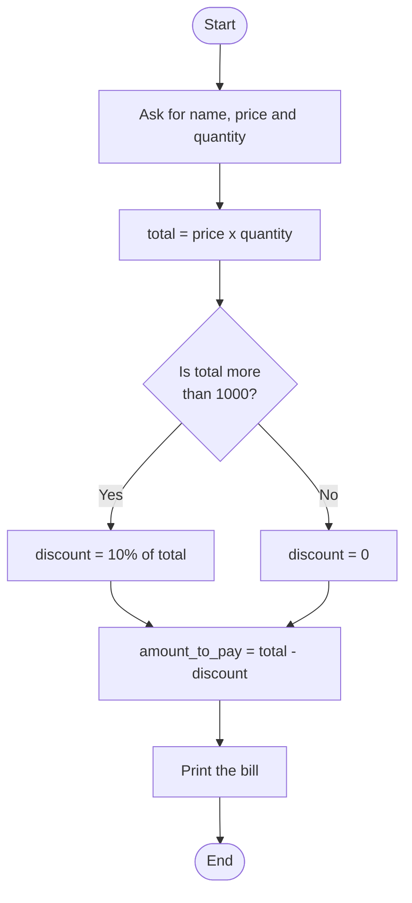
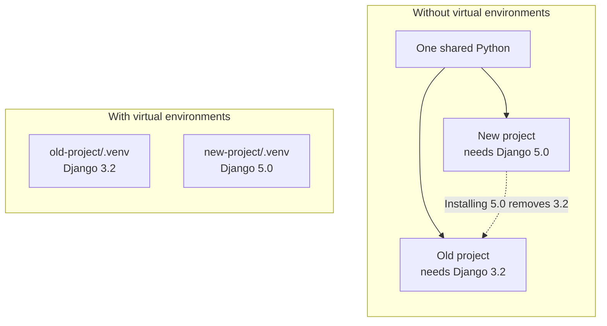
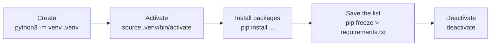
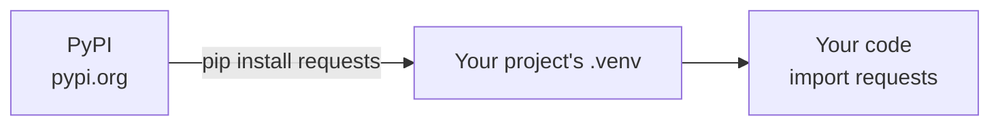
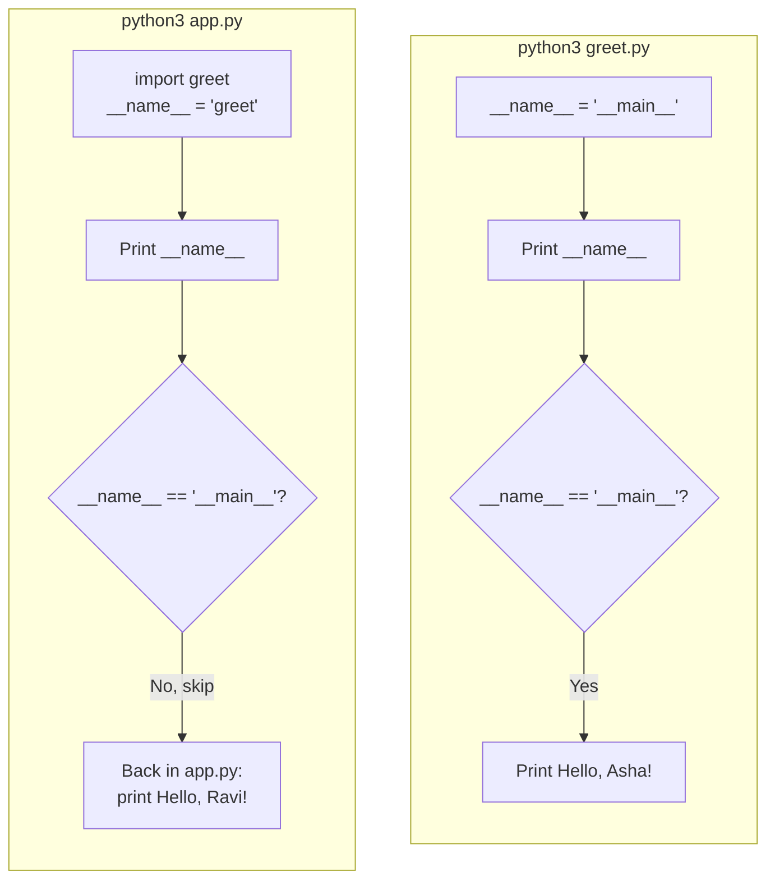

<p align="center">
  
</p>

# 01.1 Setup and First Program

Topic 01 was theory. This topic is hands-on. You will install Python, learn the tools, write your first programs, and set up a clean workspace for every project in this course.

> **Extra topic.** This topic is not part of the syllabus PDFs. It fills a gap: you need a working setup before you can practise anything else.

**By the end of this topic you will be able to:**

- install Python and check which version you are running
- use the interactive shell (REPL) to test small ideas quickly
- choose an editor and set it up correctly
- write, save and run a Python script
- create a virtual environment and install packages with `pip`
- lay out a Python file the way professional projects do

**In this topic**

1. [The big picture](#1-the-big-picture)
2. [Installing Python](#2-installing-python)
3. [Checking your installation](#3-checking-your-installation)
4. [Two ways to run Python](#4-two-ways-to-run-python)
5. [The interactive shell (REPL)](#5-the-interactive-shell-repl)
6. [Editors and IDEs](#6-editors-and-ides)
7. [Your first script](#7-your-first-script)
8. [A complete program: shop bill](#8-a-complete-program-shop-bill)
9. [Building blocks used in the first program](#9-building-blocks-used-in-the-first-program)
10. [Virtual environments](#10-virtual-environments)
11. [Installing packages with pip](#11-installing-packages-with-pip)
12. [Anatomy of a Python file](#12-anatomy-of-a-python-file)
13. [Common errors](#13-common-errors)
14. [Quick revision](#14-quick-revision)
15. [Interview questions](#15-interview-questions)
16. [Practice questions](#16-practice-questions)

## 1. The big picture

Every program you write in this course goes through the same loop: **write, run, read the output, change something, run again**. This topic sets up everything that loop needs.



## 2. Installing Python

Many computers already have Python, sometimes more than one version. This course needs **Python 3.12 or newer**. Download it from the official site: [python.org/downloads](https://www.python.org/downloads/).

<table width="100%">
<tr>
<th align="left" width="14%">Platform</th>
<th align="left" width="30%">How to install</th>
<th align="left" width="18%">Command to check</th>
<th align="left" width="38%">Watch out for</th>
</tr>
<tr>
<td valign="top"><br/><b>Windows</b></td>
<td valign="top">Run the installer from python.org</td>
<td valign="top"><code>python --version</code></td>
<td valign="top">On the first screen, <b>tick "Add python.exe to PATH"</b>. If you miss it, the <code>python</code> command will not be found.</td>
</tr>
<tr>
<td valign="top"><br/><b>macOS</b></td>
<td valign="top">Run the installer from python.org, or use Homebrew: <code>brew install python@3.12</code></td>
<td valign="top"><code>python3 --version</code></td>
<td valign="top">Type <code>python3</code>, not <code>python</code>. macOS calls itself <b>Darwin</b> inside Python, so do not be surprised when you see that name.</td>
</tr>
<tr>
<td valign="top"><br/><b>Linux</b></td>
<td valign="top">Use the package manager, for example: <code>sudo apt install python3 python3-venv python3-pip</code></td>
<td valign="top"><code>python3 --version</code></td>
<td valign="top">Linux already uses Python for system tools. Do not remove or change the system Python.</td>
</tr>
</table>

**What is PATH?** PATH is a list of folders that your computer searches when you type a command. If the Python folder is on that list, typing `python` works from anywhere. If it is not, you get `command not found`.

**Why `python` on Windows but `python3` on macOS and Linux?** Long ago, `python` meant Python 2. Mac and Linux systems kept the name `python3` for Python 3 so that old scripts would not break. Windows does not have that history, so it uses `python`. In this course, examples use `python3`. On Windows, type `python` instead.

## 3. Checking your installation

Open a terminal (Command Prompt or PowerShell on Windows, Terminal on macOS and Linux) and run:

```bash
# Show the installed Python version
python3 --version
```

**Output** (example, your version may be newer)

```text
Python 3.12.7
```

You can also ask Python, from inside a program, which Python is running it. This is the first thing to check when something behaves strangely, for example a package you installed seems to be missing.

```python
# Load the sys module, which gives details about the running Python
import sys

# Print the full version text
print(sys.version)

# Print the full path of the Python program that is running this code
print(sys.executable)
```

**Output** (example, your path will be different)

```text
3.12.7 (v3.12.7:0b05ead877f, Sep 30 2024, 23:18:00) [Clang 13.0.0 (clang-1300.0.29.30)]
/Library/Frameworks/Python.framework/Versions/3.12/bin/python3
```

## 4. Two ways to run Python

There are two ways to run Python code. You will use both.



<table width="100%">
<tr>
<th align="left" width="16%">Mode</th>
<th align="left" width="22%">How to start</th>
<th align="left" width="22%">Shows results</th>
<th align="left" width="20%">Code is saved?</th>
<th align="left" width="20%">Use it for</th>
</tr>
<tr>
<td><b>Interactive (REPL)</b></td>
<td>Type <code>python3</code> and press Enter</td>
<td>Automatically, after each line</td>
<td>No, it is lost when you exit</td>
<td>Experiments and quick checks</td>
</tr>
<tr>
<td><b>Script</b></td>
<td>Type <code>python3 file_name.py</code></td>
<td>Only what you <code>print()</code></td>
<td>Yes, in the <code>.py</code> file</td>
<td>Real programs</td>
</tr>
</table>

## 5. The interactive shell (REPL)

**REPL** stands for **Read, Evaluate, Print, Loop**:



Start it by typing `python3` in the terminal. You will see the prompt `>>>`. Leave it with `exit()` or by pressing **Ctrl+D** (on Windows, **Ctrl+Z** then Enter).

### Expressions show a value, statements do not

```text
>>> 2 + 3
5
>>> x = 5
>>> x * 2
10
>>> _ + 1
11
>>> print("hi")
hi
```

What happened, line by line:

<table width="100%">
<tr>
<th align="left" width="16%">You typed</th>
<th align="left" width="16%">Kind</th>
<th align="left" width="16%">Shown</th>
<th align="left" width="52%">Why</th>
</tr>
<tr><td><code>2 + 3</code></td><td>Expression</td><td><code>5</code></td><td>An <b>expression</b> produces a value, so the REPL shows it.</td></tr>
<tr><td><code>x = 5</code></td><td>Statement</td><td>Nothing</td><td>A <b>statement</b> does an action (here, it stores 5 in <code>x</code>). There is no value to show.</td></tr>
<tr><td><code>x * 2</code></td><td>Expression</td><td><code>10</code></td><td>Python reads <code>x</code> (5) and multiplies it by 2.</td></tr>
<tr><td><code>_ + 1</code></td><td>Expression</td><td><code>11</code></td><td>In the REPL only, <code>_</code> holds the <b>last result</b> (10).</td></tr>
<tr><td><code>print("hi")</code></td><td>Function call</td><td><code>hi</code></td><td><code>print()</code> writes the text on the screen.</td></tr>
</table>

> **Important:** In a script file, expressions are **not** shown automatically. A line like `2 + 3` in a file works out 5 and then throws it away. To see a value in a script, you must use `print()`.

### Three tools for exploring

<table width="100%">
<tr>
<th align="left" width="14%">Tool</th>
<th align="left" width="24%">Answers the question</th>
<th align="left" width="20%">Example</th>
<th align="left" width="42%">What you get</th>
</tr>
<tr><td><code>type(x)</code></td><td>What kind of value is this?</td><td><code>type(5)</code></td><td><code>&lt;class 'int'&gt;</code></td></tr>
<tr><td><code>dir(x)</code></td><td>What can this value do?</td><td><code>dir(str)</code></td><td>A list of every method of text, such as <code>upper</code> and <code>split</code></td></tr>
<tr><td><code>help(x)</code></td><td>How do I use this?</td><td><code>help(len)</code></td><td>The official explanation. Press <b>q</b> to close it.</td></tr>
</table>

## 6. Editors and IDEs

You *can* write Python in Notepad, but a good editor helps a lot. It colours your code, warns about mistakes as you type, shows what a function expects, and runs your program with one click.

<table width="100%">
<tr>
<th align="left" width="18%">Tool</th>
<th align="left" width="14%">Type</th>
<th align="left" width="24%">Good for</th>
<th align="left" width="14%">Cost</th>
<th align="left" width="30%">Notes</th>
</tr>
<tr>
<td valign="top"><br/><b>IDLE</b></td>
<td valign="top">Simple editor</td>
<td valign="top">Very first steps</td>
<td valign="top">Free</td>
<td valign="top">Installed together with Python. Basic but enough to start.</td>
</tr>
<tr>
<td valign="top"><br/><b>VS Code</b></td>
<td valign="top">Code editor</td>
<td valign="top">Everything in this course</td>
<td valign="top">Free</td>
<td valign="top"><b>Recommended.</b> Install the <b>Python</b> and <b>Jupyter</b> extensions from Microsoft.</td>
</tr>
<tr>
<td valign="top"><br/><b>PyCharm</b></td>
<td valign="top">Full IDE</td>
<td valign="top">Large projects</td>
<td valign="top">Free and paid editions</td>
<td valign="top">Very powerful, made only for Python. Heavier than VS Code.</td>
</tr>
<tr>
<td valign="top"><br/><b>Jupyter</b></td>
<td valign="top">Notebook</td>
<td valign="top">Data work, step by step experiments</td>
<td valign="top">Free</td>
<td valign="top">Mixes code, output and notes in one page. Runs in the browser or inside VS Code.</td>
</tr>
</table>

**IDE** means **Integrated Development Environment**: an editor, a run button, a debugger and other tools in one program.

### Settings to change on day one

<table width="100%">
<tr>
<th align="left" width="26%">Setting</th>
<th align="left" width="18%">Value</th>
<th align="left" width="56%">Why it matters</th>
</tr>
<tr><td>Insert spaces instead of tabs</td><td>On</td><td>Python uses indentation to group code. Mixing tabs and spaces causes errors.</td></tr>
<tr><td>Tab size</td><td>4</td><td>The Python style guide (PEP 8) uses four spaces for each level.</td></tr>
<tr><td>Render whitespace</td><td>On</td><td>Makes invisible spaces visible, so indentation mistakes are easy to see.</td></tr>
<tr><td>Trim trailing whitespace</td><td>On</td><td>Removes extra spaces at the end of lines, which keeps files clean.</td></tr>
<tr><td>Format on save</td><td>On</td><td>The editor tidies your code automatically every time you save.</td></tr>
</table>

## 7. Your first script

A **script** is a text file that ends with `.py` and contains Python code. Python runs it from the **top line to the bottom line**, one line at a time.

**Step 1.** Create a folder for your practice work, for example `python-practice`.

**Step 2.** Inside it, create a file named `hello.py` and type:

```python
# Print a greeting on the screen
print("Hello, world!")

# Print a second line
print("My first Python program is working.")
```

**Step 3.** Save the file. Open a terminal in that folder and run:

```bash
# Run the script with Python
python3 hello.py
```

**Output**

```text
Hello, world!
My first Python program is working.
```

**How this program runs**



Python reads the file, compiles it to bytecode, and the PVM runs each line in order (you learned this in [Topic 01](../01.%20Language%20fundamentals/README.md#feature-8-interpreted)). Comment lines, the ones starting with `#`, are skipped. When the last line is done, the program ends.

## 8. A complete program: shop bill

This program asks the user for some details, makes a decision, and prints a bill. It uses everything a real program needs: **input, variables, calculation, a decision and output**.

Save it as `bill.py`:

```python
# Ask the user for their name
name = input("Enter your name: ")

# Ask for the price of one item and convert the text to a decimal number
price = float(input("Enter the price of one item: "))

# Ask for the number of items and convert the text to a whole number
quantity = int(input("Enter the quantity: "))

# Multiply price by quantity to get the total
total = price * quantity

# Check whether the total is more than 1000
if total > 1000:

    # If yes, the discount is 10 percent of the total
    discount = total * 0.10

# Otherwise, run the block below
else:

    # There is no discount
    discount = 0

# Subtract the discount from the total
amount_to_pay = total - discount

# Print an empty line to separate the questions from the bill
print()

# Print the customer name
print(f"Customer : {name}")

# Print the total with 2 decimal places
print(f"Total    : {total:.2f}")

# Print the discount with 2 decimal places
print(f"Discount : {discount:.2f}")

# Print the final amount with 2 decimal places
print(f"Pay      : {amount_to_pay:.2f}")
```

**Output, run 1** (user types `Asha`, `450`, `3`)

```text
Enter your name: Asha
Enter the price of one item: 450
Enter the quantity: 3

Customer : Asha
Total    : 1350.00
Discount : 135.00
Pay      : 1215.00
```

**Output, run 2** (user types `Ravi`, `200`, `2`)

```text
Enter your name: Ravi
Enter the price of one item: 200
Enter the quantity: 2

Customer : Ravi
Total    : 400.00
Discount : 0.00
Pay      : 400.00
```

**How this program runs**



1. **Input.** `input()` shows a message and waits for the user to type something and press Enter. It always gives back **text**. For the price we use `float()` to turn that text into a decimal number, and for the quantity we use `int()` to turn it into a whole number.
2. **Calculation.** `total = price * quantity`. In run 1 that is 450 x 3 = 1350.
3. **Decision.** `if total > 1000:` checks a condition. In run 1, 1350 is more than 1000, so Python runs the indented line under `if` and the discount is 135. In run 2, 400 is not more than 1000, so Python skips to the `else` block and the discount is 0. Only **one** of the two blocks runs.
4. **Final amount.** The discount is subtracted from the total.
5. **Output.** `print()` with an **f-string** puts the values into the text. `:.2f` means "show this number with exactly 2 decimal places".

Notice the **indentation** (the 4 spaces) under `if` and `else`. Python uses indentation to know which lines belong to which block. You will learn decisions in detail in [Topic 05](../05.%20Flow%20control/README.md).

## 9. Building blocks used in the first program

### `input()` always returns text

This is the mistake almost every beginner makes once:

```python
# Ask for the age; the answer comes back as text
age = input("Your age: ")

# Print the type of age to prove it is text
print(type(age))

# Try to add 1 to the text, which fails
print(age + 1)
```

**Output** (user types `30`; only the last line of the error is shown)

```text
Your age: <class 'str'>
TypeError: can only concatenate str (not "int") to str
```

The user typed `30`, but Python stored the text `"30"`, not the number 30. You cannot add a number to text. The fix is to convert the text with `int()`:

```python
# Ask for the age and convert the text answer to a whole number
age = int(input("Your age: "))

# Print the type of age, which is now a number
print(type(age))

# Add 1 to the number
print(age + 1)
```

**Output** (user types `30`)

```text
Your age: <class 'int'>
31
```

### Basic arithmetic

<table width="100%">
<tr>
<th align="left" width="12%">Operator</th>
<th align="left" width="22%">Name</th>
<th align="left" width="14%">Example</th>
<th align="left" width="12%">Result</th>
<th align="left" width="40%">Remember</th>
</tr>
<tr><td><code>+</code></td><td>Addition</td><td><code>17 + 5</code></td><td><code>22</code></td><td>Also joins text: <code>"ab" + "cd"</code> gives <code>"abcd"</code></td></tr>
<tr><td><code>-</code></td><td>Subtraction</td><td><code>17 - 5</code></td><td><code>12</code></td><td></td></tr>
<tr><td><code>*</code></td><td>Multiplication</td><td><code>17 * 5</code></td><td><code>85</code></td><td></td></tr>
<tr><td><code>/</code></td><td>Division</td><td><code>17 / 5</code></td><td><code>3.4</code></td><td>Always gives a decimal: <code>10 / 5</code> is <code>2.0</code>, not <code>2</code></td></tr>
<tr><td><code>//</code></td><td>Floor division</td><td><code>17 // 5</code></td><td><code>3</code></td><td>Drops the decimal part</td></tr>
<tr><td><code>%</code></td><td>Remainder (modulus)</td><td><code>17 % 5</code></td><td><code>2</code></td><td>Useful to check even or odd: <code>n % 2</code></td></tr>
<tr><td><code>**</code></td><td>Power</td><td><code>17 ** 2</code></td><td><code>289</code></td><td>17 x 17</td></tr>
</table>

You will study every operator in depth in [Topic 04](../04.%20Operators/README.md).

### f-strings

An **f-string** puts values straight into text. Write the letter `f` before the opening quote and put variables or calculations inside `{ }`.

```python
# Store a name
name = "Asha"

# Store an age
age = 25

# Put both values inside the text
print(f"{name} is {age} years old.")

# Any calculation can go inside the braces
print(f"Next year {name} will be {age + 1}.")

# Format a number with a thousands separator and 2 decimal places
print(f"Price: {1234.5678:,.2f}")
```

**Output**

```text
Asha is 25 years old.
Next year Asha will be 26.
Price: 1,234.57
```

You will learn all the formatting options in [Topic 03.1](../03.1%20Strings/README.md).

### Comments

A comment starts with `#`. Python ignores it completely. Comments are for people who read the code.

- A **good** comment explains **why** the code does something.
- A **poor** comment only repeats **what** the code already says.

```python
# Good: explains the reason behind the number
# Shops in this region charge 18 percent GST
tax_rate = 0.18

# Poor: just repeats the code
# Set tax_rate to 0.18
tax_rate = 0.18
```

> In this course, every line has a comment because these are learning notes. In real projects, you write fewer comments and focus on the "why".

## 10. Virtual environments

A **virtual environment** (venv) is a private copy of Python for **one project**, with its own set of installed packages.

### The problem it solves

Imagine two projects on the same computer:



Without a venv, every project shares one set of packages. Installing a new version for one project can break another. This problem is called **dependency hell**. With a venv, each project has its own `.venv` folder, and the projects never affect each other.

### The workflow

```bash
# Step 1: create a virtual environment in a folder named .venv
python3 -m venv .venv

# Step 2 (macOS and Linux): activate it
source .venv/bin/activate

# Step 2 (Windows): activate it
.venv\Scripts\activate

# Step 3: install a package; it goes into this project only
python3 -m pip install requests

# Step 4: save the exact list of installed packages to a file
python3 -m pip freeze > requirements.txt

# Step 5: leave the virtual environment when you are done
deactivate
```



When the venv is active, your terminal prompt shows its name at the start:

```text
before:  user@laptop ~/project $
after:   (.venv) user@laptop ~/project $
```

You can also check from Python:

```python
# Load the sys module
import sys

# Inside a venv, sys.prefix points to the venv and differs from sys.base_prefix
print(sys.prefix != sys.base_prefix)
```

**Output**

```text
True
```

You get `True` inside an active virtual environment and `False` outside it.

### Rules for virtual environments

<table width="100%">
<tr>
<th align="left" width="6%">#</th>
<th align="left" width="30%">Rule</th>
<th align="left" width="40%">Why</th>
<th align="left" width="24%">Command or example</th>
</tr>
<tr><td>1</td><td>One environment for each project</td><td>Projects never break each other</td><td><code>python3 -m venv .venv</code></td></tr>
<tr><td>2</td><td>Name it <code>.venv</code></td><td>Editors such as VS Code find it automatically</td><td><code>.venv</code></td></tr>
<tr><td>3</td><td>Activate before installing</td><td>Otherwise packages go into the system Python</td><td><code>source .venv/bin/activate</code></td></tr>
<tr><td>4</td><td>Never commit <code>.venv</code> to Git</td><td>It is large and works only on your computer</td><td>Add <code>.venv/</code> to <code>.gitignore</code></td></tr>
<tr><td>5</td><td>Always commit <code>requirements.txt</code></td><td>Others can rebuild the same environment from it</td><td><code>pip install -r requirements.txt</code></td></tr>
<tr><td>6</td><td>Delete it freely</td><td>Nothing is lost; rebuild it from <code>requirements.txt</code></td><td><code>rm -rf .venv</code></td></tr>
</table>

## 11. Installing packages with pip

**pip** is the tool that installs packages (code written by other people) from **PyPI**, the Python Package Index at [pypi.org](https://pypi.org/). There are hundreds of thousands of packages there.



> **Check the standard library first.** Python already includes modules such as `math`, `json`, `csv`, `datetime`, `pathlib` and `sqlite3`. Use pip only when the standard library does not solve your problem.

### Common pip commands

<table width="100%">
<tr>
<th align="left" width="34%">Command</th>
<th align="left" width="30%">What it does</th>
<th align="left" width="36%">When to use it</th>
</tr>
<tr><td><code>pip install requests</code></td><td>Install the latest version</td><td>Adding a new package</td></tr>
<tr><td><code>pip install requests==2.31.0</code></td><td>Install one exact version</td><td>You need a specific version</td></tr>
<tr><td><code>pip install --upgrade requests</code></td><td>Upgrade to the latest version</td><td>Getting bug fixes and new features</td></tr>
<tr><td><code>pip uninstall requests</code></td><td>Remove a package</td><td>You no longer need it</td></tr>
<tr><td><code>pip list</code></td><td>Show all installed packages</td><td>Checking what is in the environment</td></tr>
<tr><td><code>pip show requests</code></td><td>Show details of one package</td><td>Checking version and dependencies</td></tr>
<tr><td><code>pip freeze &gt; requirements.txt</code></td><td>Save exact versions to a file</td><td>Before sharing or committing a project</td></tr>
<tr><td><code>pip install -r requirements.txt</code></td><td>Install everything in the file</td><td>Setting up a project someone else made</td></tr>
</table>

### Use `python3 -m pip`, not plain `pip`

If several Python versions are installed, a plain `pip` command can install into the **wrong** one. Then your code says `ModuleNotFoundError` for a package you just installed.

```bash
# Run pip through the exact Python you use, so the package lands in the right place
python3 -m pip install requests
```

### Version specifiers

<table width="100%">
<tr>
<th align="left" width="28%">Written as</th>
<th align="left" width="36%">Meaning</th>
<th align="left" width="36%">Typical use</th>
</tr>
<tr><td><code>requests</code></td><td>Any version, the newest today</td><td>Quick experiments</td></tr>
<tr><td><code>requests==2.31.0</code></td><td>Exactly this version</td><td>Applications, so every install is the same</td></tr>
<tr><td><code>requests&gt;=2.28</code></td><td>This version or newer</td><td>You need a feature added in 2.28</td></tr>
<tr><td><code>requests&gt;=2.28,&lt;3.0</code></td><td>Any version in this range</td><td>Libraries that must work with other packages</td></tr>
</table>

### Staying safe with pip

<table width="100%">
<tr>
<th align="left" width="30%">Rule</th>
<th align="left" width="70%">Why</th>
</tr>
<tr><td>Check the package name carefully</td><td>Attackers publish fake packages with names one letter different from popular ones (this is called <b>typo-squatting</b>).</td></tr>
<tr><td>Activate your venv first</td><td>Otherwise you install into the system Python.</td></tr>
<tr><td>Never use <code>sudo pip install</code></td><td>It can break the Python that your operating system needs.</td></tr>
<tr><td>Review each new dependency</td><td>Every package is code you are choosing to trust and run.</td></tr>
</table>

## 12. Anatomy of a Python file

Professional Python files follow the same order from top to bottom:

```python
#!/usr/bin/env python3
"""Calculate a shop bill. This line describes what the file is for."""

# Standard library imports come first
import sys

# Third-party imports (installed with pip) come next
import requests

# Constants are written in UPPER_CASE
DEFAULT_TAX_RATE = 0.18

# Functions and classes come after the constants
def calculate_total(price, quantity):
    """Return price multiplied by quantity."""
    return price * quantity

# The main guard comes last
if __name__ == "__main__":
    print(calculate_total(100, 3))
```

<table width="100%">
<tr>
<th align="left" width="6%">#</th>
<th align="left" width="22%">Part</th>
<th align="left" width="40%">What it is</th>
<th align="left" width="32%">Required?</th>
</tr>
<tr><td>1</td><td>Shebang line</td><td><code>#!/usr/bin/env python3</code> lets macOS and Linux run the file directly as <code>./file.py</code></td><td>Optional. Must be the very first line.</td></tr>
<tr><td>2</td><td>Module docstring</td><td>A text in triple quotes that says what the file is for</td><td>Recommended</td></tr>
<tr><td>3</td><td>Imports</td><td>Standard library first, then third-party, then your own modules</td><td>Only if you need them</td></tr>
<tr><td>4</td><td>Constants</td><td>Fixed values in <code>UPPER_CASE</code></td><td>Only if you need them</td></tr>
<tr><td>5</td><td>Functions and classes</td><td>The reusable pieces of your program</td><td>Most real files have them</td></tr>
<tr><td>6</td><td>Main guard</td><td><code>if __name__ == "__main__":</code></td><td>Recommended for files you run</td></tr>
</table>

### The main guard

Python gives every file a hidden variable called `__name__`:

- When you **run** the file directly, `__name__` is `"__main__"`.
- When another file **imports** it, `__name__` is the file's own name.

The main guard uses this to run some code **only** when the file is run directly. Here is a complete example with two files.

**File 1: `greet.py`**

```python
# Define a function that builds a greeting for a name
def say_hello(name):

    # Return the greeting text
    return f"Hello, {name}!"

# Show the value of __name__ for this file
print("__name__ in greet.py is:", __name__)

# Run the line below only when greet.py is run directly
if __name__ == "__main__":

    # Call the function and print the greeting
    print(say_hello("Asha"))
```

**File 2: `app.py`** (in the same folder)

```python
# Import greet.py as a module; this runs greet.py from top to bottom once
import greet

# Use the function from greet.py
print(greet.say_hello("Ravi"))
```

**Output of `python3 greet.py`**

```text
__name__ in greet.py is: __main__
Hello, Asha!
```

**Output of `python3 app.py`**

```text
__name__ in greet.py is: greet
Hello, Ravi!
```

**How these programs run**



1. When we run `greet.py` directly, `__name__` is `"__main__"`. The condition is true, so `Hello, Asha!` is printed.
2. When `app.py` imports `greet`, Python runs `greet.py` once, but now `__name__` is `"greet"`. The condition is false, so `Hello, Asha!` is **not** printed.
3. Back in `app.py`, we call `greet.say_hello("Ravi")` and print the result.

So one file can be both a **program you run** and a **module others import**. Without the main guard, importing `greet` would also print `Hello, Asha!`.

### Naming your files

<table width="100%">
<tr>
<th align="left" width="22%">File name</th>
<th align="left" width="14%">Verdict</th>
<th align="left" width="40%">Why</th>
<th align="left" width="24%">Better name</th>
</tr>
<tr><td><code>shop_bill.py</code></td><td>Good</td><td>Lowercase words joined with underscores</td><td>(already good)</td></tr>
<tr><td><code>ShopBill.py</code></td><td>Avoid</td><td>Capital letters are used for class names, not files</td><td><code>shop_bill.py</code></td></tr>
<tr><td><code>shop-bill.py</code></td><td>Broken</td><td>Cannot be imported, because Python reads <code>-</code> as minus</td><td><code>shop_bill.py</code></td></tr>
<tr><td><code>2026_bill.py</code></td><td>Broken</td><td>Cannot be imported, because a name cannot start with a digit</td><td><code>bill_2026.py</code></td></tr>
<tr><td><code>math.py</code></td><td>Dangerous</td><td>Hides the real <code>math</code> module; your file gets imported instead</td><td><code>my_math_tools.py</code></td></tr>
</table>

## 13. Common errors

<table width="100%">
<tr>
<th align="left" width="28%">Error message</th>
<th align="left" width="26%">Usual cause</th>
<th align="left" width="28%">Fix</th>
<th align="left" width="18%">Section</th>
</tr>
<tr><td><code>command not found: python</code></td><td>Python is not on PATH, or wrong command name</td><td>Try <code>python3</code>. On Windows, reinstall and tick "Add python.exe to PATH".</td><td><a href="#2-installing-python">2</a></td></tr>
<tr><td><code>TypeError: can only concatenate str (not "int") to str</code></td><td>Doing maths on the text from <code>input()</code></td><td>Convert it: <code>int(input(...))</code></td><td><a href="#9-building-blocks-used-in-the-first-program">9</a></td></tr>
<tr><td><code>IndentationError</code></td><td>Wrong or mixed indentation (tabs and spaces)</td><td>Use 4 spaces. Turn on "Render whitespace".</td><td><a href="#6-editors-and-ides">6</a></td></tr>
<tr><td><code>ModuleNotFoundError</code></td><td>Package installed into a different Python, or venv not active</td><td>Activate the venv and use <code>python3 -m pip install</code></td><td><a href="#11-installing-packages-with-pip">11</a></td></tr>
<tr><td><code>TypeError: 'list' object is not callable</code></td><td>You used a built-in name such as <code>list</code> for your own variable</td><td>Rename your variable, for example <code>numbers</code></td><td>Below</td></tr>
</table>

The last error is called **shadowing**. It is confusing the first time you see it:

```python
# Store data in a variable named list; this hides the built-in list() function
list = [1, 2, 3]

# Try to use the built-in list() function, which is now hidden
list("abc")
```

**Output** (last line of the error message)

```text
TypeError: 'list' object is not callable
```

Never name your variables `list`, `str`, `dict`, `sum`, `max`, `min`, `type`, `id` or `input`.

## 14. Quick revision

<table width="100%">
<tr>
<th align="left" width="6%">#</th>
<th align="left" width="34%">Question</th>
<th align="left" width="44%">Answer</th>
<th align="left" width="16%">Read again</th>
</tr>
<tr><td>1</td><td>Minimum Python version for this course</td><td>3.12</td><td><a href="#2-installing-python">Section 2</a></td></tr>
<tr><td>2</td><td>Most common Windows install mistake</td><td>Not ticking "Add python.exe to PATH"</td><td><a href="#2-installing-python">Section 2</a></td></tr>
<tr><td>3</td><td>How to see which Python is running</td><td><code>sys.executable</code></td><td><a href="#3-checking-your-installation">Section 3</a></td></tr>
<tr><td>4</td><td>What REPL stands for</td><td>Read, Evaluate, Print, Loop</td><td><a href="#5-the-interactive-shell-repl">Section 5</a></td></tr>
<tr><td>5</td><td>Expression vs statement</td><td>An expression produces a value; a statement does an action</td><td><a href="#5-the-interactive-shell-repl">Section 5</a></td></tr>
<tr><td>6</td><td>What <code>_</code> means in the REPL</td><td>The last result (REPL only)</td><td><a href="#5-the-interactive-shell-repl">Section 5</a></td></tr>
<tr><td>7</td><td>What <code>input()</code> returns</td><td>Always text (<code>str</code>)</td><td><a href="#9-building-blocks-used-in-the-first-program">Section 9</a></td></tr>
<tr><td>8</td><td><code>10 / 5</code> gives</td><td><code>2.0</code> (always a decimal)</td><td><a href="#9-building-blocks-used-in-the-first-program">Section 9</a></td></tr>
<tr><td>9</td><td>Why use a virtual environment</td><td>Each project gets its own packages, so projects never break each other</td><td><a href="#10-virtual-environments">Section 10</a></td></tr>
<tr><td>10</td><td>File that lists a project's packages</td><td><code>requirements.txt</code></td><td><a href="#10-virtual-environments">Section 10</a></td></tr>
<tr><td>11</td><td>Safest way to run pip</td><td><code>python3 -m pip install ...</code></td><td><a href="#11-installing-packages-with-pip">Section 11</a></td></tr>
<tr><td>12</td><td>Value of <code>__name__</code> when a file is run directly</td><td><code>"__main__"</code></td><td><a href="#12-anatomy-of-a-python-file">Section 12</a></td></tr>
<tr><td>13</td><td>Good file name style</td><td>Lowercase with underscores, for example <code>shop_bill.py</code></td><td><a href="#12-anatomy-of-a-python-file">Section 12</a></td></tr>
</table>

## 15. Interview questions

Try to answer each question aloud first, then click it to see a model answer.

<details>
<summary><b>Q1. What is the difference between interactive mode and script mode?</b></summary>

In **interactive mode** (the REPL), you type one line at a time and Python shows the result of each expression at once. Nothing is saved. In **script mode**, you save code in a `.py` file and run the whole file with `python3 file.py`. Only what you `print()` is shown, and the code is kept for later.

</details>

<details>
<summary><b>Q2. What is a virtual environment and why do we use it?</b></summary>

A virtual environment is a private Python setup for one project, with its own packages. We use it so that projects that need different versions of the same package do not break each other. It also keeps the system Python clean, and the project's packages can be rebuilt anywhere from `requirements.txt`.

</details>

<details>
<summary><b>Q3. What is pip? What is PyPI?</b></summary>

**pip** is Python's package installer. **PyPI** (Python Package Index, pypi.org) is the online store of packages that pip downloads from. For example, `python3 -m pip install requests` downloads the `requests` package from PyPI and installs it.

</details>

<details>
<summary><b>Q4. Why is <code>python -m pip</code> better than plain <code>pip</code>?</b></summary>

If several Python versions are installed, `pip` might belong to a different Python than the one that runs your code, so the package lands in the wrong place. `python -m pip` runs pip through the exact Python you are using, so the package is always installed where your code looks for it.

</details>

<details>
<summary><b>Q5. What is <code>requirements.txt</code>?</b></summary>

It is a text file that lists the packages a project needs, usually with exact versions, for example `requests==2.31.0`. It is created with `pip freeze > requirements.txt`. Anyone can then rebuild the same environment with `pip install -r requirements.txt`.

</details>

<details>
<summary><b>Q6. What does <code>if __name__ == "__main__":</code> do?</b></summary>

Python sets `__name__` to `"__main__"` when a file is run directly, and to the module name when it is imported. Code under this check runs only when the file is run directly, not when it is imported. This lets one file work both as a runnable program and as an importable module.

</details>

<details>
<summary><b>Q7. What does <code>input()</code> return? How do you read a number?</b></summary>

`input()` always returns a string (text), even if the user types digits. To get a number, convert the result: `int(input())` for a whole number or `float(input())` for a decimal number.

</details>

<details>
<summary><b>Q8. What is the difference between an expression and a statement?</b></summary>

An **expression** produces a value, for example `2 + 3` or `len("hi")`. A **statement** performs an action, for example `x = 5`, `import math` or `if ...:`. In the REPL, expressions show their value and statements show nothing.

</details>

<details>
<summary><b>Q9. What is the shebang line?</b></summary>

`#!/usr/bin/env python3` on the first line of a file tells macOS and Linux which program should run the file. After `chmod +x file.py`, you can run it with `./file.py` instead of `python3 file.py`. Windows ignores it.

</details>

<details>
<summary><b>Q10. Why should you not name a file <code>math.py</code> or <code>json.py</code>?</b></summary>

Python looks in the current folder first when you import a module. If your file is called `math.py`, then `import math` loads your file instead of the real math module, and your program breaks with confusing errors. This is called **shadowing** the standard library.

</details>

<details>
<summary><b>Q11. What is the difference between an editor and an IDE?</b></summary>

An **editor** (such as VS Code) is mainly for writing code, and gains extra features through extensions. An **IDE** (Integrated Development Environment, such as PyCharm) has an editor, run button, debugger, testing tools and project management built in from the start.

</details>

<details>
<summary><b>Q12. Should you commit the <code>.venv</code> folder to Git?</b></summary>

No. It is large, it contains files that work only on your computer, and it can be rebuilt at any time. Commit `requirements.txt` instead and add `.venv/` to `.gitignore`.

</details>

## 16. Practice questions

1. Install Python 3.12 or newer. Run `python3 --version` and write down the output.
2. Open the REPL and work out `17 / 5`, `17 // 5` and `17 % 5`. Explain each result.
3. In the REPL, type `10 * 5` and then `_ * 2`. What do you get and why?
4. Write a script `about_me.py` that prints your name, your city and your favourite food on three separate lines.
5. Write a script that asks for two numbers and prints their sum. What goes wrong if you forget `int()`?
6. Change the shop bill program so that the discount is 15 percent when the total is more than 2000.
7. Create a project folder, make a virtual environment, activate it, install `requests`, and save `requirements.txt`. Open the file and look at its content.
8. Create `greet.py` and `app.py` from Section 12. Remove the main guard from `greet.py` and run `app.py` again. What changes?
9. Which of these file names are good, and which are broken: `report.py`, `Report.py`, `my-report.py`, `1report.py`, `random.py`?

<p align="center">
  <a href="../01.%20Language%20fundamentals/README.md">Previous: 01. Language fundamentals</a> &nbsp;|&nbsp; <a href="../README.md">Course home</a> &nbsp;|&nbsp; <a href="../02.%20Identifiers/README.md">Next: 02. Identifiers</a>
</p>
