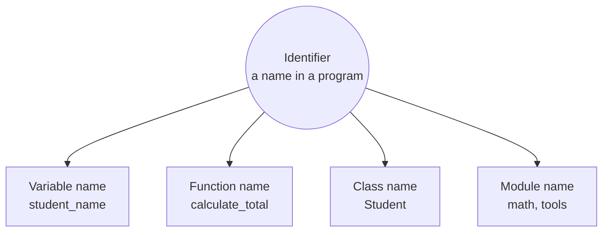
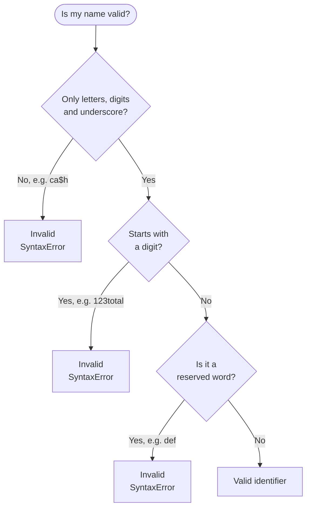
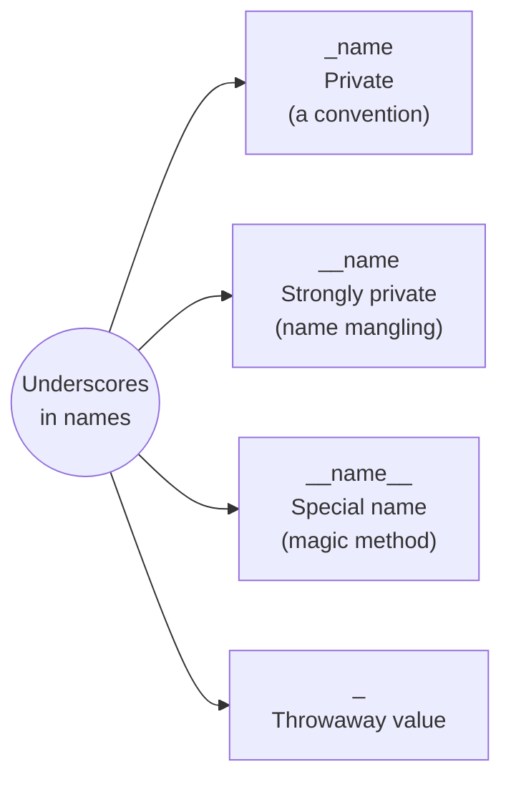
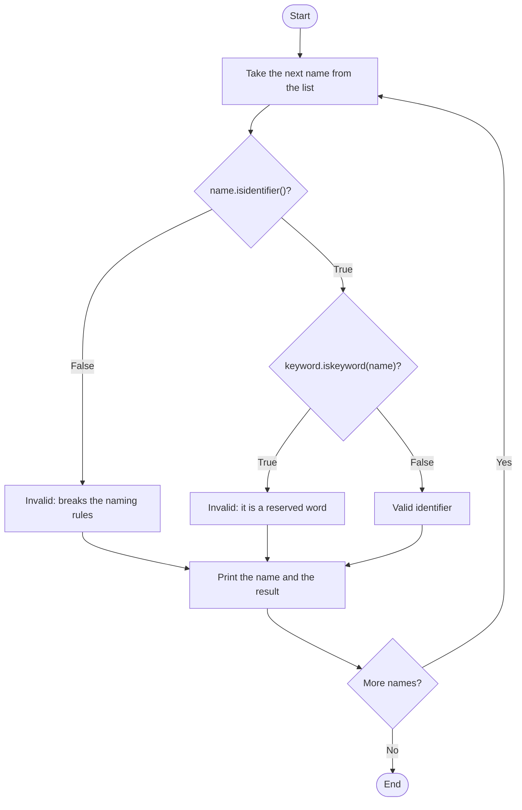

<p align="center">
  
</p>

# 02. Identifiers

Every program is full of names: names for values, for functions, for classes and for files. In Python, these names are called **identifiers**. This topic explains the rules for making a valid name, the special meaning of underscores, and the **reserved words** that you can never use as names.

**In this topic**

1. [What is an identifier?](#1-what-is-an-identifier)
2. [Rules to define identifiers](#2-rules-to-define-identifiers)
3. [Valid or invalid? Practice set](#3-valid-or-invalid-practice-set)
4. [Underscores and their special meaning](#4-underscores-and-their-special-meaning)
5. [Reserved words (keywords)](#5-reserved-words-keywords)
6. [Soft keywords](#6-soft-keywords)
7. [Checking names with Python](#7-checking-names-with-python)
8. [Naming conventions (PEP 8)](#8-naming-conventions-pep-8)
9. [Common errors](#9-common-errors)
10. [Quick revision](#10-quick-revision)
11. [Interview questions](#11-interview-questions)
12. [Practice questions](#12-practice-questions)

## 1. What is an identifier?

> **A name in a Python program is called an identifier.**

It can be the name of a **variable**, a **function**, a **class** or a **module**.

```python
# a is an identifier: the name of a variable that refers to the value 10
a = 10
```

All of the names below are identifiers:

```python
# student_name is the identifier of a variable
student_name = "Asha"

# calculate_total is the identifier of a function
def calculate_total(price, quantity):

    # price and quantity are also identifiers (function parameters)
    return price * quantity

# Student is the identifier of a class
class Student:

    # pass means "do nothing"; the class is empty for now
    pass
```



A good way to think about it: an identifier is a **label** that you stick on a value, so you can find and use that value later by its name.

## 2. Rules to define identifiers

These are the rules Python checks. If you break one, Python stops with an error before your program even starts.



<table width="100%">
<tr>
<th align="left" width="5%">#</th>
<th align="left" width="27%">Rule</th>
<th align="left" width="16%">Valid example</th>
<th align="left" width="16%">Invalid example</th>
<th align="left" width="36%">Explanation</th>
</tr>
<tr><td>1</td><td>Allowed characters are only <b>letters</b> (a to z, A to Z), <b>digits</b> (0 to 9) and the <b>underscore</b> (<code>_</code>)</td><td><code>cash</code></td><td><code>ca$h</code></td><td>Any other symbol, such as <code>$</code>, <code>@</code>, <code>-</code>, <code>#</code> or a space, gives a <code>SyntaxError</code></td></tr>
<tr><td>2</td><td>Must <b>not start with a digit</b></td><td><code>total123</code></td><td><code>123total</code></td><td>Digits are allowed, but not as the first character</td></tr>
<tr><td>3</td><td>Identifiers are <b>case sensitive</b></td><td><code>total</code> and <code>TOTAL</code> are different</td><td>(not an error)</td><td>Python is a case sensitive language, so capital and small letters are different</td></tr>
<tr><td>4</td><td>Must <b>not be a reserved word</b></td><td><code>define</code></td><td><code>def</code></td><td>Reserved words already have a meaning in Python (see <a href="#5-reserved-words-keywords">Section 5</a>)</td></tr>
<tr><td>5</td><td><b>No length limit</b></td><td><code>total_marks_of_class_ten</code></td><td>(not an error)</td><td>Any length works, but very long names are hard to read, so keep them sensible</td></tr>
<tr><td>6</td><td>The <b>dollar sign</b> (<code>$</code>) is not allowed</td><td><code>price_in_dollars</code></td><td><code>$price</code></td><td>Some languages, such as JavaScript and PHP, allow <code>$</code>. Python does not.</td></tr>
<tr><td>7</td><td>Starting with an <b>underscore</b> is allowed, and has a special meaning</td><td><code>_total</code></td><td>(not an error)</td><td>It tells other programmers the name is <b>private</b> (see <a href="#4-underscores-and-their-special-meaning">Section 4</a>)</td></tr>
</table>

### Rule 1: Only letters, digits and underscore

```python
# Valid: only letters
cash = 10

# Print the value
print(cash)
```

**Output**

```text
10
```

```python
# Invalid: the $ symbol is not allowed in a name
ca$h = 20
```

**Output** (last line of the error message)

```text
SyntaxError: invalid syntax
```

### Rule 2: Must not start with a digit

```python
# Valid: digits at the end are fine
total123 = 5

# Print the value
print(total123)
```

**Output**

```text
5
```

```python
# Invalid: the name starts with a digit
123total = 5
```

**Output** (last line of the error message)

```text
SyntaxError: invalid decimal literal
```

Python sees `123` and expects a number. When it meets the letters `total` straight after the digits, it does not know what to do, so it reports an invalid number ("decimal literal").

### Rule 3: Identifiers are case sensitive

```python
# A name in small letters
total = 10

# The same word in capital letters is a different name
TOTAL = 999

# Only the first letter is capital; this is a third, different name
Total = 55

# Print each of the three names
print(total)

# Print the capital letters version
print(TOTAL)

# Print the mixed version
print(Total)
```

**Output**

```text
10
999
55
```

**How this program runs:** Python treats `total`, `TOTAL` and `Total` as three completely separate labels, so three different values are stored and printed. This also means that a small typing mistake, such as writing `Total` when you meant `total`, uses the wrong name or causes a `NameError`.

### Rule 4: Must not be a reserved word

```python
# Invalid: def is a reserved word used to create functions
def = 10
```

**Output** (last line of the error message)

```text
SyntaxError: invalid syntax
```

### Rule 5: No length limit

```python
# A very long name is allowed
this_is_a_very_long_variable_name_that_still_works_fine_in_python = 1

# Print it to prove it works
print(this_is_a_very_long_variable_name_that_still_works_fine_in_python)
```

**Output**

```text
1
```

It works, but nobody wants to type or read this. Choose names that are **clear and short**, such as `student_count` instead of `x` or `the_number_of_students_in_the_class`.

### Extra: Letters from other languages

The notes say "alphabet symbols". In Python 3, "letters" includes letters from **any language**, not only English, because Python 3 supports **Unicode** in names.

```python
# A name with an accented letter
café = 120

# A name written in Hindi (Devanagari script)
नाम = "Asha"

# Print both values
print(café, नाम)
```

**Output**

```text
120 Asha
```

This is allowed, but in real projects **stick to English letters**. Everyone in a team can type them, and every tool supports them.

## 3. Valid or invalid? Practice set

Here is the practice question from the notes, with the reason for each answer.

**Q. Which of the following are valid Python identifiers?**

<table width="100%">
<tr>
<th align="left" width="5%">#</th>
<th align="left" width="16%">Name</th>
<th align="left" width="12%">Valid?</th>
<th align="left" width="22%">Rule involved</th>
<th align="left" width="45%">Reason</th>
</tr>
<tr><td>1</td><td><code>123total</code></td><td>No</td><td>Rule 2</td><td>Starts with a digit</td></tr>
<tr><td>2</td><td><code>total123</code></td><td>Yes</td><td>Rules 1 and 2</td><td>Letters followed by digits is fine</td></tr>
<tr><td>3</td><td><code>java2share</code></td><td>Yes</td><td>Rule 1</td><td>Only letters and a digit, and it starts with a letter</td></tr>
<tr><td>4</td><td><code>ca$h</code></td><td>No</td><td>Rules 1 and 6</td><td>The <code>$</code> symbol is not allowed</td></tr>
<tr><td>5</td><td><code>_abc_abc_</code></td><td>Yes</td><td>Rules 1 and 7</td><td>Underscores are allowed anywhere, including the start and the end</td></tr>
<tr><td>6</td><td><code>def</code></td><td>No</td><td>Rule 4</td><td>Reserved word used to define functions</td></tr>
<tr><td>7</td><td><code>if</code></td><td>No</td><td>Rule 4</td><td>Reserved word used for decisions</td></tr>
</table>

More examples to test yourself:

<table width="100%">
<tr>
<th align="left" width="18%">Name</th>
<th align="left" width="12%">Valid?</th>
<th align="left" width="40%">Reason</th>
<th align="left" width="30%">A valid version</th>
</tr>
<tr><td><code>my-name</code></td><td>No</td><td>The hyphen is read as a minus sign</td><td><code>my_name</code></td></tr>
<tr><td><code>total value</code></td><td>No</td><td>Spaces are not allowed</td><td><code>total_value</code></td></tr>
<tr><td><code>@name</code></td><td>No</td><td><code>@</code> is not allowed</td><td><code>name</code></td></tr>
<tr><td><code>true</code></td><td>Yes</td><td>Only <code>True</code> with a capital T is reserved</td><td>Valid, but confusing; avoid it</td></tr>
<tr><td><code>print</code></td><td>Yes</td><td>It is a built-in function name, not a reserved word</td><td>Valid, but never do it (see <a href="#9-common-errors">Section 9</a>)</td></tr>
<tr><td><code>_</code></td><td>Yes</td><td>A single underscore is a valid name</td><td>Used for values you do not need</td></tr>
</table>

## 4. Underscores and their special meaning

Underscores at the start or end of a name send a message about how the name should be used.



<table width="100%">
<tr>
<th align="left" width="15%">Pattern</th>
<th align="left" width="15%">Example</th>
<th align="left" width="18%">Meaning</th>
<th align="left" width="32%">What Python actually does</th>
<th align="left" width="20%">Who uses it</th>
</tr>
<tr><td>Starts with <code>_</code></td><td><code>_branch</code></td><td><b>Private</b></td><td>Nothing is blocked. It is a signal: "internal use only, please do not touch". It is skipped by <code>from module import *</code>.</td><td>You, for helper names</td></tr>
<tr><td>Starts with <code>__</code></td><td><code>__pin</code></td><td><b>Strongly private</b></td><td>Inside a class, Python renames it to <code>_ClassName__pin</code> (this is called <b>name mangling</b>), so it is hard to reach from outside.</td><td>You, inside classes</td></tr>
<tr><td>Starts and ends with <code>__</code></td><td><code>__add__</code>, <code>__init__</code></td><td><b>Special name</b> defined by the language (<b>magic methods</b> or <b>dunder methods</b>)</td><td>Python calls them automatically, for example <code>+</code> calls <code>__add__</code></td><td>Python itself. Do not invent your own.</td></tr>
<tr><td>Just <code>_</code></td><td><code>_</code></td><td>"I do not need this value"</td><td>A normal name that people agree to ignore</td><td>You, in loops and unpacking</td></tr>
</table>

> **Dunder** is short for "**d**ouble **under**score". People say "dunder init" for `__init__`.

### Example 1: Private and strongly private names in a class

You will learn classes properly in Topics 26 to 29. For now, just watch what happens to each name.

```python
# Create a class (a blueprint) for a bank account
class Account:

    # __init__ runs automatically when a new account is created
    def __init__(self):

        # A normal (public) name
        self.owner = "Asha"

        # One underscore: private by convention
        self._branch = "Pune"

        # Two underscores: strongly private, Python will rename it
        self.__pin = 1234

# Create one account object
acc = Account()

# Public name: works
print(acc.owner)

# Private name: still works, but the underscore says "please do not use"
print(acc._branch)

# Try to read the strongly private name from outside the class
try:

    # This fails, because Python renamed __pin
    print(acc.__pin)

# Catch the error and print it instead of stopping the program
except AttributeError as error:

    # Show the error message
    print("AttributeError:", error)

# The renamed (mangled) name can still be reached, which shows it is not truly secret
print(acc._Account__pin)

# List every name stored inside the object
print(list(vars(acc)))
```

**Output**

```text
Asha
Pune
AttributeError: 'Account' object has no attribute '__pin'
1234
['owner', '_branch', '_Account__pin']
```

**How this program runs**

1. `Account()` creates an object and runs `__init__`, which stores three names.
2. `owner` and `_branch` are stored exactly as written. One underscore changes nothing for Python.
3. `__pin` is stored as `_Account__pin`. Python added `_Account` in front. This is **name mangling**.
4. So `acc.__pin` fails with `AttributeError`, because no name `__pin` exists in the object.
5. `acc._Account__pin` works, and the last line proves that the stored name really is `_Account__pin`.

**Lesson:** Python has **no truly private names**. Underscores are a strong **agreement** between programmers, plus a renaming trick for double underscores.

### Example 2: Private names in a module

A name that starts with `_` is not imported by `from module import *`.

**File 1: `tools.py`**

```python
# A public function that other files are meant to use
def greet():

    # Return a greeting
    return "Hello"

# A private helper function, meant only for use inside tools.py
def _helper():

    # Return some text
    return "internal"
```

**File 2: `main.py`** (in the same folder)

```python
# Import every public name from tools.py
from tools import *

# greet was imported, so this works
print(greet())

# Try to call the private helper
try:

    # _helper was not imported, because its name starts with _
    print(_helper())

# Catch the error and print it
except NameError as error:

    # Show the error message
    print("NameError:", error)
```

**Output of `python3 main.py`**

```text
Hello
NameError: name '_helper' is not defined
```

`from tools import *` brought in `greet` but skipped `_helper`, because the leading underscore marks it as private.

### Example 3: Magic (dunder) methods

```python
# The + operator: the normal way to add
print(10 + 5)

# Behind the scenes, + calls the magic method __add__
print((10).__add__(5))

# The len() function: the normal way to get a length
print(len("hello"))

# Behind the scenes, len() calls the magic method __len__
print("hello".__len__())
```

**Output**

```text
15
15
5
5
```

When you write `10 + 5`, Python actually runs `(10).__add__(5)`. You normally never call dunder methods yourself; Python calls them for you. You will write your own in [Topic 29.1](../29.1%20Magic%20methods/README.md).

## 5. Reserved words (keywords)

> **Reserved words** are words that already have a fixed meaning or job in Python. You cannot use them as identifiers.

The notes list **33** reserved words. That was correct for older versions. Python 3.7 added two more, `async` and `await`, so **Python 3.12 has 35**.

<table width="100%">
<tr>
<th align="left" width="22%">Group</th>
<th align="left" width="38%">Reserved words</th>
<th align="left" width="24%">Used for</th>
<th align="left" width="16%">Learn it in</th>
</tr>
<tr><td>Values</td><td><code>True</code>, <code>False</code>, <code>None</code></td><td>Special constant values</td><td>Topic 03</td></tr>
<tr><td>Operators</td><td><code>and</code>, <code>or</code>, <code>not</code>, <code>is</code>, <code>in</code></td><td>Logic, identity and membership</td><td>Topic 04</td></tr>
<tr><td>Decisions</td><td><code>if</code>, <code>elif</code>, <code>else</code></td><td>Choosing what to run</td><td>Topic 05</td></tr>
<tr><td>Loops</td><td><code>while</code>, <code>for</code>, <code>break</code>, <code>continue</code></td><td>Repeating code</td><td>Topic 05</td></tr>
<tr><td>Functions</td><td><code>def</code>, <code>return</code>, <code>lambda</code>, <code>yield</code>, <code>global</code>, <code>nonlocal</code></td><td>Creating and using functions</td><td>Topics 10 and 21</td></tr>
<tr><td>Classes</td><td><code>class</code></td><td>Creating classes</td><td>Topics 26 to 29</td></tr>
<tr><td>Errors</td><td><code>try</code>, <code>except</code>, <code>finally</code>, <code>raise</code>, <code>assert</code></td><td>Handling and raising errors</td><td>Topics 14, 18 and 24</td></tr>
<tr><td>Modules</td><td><code>import</code>, <code>from</code>, <code>as</code></td><td>Using code from other files</td><td>Topic 11</td></tr>
<tr><td>Others</td><td><code>pass</code>, <code>del</code>, <code>with</code></td><td>Empty block, delete a name, context managers</td><td>Topics 05, 13 and 21.1</td></tr>
<tr><td>Async (new)</td><td><code>async</code>, <code>await</code></td><td>Asynchronous programming</td><td>Topic 25.2</td></tr>
</table>

### Two facts to remember

1. **All reserved words contain only letters.** No digits, no underscores, no symbols.
2. **All reserved words are in small letters, except three:** `True`, `False` and `None`.

Because Python is case sensitive, `true` (small t) is **not** the same as `True`:

```python
# Wrong: true with a small t is not a Python value
a = true
```

**Output** (last line of the error message)

```text
NameError: name 'true' is not defined. Did you mean: 'True'?
```

```python
# Right: True with a capital T is the Boolean value
a = True

# Print it
print(a)
```

**Output**

```text
True
```

Notice the error type. `a = true` is **not** a `SyntaxError`, because `true` is a valid identifier. Python simply cannot find any value with that name, so it raises a `NameError`. Helpfully, it suggests `True`.

### Getting the list from Python

You never need to memorise the list. Python can give it to you:

```python
# Load the keyword module
import keyword

# Print the list of all reserved words
print(keyword.kwlist)

# Print how many there are
print(len(keyword.kwlist))
```

**Output** (Python 3.12)

```text
['False', 'None', 'True', 'and', 'as', 'assert', 'async', 'await', 'break', 'class', 'continue', 'def', 'del', 'elif', 'else', 'except', 'finally', 'for', 'from', 'global', 'if', 'import', 'in', 'is', 'lambda', 'nonlocal', 'not', 'or', 'pass', 'raise', 'return', 'try', 'while', 'with', 'yield']
35
```

## 6. Soft keywords

Newer versions of Python also have **soft keywords**. They act like keywords only in a special place, and work as normal names everywhere else. This lets Python add new features without breaking old programs that already used those words as names.

```python
# Load the keyword module
import keyword

# Print the list of soft keywords
print(keyword.softkwlist)

# match is a soft keyword, so it is NOT in the normal keyword list
print(keyword.iskeyword("match"))

# But Python knows it is a soft keyword
print(keyword.issoftkeyword("match"))

# Outside a match statement, match can still be used as a normal name
match = 5

# Print it
print(match)
```

**Output** (Python 3.12)

```text
['_', 'case', 'match', 'type']
False
True
5
```

<table width="100%">
<tr>
<th align="left" width="16%">Soft keyword</th>
<th align="left" width="18%">Added in</th>
<th align="left" width="36%">Special job</th>
<th align="left" width="30%">Can you use it as a name?</th>
</tr>
<tr><td><code>match</code>, <code>case</code></td><td>Python 3.10</td><td>Pattern matching (<code>match</code> statement)</td><td>Yes, but avoid it</td></tr>
<tr><td><code>_</code></td><td>Python 3.10</td><td>"Anything else" inside a <code>case</code></td><td>Yes, it is very common</td></tr>
<tr><td><code>type</code></td><td>Python 3.12</td><td>Creating type aliases</td><td>Yes, but it also hides the built-in <code>type()</code>, so avoid it</td></tr>
</table>

## 7. Checking names with Python

Python has two tools to check a name:

- `"name".isidentifier()` checks the **character rules** (Rules 1 and 2).
- `keyword.iskeyword("name")` checks whether it is a **reserved word** (Rule 4).

> `isidentifier()` returns `True` for `"def"`, because `def` is made of letters. It does **not** check reserved words. To be sure a name is usable, you need **both** checks.

Here is a complete program that checks the names from the practice set:

```python
# Load the keyword module to check for reserved words
import keyword

# Define a function that checks one name and returns a message
def check_name(name):

    # First check the character rules
    if not name.isidentifier():

        # The name has a bad character or starts with a digit
        return "Invalid: breaks the naming rules"

    # Then check whether it is a reserved word
    if keyword.iskeyword(name):

        # The name is a reserved word
        return "Invalid: it is a reserved word"

    # Both checks passed
    return "Valid identifier"

# The list of names to test
names = ["123total", "total123", "java2share", "ca$h", "_abc_abc_", "def", "if"]

# Check each name in the list, one by one
for name in names:

    # Call the function for the current name
    result = check_name(name)

    # Print the name, padded to 12 characters, and the result
    print(f"{name:12} -> {result}")
```

**Output**

```text
123total     -> Invalid: breaks the naming rules
total123     -> Valid identifier
java2share   -> Valid identifier
ca$h         -> Invalid: breaks the naming rules
_abc_abc_    -> Valid identifier
def          -> Invalid: it is a reserved word
if           -> Invalid: it is a reserved word
```

**How this program runs**



1. The `for` loop takes one name at a time from the list.
2. `check_name()` first tests the characters. `"123total"` and `"ca$h"` fail here, and the function returns at once.
3. If the characters are fine, it tests for a reserved word. `"def"` and `"if"` fail here.
4. Any name that passes both tests is valid.
5. `{name:12}` in the f-string pads the name to 12 characters, so the arrows line up neatly.

## 8. Naming conventions (PEP 8)

The rules above decide what Python **accepts**. **Conventions** decide what good programmers **write**. The official Python style guide, **PEP 8**, recommends:

<table width="100%">
<tr>
<th align="left" width="18%">Kind of name</th>
<th align="left" width="20%">Style</th>
<th align="left" width="22%">Good example</th>
<th align="left" width="18%">Avoid</th>
<th align="left" width="22%">Topic</th>
</tr>
<tr><td>Variable</td><td><code>snake_case</code> (small letters joined by <code>_</code>)</td><td><code>student_name</code></td><td><code>StudentName</code>, <code>sn</code></td><td>Topic 02.1</td></tr>
<tr><td>Function</td><td><code>snake_case</code></td><td><code>calculate_total</code></td><td><code>CalculateTotal</code></td><td>Topic 10</td></tr>
<tr><td>Class</td><td><code>PascalCase</code> (each word starts with a capital)</td><td><code>BankAccount</code></td><td><code>bank_account</code></td><td>Topic 26</td></tr>
<tr><td>Constant</td><td><code>UPPER_CASE</code></td><td><code>MAX_MARKS</code></td><td><code>maxMarks</code></td><td>Topic 02.1</td></tr>
<tr><td>Module (file)</td><td>short <code>snake_case</code></td><td><code>shop_bill.py</code></td><td><code>Shop-Bill.py</code></td><td>Topic 11</td></tr>
<tr><td>Private name</td><td><code>_snake_case</code></td><td><code>_helper</code></td><td><code>helper_private</code></td><td>This topic</td></tr>
</table>

**Tips for good names**

- Use full words: `price`, not `p`. Single letters are fine only for short loops (`i`, `j`) or maths (`x`, `y`).
- Say what the value **is**: `total_marks`, not `data` or `temp`.
- Use `is_`, `has_` or `can_` for yes/no values: `is_active`, `has_discount`.
- Never use the letters `l` (small L), `O` (capital o) or `I` (capital i) alone, because they look like `1` and `0`.

## 9. Common errors

<table width="100%">
<tr>
<th align="left" width="18%">Code</th>
<th align="left" width="34%">Error</th>
<th align="left" width="26%">Cause</th>
<th align="left" width="22%">Fix</th>
</tr>
<tr><td><code>ca$h = 20</code></td><td><code>SyntaxError: invalid syntax</code></td><td>Symbol not allowed</td><td><code>cash = 20</code></td></tr>
<tr><td><code>123total = 5</code></td><td><code>SyntaxError: invalid decimal literal</code></td><td>Starts with a digit</td><td><code>total123 = 5</code></td></tr>
<tr><td><code>def = 10</code></td><td><code>SyntaxError: invalid syntax</code></td><td>Reserved word</td><td><code>define = 10</code></td></tr>
<tr><td><code>my-name = 5</code></td><td><code>SyntaxError: cannot assign to expression here</code></td><td>Hyphen read as minus</td><td><code>my_name = 5</code></td></tr>
<tr><td><code>a = true</code></td><td><code>NameError: name 'true' is not defined</code></td><td>Wrong case</td><td><code>a = True</code></td></tr>
<tr><td><code>print = 5</code> then <code>print("hi")</code></td><td><code>TypeError: 'int' object is not callable</code></td><td>Built-in name reused</td><td>Pick another name</td></tr>
</table>

### The hidden trap: built-in names are not reserved

`print`, `list`, `str`, `input`, `max`, `sum` and `type` are **not** reserved words. Python lets you use them as names, but then the original function is hidden. This is called **shadowing**.

```python
# Allowed, because print is not a reserved word, but now print means 5
print = 5

# Try to use the print function, which is now hidden
print("hi")
```

**Output** (last line of the error message)

```text
TypeError: 'int' object is not callable
```

The name `print` now refers to the number `5`, and you cannot "call" a number. Never use built-in names for your own values.

## 10. Quick revision

<table width="100%">
<tr>
<th align="left" width="6%">#</th>
<th align="left" width="36%">Question</th>
<th align="left" width="42%">Answer</th>
<th align="left" width="16%">Read again</th>
</tr>
<tr><td>1</td><td>What is an identifier?</td><td>A name in a program: variable, function, class or module name</td><td><a href="#1-what-is-an-identifier">Section 1</a></td></tr>
<tr><td>2</td><td>Allowed characters</td><td>Letters, digits and underscore only</td><td><a href="#2-rules-to-define-identifiers">Section 2</a></td></tr>
<tr><td>3</td><td>Can a name start with a digit?</td><td>No</td><td><a href="#2-rules-to-define-identifiers">Section 2</a></td></tr>
<tr><td>4</td><td>Is Python case sensitive?</td><td>Yes: <code>total</code>, <code>Total</code> and <code>TOTAL</code> are different</td><td><a href="#2-rules-to-define-identifiers">Section 2</a></td></tr>
<tr><td>5</td><td>Length limit for identifiers</td><td>None, but keep names readable</td><td><a href="#2-rules-to-define-identifiers">Section 2</a></td></tr>
<tr><td>6</td><td>Is <code>$</code> allowed?</td><td>No</td><td><a href="#2-rules-to-define-identifiers">Section 2</a></td></tr>
<tr><td>7</td><td><code>_name</code> means</td><td>Private (by convention)</td><td><a href="#4-underscores-and-their-special-meaning">Section 4</a></td></tr>
<tr><td>8</td><td><code>__name</code> means</td><td>Strongly private (name mangling in classes)</td><td><a href="#4-underscores-and-their-special-meaning">Section 4</a></td></tr>
<tr><td>9</td><td><code>__name__</code> means</td><td>Special name defined by Python (magic or dunder method)</td><td><a href="#4-underscores-and-their-special-meaning">Section 4</a></td></tr>
<tr><td>10</td><td>Number of reserved words</td><td>33 in older notes; 35 in Python 3.12 (<code>async</code>, <code>await</code> added)</td><td><a href="#5-reserved-words-keywords">Section 5</a></td></tr>
<tr><td>11</td><td>Reserved words with capital letters</td><td><code>True</code>, <code>False</code>, <code>None</code></td><td><a href="#5-reserved-words-keywords">Section 5</a></td></tr>
<tr><td>12</td><td>How to list reserved words</td><td><code>import keyword</code> then <code>keyword.kwlist</code></td><td><a href="#5-reserved-words-keywords">Section 5</a></td></tr>
<tr><td>13</td><td>Soft keywords in Python 3.12</td><td><code>_</code>, <code>case</code>, <code>match</code>, <code>type</code></td><td><a href="#6-soft-keywords">Section 6</a></td></tr>
<tr><td>14</td><td>Style for class names</td><td><code>PascalCase</code></td><td><a href="#8-naming-conventions-pep-8">Section 8</a></td></tr>
<tr><td>15</td><td>Style for variables and functions</td><td><code>snake_case</code></td><td><a href="#8-naming-conventions-pep-8">Section 8</a></td></tr>
</table>

## 11. Interview questions

Try to answer each question aloud first, then click it to see a model answer.

<details>
<summary><b>Q1. What is an identifier? What are the rules for naming one?</b></summary>

An identifier is a name for a variable, function, class or module. Rules: it can contain only letters, digits and underscores; it cannot start with a digit; it cannot be a reserved word; it is case sensitive; and there is no length limit.

</details>

<details>
<summary><b>Q2. Is Python case sensitive?</b></summary>

Yes. `total`, `Total` and `TOTAL` are three different identifiers. Reserved words are also case sensitive: `True` is a keyword, but `true` is not.

</details>

<details>
<summary><b>Q3. What is the difference between <code>_var</code>, <code>__var</code> and <code>__var__</code>?</b></summary>

- `_var`: private by **convention**. Python does not block access, but it is skipped by `from module import *`.
- `__var`: **name mangling**. Inside a class, Python renames it to `_ClassName__var` so subclasses and outside code do not clash with it by accident.
- `__var__`: special names defined by Python, called **magic** or **dunder** methods, such as `__init__` and `__add__`. Python calls them automatically.

</details>

<details>
<summary><b>Q4. Does Python have truly private variables?</b></summary>

No. Python follows the idea "we are all consenting adults here". A single underscore is only a convention, and a double underscore is only renamed (`_ClassName__var`), so it can still be reached. Privacy in Python is based on agreement, not on enforcement.

</details>

<details>
<summary><b>Q5. How many keywords does Python have? How can you list them?</b></summary>

Python 3.12 has 35 keywords (older Python 3 versions had 33, before `async` and `await` became keywords in 3.7). List them with `import keyword` and `print(keyword.kwlist)`. You can check a single word with `keyword.iskeyword("word")`.

</details>

<details>
<summary><b>Q6. Which keywords start with a capital letter?</b></summary>

Only three: `True`, `False` and `None`. All the others are completely in small letters.

</details>

<details>
<summary><b>Q7. What is a soft keyword?</b></summary>

A soft keyword is a word that acts as a keyword only in a specific place, and is a normal name everywhere else. In Python 3.12 they are `match`, `case`, `_` and `type`. This design let Python add the `match` statement without breaking older code that already used `match` as a variable name.

</details>

<details>
<summary><b>Q8. Is <code>print</code> a keyword? Can you use it as a variable name?</b></summary>

No, `print` is a **built-in function**, not a keyword. Python lets you write `print = 5`, but then the real `print()` function is hidden (shadowed), and calling `print("hi")` gives `TypeError: 'int' object is not callable`. The same applies to `list`, `str`, `input`, `sum` and `max`.

</details>

<details>
<summary><b>Q9. Does <code>"def".isidentifier()</code> return True or False?</b></summary>

`True`. `isidentifier()` only checks the character rules, and `def` is made of letters. To know whether a name can really be used, also check `keyword.iskeyword(name)`, which returns `True` for `def`.

</details>

<details>
<summary><b>Q10. Can identifiers use non-English letters?</b></summary>

Yes. Python 3 supports Unicode identifiers, so names like `café` or `नाम` are valid. In practice, teams use English letters so that everyone can read and type the code.

</details>

<details>
<summary><b>Q11. What naming styles does PEP 8 recommend?</b></summary>

`snake_case` for variables, functions and modules; `PascalCase` for classes; `UPPER_CASE` for constants; and a leading underscore for private names.

</details>

<details>
<summary><b>Q12. Why does <code>123total = 5</code> give "invalid decimal literal"?</b></summary>

Python reads from left to right. When a token starts with a digit, Python expects a number (a "decimal literal"). The letters straight after `123` make it an invalid number, so Python reports that error instead of "invalid identifier".

</details>

## 12. Practice questions

1. Which of these are valid identifiers? Give a reason for each: `amount`, `2nd_place`, `second_place`, `first name`, `first_name`, `class`, `Class`, `_temp`, `price$`, `None`, `none`.
2. Write a program that creates `marks`, `Marks` and `MARKS` with three different values and prints all three.
3. Run `import keyword` and print `keyword.kwlist`. Count the keywords that start with a capital letter.
4. Use the `check_name()` program from Section 7 to test the names from question 1.
5. Rename these to follow PEP 8: `StudentAge` (a variable), `bank_account` (a class), `maxlimit` (a constant), `GetTotal` (a function).
6. In the `Account` example, add `self.__balance = 5000`. What name does `vars(acc)` show for it?
7. Write `list = [1, 2]` and then `list("abc")` in the REPL. Read the error, then fix it with `del list`. Why does `del` fix it?
8. Explain in your own words why `a = true` gives a `NameError` but `a = def` gives a `SyntaxError`.

<p align="center">
  <a href="../01.1%20Setup%20and%20first%20program/README.md">Previous: 01.1 Setup and first program</a> &nbsp;|&nbsp; <a href="../README.md">Course home</a> &nbsp;|&nbsp; <a href="../02.1%20Variables%20and%20memory%20model/README.md">Next: 02.1 Variables and memory model</a>
</p>
