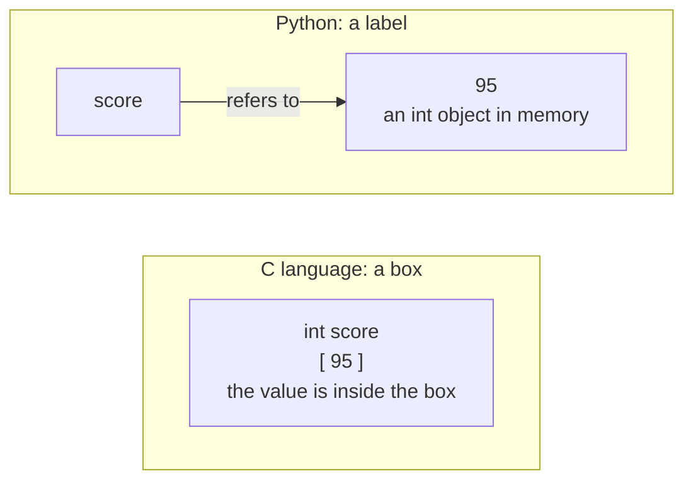
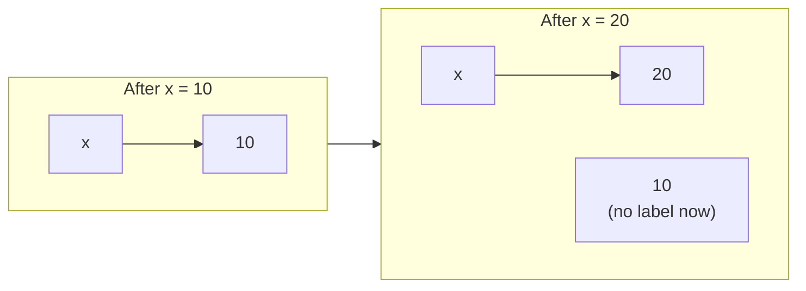
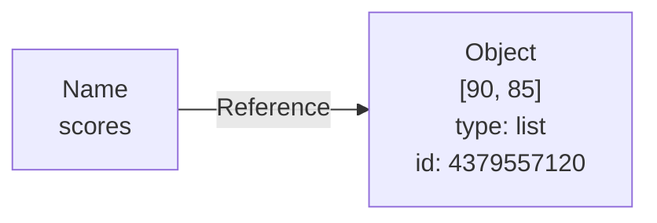
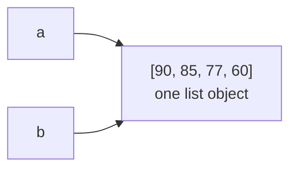
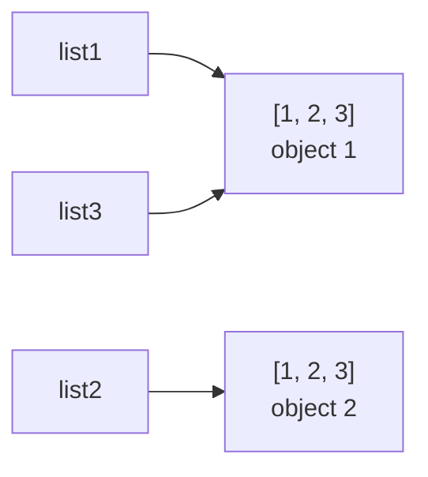
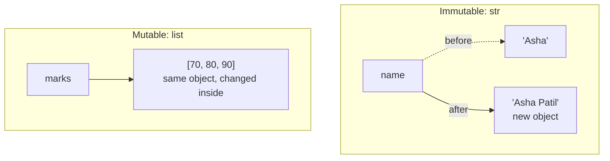
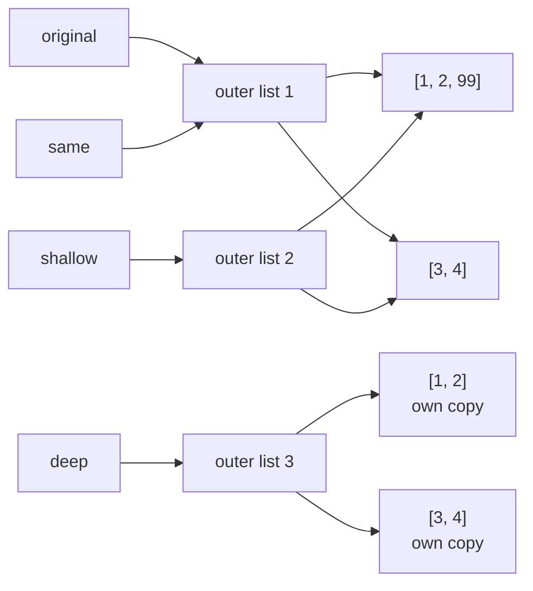
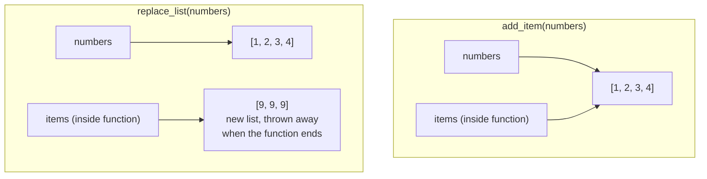
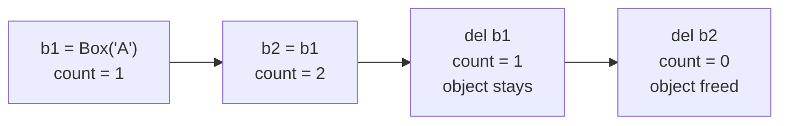
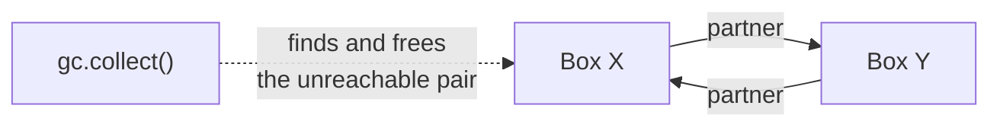

<p align="center">
  
</p>

# 02.1 Variables and Memory Model

In Topic 02 you learned how to **name** things. This topic explains what a name really **is** in Python, and what happens in memory when you create, copy, change and delete values.

This topic explains the bugs that look like magic: "Why did my list change when I only changed the copy?" or "Why does my function remember old values?" Almost all of them come from one idea:

> **A variable in Python is a label stuck on an object. It is not a box that holds a value.**

> **Extra topic.** This topic is not part of the syllabus PDFs. It fills an important gap: you need it to understand lists, functions and classes later.

**In this topic**

1. [What is a variable?](#1-what-is-a-variable)
2. [Names, objects and references](#2-names-objects-and-references)
3. [The three properties of every object: id, type and value](#3-the-three-properties-of-every-object-id-type-and-value)
4. [== versus is](#4--versus-is)
5. [Mutable and immutable objects](#5-mutable-and-immutable-objects)
6. [Aliasing: two names, one object](#6-aliasing-two-names-one-object)
7. [Copying: assignment, shallow copy and deep copy](#7-copying-assignment-shallow-copy-and-deep-copy)
8. [Variables and functions: pass by assignment](#8-variables-and-functions-pass-by-assignment)
9. [+= versus = +](#9--versus--)
10. [How Python frees memory (garbage collection)](#10-how-python-frees-memory-garbage-collection)
11. [Constants](#11-constants)
12. [Multiple assignment and unpacking](#12-multiple-assignment-and-unpacking)
13. [Classic traps](#13-classic-traps)
14. [Quick revision](#14-quick-revision)
15. [Interview questions](#15-interview-questions)
16. [Practice questions](#16-practice-questions)

## 1. What is a variable?

A **variable** is a name that refers to a value stored in memory. You create one with the **assignment operator** `=`:

```python
# Create the name score and make it refer to the value 95
score = 95

# Use the name to get the value back
print(score)
```

**Output**

```text
95
```

Read `score = 95` from **right to left**: "Python creates the object `95`, then sticks the label `score` on it."

### Box or label?

Many languages (such as C) explain a variable as a **box** that holds a value. Python works differently. In Python, the value lives in memory as an **object**, and the variable is a **label** (a name tag) that points to it.



Why does this matter? Because one object can carry **many labels**, and a label can be **moved** to a different object at any time. Everything in this topic follows from that.

### Rebinding: moving the label

```python
# x refers to the object 10
x = 10

# Print the memory address (identity) of the object x refers to
print(id(x))

# Move the label x to a new object, 20
x = 20

# Print the identity again; it is a different object
print(id(x))
```

**Output** (the numbers will be different on your computer)

```text
4403257760
4403258080
```

**How this program runs:** `x = 20` does **not** change the `10` object. Python creates (or finds) a `20` object and moves the label `x` to it. That is why the `id` changes. This is called **rebinding** the name.



### Using a name before creating it

A name exists only after you assign to it:

```python
# Try to print a name that was never created
print(total)
```

**Output** (last line of the error message)

```text
NameError: name 'total' is not defined
```

## 2. Names, objects and references

Three words describe everything that happens:

<table width="100%">
<tr>
<th align="left" width="14%">Term</th>
<th align="left" width="32%">Meaning</th>
<th align="left" width="22%">In <code>scores = [90, 85]</code></th>
<th align="left" width="32%">Think of it as</th>
</tr>
<tr><td><b>Name</b></td><td>The label you write in code</td><td><code>scores</code></td><td>A name tag</td></tr>
<tr><td><b>Object</b></td><td>The actual data stored in memory</td><td>The list <code>[90, 85]</code></td><td>The thing the tag is stuck on</td></tr>
<tr><td><b>Reference</b></td><td>The link from the name to the object</td><td>The arrow</td><td>The string tying the tag to the thing</td></tr>
</table>



**Assignment never copies an object.** It only creates a new reference. So `b = a` means "stick the label `b` on the same object that `a` is on":

```python
# Create a list and stick the label a on it
a = [90, 85, 77]

# Stick a second label, b, on the SAME list
b = a

# Check whether a and b refer to the same object
print(id(a) == id(b))

# Change the list through the name b
b.append(60)

# Print the list through the name a
print(a)

# Print the list through the name b
print(b)
```

**Output**

```text
True
[90, 85, 77, 60]
[90, 85, 77, 60]
```

**How this program runs:** There is only **one** list in memory, with two labels on it. When we add `60` through `b`, we change that one list, so `a` shows the change too.



## 3. The three properties of every object: id, type and value

Every object in Python has three properties:

<table width="100%">
<tr>
<th align="left" width="12%">Property</th>
<th align="left" width="30%">Meaning</th>
<th align="left" width="16%">How to see it</th>
<th align="left" width="20%">Can it change?</th>
<th align="left" width="22%">Analogy</th>
</tr>
<tr><td><b>Identity</b></td><td>A unique number for the object while it exists. In CPython it is the memory address.</td><td><code>id(x)</code></td><td>Never, for the life of the object</td><td>A person's ID card number</td></tr>
<tr><td><b>Type</b></td><td>What kind of object it is, and what it can do</td><td><code>type(x)</code></td><td>Never</td><td>A person's profession</td></tr>
<tr><td><b>Value</b></td><td>The data it holds</td><td><code>print(x)</code></td><td>Only for <b>mutable</b> objects (see Section 5)</td><td>A person's current address</td></tr>
</table>

```python
# Create an int object 95 and label it score
score = 95

# Identity: the unique number of the object
print(id(score))

# Type: the kind of object
print(type(score))

# Value: the data inside
print(score)
```

**Output** (the id will be different on your computer)

```text
4403260480
<class 'int'>
95
```

## 4. == versus is

Python has two different ways to compare:

<table width="100%">
<tr>
<th align="left" width="12%">Operator</th>
<th align="left" width="22%">Question it asks</th>
<th align="left" width="24%">Compares</th>
<th align="left" width="42%">Use it for</th>
</tr>
<tr><td><code>==</code></td><td>Do they have the <b>same value</b>?</td><td>The values</td><td>Almost all comparisons</td></tr>
<tr><td><code>is</code></td><td>Are they the <b>same object</b>?</td><td>The identities: <code>a is b</code> means <code>id(a) == id(b)</code></td><td>Checking for <code>None</code>, <code>True</code> or <code>False</code>, and checking if two names share one object</td></tr>
</table>

**Example: Same values?**

```python
# Create a list
list1 = [1, 2, 3]

# Create a second, separate list with the same values
list2 = [1, 2, 3]

# Put a second label on the first list
list3 = list1

# Same values?
print(list1 == list2)
```

**Output**

```text
True
```

**Example: Same object?**

```python
# Create a list
list1 = [1, 2, 3]

# Create a second, separate list with the same values
list2 = [1, 2, 3]

# Put a second label on the first list
list3 = list1

# Same object?
print(list1 is list2)
```

**Output**

```text
False
```

**Example: Same object?**

```python
# Create a list
list1 = [1, 2, 3]

# Create a second, separate list with the same values
list2 = [1, 2, 3]

# Put a second label on the first list
list3 = list1

# Same object?
print(list1 is list3)
```

**Output**

```text
True
```



`list1` and `list2` look the same (`==` is `True`) but they are two separate objects (`is` is `False`). Think of two identical twins: same face, different people.

### Why you must never use `is` to compare numbers or text

To save memory, CPython keeps **one shared copy** of small integers from **-5 to 256** (this is called **caching** or **interning**). Bigger numbers are usually created fresh each time.

```python
# Two names for 256, which is inside the cached range
a = 256

# Python reuses the cached 256 object
b = 256

# Same object, because of the cache
print(a is b)

# Create 257 at run time, which is outside the cached range
c = int("257")

# Create another 257 at run time
d = int("257")

# Different objects
print(c is d)

# But the values are equal
print(c == d)
```

**Output**

```text
True
False
True
```

The result of `is` depends on hidden memory details, so it can surprise you. **Rule:** use `==` for values. Use `is` only with `None`, `True` and `False`, for example `if result is None:`.

## 5. Mutable and immutable objects

<table width="100%">
<tr>
<th align="left" width="14%">Kind</th>
<th align="left" width="30%">Meaning</th>
<th align="left" width="32%">Types</th>
<th align="left" width="24%">Can be a dictionary key?</th>
</tr>
<tr><td><b>Immutable</b></td><td>The value can <b>never</b> change after the object is created</td><td><code>int</code>, <code>float</code>, <code>complex</code>, <code>bool</code>, <code>str</code>, <code>bytes</code>, <code>tuple</code>, <code>frozenset</code>, <code>None</code></td><td>Yes</td></tr>
<tr><td><b>Mutable</b></td><td>The value <b>can</b> change while it stays the same object</td><td><code>list</code>, <code>dict</code>, <code>set</code>, <code>bytearray</code>, most of your own classes</td><td>No</td></tr>
</table>

The collection types come in pairs: `list` and `tuple`, `set` and `frozenset`, `bytearray` and `bytes`.

### Watching identity during a change

```python
# Create a string (immutable)
name = "Asha"

# Print its identity
print(id(name))

# "Change" the string: this actually builds a NEW string object
name = name + " Patil"

# The identity is different, because it is a new object
print(id(name))

# Print the new value
print(name)

# Create a list (mutable)
marks = [70, 80]

# Print its identity
print(id(marks))

# Change the list in place
marks.append(90)

# The identity is the same, because the same object was changed
print(id(marks))

# Print the changed list
print(marks)
```

**Output** (the ids will be different on your computer)

```text
4379452704
4379548144
Asha Patil
4379557120
4379557120
[70, 80, 90]
```

**How this program runs**



- A string cannot change, so `name + " Patil"` builds a **new** string and the label moves to it. The id changes.
- A list can change, so `append()` changes the **same** list. The id stays the same.

### Trying to change an immutable object

```python
# Create a tuple, which is immutable
t = (1, 2)

# Try to change its first item
try:

    # This is not allowed
    t[0] = 99

# Catch the error
except TypeError as error:

    # Show the error message
    print("TypeError:", error)

# Create a string, which is immutable
s = "hello"

# Try to change its first letter
try:

    # This is not allowed either
    s[0] = "H"

# Catch the error
except TypeError as error:

    # Show the error message
    print("TypeError:", error)
```

**Output**

```text
TypeError: 'tuple' object does not support item assignment
TypeError: 'str' object does not support item assignment
```

## 6. Aliasing: two names, one object

When two or more names refer to the **same** object, they are called **aliases**. Aliases are harmless with immutable objects, because nobody can change the object. With mutable objects, a change through **one** alias is visible through **all** of them.

> **The one rule that predicts everything:** a change is visible through every alias **only if you changed (mutated) the object**. If you just moved a label (**rebinding**), the other aliases do not see it.

<table width="100%">
<tr>
<th align="left" width="24%">Action</th>
<th align="left" width="18%">Kind</th>
<th align="left" width="20%">Other aliases see it?</th>
<th align="left" width="38%">Why</th>
</tr>
<tr><td><code>b.append(60)</code></td><td>Mutation</td><td><b>Yes</b></td><td>The shared object itself changed</td></tr>
<tr><td><code>b[0] = 1</code></td><td>Mutation</td><td><b>Yes</b></td><td>The shared object itself changed</td></tr>
<tr><td><code>b = [1, 2]</code></td><td>Rebinding</td><td><b>No</b></td><td>Only the label <code>b</code> moved to a new object</td></tr>
<tr><td><code>del b</code></td><td>Removes a label</td><td><b>No</b></td><td>Only the label <code>b</code> is removed; the object still has <code>a</code></td></tr>
</table>

## 7. Copying: assignment, shallow copy and deep copy

Because `=` never copies, Python gives you real copy tools:

<table width="100%">
<tr>
<th align="left" width="20%">Method</th>
<th align="left" width="20%">New outer object?</th>
<th align="left" width="20%">New inner objects?</th>
<th align="left" width="40%">Use it when</th>
</tr>
<tr><td><code>b = a</code></td><td>No</td><td>No</td><td>You want a second name, not a copy</td></tr>
<tr><td><code>a.copy()</code> or <code>list(a)</code> or <code>a[:]</code></td><td>Yes</td><td>No (shared)</td><td>The list holds only immutable items, such as numbers or text (<b>shallow copy</b>)</td></tr>
<tr><td><code>copy.deepcopy(a)</code></td><td>Yes</td><td>Yes</td><td>The list holds other lists or dictionaries (<b>deep copy</b>)</td></tr>
</table>

```python
# Load the copy module for deep copies
import copy

# A list that contains two inner lists
original = [[1, 2], [3, 4]]

# A second name for the same object (no copy at all)
same = original

# A shallow copy: new outer list, but the inner lists are shared
shallow = original.copy()

# A deep copy: new outer list AND new inner lists
deep = copy.deepcopy(original)

# Change the first inner list through the original name
original[0].append(99)

# Print all three
print(same)

# Print the shallow copy
print(shallow)

# Print the deep copy
print(deep)
```

**Output**

```text
[[1, 2, 99], [3, 4]]
[[1, 2, 99], [3, 4]]
[[1, 2], [3, 4]]
```

**How this program runs**



1. `same` is just another label, so it shows the change.
2. `shallow` is a new outer list, but its items point to the **same inner lists**, so it also shows the change.
3. `deep` copied everything, including the inner lists, so it is not affected.

## 8. Variables and functions: pass by assignment

When you call a function, the **parameter** becomes one more label on the caller's object. Python does not copy the object, and it does not pass the variable itself. This is called **pass by assignment** (also called "pass by object reference").

```python
# A function that MUTATES the list it receives
def add_item(items):

    # Change the shared list in place
    items.append(4)

# A function that REBINDS its parameter
def replace_list(items):

    # Move the local label items to a brand new list
    items = [9, 9, 9]

# Create the caller's list
numbers = [1, 2, 3]

# Pass it to the mutating function
add_item(numbers)

# The caller sees the change
print(numbers)

# Pass it to the rebinding function
replace_list(numbers)

# The caller does NOT see the change
print(numbers)
```

**Output**

```text
[1, 2, 3, 4]
[1, 2, 3, 4]
```

**How this program runs**



1. In `add_item`, `items` and `numbers` are two labels on one list. `append` changes that list, so the caller sees `4`.
2. In `replace_list`, `items = [9, 9, 9]` only moves the **local** label `items`. The caller's label `numbers` still points to the old list, so nothing changes for the caller.

## 9. += versus = +

They look the same, but for mutable objects they behave differently:

```python
# Create a list with two labels
a = [1, 2]

# b refers to the same list
b = a

# += changes the list in place
a += [3]

# Print a, b, and whether they are still the same object
print(a, b, a is b)

# Create another list with two labels
c = [1, 2]

# d refers to the same list
d = c

# = + builds a NEW list and moves the label c to it
c = c + [3]

# Print c, d, and whether they are still the same object
print(c, d, c is d)
```

**Output**

```text
[1, 2, 3] [1, 2, 3] True
[1, 2, 3] [1, 2] False
```

<table width="100%">
<tr>
<th align="left" width="18%">Code</th>
<th align="left" width="26%">For a list (mutable)</th>
<th align="left" width="26%">For an int or str (immutable)</th>
<th align="left" width="30%">Other aliases see it?</th>
</tr>
<tr><td><code>a += [3]</code></td><td>Changes the same list in place</td><td>Builds a new object</td><td>Yes for a list, no for immutable types</td></tr>
<tr><td><code>a = a + [3]</code></td><td>Builds a new list</td><td>Builds a new object</td><td>No</td></tr>
</table>

## 10. How Python frees memory (garbage collection)

In C, you must free memory yourself. Python does it **automatically**. This is called **garbage collection**. Python uses two tools:

<table width="100%">
<tr>
<th align="left" width="20%">Tool</th>
<th align="left" width="34%">How it works</th>
<th align="left" width="22%">When it frees memory</th>
<th align="left" width="24%">Handles</th>
</tr>
<tr><td><b>Reference counting</b></td><td>Every object counts how many references point to it. When the count drops to 0, the object is freed.</td><td>Immediately</td><td>Almost every object</td></tr>
<tr><td><b>Cycle collector</b> (the <code>gc</code> module)</td><td>Looks for groups of objects that point only to each other and that no name can reach</td><td>From time to time, automatically</td><td>Reference cycles</td></tr>
</table>

### Reference counting

```python
# Load the sys module
import sys

# Create a list with one label
data = [1, 2, 3]

# Print the reference count
print(sys.getrefcount(data))

# Add a second label
other = data

# The count goes up by one
print(sys.getrefcount(data))

# Remove the second label
del other

# The count goes back down
print(sys.getrefcount(data))
```

**Output** (Python 3.12)

```text
2
3
2
```

The count is one more than you expect, because passing `data` into `getrefcount()` creates one extra, temporary reference. The exact numbers can be different in other Python versions; what matters is that the count goes **up** and **down**.

### Seeing an object being freed

`__del__` is a special method that runs just before an object is freed. We use it here only to **watch** the moment it happens.

```python
# A small class that prints a message when it is created and when it is freed
class Box:

    # Runs when a Box is created
    def __init__(self, label):

        # Store the label
        self.label = label

        # Announce the creation
        print("Created", self.label)

    # Runs just before the Box is freed
    def __del__(self):

        # Announce the deletion
        print("Deleted", self.label)

# Create a Box; reference count is 1
b1 = Box("A")

# Add a second label; reference count is 2
b2 = b1

# Remove one label; count drops to 1, so the Box stays
del b1

# Show that the Box is still alive
print("b1 deleted, but b2 still points to the box")

# Remove the last label; count drops to 0, so the Box is freed at once
del b2

# This line runs after the Box is gone
print("end of example")
```

**Output**

```text
Created A
b1 deleted, but b2 still points to the box
Deleted A
end of example
```



> `del` removes a **label**, not the object. The object is freed only when its **last** label is gone.

### Reference cycles

Sometimes objects point to each other. Then their counts never reach 0, even when no name can reach them. The **cycle collector** finds and frees them.

```python
# Load the garbage collector module
import gc

# Create two boxes
x1 = Box("X")

# Create the second box
y1 = Box("Y")

# Box X points to box Y
x1.partner = y1

# Box Y points back to box X: this is a cycle
y1.partner = x1

# Remove both names
del x1

# Now nothing outside can reach the two boxes, but they still point to each other
del y1

# The boxes are still in memory
print("names deleted; cycle still in memory")

# Run the cycle collector now and count what it freed
found = gc.collect()

# Check that it freed at least the two boxes
print("collected objects:", found >= 2)
```

**Output**

```text
Created X
Created Y
names deleted; cycle still in memory
Deleted X
Deleted Y
collected objects: True
```



You almost never need to call `gc.collect()` yourself; Python runs it automatically. It is shown here so you can see that cycles are freed only by the collector, not by reference counting.

## 11. Constants

A **constant** is a value that should never change, such as the maximum marks in an exam. **Python has no real constants.** Instead, programmers follow a convention: write the name in `UPPER_CASE`, and everyone agrees not to change it.

```python
# A constant by convention: UPPER_CASE says "do not change me"
MAX_MARKS = 100

# Python does not stop you from changing it
MAX_MARKS = 200

# Prints the changed value
print(MAX_MARKS)
```

**Output**

```text
200
```

<table width="100%">
<tr>
<th align="left" width="26%">Approach</th>
<th align="left" width="20%">Who enforces it?</th>
<th align="left" width="30%">Example</th>
<th align="left" width="24%">Use it when</th>
</tr>
<tr><td>UPPER_CASE name</td><td>Nobody, it is a convention</td><td><code>MAX_MARKS = 100</code></td><td>Almost always</td></tr>
<tr><td><code>Final</code> type hint</td><td>Type checkers such as mypy, not Python</td><td><code>MAX_MARKS: Final = 100</code></td><td>Your project uses a type checker (Topic 29.2)</td></tr>
<tr><td><code>Enum</code> class</td><td>Python, at run time</td><td><code>class Color(Enum): RED = 1</code></td><td>A fixed set of related values</td></tr>
</table>

**Tip:** use immutable types for constants, for example a `tuple` instead of a `list`: `WEEKDAYS = ("Mon", "Tue", "Wed", "Thu", "Fri")`.

## 12. Multiple assignment and unpacking

Python can assign many names in one line.

**Example: Print both**

```python
# Give values to two names at once
a, b = 5, 10

# Print both
print(a, b)
```

**Output**

```text
5 10
```

**Example: Swap the values, with no temporary variable**

```python
# Give values to two names at once
a, b = 5, 10

# Swap the values, with no temporary variable
a, b = b, a

# Print the swapped values
print(a, b)
```

**Output**

```text
10 5
```

**Example: Give the same value to three names**

```python
# Give values to two names at once
a, b = 5, 10

# Give the same value to three names
x = y = z = 0

# Print all three
print(x, y, z)
```

**Output**

```text
0 0 0
```

**Example: Take the first item, and collect the rest into a list**

```python
# Give values to two names at once
a, b = 5, 10

# Take the first item, and collect the rest into a list
first, *rest = [10, 20, 30, 40]

# Print the two parts
print(first, rest)
```

**Output**

```text
10 [20, 30, 40]
```

**Example: Collect everything except the last item, and take the last item**

```python
# Give values to two names at once
a, b = 5, 10

# Collect everything except the last item, and take the last item
*start, last = [10, 20, 30, 40]

# Print the two parts
print(start, last)
```

**Output**

```text
[10, 20, 30] 40
```

**Example: Unpack a nested structure: a name and a pair of coordinates**

```python
# Give values to two names at once
a, b = 5, 10

# Unpack a nested structure: a name and a pair of coordinates
name, (lat, lon) = ("Pune", (18.52, 73.86))

# Print the three values
print(name, lat, lon)
```

**Output**

```text
Pune 18.52 73.86
```

<table width="100%">
<tr>
<th align="left" width="26%">Pattern</th>
<th align="left" width="30%">What it does</th>
<th align="left" width="20%">Result</th>
<th align="left" width="24%">Remember</th>
</tr>
<tr><td><code>a, b = 5, 10</code></td><td>Assigns each value to a name, in order</td><td><code>a=5</code>, <code>b=10</code></td><td>Counts must match</td></tr>
<tr><td><code>a, b = b, a</code></td><td>Swaps two values</td><td>Swapped</td><td>The right side is worked out <b>completely first</b></td></tr>
<tr><td><code>x = y = z = 0</code></td><td>Puts three labels on one object</td><td>All <code>0</code></td><td>Never do this with a list: all three would share it</td></tr>
<tr><td><code>first, *rest = items</code></td><td>Starred name collects the extra items</td><td><code>rest</code> is a list</td><td>Only one starred name allowed</td></tr>
<tr><td><code>value, _ = pair</code></td><td><code>_</code> catches a value you do not need</td><td>Ignore the second item</td><td>Convention from Topic 02</td></tr>
</table>

**How the swap works:** for `a, b = b, a`, Python first works out the right side, `(10, 5)`, as a temporary tuple. Only then does it assign `a = 10` and `b = 5`. So no value is lost.

## 13. Classic traps

These three bugs all come from shared references. Learn to spot them early.

### Trap 1: A list as a default argument

```python
# The default list is created ONCE, when def runs, and shared by every call
def add_student(name, group=[]):

    # Add the name to the shared default list
    group.append(name)

    # Return the list
    return group

# First call uses the default list
print(add_student("Asha"))

# Second call uses the SAME default list, so Asha is still there
print(add_student("Ravi"))
```

**Output**

```text
['Asha']
['Asha', 'Ravi']
```

**The fix:** use `None` as the default and create a new list inside the function.

```python
# None is immutable, so it is safe as a default
def add_student_fixed(name, group=None):

    # If no list was given, create a fresh one for this call
    if group is None:

        # A new empty list, created every time the function runs
        group = []

    # Add the name
    group.append(name)

    # Return the list
    return group

# First call gets its own new list
print(add_student_fixed("Asha"))

# Second call gets another new list
print(add_student_fixed("Ravi"))
```

**Output**

```text
['Asha']
['Ravi']
```

### Trap 2: Building a grid with `*`

```python
# Looks like 3 rows, but it is ONE row with 3 labels
grid = [[0] * 3] * 3

# Change the first cell of the first row
grid[0][0] = 5

# Every row shows the change
print(grid)

# The right way: build a new row for each position
grid2 = [[0] * 3 for _ in range(3)]

# Change the first cell of the first row
grid2[0][0] = 5

# Only the first row changes
print(grid2)
```

**Output**

```text
[[5, 0, 0], [5, 0, 0], [5, 0, 0]]
[[5, 0, 0], [0, 0, 0], [0, 0, 0]]
```

`* 3` repeats the **reference** to the row, not the row itself. You will learn the `for _ in range(3)` form (a list comprehension) in Topic 09.1.

### Trap 3: Shallow copy of nested data

Covered in [Section 7](#7-copying-assignment-shallow-copy-and-deep-copy). If a list contains other lists, `copy()` shares the inner lists. Use `copy.deepcopy()` when you need a fully independent copy.

<table width="100%">
<tr>
<th align="left" width="26%">Trap</th>
<th align="left" width="32%">Why it happens</th>
<th align="left" width="28%">Fix</th>
<th align="left" width="14%">Section</th>
</tr>
<tr><td><code>def f(x=[])</code></td><td>The default is created once and shared</td><td>Use <code>x=None</code> and create the list inside</td><td><a href="#trap-1-a-list-as-a-default-argument">13</a></td></tr>
<tr><td><code>[[0] * 3] * 3</code></td><td>Repeats one row reference</td><td><code>[[0] * 3 for _ in range(3)]</code></td><td><a href="#trap-2-building-a-grid-with-">13</a></td></tr>
<tr><td><code>a.copy()</code> on nested data</td><td>Inner objects are shared</td><td><code>copy.deepcopy(a)</code></td><td><a href="#7-copying-assignment-shallow-copy-and-deep-copy">7</a></td></tr>
<tr><td><code>x = y = []</code></td><td>Two labels on one list</td><td><code>x, y = [], []</code></td><td><a href="#12-multiple-assignment-and-unpacking">12</a></td></tr>
</table>

## 14. Quick revision

<table width="100%">
<tr>
<th align="left" width="6%">#</th>
<th align="left" width="36%">Question</th>
<th align="left" width="42%">Answer</th>
<th align="left" width="16%">Read again</th>
</tr>
<tr><td>1</td><td>What is a variable in Python?</td><td>A name (label) that refers to an object</td><td><a href="#1-what-is-a-variable">Section 1</a></td></tr>
<tr><td>2</td><td>Does <code>b = a</code> copy the object?</td><td>No, it adds a second label to the same object</td><td><a href="#2-names-objects-and-references">Section 2</a></td></tr>
<tr><td>3</td><td>Three properties of every object</td><td>Identity (<code>id</code>), type (<code>type</code>) and value</td><td><a href="#3-the-three-properties-of-every-object-id-type-and-value">Section 3</a></td></tr>
<tr><td>4</td><td><code>==</code> vs <code>is</code></td><td><code>==</code> compares values; <code>is</code> compares identity</td><td><a href="#4--versus-is">Section 4</a></td></tr>
<tr><td>5</td><td>Range of cached small integers</td><td>-5 to 256</td><td><a href="#4--versus-is">Section 4</a></td></tr>
<tr><td>6</td><td>Immutable types</td><td><code>int</code>, <code>float</code>, <code>bool</code>, <code>str</code>, <code>tuple</code>, <code>frozenset</code>, <code>bytes</code>, <code>None</code></td><td><a href="#5-mutable-and-immutable-objects">Section 5</a></td></tr>
<tr><td>7</td><td>Mutable types</td><td><code>list</code>, <code>dict</code>, <code>set</code>, <code>bytearray</code></td><td><a href="#5-mutable-and-immutable-objects">Section 5</a></td></tr>
<tr><td>8</td><td>Shallow vs deep copy</td><td>Shallow shares inner objects; deep copies everything</td><td><a href="#7-copying-assignment-shallow-copy-and-deep-copy">Section 7</a></td></tr>
<tr><td>9</td><td>How Python passes arguments</td><td>Pass by assignment: the parameter is another label on the same object</td><td><a href="#8-variables-and-functions-pass-by-assignment">Section 8</a></td></tr>
<tr><td>10</td><td><code>a += [3]</code> vs <code>a = a + [3]</code> for a list</td><td><code>+=</code> changes in place; <code>= +</code> builds a new list</td><td><a href="#9--versus--">Section 9</a></td></tr>
<tr><td>11</td><td>Main memory freeing method</td><td>Reference counting, plus a cycle collector</td><td><a href="#10-how-python-frees-memory-garbage-collection">Section 10</a></td></tr>
<tr><td>12</td><td>What <code>del x</code> removes</td><td>The name, not the object</td><td><a href="#10-how-python-frees-memory-garbage-collection">Section 10</a></td></tr>
<tr><td>13</td><td>Does Python have constants?</td><td>No; use <code>UPPER_CASE</code> by convention</td><td><a href="#11-constants">Section 11</a></td></tr>
<tr><td>14</td><td>Swap two variables</td><td><code>a, b = b, a</code></td><td><a href="#12-multiple-assignment-and-unpacking">Section 12</a></td></tr>
<tr><td>15</td><td>Safe default for a list parameter</td><td><code>None</code>, then create the list inside</td><td><a href="#13-classic-traps">Section 13</a></td></tr>
</table>

## 15. Interview questions

Try to answer each question aloud first, then click it to see a model answer.

<details>
<summary><b>Q1. What is a variable in Python? How is it different from a variable in C?</b></summary>

In C, a variable is a fixed memory box of a declared type that holds a value. In Python, a variable is just a **name** that refers to an object. The object holds the value and the type. The name can be moved to any other object, of any type, at any time.

</details>

<details>
<summary><b>Q2. What is the difference between <code>==</code> and <code>is</code>?</b></summary>

`==` checks whether two objects have the same **value**. `is` checks whether two names refer to the **same object** (same `id`). Two separate lists `[1, 2]` and `[1, 2]` are `==` but not `is`. Use `is` only for `None`, `True` and `False`.

</details>

<details>
<summary><b>Q3. Why does <code>a is b</code> give True for 256 but can give False for 257?</b></summary>

CPython caches small integers from -5 to 256, so every `256` in the program is the same object. Larger integers are usually created as new objects, so two `257` values can be different objects. This is an implementation detail, which is why `is` must not be used to compare numbers.

</details>

<details>
<summary><b>Q4. What are mutable and immutable objects? Give examples.</b></summary>

An immutable object cannot be changed after it is created: `int`, `float`, `str`, `tuple`, `frozenset`, `bool`, `None`. A mutable object can be changed in place: `list`, `dict`, `set`. "Changing" an immutable object really creates a new object.

</details>

<details>
<summary><b>Q5. Is Python pass by value or pass by reference?</b></summary>

Neither exactly. Python uses **pass by assignment** (pass by object reference). The parameter becomes another name for the caller's object. If the function **mutates** that object, the caller sees the change. If the function **rebinds** the parameter to a new object, the caller does not see it.

</details>

<details>
<summary><b>Q6. What is the difference between a shallow copy and a deep copy?</b></summary>

A shallow copy (`list.copy()`, `list(a)`, `a[:]`, `copy.copy(a)`) creates a new outer object but shares the inner objects. A deep copy (`copy.deepcopy(a)`) creates new copies of everything, at every level. Use a deep copy for nested mutable data.

</details>

<details>
<summary><b>Q7. How does Python manage memory?</b></summary>

Python allocates memory automatically when objects are created. It frees memory mainly with **reference counting**: when no references to an object are left, it is freed immediately. A **cycle collector** (`gc` module) runs from time to time to free groups of objects that refer only to each other.

</details>

<details>
<summary><b>Q8. What does <code>del</code> do?</b></summary>

`del x` removes the **name** `x`, which lowers the object's reference count by one. The object is freed only when its count reaches zero, that is, when no other names or containers refer to it.

</details>

<details>
<summary><b>Q9. Why is a mutable default argument dangerous?</b></summary>

Default values are created **once**, when the `def` line runs, not each time the function is called. A default list is therefore shared by all calls, and items from earlier calls stay in it. Use `None` as the default and create a new list inside the function.

</details>

<details>
<summary><b>Q10. How do you swap two variables in Python? How does it work?</b></summary>

`a, b = b, a`. Python first evaluates the right side and builds a temporary tuple `(b, a)`. Then it unpacks that tuple into `a` and `b`. Because the right side is fully worked out first, no value is lost and no extra variable is needed.

</details>

<details>
<summary><b>Q11. Does Python support constants?</b></summary>

Not truly. By convention, names in `UPPER_CASE` are treated as constants, but Python does not stop you from changing them. `typing.Final` lets type checkers warn about changes, and an `Enum` gives values that cannot be reassigned at run time.

</details>

<details>
<summary><b>Q12. Why can a tuple be a dictionary key but a list cannot?</b></summary>

Dictionary keys must be **hashable**: their hash value must never change. Immutable objects like tuples (that contain only immutable items) are hashable. Lists are mutable, so their content, and therefore their hash, could change, which would break the dictionary.

</details>

## 16. Practice questions

1. Predict the output, then run it: `a = [1, 2]`, `b = a`, `b.append(3)`, `print(a)`.
2. Predict the output: `a = 10`, `b = a`, `b = b + 1`, `print(a, b)`. Why is it different from question 1?
3. Create two lists with the same values. Print the result of `==` and `is`. Then make one a label of the other and print both again.
4. Print `id()` of a string before and after `s = s + "!"`, and of a list before and after `lst.append(1)`. Explain the difference.
5. Make a nested list `data = [[1], [2]]`. Make a shallow copy and a deep copy. Change `data[0][0]` and print all three.
6. Write a function that receives a list and adds `"done"` to it. Write a second function that sets its parameter to `["new"]`. Call both and explain what the caller sees.
7. Fix this function so each call gets a new list: `def log(msg, history=[]): history.append(msg); return history`.
8. Swap three variables in one line so that `a, b, c = 1, 2, 3` becomes `a=3, b=1, c=2`.
9. Use `first, *middle, last = [5, 10, 15, 20, 25]` and print each part.
10. Explain in your own words why `[[0] * 2] * 2` creates a shared row.

<p align="center">
  <a href="../02.%20Identifiers/README.md">Previous: 02. Identifiers</a> &nbsp;|&nbsp; <a href="../README.md">Course home</a> &nbsp;|&nbsp; <a href="../03.%20Data%20types/README.md">Next: 03. Data types</a>
</p>
