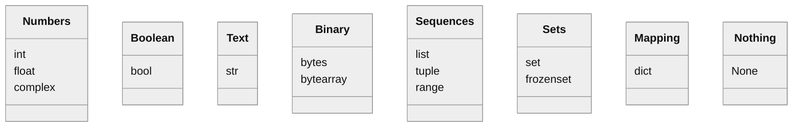
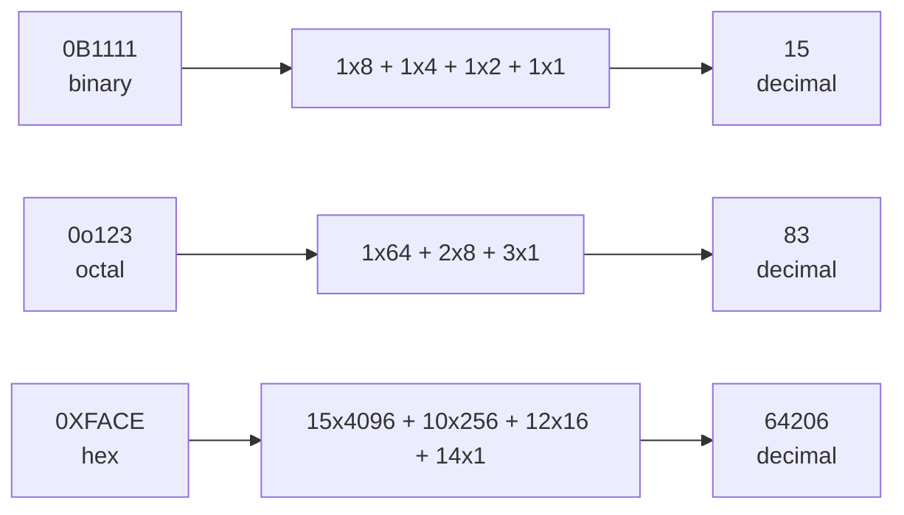
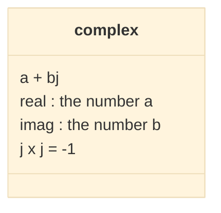
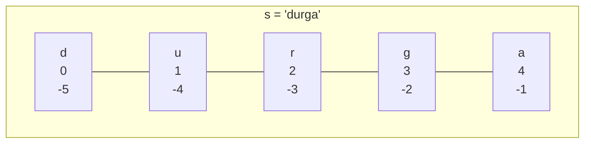
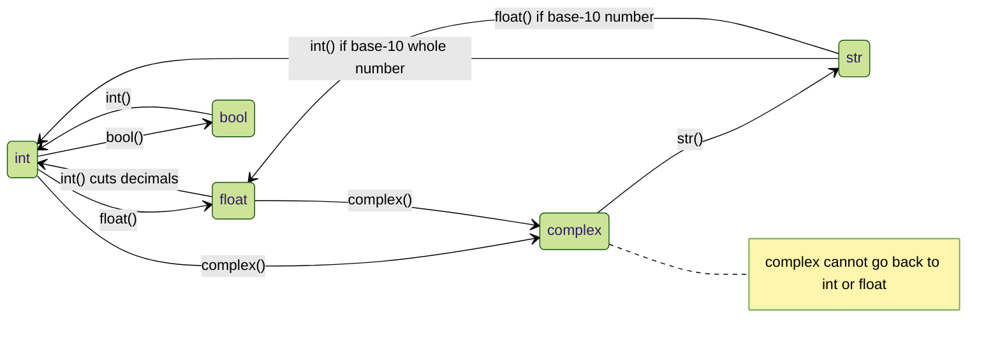
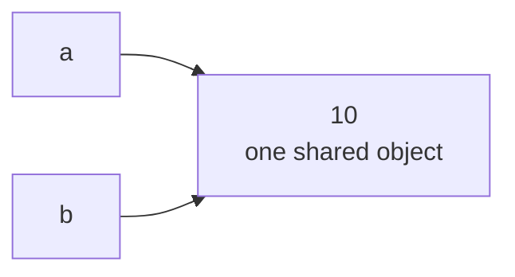
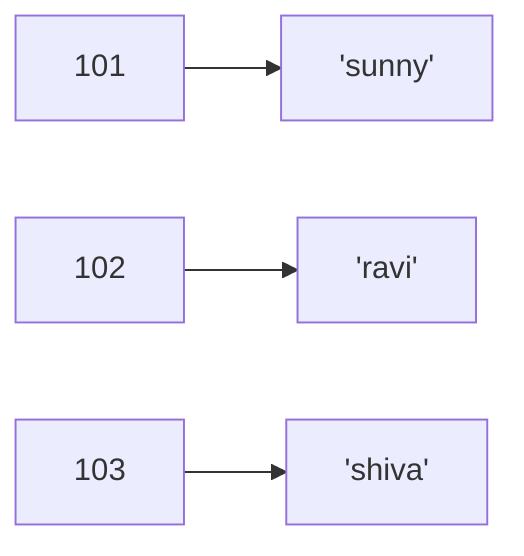
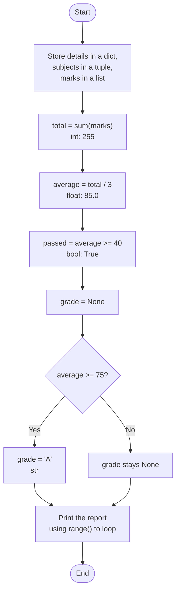

<p align="center">
  
</p>

# 03. Data Types

Every value in a program has a **type**: a whole number, a decimal number, a piece of text, a list of items and so on. The type decides what the value looks like, what you can do with it, and whether it can change. This topic is a tour of all 14 built-in data types in Python, plus type casting (converting between types) and escape characters.

**In this topic**

1. [What is a data type?](#1-what-is-a-data-type)
2. [The 14 built-in data types](#2-the-14-built-in-data-types)
3. [int: whole numbers](#3-int-whole-numbers)
4. [Base conversions](#4-base-conversions)
5. [float: decimal numbers](#5-float-decimal-numbers)
6. [complex: complex numbers](#6-complex-complex-numbers)
7. [bool: True and False](#7-bool-true-and-false)
8. [str: text](#8-str-text)
9. [Escape characters](#9-escape-characters)
10. [Type casting](#10-type-casting)
11. [Fundamental data types and immutability](#11-fundamental-data-types-and-immutability)
12. [bytes and bytearray](#12-bytes-and-bytearray)
13. [list](#13-list)
14. [tuple](#14-tuple)
15. [range](#15-range)
16. [set and frozenset](#16-set-and-frozenset)
17. [dict](#17-dict)
18. [None](#18-none)
19. [Constants](#19-constants)
20. [Summary of all data types](#20-summary-of-all-data-types)
21. [A complete program using many types](#21-a-complete-program-using-many-types)
22. [Quick revision](#22-quick-revision)
23. [Interview questions](#23-interview-questions)
24. [Practice questions](#24-practice-questions)

## 1. What is a data type?

> **A data type represents the type of data present inside a variable.**

In Python you do **not** write the type yourself. Python looks at the value and decides the type automatically. That is why Python is a **dynamically typed** language (you met this idea in [Topic 01](../01.%20Language%20fundamentals/README.md#feature-6-dynamically-typed)).

Three built-in functions help you explore any value:

<table width="100%">
<tr>
<th align="left" width="14%">Function</th>
<th align="left" width="28%">What it does</th>
<th align="left" width="20%">Example</th>
<th align="left" width="18%">Result</th>
<th align="left" width="20%">Learn more</th>
</tr>
<tr><td><code>type()</code></td><td>Tells the type of a value</td><td><code>type(10)</code></td><td><code>&lt;class 'int'&gt;</code></td><td>This topic</td></tr>
<tr><td><code>id()</code></td><td>Gives the identity (address) of the object</td><td><code>id(10)</code></td><td>A big number</td><td><a href="../02.1%20Variables%20and%20memory%20model/README.md">Topic 02.1</a></td></tr>
<tr><td><code>print()</code></td><td>Shows the value on the screen</td><td><code>print(10)</code></td><td><code>10</code></td><td><a href="../01.1%20Setup%20and%20first%20program/README.md">Topic 01.1</a></td></tr>
</table>

> **In Python, everything is an object.** Numbers, text, lists, functions, even types themselves are objects. Every object has an id, a type and a value.

## 2. The 14 built-in data types



<table width="100%">
<tr>
<th align="left" width="5%">#</th>
<th align="left" width="12%">Type</th>
<th align="left" width="25%">Stores</th>
<th align="left" width="20%">Example</th>
<th align="left" width="14%">Changeable?</th>
<th align="left" width="12%">Group</th>
<th align="left" width="12%">Section</th>
</tr>
<tr><td>1</td><td><code>int</code></td><td>Whole numbers</td><td><code>10</code></td><td>No</td><td>Number</td><td><a href="#3-int-whole-numbers">3</a></td></tr>
<tr><td>2</td><td><code>float</code></td><td>Decimal numbers</td><td><code>10.5</code></td><td>No</td><td>Number</td><td><a href="#5-float-decimal-numbers">5</a></td></tr>
<tr><td>3</td><td><code>complex</code></td><td>Complex numbers</td><td><code>3+5j</code></td><td>No</td><td>Number</td><td><a href="#6-complex-complex-numbers">6</a></td></tr>
<tr><td>4</td><td><code>bool</code></td><td>True or False</td><td><code>True</code></td><td>No</td><td>Boolean</td><td><a href="#7-bool-true-and-false">7</a></td></tr>
<tr><td>5</td><td><code>str</code></td><td>Text</td><td><code>"Asha"</code></td><td>No</td><td>Text</td><td><a href="#8-str-text">8</a></td></tr>
<tr><td>6</td><td><code>bytes</code></td><td>Byte numbers 0 to 255</td><td><code>bytes([10, 20])</code></td><td>No</td><td>Binary</td><td><a href="#12-bytes-and-bytearray">12</a></td></tr>
<tr><td>7</td><td><code>bytearray</code></td><td>Byte numbers 0 to 255</td><td><code>bytearray([10, 20])</code></td><td>Yes</td><td>Binary</td><td><a href="#12-bytes-and-bytearray">12</a></td></tr>
<tr><td>8</td><td><code>range</code></td><td>A sequence of numbers</td><td><code>range(10)</code></td><td>No</td><td>Sequence</td><td><a href="#15-range">15</a></td></tr>
<tr><td>9</td><td><code>list</code></td><td>Ordered group of items</td><td><code>[10, 20, 30]</code></td><td>Yes</td><td>Sequence</td><td><a href="#13-list">13</a></td></tr>
<tr><td>10</td><td><code>tuple</code></td><td>Read-only ordered group</td><td><code>(10, 20, 30)</code></td><td>No</td><td>Sequence</td><td><a href="#14-tuple">14</a></td></tr>
<tr><td>11</td><td><code>set</code></td><td>Unique items, no order</td><td><code>{10, 20, 30}</code></td><td>Yes</td><td>Set</td><td><a href="#16-set-and-frozenset">16</a></td></tr>
<tr><td>12</td><td><code>frozenset</code></td><td>Read-only set</td><td><code>frozenset({10, 20})</code></td><td>No</td><td>Set</td><td><a href="#16-set-and-frozenset">16</a></td></tr>
<tr><td>13</td><td><code>dict</code></td><td>Key-value pairs</td><td><code>{101: "Asha"}</code></td><td>Yes</td><td>Mapping</td><td><a href="#17-dict">17</a></td></tr>
<tr><td>14</td><td><code>None</code></td><td>No value</td><td><code>None</code></td><td>No</td><td>Nothing</td><td><a href="#18-none">18</a></td></tr>
</table>

## 3. int: whole numbers

The `int` type represents **whole numbers** (integral values): positive, negative or zero, with no decimal point.

```python
# A whole number
a = 10

# Check its type
print(type(a))

# A very large whole number: 2 to the power 100
big = 2 ** 100

# Python handles it without any special type
print(big)

# It is still an int
print(type(big))
```

**Output**

```text
<class 'int'>
1267650600228229401496703205376
<class 'int'>
```

> **Python 2 vs Python 3:** Python 2 had a separate `long` type for very large whole numbers. Python 3 has **no `long` type**. The `int` type can hold numbers of **any size**, limited only by your computer's memory.

### Four ways to write an int

You can write an int in four number systems. The **prefix** tells Python which one you mean.

<table width="100%">
<tr>
<th align="left" width="16%">Form</th>
<th align="left" width="8%">Base</th>
<th align="left" width="18%">Allowed digits</th>
<th align="left" width="12%">Prefix</th>
<th align="left" width="16%">Valid example</th>
<th align="left" width="30%">Invalid example and why</th>
</tr>
<tr><td><b>Decimal</b> (default)</td><td>10</td><td>0 to 9</td><td>none</td><td><code>a = 10</code></td><td>(normal numbers)</td></tr>
<tr><td><b>Binary</b></td><td>2</td><td>0 and 1</td><td><code>0b</code> or <code>0B</code></td><td><code>a = 0B1111</code></td><td><code>0B123</code>: digits 2 and 3 are not binary. <code>b111</code>: missing the 0, so it is a name.</td></tr>
<tr><td><b>Octal</b></td><td>8</td><td>0 to 7</td><td><code>0o</code> or <code>0O</code></td><td><code>a = 0o123</code></td><td><code>0o786</code>: digit 8 is not octal</td></tr>
<tr><td><b>Hexadecimal</b></td><td>16</td><td>0 to 9, a to f (small or capital)</td><td><code>0x</code> or <code>0X</code></td><td><code>a = 0XFACE</code>, <code>0XBeef</code></td><td><code>0XBeer</code>: <code>r</code> is not a hex digit</td></tr>
</table>

The errors Python gives for the invalid examples:

<table width="100%">
<tr>
<th align="left" width="20%">Code</th>
<th align="left" width="46%">Error</th>
<th align="left" width="34%">Reason</th>
</tr>
<tr><td><code>a = 0B123</code></td><td><code>SyntaxError: invalid digit '2' in binary literal</code></td><td>Binary allows only 0 and 1</td></tr>
<tr><td><code>a = b111</code></td><td><code>NameError: name 'b111' is not defined</code></td><td>Without <code>0</code>, <code>b111</code> is read as a variable name</td></tr>
<tr><td><code>a = 0o786</code></td><td><code>SyntaxError: invalid digit '8' in octal literal</code></td><td>Octal allows only 0 to 7</td></tr>
<tr><td><code>a = 0XBeer</code></td><td><code>SyntaxError: invalid hexadecimal literal</code></td><td>Hex allows only 0 to 9 and a to f</td></tr>
</table>

### Python always shows ints in decimal

You can **write** a number in any of the four forms, but the PVM always **shows** it in decimal.

**Example: Print each value; Python shows them in decimal**

```python
# Decimal 10
a = 10

# Octal 10, which is 1 x 8 + 0 = 8
b = 0o10

# Hexadecimal 10, which is 1 x 16 + 0 = 16
c = 0X10

# Binary 10, which is 1 x 2 + 0 = 2
d = 0B10

# Print each value; Python shows them in decimal
print(a)
```

**Output**

```text
10
```

**Example: Print the octal value**

```python
# Decimal 10
a = 10

# Octal 10, which is 1 x 8 + 0 = 8
b = 0o10

# Hexadecimal 10, which is 1 x 16 + 0 = 16
c = 0X10

# Binary 10, which is 1 x 2 + 0 = 2
d = 0B10

# Print the octal value
print(b)
```

**Output**

```text
8
```

**Example: Print the hexadecimal value**

```python
# Decimal 10
a = 10

# Octal 10, which is 1 x 8 + 0 = 8
b = 0o10

# Hexadecimal 10, which is 1 x 16 + 0 = 16
c = 0X10

# Binary 10, which is 1 x 2 + 0 = 2
d = 0B10

# Print the hexadecimal value
print(c)
```

**Output**

```text
16
```

**Example: Print the binary value**

```python
# Decimal 10
a = 10

# Octal 10, which is 1 x 8 + 0 = 8
b = 0o10

# Hexadecimal 10, which is 1 x 16 + 0 = 16
c = 0X10

# Binary 10, which is 1 x 2 + 0 = 2
d = 0B10

# Print the binary value
print(d)
```

**Output**

```text
2
```

**How the conversion works:** each digit is multiplied by the base raised to its position, counting from 0 on the right.



> **Tip:** for long numbers, you can use underscores to make them readable. `1_000_000` is the same as `1000000`. Python ignores the underscores.

## 4. Base conversions

Python has three built-in functions to convert a number **from any base** into another base. They return **text** (a `str`) with the prefix.

<table width="100%">
<tr>
<th align="left" width="12%">Function</th>
<th align="left" width="22%">Converts to</th>
<th align="left" width="22%">Example</th>
<th align="left" width="14%">Result</th>
<th align="left" width="30%">Check</th>
</tr>
<tr><td><code>bin()</code></td><td>Binary</td><td><code>bin(15)</code></td><td><code>'0b1111'</code></td><td>8 + 4 + 2 + 1 = 15</td></tr>
<tr><td><code>bin()</code></td><td>Binary</td><td><code>bin(0o11)</code></td><td><code>'0b1001'</code></td><td>0o11 is 9 in decimal</td></tr>
<tr><td><code>bin()</code></td><td>Binary</td><td><code>bin(0X10)</code></td><td><code>'0b10000'</code></td><td>0X10 is 16 in decimal</td></tr>
<tr><td><code>oct()</code></td><td>Octal</td><td><code>oct(10)</code></td><td><code>'0o12'</code></td><td>1 x 8 + 2 = 10</td></tr>
<tr><td><code>oct()</code></td><td>Octal</td><td><code>oct(0B1111)</code></td><td><code>'0o17'</code></td><td>0B1111 is 15</td></tr>
<tr><td><code>oct()</code></td><td>Octal</td><td><code>oct(0X123)</code></td><td><code>'0o443'</code></td><td>0X123 is 291</td></tr>
<tr><td><code>hex()</code></td><td>Hexadecimal</td><td><code>hex(100)</code></td><td><code>'0x64'</code></td><td>6 x 16 + 4 = 100</td></tr>
<tr><td><code>hex()</code></td><td>Hexadecimal</td><td><code>hex(0B111111)</code></td><td><code>'0x3f'</code></td><td>0B111111 is 63</td></tr>
<tr><td><code>hex()</code></td><td>Hexadecimal</td><td><code>hex(0o12345)</code></td><td><code>'0x14e5'</code></td><td>0o12345 is 5349</td></tr>
</table>

To go the other way, from text in any base back to an int, give `int()` a second argument, the **base**:

**Example: Read the text "1111" as a binary number**

```python
# Read the text "1111" as a binary number
print(int("1111", 2))
```

**Output**

```text
15
```

**Example: Read the text "ff" as a hexadecimal number**

```python
# Read the text "ff" as a hexadecimal number
print(int("ff", 16))
```

**Output**

```text
255
```

**Example: Base 0 means "look at the prefix to decide the base"**

```python
# Base 0 means "look at the prefix to decide the base"
print(int("0B1111", 0))
```

**Output**

```text
15
```

## 5. float: decimal numbers

The `float` type represents **floating point values**: numbers with a decimal point.

```python
# A decimal number
f = 1.234

# Check its type
print(type(f))
```

**Output**

```text
<class 'float'>
```

### Exponential form (scientific notation)

You can write a float using `e` or `E`, which means "times 10 to the power of".

**Example: Print it**

```python
# 1.2e3 means 1.2 x 10 to the power 3
f = 1.2e3

# Print it
print(f)
```

**Output**

```text
1200.0
```

**Example: Capital E works the same way**

```python
# 1.2e3 means 1.2 x 10 to the power 3
f = 1.2e3

# Capital E works the same way
print(1.2E3)
```

**Output**

```text
1200.0
```

**Example: A negative power makes a small number: 5 x 10 to the power -3**

```python
# 1.2e3 means 1.2 x 10 to the power 3
f = 1.2e3

# A negative power makes a small number: 5 x 10 to the power -3
print(5e-3)
```

**Output**

```text
0.005
```

**Example: A very large number, written in a short form**

```python
# 1.2e3 means 1.2 x 10 to the power 3
f = 1.2e3

# A very large number, written in a short form
print(6.02e23)
```

**Output**

```text
6.02e+23
```

The main advantage of exponential form is that you can write **very big or very small values in a short way**, such as `6.02e23` instead of `602000000000000000000000.0`.

### Floats can only be written in decimal form

Ints can be written in binary, octal or hex. **Floats cannot.**

<table width="100%">
<tr>
<th align="left" width="24%">Code</th>
<th align="left" width="34%">Result</th>
<th align="left" width="42%">Reason</th>
</tr>
<tr><td><code>f = 0B11.01</code></td><td><code>SyntaxError: invalid syntax</code></td><td>Binary form is only for ints</td></tr>
<tr><td><code>f = 0o123.456</code></td><td><code>SyntaxError: invalid syntax</code></td><td>Octal form is only for ints</td></tr>
<tr><td><code>f = 0X123.456</code></td><td><code>SyntaxError: invalid syntax</code></td><td>Hexadecimal form is only for ints</td></tr>
</table>

### Floats are not exact

Computers store floats in binary, and some decimal numbers, like 0.1, cannot be stored exactly in binary. So small rounding errors appear:

```python
# Add two simple decimal numbers
print(0.1 + 0.2)
```

**Output**

```text
0.30000000000000004
```

This is normal in every programming language, not a Python bug. For money and other exact values, use the `decimal` module, which you will meet later. To compare floats, round them first: `round(0.1 + 0.2, 2) == 0.3` is `True`.

## 6. complex: complex numbers

A complex number has the form **a + bj**:



- `a` and `b` can be ints or floats.
- Python uses `j` (not `i`, as in maths) for the imaginary part.
- Examples: `3+5j`, `10+5.5j`, `0.5+0.1j`.

**Rule:** the **real part** can be written in decimal, binary, octal or hexadecimal. The **imaginary part** must be in **decimal** form.

```python
# Real part written in binary: 0B11 is 3
a = 0B11 + 5j

# Print the complex number
print(a)
```

**Output**

```text
(3+5j)
```

```python
# Imaginary part written in binary: not allowed
a = 3 + 0B11j
```

**Output** (last line of the error message)

```text
SyntaxError: invalid binary literal
```

### Operations on complex numbers

**Example: Print the result**

```python
# First complex number
a = 10 + 1.5j

# Second complex number
b = 20 + 2.5j

# Add them: real parts add, imaginary parts add
c = a + b

# Print the result
print(c)
```

**Output**

```text
(30+4j)
```

**Example: Check the type**

```python
# First complex number
a = 10 + 1.5j

# Second complex number
b = 20 + 2.5j

# Add them: real parts add, imaginary parts add
c = a + b

# Check the type
print(type(c))
```

**Output**

```text
<class 'complex'>
```

**Example: Multiply two complex numbers**

```python
# First complex number
a = 10 + 1.5j

# Second complex number
b = 20 + 2.5j

# Add them: real parts add, imaginary parts add
c = a + b

# Multiply two complex numbers
print((2 + 3j) * (4 + 5j))
```

**Output**

```text
(-7+22j)
```

**How the multiplication works:** (2 + 3j)(4 + 5j) = 8 + 10j + 12j + 15j². Because j² = -1, this is 8 + 22j - 15 = **-7 + 22j**.

### Getting the real and imaginary parts

A complex number has two built-in **attributes**: `real` and `imag`.

**Example: The real part**

```python
# A complex number
c = 10.5 + 3.6j

# The real part
print(c.real)
```

**Output**

```text
10.5
```

**Example: The imaginary part (without the j)**

```python
# A complex number
c = 10.5 + 3.6j

# The imaginary part (without the j)
print(c.imag)
```

**Output**

```text
3.6
```

**Example: Both parts are stored as floats**

```python
# A complex number
c = 10.5 + 3.6j

# Both parts are stored as floats
print(type(c.real))
```

**Output**

```text
<class 'float'>
```

Complex numbers are mainly used in **scientific** and **electrical engineering** applications, for example to calculate alternating current circuits and signals.

## 7. bool: True and False

The `bool` type represents **Boolean** (logical) values. There are only **two** allowed values: `True` and `False` (with capital letters).

```python
# A Boolean value
b = True

# Check its type
print(type(b))

# Two numbers
a = 10

# A second number
b = 20

# A comparison gives a Boolean result
c = a < b

# Print the result
print(c)
```

**Output**

```text
<class 'bool'>
True
```

### True is 1 and False is 0

Internally, Python stores `True` as `1` and `False` as `0`. So you can even do arithmetic with them:

**Example: 1 + 1**

```python
# 1 + 1
print(True + True)
```

**Output**

```text
2
```

**Example: 1 - 0**

```python
# 1 - 0
print(True - False)
```

**Output**

```text
1
```

**Example: 1 x 10**

```python
# 1 x 10
print(True * 10)
```

**Output**

```text
10
```

**Example: Bool is actually a special kind of int**

```python
# bool is actually a special kind of int
print(isinstance(True, int))
```

**Output**

```text
True
```

This is useful for counting. For example, `sum([True, False, True])` gives `2`, the number of `True` values.

## 8. str: text

`str` represents the **string** data type. A string is a **sequence of characters** enclosed in quotes.

### Single, double and triple quotes

```python
# Single quotes
s1 = 'Asha'

# Double quotes; exactly the same kind of string
s2 = "Asha"

# Both are equal
print(s1 == s2)
```

**Output**

```text
True
```

Single and double quotes **cannot** span more than one line:

```python
# A line break inside double quotes is not allowed
s1 = "durga
soft"
```

**Output** (last line of the error message)

```text
SyntaxError: unterminated string literal (detected at line 1)
```

For text with several lines, use **triple quotes**: `'''` or `"""`.

```python
# Triple quotes allow a string over several lines
s = '''Durga
Soft'''

# Print it; the line break is kept
print(s)
```

**Output**

```text
Durga
Soft
```

### Quotes inside a string

<table width="100%">
<tr>
<th align="left" width="40%">You want to show</th>
<th align="left" width="36%">Write it as</th>
<th align="left" width="24%">Why it works</th>
</tr>
<tr><td>A single quote: It's easy</td><td><code>"It's easy"</code></td><td>Outer quotes are different</td></tr>
<tr><td>A double quote: This is " character</td><td><code>'''This is " character'''</code></td><td>Triple quotes accept both</td></tr>
<tr><td>A quoted phrase inside text</td><td><code>'''This "Python class very helpful" for java students'''</code></td><td>Triple quotes accept both</td></tr>
<tr><td>Any quote, with the same outer quotes</td><td><code>"This is \" symbol"</code></td><td>Escape character (<a href="#9-escape-characters">Section 9</a>)</td></tr>
</table>

### Indexing: getting one character

Each character has a position number called an **index**. Python strings use **zero-based** indexing.

- A **positive index** counts from the left, starting at `0`.
- A **negative index** counts from the right, starting at `-1`.



```python
# Create a string
s = "durga"

# First character, index 0
print(s[0])

# Second character, index 1
print(s[1])

# Last character, index -1
print(s[-1])

# Index 40 does not exist
print(s[40])
```

**Output**

```text
d
u
a
IndexError: string index out of range
```

### Slicing: getting a piece

The `[ ]` operator with a colon is called the **slice operator**. "Slice" means "a piece". `s[start:end]` gives the characters from `start` up to, **but not including**, `end`.

<table width="100%">
<tr>
<th align="left" width="16%">Code</th>
<th align="left" width="14%">Result</th>
<th align="left" width="40%">Meaning</th>
<th align="left" width="30%">Remember</th>
</tr>
<tr><td><code>s[1:40]</code></td><td><code>'urga'</code></td><td>From index 1 to the end</td><td>Slicing never gives an IndexError, even past the end</td></tr>
<tr><td><code>s[1:]</code></td><td><code>'urga'</code></td><td>From index 1 to the end</td><td>Missing end means "to the end"</td></tr>
<tr><td><code>s[:4]</code></td><td><code>'durg'</code></td><td>From the start up to index 3</td><td>Missing start means "from the beginning"</td></tr>
<tr><td><code>s[:]</code></td><td><code>'durga'</code></td><td>The whole string</td><td>Both missing</td></tr>
<tr><td><code>s[0:5:2]</code></td><td><code>'dra'</code></td><td>Every 2nd character</td><td>Third number is the step</td></tr>
<tr><td><code>s[::-1]</code></td><td><code>'agrud'</code></td><td>The string reversed</td><td>A step of -1 goes backwards</td></tr>
</table>

### Repetition and length

```python
# A string
s = "durga"

# Repeat the string 3 times
print(s * 3)

# Count the characters
print(len(s))
```

**Output**

```text
durgadurgadurga
5
```

### There is no char type

Many languages have a separate `char` type for one character. **Python does not.** A single character is just a string of length 1.

```python
# One character in quotes
c = 'a'

# It is a str, not a char
print(type(c))
```

**Output**

```text
<class 'str'>
```

You will study strings in much more depth in [Topic 03.1](../03.1%20Strings/README.md).

## 9. Escape characters

An **escape character** is a backslash `\` followed by a letter or symbol. Together they have a special meaning inside a string.

<table width="100%">
<tr>
<th align="left" width="6%">#</th>
<th align="left" width="12%">Escape</th>
<th align="left" width="24%">Meaning</th>
<th align="left" width="28%">Example code</th>
<th align="left" width="30%">Prints</th>
</tr>
<tr><td>1</td><td><code>\n</code></td><td>New line</td><td><code>print("durga\nsoftware")</code></td><td>durga<br/>software</td></tr>
<tr><td>2</td><td><code>\t</code></td><td>Horizontal tab</td><td><code>print("durga\tsoftware")</code></td><td>durga&nbsp;&nbsp;&nbsp;software</td></tr>
<tr><td>3</td><td><code>\r</code></td><td>Carriage return (go back to the start of the line)</td><td><code>print("abc\rX")</code></td><td>Xbc (in most terminals)</td></tr>
<tr><td>4</td><td><code>\b</code></td><td>Backspace</td><td><code>print("ab\bc")</code></td><td>ac (in most terminals)</td></tr>
<tr><td>5</td><td><code>\f</code></td><td>Form feed (new page, for printers)</td><td>Rarely used</td><td></td></tr>
<tr><td>6</td><td><code>\v</code></td><td>Vertical tab</td><td>Rarely used</td><td></td></tr>
<tr><td>7</td><td><code>\'</code></td><td>Single quote</td><td><code>print('It\'s')</code></td><td>It's</td></tr>
<tr><td>8</td><td><code>\"</code></td><td>Double quote</td><td><code>print("This is \" symbol")</code></td><td>This is " symbol</td></tr>
<tr><td>9</td><td><code>\\</code></td><td>Backslash</td><td><code>print("C:\\new\\test")</code></td><td>C:\new\test</td></tr>
</table>

Without the escape, a quote inside the same quotes ends the string early:

```python
# The middle " ends the string, so the rest is broken
s = "This is " symbol"
```

**Output** (last line of the error message)

```text
SyntaxError: unterminated string literal (detected at line 1)
```

```python
# The backslash tells Python this quote is part of the text
s = "This is \" symbol"

# Print it
print(s)
```

**Output**

```text
This is " symbol
```

> **Raw strings:** put `r` before the quotes to turn escapes off. `print(r"C:\new\test")` prints `C:\new\test`. This is very useful for Windows paths and for regular expressions (Topic 16).

## 10. Type casting

**Type casting** (also called **type coercion** or **type conversion**) means converting a value from one type to another. Python has a built-in function for each fundamental type:



### int()

<table width="100%">
<tr>
<th align="left" width="20%">Code</th>
<th align="left" width="36%">Result</th>
<th align="left" width="44%">Explanation</th>
</tr>
<tr><td><code>int(123.987)</code></td><td><code>123</code></td><td>The decimal part is cut off (not rounded)</td></tr>
<tr><td><code>int(-7.9)</code></td><td><code>-7</code></td><td>Cut towards zero, not rounded down</td></tr>
<tr><td><code>int(10+5j)</code></td><td><code>TypeError: int() argument must be a string, a bytes-like object or a real number, not 'complex'</code></td><td>Complex cannot become int</td></tr>
<tr><td><code>int(True)</code></td><td><code>1</code></td><td>True is 1</td></tr>
<tr><td><code>int(False)</code></td><td><code>0</code></td><td>False is 0</td></tr>
<tr><td><code>int("10")</code></td><td><code>10</code></td><td>Text with a whole number works</td></tr>
<tr><td><code>int("10.5")</code></td><td><code>ValueError: invalid literal for int() with base 10: '10.5'</code></td><td>Text must hold a whole number</td></tr>
<tr><td><code>int("ten")</code></td><td><code>ValueError: invalid literal for int() with base 10: 'ten'</code></td><td>Words are not numbers</td></tr>
<tr><td><code>int("0B1111")</code></td><td><code>ValueError: invalid literal for int() with base 10: '0B1111'</code></td><td>Text must be base 10, unless you pass a base: <code>int("0B1111", 0)</code></td></tr>
</table>

**Rules for `int()`:**

1. Any type can be converted to int **except complex**.
2. To convert text to int, the text must contain a **whole number in base 10**.

### float()

<table width="100%">
<tr>
<th align="left" width="20%">Code</th>
<th align="left" width="36%">Result</th>
<th align="left" width="44%">Explanation</th>
</tr>
<tr><td><code>float(10)</code></td><td><code>10.0</code></td><td>Adds a decimal part</td></tr>
<tr><td><code>float(10+5j)</code></td><td><code>TypeError: float() argument must be a string or a real number, not 'complex'</code></td><td>Complex cannot become float</td></tr>
<tr><td><code>float(True)</code></td><td><code>1.0</code></td><td>True is 1</td></tr>
<tr><td><code>float(False)</code></td><td><code>0.0</code></td><td>False is 0</td></tr>
<tr><td><code>float("10")</code></td><td><code>10.0</code></td><td>Whole number text works</td></tr>
<tr><td><code>float("10.5")</code></td><td><code>10.5</code></td><td>Decimal text works</td></tr>
<tr><td><code>float("1e3")</code></td><td><code>1000.0</code></td><td>Exponential text works</td></tr>
<tr><td><code>float("ten")</code></td><td><code>ValueError: could not convert string to float: 'ten'</code></td><td>Words are not numbers</td></tr>
<tr><td><code>float("0B1111")</code></td><td><code>ValueError: could not convert string to float: '0B1111'</code></td><td>Text must be base 10</td></tr>
</table>

**Rules for `float()`:**

1. Any type can be converted to float **except complex**.
2. To convert text to float, the text must contain a whole or decimal number **in base 10**.

### complex()

`complex()` has two forms.

**Form 1: `complex(x)`** makes a complex number with real part `x` and imaginary part `0`.

<table width="100%">
<tr>
<th align="left" width="24%">Code</th>
<th align="left" width="36%">Result</th>
<th align="left" width="40%">Explanation</th>
</tr>
<tr><td><code>complex(10)</code></td><td><code>(10+0j)</code></td><td>Real part 10</td></tr>
<tr><td><code>complex(10.5)</code></td><td><code>(10.5+0j)</code></td><td>Real part 10.5</td></tr>
<tr><td><code>complex(True)</code></td><td><code>(1+0j)</code></td><td>True is 1</td></tr>
<tr><td><code>complex(False)</code></td><td><code>0j</code></td><td>False is 0</td></tr>
<tr><td><code>complex("10")</code></td><td><code>(10+0j)</code></td><td>Number text works</td></tr>
<tr><td><code>complex("10.5")</code></td><td><code>(10.5+0j)</code></td><td>Number text works</td></tr>
<tr><td><code>complex("ten")</code></td><td><code>ValueError: complex() arg is a malformed string</code></td><td>Words are not numbers</td></tr>
</table>

**Form 2: `complex(x, y)`** makes a complex number with real part `x` and imaginary part `y`.

<table width="100%">
<tr>
<th align="left" width="28%">Code</th>
<th align="left" width="28%">Result</th>
<th align="left" width="44%">Explanation</th>
</tr>
<tr><td><code>complex(10, -2)</code></td><td><code>(10-2j)</code></td><td>Real 10, imaginary -2</td></tr>
<tr><td><code>complex(True, False)</code></td><td><code>(1+0j)</code></td><td>Real 1, imaginary 0</td></tr>
</table>

### bool()

The rule is simple:

- **Numbers:** `0` (of any number type) is `False`; every other number is `True`.
- **Text and collections:** **empty** is `False`; **not empty** is `True`.
- `None` is `False`.

<table width="100%">
<tr>
<th align="left" width="22%">Code</th>
<th align="left" width="14%">Result</th>
<th align="left" width="64%">Reason</th>
</tr>
<tr><td><code>bool(0)</code></td><td><code>False</code></td><td>Zero</td></tr>
<tr><td><code>bool(1)</code></td><td><code>True</code></td><td>Not zero</td></tr>
<tr><td><code>bool(10)</code></td><td><code>True</code></td><td>Not zero</td></tr>
<tr><td><code>bool(10.5)</code></td><td><code>True</code></td><td>Not zero</td></tr>
<tr><td><code>bool(0.178)</code></td><td><code>True</code></td><td>Not zero, even though it is small</td></tr>
<tr><td><code>bool(0.0)</code></td><td><code>False</code></td><td>Zero</td></tr>
<tr><td><code>bool(10-2j)</code></td><td><code>True</code></td><td>Not zero</td></tr>
<tr><td><code>bool(0+1.5j)</code></td><td><code>True</code></td><td>Imaginary part is not zero</td></tr>
<tr><td><code>bool(0+0j)</code></td><td><code>False</code></td><td>Both parts are zero</td></tr>
<tr><td><code>bool("True")</code></td><td><code>True</code></td><td>Text is not empty</td></tr>
<tr><td><code>bool("False")</code></td><td><code>True</code></td><td><b>Surprise:</b> text is not empty, so it is True. Python does not read the word.</td></tr>
<tr><td><code>bool("")</code></td><td><code>False</code></td><td>Empty text</td></tr>
<tr><td><code>bool(" ")</code></td><td><code>True</code></td><td>A space is a character, so the text is not empty</td></tr>
<tr><td><code>bool([])</code></td><td><code>False</code></td><td>Empty list</td></tr>
<tr><td><code>bool(None)</code></td><td><code>False</code></td><td>None means no value</td></tr>
</table>

### str()

Any value can be converted to text:

<table width="100%">
<tr>
<th align="left" width="26%">Code</th>
<th align="left" width="26%">Result</th>
<th align="left" width="48%">Explanation</th>
</tr>
<tr><td><code>str(10)</code></td><td><code>'10'</code></td><td>The number becomes text</td></tr>
<tr><td><code>str(10.5)</code></td><td><code>'10.5'</code></td><td>The number becomes text</td></tr>
<tr><td><code>str(10+5j)</code></td><td><code>'(10+5j)'</code></td><td>Brackets are included</td></tr>
<tr><td><code>str(True)</code></td><td><code>'True'</code></td><td>The word becomes text</td></tr>
</table>

### Conversion summary

<table width="100%">
<tr>
<th align="left" width="16%">From \ To</th>
<th align="left" width="16%">int</th>
<th align="left" width="16%">float</th>
<th align="left" width="16%">complex</th>
<th align="left" width="16%">bool</th>
<th align="left" width="20%">str</th>
</tr>
<tr><td><b>int</b></td><td>-</td><td>Yes</td><td>Yes</td><td>Yes</td><td>Yes</td></tr>
<tr><td><b>float</b></td><td>Yes (cuts decimals)</td><td>-</td><td>Yes</td><td>Yes</td><td>Yes</td></tr>
<tr><td><b>complex</b></td><td><b>No</b></td><td><b>No</b></td><td>-</td><td>Yes</td><td>Yes</td></tr>
<tr><td><b>bool</b></td><td>Yes</td><td>Yes</td><td>Yes</td><td>-</td><td>Yes</td></tr>
<tr><td><b>str</b></td><td>Only base-10 whole numbers</td><td>Only base-10 numbers</td><td>Only number text</td><td>Yes (empty is False)</td><td>-</td></tr>
</table>

## 11. Fundamental data types and immutability

These five types are called the **fundamental data types**: `int`, `float`, `complex`, `bool` and `str`.

> **All fundamental data types are immutable.** Once an object is created, you cannot change it. If you try, Python creates a **new** object with the change. This "cannot change" behaviour is called **immutability**.

### Why are they immutable? Object reuse

When a new object is needed, the PVM does not always create one straight away. It first checks whether an object with the **same content already exists**. If it does, the PVM **reuses** it. This saves memory and time.

**Example: Same object?**

```python
# Two names for the int 10
a = 10

# Python reuses the existing 10 object
b = 10

# Same object?
print(a is b)
```

**Output**

```text
True
```

**Example: Two names for True**

```python
# Two names for the int 10
a = 10

# Python reuses the existing 10 object
b = 10

# Two names for True
a = True

# There is only one True object in Python
b = True

# Same object?
print(a is b)
```

**Output**

```text
True
```

**Example: Two names for the same short text**

```python
# Two names for the int 10
a = 10

# Python reuses the existing 10 object
b = 10

# Two names for the same short text
a = 'durga'

# Python reuses the existing string
b = 'durga'

# Same object?
print(a is b)
```

**Output**

```text
True
```



But sharing creates a risk: if `a` and `b` share one object, and you could **change** that object through `a`, then `b` would change too, without you asking. **Immutability prevents this.** Because nobody can change the shared object, sharing is always safe. When you "change" `a`, Python creates a new object for `a`, and `b` keeps the old one.

> **Note:** Python does not reuse every value. In the REPL, `a = 10+5j` and `b = 10+5j` give `a is b` as `False`, because complex numbers are not reused there. Object reuse is a hidden memory optimisation, so always compare values with `==`, never with `is`. See [Topic 02.1](../02.1%20Variables%20and%20memory%20model/README.md#4--versus-is) for details.

## 12. bytes and bytearray

### bytes

`bytes` represents a group of **byte numbers**, like an array. Each item must be a whole number from **0 to 255**.

**Example: Check the type**

```python
# A list of numbers
x = [10, 20, 30, 40]

# Convert the list to bytes
b = bytes(x)

# Check the type
print(type(b))
```

**Output**

```text
<class 'bytes'>
```

**Example: First item**

```python
# A list of numbers
x = [10, 20, 30, 40]

# Convert the list to bytes
b = bytes(x)

# First item
print(b[0])
```

**Output**

```text
10
```

**Example: Last item**

```python
# A list of numbers
x = [10, 20, 30, 40]

# Convert the list to bytes
b = bytes(x)

# Last item
print(b[-1])
```

**Output**

```text
40
```

**Example: Go through every item**

```python
# A list of numbers
x = [10, 20, 30, 40]

# Convert the list to bytes
b = bytes(x)

# Go through every item
for i in b:

    # Print the current item
    print(i)
```

**Output**

```text
10
20
30
40
```

**Conclusion 1:** The only allowed values are **0 to 255**. Any other value gives a `ValueError`.

> The notes say "0 to 256". The correct range is **0 to 255** (256 values in total), because one byte has 8 bits, and 8 bits can store 2⁸ = 256 different values, starting at 0.

```python
# 256 is outside the allowed range
b = bytes([10, 256])
```

**Output** (last line of the error message)

```text
ValueError: bytes must be in range(0, 256)
```

**Conclusion 2:** `bytes` is **immutable**. You cannot change an item.

```python
# Create bytes
b = bytes([10, 20, 30, 40])

# Try to change the first item
b[0] = 100
```

**Output** (last line of the error message)

```text
TypeError: 'bytes' object does not support item assignment
```

### bytearray

`bytearray` is **exactly the same as bytes, except that its items can be changed** (it is mutable).

```python
# A list of numbers
x = [10, 20, 30, 40]

# Convert the list to a bytearray
b = bytearray(x)

# Change the first item; allowed for bytearray
b[0] = 100

# Go through every item
for i in b:

    # Print the current item
    print(i)
```

**Output**

```text
100
20
30
40
```

The same 0 to 255 rule applies:

```python
# 256 is outside the allowed range
b = bytearray([10, 256])
```

**Output** (last line of the error message)

```text
ValueError: byte must be in range(0, 256)
```

**Where are they used?** `bytes` and `bytearray` represent **binary information** such as images, video files, audio and network data. You will use them in file handling (Topic 20).

## 13. list

Use a **list** when you want a group of values as a single item, where **order matters** and **duplicates are allowed**.

<table width="100%">
<tr>
<th align="left" width="6%">#</th>
<th align="left" width="34%">Property</th>
<th align="left" width="60%">Meaning</th>
</tr>
<tr><td>1</td><td>Insertion order is preserved</td><td>Items stay in the order you added them</td></tr>
<tr><td>2</td><td>Heterogeneous objects are allowed</td><td>Different types can be mixed in one list</td></tr>
<tr><td>3</td><td>Duplicates are allowed</td><td>The same value can appear many times</td></tr>
<tr><td>4</td><td>Growable</td><td>You can add or remove items at any time</td></tr>
<tr><td>5</td><td>Square brackets</td><td>Written as <code>[ ]</code></td></tr>
<tr><td>6</td><td>Mutable</td><td>Items can be changed</td></tr>
</table>

```python
# A list with mixed types and a duplicate
items = [10, 10.5, 'durga', True, 10]

# Print the list
print(items)
```

**Output**

```text
[10, 10.5, 'durga', True, 10]
```

```python
# A list of numbers
items = [10, 20, 30, 40]

# First item, last item, and a slice from index 1 up to 3
print(items[0], items[-1], items[1:3])

# Change the first item
items[0] = 100

# Print the changed list
print(items)
```

**Output**

```text
10 40 [20, 30]
[100, 20, 30, 40]
```

### A list can grow and shrink

```python
# A list of numbers
items = [10, 20, 30]

# Add an item at the end
items.append("durga")

# Print the list
print(items)

# Remove the value 20
items.remove(20)

# Print the list
print(items)

# Repeat the list twice
print(items * 2)
```

**Output**

```text
[10, 20, 30, 'durga']
[10, 30, 'durga']
[10, 30, 'durga', 10, 30, 'durga']
```

> The notes use `list` as a variable name. Here we use `items` instead, because naming a variable `list` hides the built-in `list()` function (see [Topic 02](../02.%20Identifiers/README.md#9-common-errors)).

**In one line:** a list is an **ordered, mutable, heterogeneous** collection where **duplicates are allowed**. Full details in [Topic 06](../06.%20List/README.md).

## 14. tuple

A **tuple** is **exactly the same as a list, except that it is immutable**. You cannot change, add or remove items. Tuple items are written inside **parentheses** `( )`.

```python
# A tuple
t = (10, 20, 30, 40)

# Check the type
print(type(t))
```

**Output**

```text
<class 'tuple'>
```

<table width="100%">
<tr>
<th align="left" width="26%">Code</th>
<th align="left" width="46%">Error</th>
<th align="left" width="28%">Reason</th>
</tr>
<tr><td><code>t[0] = 100</code></td><td><code>TypeError: 'tuple' object does not support item assignment</code></td><td>Items cannot be changed</td></tr>
<tr><td><code>t.append("durga")</code></td><td><code>AttributeError: 'tuple' object has no attribute 'append'</code></td><td>Cannot grow</td></tr>
<tr><td><code>t.remove(10)</code></td><td><code>AttributeError: 'tuple' object has no attribute 'remove'</code></td><td>Cannot shrink</td></tr>
</table>

**A tuple is the read-only version of a list.** Use it for values that should not change, such as the days of the week or a pair of coordinates.

> **Watch out:** `(10)` is just the int `10` in brackets. A tuple with one item needs a comma: `(10,)`. `type((10))` is `int`, but `type((10,))` is `tuple`.

Full details in [Topic 07](../07.%20Tuple/README.md).

## 15. range

`range` represents a **sequence of numbers**. It is **immutable**.

<table width="100%">
<tr>
<th align="left" width="22%">Form</th>
<th align="left" width="30%">Generates</th>
<th align="left" width="22%">Example</th>
<th align="left" width="26%">Numbers</th>
</tr>
<tr><td><code>range(stop)</code></td><td>0 up to <code>stop - 1</code></td><td><code>range(10)</code></td><td>0, 1, 2 ... 9</td></tr>
<tr><td><code>range(start, stop)</code></td><td><code>start</code> up to <code>stop - 1</code></td><td><code>range(10, 20)</code></td><td>10, 11 ... 19</td></tr>
<tr><td><code>range(start, stop, step)</code></td><td>Jumps by <code>step</code></td><td><code>range(10, 20, 2)</code></td><td>10, 12, 14, 16, 18</td></tr>
<tr><td>Negative step</td><td>Counts down</td><td><code>range(10, 0, -2)</code></td><td>10, 8, 6, 4, 2</td></tr>
</table>

```python
# Numbers from 0 to 9
r = range(10)

# Go through each number
for i in r:

    # Print it on the same line, separated by spaces
    print(i, end=" ")
```

**Output**

```text
0 1 2 3 4 5 6 7 8 9 
```

```python
# A range from 10 to 19
r = range(10, 20)

# Index 0 is the first number
print(r[0])

# Turn a range into a list to see all the numbers at once
print(list(range(10)))

# Index 15 does not exist (there are only 10 numbers)
print(r[15])
```

**Output**

```text
10
[0, 1, 2, 3, 4, 5, 6, 7, 8, 9]
IndexError: range object index out of range
```

Trying to change a range gives `TypeError: 'range' object does not support item assignment`.

> **Why is range useful?** `range(1000000)` does not store a million numbers. It stores only start, stop and step, and works out each number when needed. This saves a lot of memory.

## 16. set and frozenset

### set

Use a **set** when you want a group of values **without duplicates**, and **order is not important**.

<table width="100%">
<tr>
<th align="left" width="6%">#</th>
<th align="left" width="34%">Property</th>
<th align="left" width="60%">Meaning</th>
</tr>
<tr><td>1</td><td>Insertion order is not preserved</td><td>Items may come out in a different order</td></tr>
<tr><td>2</td><td>Duplicates are not allowed</td><td>Repeated values are kept only once</td></tr>
<tr><td>3</td><td>Heterogeneous objects are allowed</td><td>Different types can be mixed</td></tr>
<tr><td>4</td><td>Indexing does not apply</td><td>No <code>s[0]</code>, because there is no order</td></tr>
<tr><td>5</td><td>Mutable</td><td>You can add and remove items</td></tr>
<tr><td>6</td><td>Growable</td><td>The size can increase or decrease</td></tr>
<tr><td>7</td><td>Curly brackets</td><td>Written as <code>{ }</code></td></tr>
</table>

```python
# A set with a duplicate 10
s = {100, 0, 10, 200, 10}

# The duplicate is removed, and the order may change
print(s)

# Add an item
s.add(60)

# Print the set
print(s)

# Remove an item
s.remove(100)

# Print the set
print(s)
```

**Output** (the order may be different on your computer)

```text
{0, 10, 100, 200}
{0, 100, 200, 10, 60}
{0, 200, 10, 60}
```

```python
# Sets have no index
print(s[0])
```

**Output** (last line of the error message)

```text
TypeError: 'set' object is not subscriptable
```

> **Watch out:** `{}` creates an empty **dict**, not an empty set. Use `set()` for an empty set.

### frozenset

A **frozenset** is **exactly the same as a set, except that it is immutable**. You cannot use `add()` or `remove()`.

```python
# A normal set
s = {10, 20, 30, 40}

# Make a frozen (read-only) copy
fs = frozenset(s)

# Check the type
print(type(fs))

# Print it
print(fs)

# Try to add an item
fs.add(70)
```

**Output** (the order may be different on your computer)

```text
<class 'frozenset'>
frozenset({40, 10, 20, 30})
AttributeError: 'frozenset' object has no attribute 'add'
```

`fs.remove(10)` gives `AttributeError: 'frozenset' object has no attribute 'remove'`. Full details in [Topic 08](../08.%20Set/README.md).

## 17. dict

Use a **dict** (dictionary) when you want to store values as **key-value pairs**, so you can look up a value by its key, like a word in a dictionary.

```python
# Roll numbers as keys, names as values
d = {101: 'durga', 102: 'ravi', 103: 'shiva'}

# Assign to an existing key: the old value is replaced
d[101] = 'sunny'

# Print the dictionary
print(d)
```

**Output**

```text
{101: 'sunny', 102: 'ravi', 103: 'shiva'}
```



**Rules:**

- **Duplicate keys are not allowed.** Adding an existing key **replaces** the old value.
- **Duplicate values are allowed.** Two keys can have the same value.
- A dict is **mutable**.

### Building a dict step by step

```python
# Create an empty dictionary
d = {}

# Add a key-value pair
d['a'] = 'apple'

# Add another key-value pair
d['b'] = 'banana'

# Print the dictionary
print(d)

# Look up a value by its key
print(d['a'])

# get() returns None instead of an error when the key is missing
print(d.get('z'))

# Square brackets with a missing key give an error
print(d['z'])
```

**Output**

```text
{'a': 'apple', 'b': 'banana'}
apple
None
KeyError: 'z'
```

> **Correction:** the notes say "the order won't be preserved" for dict. That was true in old versions. **Since Python 3.7, a dict always keeps the insertion order.** `{'b': 2, 'a': 1, 'c': 3}` prints exactly as `{'b': 2, 'a': 1, 'c': 3}`.

Full details in [Topic 09](../09.%20Dictionary/README.md).

## 18. None

`None` means **nothing**, or **no value**. It is used when a value is not available. It is similar to `null` in Java.

```python
# A function that does some work but does not return anything
def m1():

    # Store 10 in a local variable; nothing is returned
    a = 10

# A function with no return statement gives back None
print(m1())

# None has its own type
print(type(None))

# A variable that has no value yet
x = None

# The correct way to check for None
print(x is None)
```

**Output**

```text
None
<class 'NoneType'>
True
```

There is only **one** `None` object in Python, so the correct check is `is None`, not `== None`.

## 19. Constants

Python has **no constants**. By convention, you write a name in **UPPER_CASE** when its value should not change:

```python
# A constant by convention only
MAX_VALUE = 10
```

It is just a convention, so the value **can** still be changed. See [Topic 02.1, Constants](../02.1%20Variables%20and%20memory%20model/README.md#11-constants) for stronger options.

## 20. Summary of all data types

<table width="100%">
<tr>
<th align="left" width="11%">Type</th>
<th align="left" width="24%">Description</th>
<th align="left" width="11%">Mutable?</th>
<th align="left" width="9%">Ordered?</th>
<th align="left" width="11%">Duplicates?</th>
<th align="left" width="18%">Example</th>
<th align="left" width="16%">Brackets</th>
</tr>
<tr><td><code>int</code></td><td>Whole numbers</td><td>Immutable</td><td>-</td><td>-</td><td><code>a = 10</code></td><td>-</td></tr>
<tr><td><code>float</code></td><td>Decimal numbers</td><td>Immutable</td><td>-</td><td>-</td><td><code>b = 10.5</code></td><td>-</td></tr>
<tr><td><code>complex</code></td><td>Complex numbers</td><td>Immutable</td><td>-</td><td>-</td><td><code>c = 10+5j</code></td><td>-</td></tr>
<tr><td><code>bool</code></td><td>Logical values, only True and False</td><td>Immutable</td><td>-</td><td>-</td><td><code>flag = True</code></td><td>-</td></tr>
<tr><td><code>str</code></td><td>Sequence of characters</td><td>Immutable</td><td>Yes</td><td>Yes</td><td><code>s = 'durga'</code></td><td><code>' '</code> <code>" "</code> <code>''' '''</code></td></tr>
<tr><td><code>bytes</code></td><td>Sequence of byte values 0 to 255</td><td>Immutable</td><td>Yes</td><td>Yes</td><td><code>bytes([1, 2, 3])</code></td><td>-</td></tr>
<tr><td><code>bytearray</code></td><td>Sequence of byte values 0 to 255</td><td>Mutable</td><td>Yes</td><td>Yes</td><td><code>bytearray([10, 20])</code></td><td>-</td></tr>
<tr><td><code>range</code></td><td>A range of numbers</td><td>Immutable</td><td>Yes</td><td>No</td><td><code>range(0, 10, 2)</code></td><td>-</td></tr>
<tr><td><code>list</code></td><td>Ordered collection of objects</td><td>Mutable</td><td>Yes</td><td>Yes</td><td><code>[10, 11, 12]</code></td><td><code>[ ]</code></td></tr>
<tr><td><code>tuple</code></td><td>Read-only ordered collection</td><td>Immutable</td><td>Yes</td><td>Yes</td><td><code>(1, 2, 3)</code></td><td><code>( )</code></td></tr>
<tr><td><code>set</code></td><td>Unordered collection of unique objects</td><td>Mutable</td><td>No</td><td>No</td><td><code>{1, 2, 3}</code></td><td><code>{ }</code></td></tr>
<tr><td><code>frozenset</code></td><td>Read-only set</td><td>Immutable</td><td>No</td><td>No</td><td><code>frozenset({1, 2})</code></td><td>-</td></tr>
<tr><td><code>dict</code></td><td>Group of key-value pairs</td><td>Mutable</td><td>Yes (3.7+)</td><td>Keys: no. Values: yes</td><td><code>{101: 'durga'}</code></td><td><code>{key: value}</code></td></tr>
<tr><td><code>None</code></td><td>No value</td><td>Immutable</td><td>-</td><td>-</td><td><code>x = None</code></td><td>-</td></tr>
</table>

## 21. A complete program using many types

This program builds a small student report. It uses `dict`, `tuple`, `list`, `int`, `float`, `bool`, `str`, `range` and `None` together.

```python
# A dict holds the student's details as key-value pairs
student = {"name": "Asha", "roll_no": 101}

# A tuple holds the subject names, which never change
subjects = ("Maths", "Science", "English")

# A list holds the marks, which could be updated later
marks = [78, 85, 92]

# sum() adds the marks; the result is an int
total = sum(marks)

# Division always gives a float
average = total / len(marks)

# A comparison gives a bool
passed = average >= 40

# None means "no grade decided yet"
grade = None

# Give grade A when the average is 75 or more
if average >= 75:

    # Now grade becomes a str
    grade = "A"

# Look up the name in the dict by its key
print("Name    :", student["name"])

# Look up the roll number
print("Roll no :", student["roll_no"])

# range(len(subjects)) gives the positions 0, 1, 2
for position in range(len(subjects)):

    # Print each subject (padded to 8 characters) and its mark
    print(f"{subjects[position]:8}: {marks[position]}")

# Print the total
print("Total   :", total)

# Print the average rounded to 2 decimal places
print("Average :", round(average, 2))

# Print the pass result
print("Passed  :", passed)

# Print the grade
print("Grade   :", grade)

# Print the type name of each calculated value
print("Types   :", type(total).__name__, type(average).__name__, type(passed).__name__, type(grade).__name__)
```

**Output**

```text
Name    : Asha
Roll no : 101
Maths   : 78
Science : 85
English : 92
Total   : 255
Average : 85.0
Passed  : True
Grade   : A
Types   : int float bool str
```

**How this program runs**



1. Each piece of data is stored in the type that fits it best: details by name in a `dict`, fixed subjects in a `tuple`, changeable marks in a `list`.
2. `sum(marks)` gives the `int` 255. Dividing by 3 with `/` always gives a `float`, 85.0.
3. `average >= 40` is a comparison, so `passed` is a `bool`.
4. `grade` starts as `None` (no value) and becomes the `str` `"A"` because 85.0 is at least 75.
5. The `for` loop uses `range(3)` to get positions 0, 1 and 2, and prints the subject and mark at each position.
6. The last line proves the type of each calculated value.

## 22. Quick revision

<table width="100%">
<tr>
<th align="left" width="6%">#</th>
<th align="left" width="36%">Question</th>
<th align="left" width="42%">Answer</th>
<th align="left" width="16%">Read again</th>
</tr>
<tr><td>1</td><td>How many built-in data types are covered?</td><td>14</td><td><a href="#2-the-14-built-in-data-types">Section 2</a></td></tr>
<tr><td>2</td><td>Fundamental data types</td><td><code>int</code>, <code>float</code>, <code>complex</code>, <code>bool</code>, <code>str</code></td><td><a href="#11-fundamental-data-types-and-immutability">Section 11</a></td></tr>
<tr><td>3</td><td>Does Python 3 have a <code>long</code> type?</td><td>No, <code>int</code> has no size limit</td><td><a href="#3-int-whole-numbers">Section 3</a></td></tr>
<tr><td>4</td><td>Prefixes for binary, octal, hex</td><td><code>0b</code>, <code>0o</code>, <code>0x</code></td><td><a href="#3-int-whole-numbers">Section 3</a></td></tr>
<tr><td>5</td><td>Functions for base conversion</td><td><code>bin()</code>, <code>oct()</code>, <code>hex()</code></td><td><a href="#4-base-conversions">Section 4</a></td></tr>
<tr><td>6</td><td>Can floats be written in binary?</td><td>No, only decimal form</td><td><a href="#5-float-decimal-numbers">Section 5</a></td></tr>
<tr><td>7</td><td>Imaginary part of complex must be</td><td>Decimal form</td><td><a href="#6-complex-complex-numbers">Section 6</a></td></tr>
<tr><td>8</td><td><code>True + True</code></td><td><code>2</code></td><td><a href="#7-bool-true-and-false">Section 7</a></td></tr>
<tr><td>9</td><td>Is there a char type?</td><td>No, use a str of length 1</td><td><a href="#8-str-text">Section 8</a></td></tr>
<tr><td>10</td><td>Multi-line strings use</td><td>Triple quotes</td><td><a href="#8-str-text">Section 8</a></td></tr>
<tr><td>11</td><td>Which type cannot be converted to int or float?</td><td><code>complex</code></td><td><a href="#10-type-casting">Section 10</a></td></tr>
<tr><td>12</td><td><code>bool("False")</code></td><td><code>True</code>, because the text is not empty</td><td><a href="#10-type-casting">Section 10</a></td></tr>
<tr><td>13</td><td>Allowed range for bytes</td><td>0 to 255</td><td><a href="#12-bytes-and-bytearray">Section 12</a></td></tr>
<tr><td>14</td><td>Mutable built-in types</td><td><code>list</code>, <code>bytearray</code>, <code>set</code>, <code>dict</code></td><td><a href="#20-summary-of-all-data-types">Section 20</a></td></tr>
<tr><td>15</td><td>Does a dict keep insertion order?</td><td>Yes, since Python 3.7</td><td><a href="#17-dict">Section 17</a></td></tr>
<tr><td>16</td><td>Empty set</td><td><code>set()</code>, because <code>{}</code> is an empty dict</td><td><a href="#16-set-and-frozenset">Section 16</a></td></tr>
<tr><td>17</td><td>One-item tuple</td><td><code>(10,)</code> with a comma</td><td><a href="#14-tuple">Section 14</a></td></tr>
</table>

## 23. Interview questions

Try to answer each question aloud first, then click it to see a model answer.

<details>
<summary><b>Q1. What are the built-in data types in Python?</b></summary>

Numbers: `int`, `float`, `complex`. Boolean: `bool`. Text: `str`. Binary: `bytes`, `bytearray`. Sequences: `list`, `tuple`, `range`. Sets: `set`, `frozenset`. Mapping: `dict`. And `None` (type `NoneType`) for "no value".

</details>

<details>
<summary><b>Q2. Which data types are mutable and which are immutable?</b></summary>

Mutable: `list`, `dict`, `set`, `bytearray`. Immutable: `int`, `float`, `complex`, `bool`, `str`, `tuple`, `frozenset`, `bytes`, `range`, `None`.

</details>

<details>
<summary><b>Q3. What is the difference between a list and a tuple?</b></summary>

Both are ordered and allow duplicates and mixed types. A list is **mutable** (items can be added, removed or changed) and uses `[ ]`. A tuple is **immutable** and uses `( )`. Tuples are slightly faster and use less memory, and a tuple of immutable items can be used as a dictionary key; a list cannot.

</details>

<details>
<summary><b>Q4. What is the difference between a set and a frozenset?</b></summary>

Both store unique items with no order. A `set` is mutable (`add`, `remove` work). A `frozenset` is immutable, so it can be used as a dictionary key or as an item inside another set.

</details>

<details>
<summary><b>Q5. Why is <code>0.1 + 0.2</code> not equal to <code>0.3</code>?</b></summary>

Floats are stored in binary, and 0.1 and 0.2 cannot be represented exactly in binary, so a tiny rounding error appears: `0.30000000000000004`. Compare floats with `round()` or `math.isclose()`, and use the `decimal` module for money.

</details>

<details>
<summary><b>Q6. What does <code>bool("False")</code> return and why?</b></summary>

`True`. For strings, `bool()` checks only whether the string is empty. `"False"` has 5 characters, so it is not empty and is therefore True. Only `""` gives False.

</details>

<details>
<summary><b>Q7. What values are False in Python?</b></summary>

`False`, `None`, zero of any number type (`0`, `0.0`, `0j`), and empty collections: `""`, `[]`, `()`, `{}`, `set()`, `range(0)`. Everything else is True.

</details>

<details>
<summary><b>Q8. Is <code>bool</code> a subclass of <code>int</code>?</b></summary>

Yes. `True` behaves like `1` and `False` like `0`, so `True + True` is `2` and `isinstance(True, int)` is `True`.

</details>

<details>
<summary><b>Q9. Does Python have a char type? Does it have a long type?</b></summary>

Neither. A single character is a `str` of length 1. Python 2 had `long`, but in Python 3 `int` can hold whole numbers of any size.

</details>

<details>
<summary><b>Q10. How do you convert a number to binary, octal and hex, and back?</b></summary>

`bin(15)` gives `'0b1111'`, `oct(15)` gives `'0o17'`, `hex(15)` gives `'0xf'`. To go back, use `int()` with a base: `int('1111', 2)`, `int('17', 8)`, `int('f', 16)`, or `int('0b1111', 0)` to read the prefix.

</details>

<details>
<summary><b>Q11. What is the difference between <code>bytes</code> and <code>bytearray</code>?</b></summary>

Both hold numbers from 0 to 255 and are used for binary data. `bytes` is immutable; `bytearray` is mutable, so its items can be changed.

</details>

<details>
<summary><b>Q12. Does a dictionary keep the order of its items?</b></summary>

Yes, from Python 3.7 onwards a dict always keeps insertion order. Before 3.7 the order was not guaranteed.

</details>

<details>
<summary><b>Q13. What is <code>None</code>? How do you check for it?</b></summary>

`None` is a special value that means "no value". Its type is `NoneType`, and there is only one `None` object. Check for it with `x is None`. A function with no `return` statement returns `None`.

</details>

<details>
<summary><b>Q14. What does <code>int(-7.9)</code> return?</b></summary>

`-7`. `int()` cuts off the decimal part, moving towards zero. It does not round, and it does not round down. Use `round()` to round, or `math.floor()` to round down (`math.floor(-7.9)` is `-8`).

</details>

<details>
<summary><b>Q15. Why are fundamental data types immutable?</b></summary>

Python reuses existing objects to save memory: two names with the value `10` can share one object. If that object could be changed through one name, the other name would change too. Immutability makes sharing safe, because a "change" always creates a new object.

</details>

## 24. Practice questions

1. Write `25` in binary, octal and hexadecimal form in Python. Print all three and check that each prints `25`.
2. Use `bin()`, `oct()` and `hex()` on the number `255`. Then use `int()` with a base to convert each result back.
3. What is the output of `print(0o17 + 0b11 + 0x1F)`? Work it out by hand, then run it.
4. Print `1.5e2`, `2E-3` and `3e0`. Explain each result.
5. Create `c = 4 - 3j`. Print `c.real`, `c.imag` and `c * c`.
6. Predict the result of each, then run them: `bool(0.0)`, `bool("0")`, `bool(" ")`, `bool([0])`, `bool(0j)`.
7. Predict the result or error of each: `int("25")`, `int("25.0")`, `float("25")`, `int(25.99)`, `complex("3")`, `int(3+0j)`.
8. Given `s = "programming"`, print the first character, the last character, `"gram"`, every second character, and the string reversed.
9. Print this exactly, using one `print()` and escape characters:
   `Name:	"Asha"` on the first line and `Path:	C:\data` on the second line.
10. Create a list, a tuple, a set and a dict from the same five numbers (use the numbers as both keys and values for the dict). Try to change the first item of each. Which ones work?
11. Why does `{}` create a dict and not a set? How do you create an empty set?
12. Write a program that stores a product's name (str), price (float), quantity (int), in-stock status (bool) and tags (list), then prints each value with its type.

<p align="center">
  <a href="../02.1%20Variables%20and%20memory%20model/README.md">Previous: 02.1 Variables and memory model</a> &nbsp;|&nbsp; <a href="../README.md">Course home</a> &nbsp;|&nbsp; <a href="../03.1%20Strings/README.md">Next: 03.1 Strings</a>
</p>
