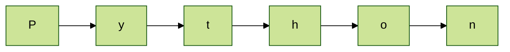
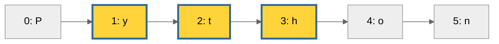
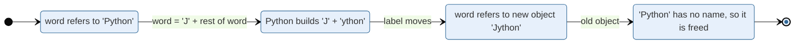
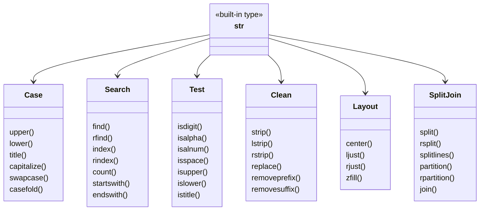
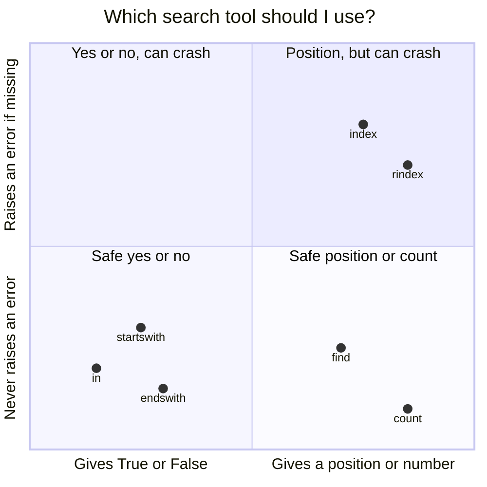
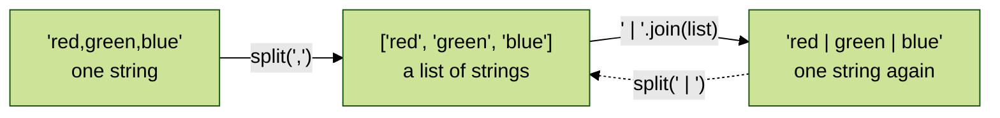
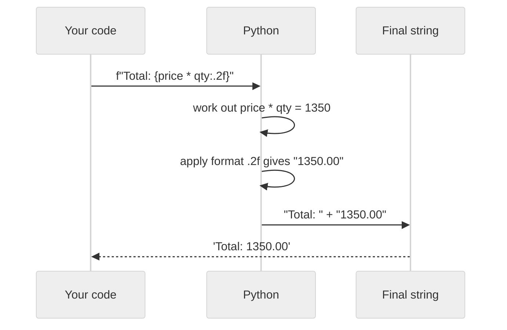
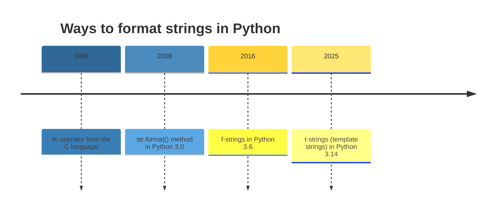
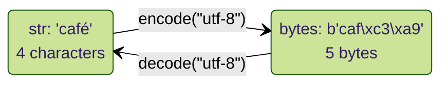
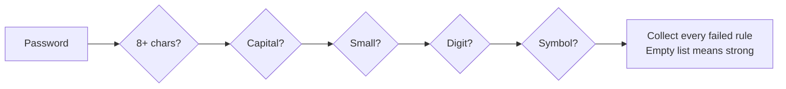

<p align="center">
  
</p>

# 03.1 Strings

Text is everywhere in programs: names, messages, emails, file contents, web pages. In Python, text is stored as a **string** (`str`). In [Topic 03](../03.%20Data%20types/README.md#8-str-text) you met the basics. This topic goes deep: every common string operation and method, each shown with **many examples**, so you see exactly how it behaves in different situations.

> **Extra topic.** This topic is not part of the syllabus PDFs. Strings are used in almost every program, so they get their own detailed topic.

**In this topic**

1. [What is a string?](#1-what-is-a-string)
2. [Creating strings](#2-creating-strings)
3. [Indexing: one character](#3-indexing-one-character)
4. [Slicing: a piece of a string](#4-slicing-a-piece-of-a-string)
5. [String operators](#5-string-operators)
6. [Strings are immutable](#6-strings-are-immutable)
7. [Looping over a string](#7-looping-over-a-string)
8. [String methods: overview](#8-string-methods-overview)
9. [Case methods](#9-case-methods)
10. [Search methods](#10-search-methods)
11. [Test methods (is...)](#11-test-methods-is)
12. [Cleaning: strip, replace and remove](#12-cleaning-strip-replace-and-remove)
13. [Padding and alignment](#13-padding-and-alignment)
14. [Splitting and joining](#14-splitting-and-joining)
15. [Formatting with f-strings](#15-formatting-with-f-strings)
16. [Other formatting styles: format() and %](#16-other-formatting-styles-format-and-)
17. [Unicode, ord(), chr() and encoding](#17-unicode-ord-chr-and-encoding)
18. [Building strings efficiently](#18-building-strings-efficiently)
19. [Complete programs](#19-complete-programs)
20. [Common errors](#20-common-errors)
21. [Quick revision](#21-quick-revision)
22. [Interview questions](#22-interview-questions)
23. [Practice questions](#23-practice-questions)

## 1. What is a string?

> **A string is an ordered sequence of characters, written inside quotes.**

Each character has a fixed position, and the order never changes on its own. A string can hold letters, digits, spaces, symbols and characters from any language.



The word `"Python"` is a chain of 6 characters, one after another. Everything in this topic is about reading, searching, changing (by making new strings), splitting and formatting this chain.

<table width="100%">
<tr>
<th align="left" width="22%">Property</th>
<th align="left" width="38%">Meaning</th>
<th align="left" width="40%">Consequence</th>
</tr>
<tr><td><b>Ordered</b></td><td>Characters keep their position</td><td>You can use indexes and slices</td></tr>
<tr><td><b>Immutable</b></td><td>A string can never be changed after it is created</td><td>Every "change" creates a new string</td></tr>
<tr><td><b>Iterable</b></td><td>You can go through it one character at a time</td><td>Works with <code>for</code> loops</td></tr>
<tr><td><b>Unicode</b></td><td>Any character from any language is allowed</td><td><code>"café"</code> and <code>"नमस्ते"</code> are valid strings</td></tr>
</table>

## 2. Creating strings

There are many ways to create a string. All of these produce the same type, `str`.

```python
# Single quotes
print('Hello')

# Double quotes
print("Hello")

# Single and double quotes give the same string
print('Hello' == "Hello")

# Double quotes let you use a single quote inside
print("It's a sunny day")

# Single quotes let you use double quotes inside
print('She said "yes"')

# Triple quotes allow both kinds of quotes inside
print('''He said "it's fine"''')

# Triple quotes allow text over several lines
print("""Line one
Line two""")

# An empty string has no characters
print(repr(""))

# str() turns a number into a string
print(str(2026))

# str() turns a list into its text form
print(str([1, 2, 3]))

# Strings written next to each other are joined automatically
print("Py" "thon")

# Check the type of a string
print(type("Hello"))
```

**Output**

```text
Hello
Hello
True
It's a sunny day
She said "yes"
He said "it's fine"
Line one
Line two
''
2026
[1, 2, 3]
Python
<class 'str'>
```

> `repr()` shows a value the way you would type it in code, including the quotes. It is useful to "see" empty strings and spaces.

## 3. Indexing: one character

Every character has a position number called an **index**.

- **Positive indexes** count from the left, starting at `0`.
- **Negative indexes** count from the right, starting at `-1`.

<table width="100%">
<tr>
<th align="center" width="16%">Character</th>
<th align="center" width="14%">P</th>
<th align="center" width="14%">y</th>
<th align="center" width="14%">t</th>
<th align="center" width="14%">h</th>
<th align="center" width="14%">o</th>
<th align="center" width="14%">n</th>
</tr>
<tr><td align="center"><b>Positive index</b></td><td align="center">0</td><td align="center">1</td><td align="center">2</td><td align="center">3</td><td align="center">4</td><td align="center">5</td></tr>
<tr><td align="center"><b>Negative index</b></td><td align="center">-6</td><td align="center">-5</td><td align="center">-4</td><td align="center">-3</td><td align="center">-2</td><td align="center">-1</td></tr>
</table>

```python
# The word we will index
word = "Python"

# First character
print(word[0])

# Second character
print(word[1])

# Fourth character
print(word[3])

# Last character, the easy way
print(word[-1])

# Second last character
print(word[-2])

# First character, counted from the right
print(word[-6])

# Last character, using the length
print(word[len(word) - 1])

# The middle character of the word (index 6 // 2 = 3)
print(word[len(word) // 2])

# Indexing works on a string literal directly
print("Hello"[1])

# An index can come from a variable
position = 2

# and from a calculation using it: index 3
print(word[position + 1])
```

**Output**

```text
P
y
h
n
o
P
n
h
e
h
```

An index outside the string gives an error:

```python
# The word has indexes 0 to 5 only
word = "Python"

# Index 10 does not exist
print(word[10])
```

**Output** (last line of the error message)

```text
IndexError: string index out of range
```

## 4. Slicing: a piece of a string

A **slice** takes a part of a string. The full form is:

```text
string[start : stop : step]
```

<table width="100%">
<tr>
<th align="left" width="14%">Part</th>
<th align="left" width="34%">Meaning</th>
<th align="left" width="26%">If you leave it out</th>
<th align="left" width="26%">Remember</th>
</tr>
<tr><td><code>start</code></td><td>Index where the slice begins (included)</td><td>Starts at the beginning</td><td>Included</td></tr>
<tr><td><code>stop</code></td><td>Index where the slice ends (<b>not</b> included)</td><td>Goes to the end</td><td>Excluded</td></tr>
<tr><td><code>step</code></td><td>How many positions to jump each time</td><td>1</td><td>Negative means backwards</td></tr>
</table>



The highlighted characters show `word[1:4]`: it starts at index 1 and stops **before** index 4, giving `"yth"`.

```python
# The word we will slice
word = "Python"

# From index 1 up to (not including) 4
print(word[1:4])

# From the start up to index 2
print(word[:3])

# From index 2 to the end
print(word[2:])

# The whole string
print(word[:])

# The last 3 characters
print(word[-3:])

# Everything except the last character
print(word[:-1])

# Everything except the first and last characters
print(word[1:-1])

# Every second character
print(word[::2])

# Every second character, starting at index 1
print(word[1::2])

# Every third character
print(word[::3])

# The string reversed
print(word[::-1])

# Backwards from index 4 down to index 1 (not included)
print(word[4:1:-1])

# A stop past the end is fine: slicing never raises IndexError
print(word[2:100])

# Start after stop gives an empty string
print(repr(word[4:2]))

# Slicing with negative indexes
print(word[-5:-2])

# The first 4 characters of a date string
print("2026-11-12"[:4])
```

**Output**

```text
yth
Pyt
thon
Python
hon
Pytho
ytho
Pto
yhn
Ph
nohtyP
oht
thon
''
yth
2026
```

> **Key difference:** `word[10]` raises `IndexError`, but `word[2:100]` simply stops at the end. Slices are forgiving; single indexes are not.

## 5. String operators

<table width="100%">
<tr>
<th align="left" width="14%">Operator</th>
<th align="left" width="24%">Meaning</th>
<th align="left" width="26%">Example</th>
<th align="left" width="16%">Result</th>
<th align="left" width="20%">Note</th>
</tr>
<tr><td><code>+</code></td><td>Join (concatenate)</td><td><code>"Py" + "thon"</code></td><td><code>'Python'</code></td><td>Both sides must be strings</td></tr>
<tr><td><code>*</code></td><td>Repeat</td><td><code>"ab" * 3</code></td><td><code>'ababab'</code></td><td>Needs a whole number</td></tr>
<tr><td><code>in</code></td><td>Contains?</td><td><code>"th" in "Python"</code></td><td><code>True</code></td><td>Case sensitive</td></tr>
<tr><td><code>not in</code></td><td>Does not contain?</td><td><code>"z" not in "Python"</code></td><td><code>True</code></td><td></td></tr>
<tr><td><code>==</code>, <code>!=</code></td><td>Equal, not equal</td><td><code>"a" == "A"</code></td><td><code>False</code></td><td>Case sensitive</td></tr>
<tr><td><code>&lt;</code>, <code>&gt;</code></td><td>Alphabetical order</td><td><code>"apple" &lt; "banana"</code></td><td><code>True</code></td><td>Compares character codes</td></tr>
</table>

```python
# Join two strings
print("Py" + "thon")

# Join three strings with a space in the middle
print("Hello" + " " + "World")

# Repeat a string
print("ab" * 3)

# Repeat to draw a line
print("-" * 20)

# Repeating zero times gives an empty string
print(repr("ab" * 0))

# Check if a piece is inside the string
print("th" in "Python")

# in is case sensitive
print("TH" in "Python")

# Check that a piece is not inside
print("z" not in "Python")

# An empty string is inside every string
print("" in "Python")

# Equality is case sensitive
print("python" == "Python")

# Compare in alphabetical order
print("apple" < "banana")

# Capital letters come before small letters
print("Zebra" < "apple")

# Comparison goes character by character
print("cat" < "car")

# A shorter string that matches the start comes first
print("app" < "apple")

# len() counts characters, including spaces
print(len("Hi there"))
```

**Output**

```text
Python
Hello World
ababab
--------------------
''
True
False
True
True
False
True
True
False
True
8
```

**Why is `"Zebra" < "apple"` True?** Python compares the **Unicode code** of each character (see [Section 17](#17-unicode-ord-chr-and-encoding)). Capital `Z` is 90 and small `a` is 97, so `Z` comes first.

`+` works only between strings:

```python
# Try to join text and a number
print("Age: " + 25)
```

**Output** (last line of the error message)

```text
TypeError: can only concatenate str (not "int") to str
```

Fix it with `str(25)` or, better, an f-string: `f"Age: {25}"`.

## 6. Strings are immutable

Once a string is created, **it can never be changed**. You cannot replace, add or remove a character inside it.

```python
# A string
word = "Python"

# Try to change the first character
word[0] = "J"
```

**Output** (last line of the error message)

```text
TypeError: 'str' object does not support item assignment
```

Instead, you build a **new** string and move the name to it:

```python
# The original string
word = "Python"

# Remember its identity
old_id = id(word)

# Build a new string from a new first letter and a slice of the old one
word = "J" + word[1:]

# Print the new string
print(word)

# The name now points to a different object
print(id(word) == old_id)
```

**Output**

```text
Jython
False
```



**Every string method returns a new string.** The original is never changed. This is the most common surprise for beginners:

```python
# A string
name = "asha"

# Call upper(), but do not store the result
name.upper()

# The original is unchanged
print(name)

# Store the result to keep it
name = name.upper()

# Now the name refers to the new string
print(name)
```

**Output**

```text
asha
ASHA
```

## 7. Looping over a string

A string is **iterable**: a `for` loop gives you one character at a time.

```python
# Print each character on its own line
for ch in "Hi!":

    # ch holds the current character
    print(ch)
```

**Output**

```text
H
i
!
```

```python
# Print each character with its index, using enumerate()
for index, ch in enumerate("cat"):

    # Show the position and the character
    print(index, ch)
```

**Output**

```text
0 c
1 a
2 t
```

```python
# Count the vowels in a sentence
sentence = "Programming in Python"

# Start the count at zero
count = 0

# Look at each character
for ch in sentence.lower():

    # Check whether the character is a vowel
    if ch in "aeiou":

        # Add one to the count
        count += 1

# Print the result
print("Vowels:", count)
```

**Output**

```text
Vowels: 5
```

```python
# Build a reversed copy one character at a time
text = "stressed"

# Start with an empty result
result = ""

# Put each new character in front of the result
for ch in text:

    # The current character goes before what we have so far
    result = ch + result

# Print the reversed text
print(result)
```

**Output**

```text
desserts
```

```python
# Loop backwards over a string with reversed()
for ch in reversed("abc"):

    # Print on one line, separated by spaces
    print(ch, end=" ")
```

**Output**

```text
c b a 
```

```python
# Loop with a while loop and an index
text = "dog"

# Start at the first index
i = 0

# Keep going while the index is inside the string
while i < len(text):

    # Print the index and the character
    print(i, text[i])

    # Move to the next index
    i += 1
```

**Output**

```text
0 d
1 o
2 g
```

## 8. String methods: overview

A **method** is a function that belongs to a value. You call it with a dot: `"hello".upper()`. The `str` type has more than 40 methods. They fall into clear families:



You can list every method yourself with `dir(str)`. Each family below shows **10 or more examples**, so you can see how each method behaves with different inputs.

## 9. Case methods

These methods change capital and small letters. They all return a **new** string.

<table width="100%">
<tr>
<th align="left" width="16%">Method</th>
<th align="left" width="34%">What it does</th>
<th align="left" width="22%">Example</th>
<th align="left" width="28%">Result</th>
</tr>
<tr><td><code>upper()</code></td><td>All letters capital</td><td><code>"hello".upper()</code></td><td><code>'HELLO'</code></td></tr>
<tr><td><code>lower()</code></td><td>All letters small</td><td><code>"HeLLo".lower()</code></td><td><code>'hello'</code></td></tr>
<tr><td><code>title()</code></td><td>First letter of every word capital</td><td><code>"good day".title()</code></td><td><code>'Good Day'</code></td></tr>
<tr><td><code>capitalize()</code></td><td>Only the very first letter capital, rest small</td><td><code>"gOOD day".capitalize()</code></td><td><code>'Good day'</code></td></tr>
<tr><td><code>swapcase()</code></td><td>Capital becomes small, small becomes capital</td><td><code>"PyThOn".swapcase()</code></td><td><code>'pYtHoN'</code></td></tr>
<tr><td><code>casefold()</code></td><td>Like <code>lower()</code>, but stronger for other languages</td><td><code>"Straße".casefold()</code></td><td><code>'strasse'</code></td></tr>
</table>

```python
# upper(): every letter becomes capital
print("hello world".upper())

# upper() leaves digits and symbols alone
print("order #42 shipped".upper())

# lower(): every letter becomes small
print("HELLO World".lower())

# lower() is useful to compare text without caring about case
print("YES".lower() == "yes")

# title(): first letter of each word becomes capital
print("the quick brown fox".title())

# title() also fixes words that were all capital
print("THE QUICK BROWN FOX".title())

# title() treats an apostrophe as a word break, which can look odd
print("it's asha's book".title())

# capitalize(): only the first character becomes capital
print("python is FUN".capitalize())

# capitalize() does nothing visible if the string starts with a digit
print("3 apples".capitalize())

# swapcase(): every letter flips its case
print("Hello World".swapcase())

# swapcase() twice gives back the original
print("Hello World".swapcase().swapcase())

# casefold(): like lower(), but also handles special letters
print("Straße".casefold())

# lower() keeps the special German letter as it is
print("Straße".lower())

# casefold() is the safest way to compare words in any language
print("STRASSE".casefold() == "Straße".casefold())

# Methods can be chained: strip spaces first, then capitalise
print("   asha patil  ".strip().title())

# Case methods on an empty string return an empty string
print(repr("".upper()))
```

**Output**

```text
HELLO WORLD
ORDER #42 SHIPPED
hello world
True
The Quick Brown Fox
The Quick Brown Fox
It'S Asha'S Book
Python is fun
3 apples
hELLO wORLD
Hello World
strasse
straße
True
Asha Patil
''
```

**When to use which?**

- To **show** text nicely: `title()` for names and headings, `capitalize()` for sentences.
- To **compare** text without caring about case: `lower()` for English, `casefold()` for any language.

## 10. Search methods

These methods find where a piece of text (a **substring**) appears.

<table width="100%">
<tr>
<th align="left" width="18%">Method</th>
<th align="left" width="30%">Returns</th>
<th align="left" width="26%">If not found</th>
<th align="left" width="26%">Searches from</th>
</tr>
<tr><td><code>find(sub)</code></td><td>Index of the first match</td><td><code>-1</code></td><td>Left</td></tr>
<tr><td><code>rfind(sub)</code></td><td>Index of the last match</td><td><code>-1</code></td><td>Right</td></tr>
<tr><td><code>index(sub)</code></td><td>Index of the first match</td><td><code>ValueError</code></td><td>Left</td></tr>
<tr><td><code>rindex(sub)</code></td><td>Index of the last match</td><td><code>ValueError</code></td><td>Right</td></tr>
<tr><td><code>count(sub)</code></td><td>How many times it appears (no overlaps)</td><td><code>0</code></td><td>-</td></tr>
<tr><td><code>startswith(x)</code></td><td><code>True</code> or <code>False</code></td><td><code>False</code></td><td>Start only</td></tr>
<tr><td><code>endswith(x)</code></td><td><code>True</code> or <code>False</code></td><td><code>False</code></td><td>End only</td></tr>
</table>



```python
# The text we will search
text = "banana bandana"

# find(): index of the first "an"
print(text.find("an"))

# rfind(): index of the last "an"
print(text.rfind("an"))

# find() returns -1 when the text is not there
print(text.find("xyz"))

# find() with a start position: search from index 5 onwards
print(text.find("an", 5))

# find() with start and end positions: search only in text[0:4]
print(text.find("na", 0, 4))

# index() works like find() when the text is found
print(text.index("band"))

# count(): how many times "an" appears
print(text.count("an"))

# count() of a single letter
print(text.count("a"))

# count() does not count overlapping matches
print("aaaa".count("aa"))

# count() returns 0 when nothing matches
print(text.count("z"))

# startswith(): does the text begin with "ban"?
print(text.startswith("ban"))

# endswith(): does the text end with "na"?
print(text.endswith("na"))

# startswith() is case sensitive
print(text.startswith("Ban"))

# startswith() can check several options at once using a tuple
print("report.pdf".endswith((".pdf", ".docx")))

# A real use: check a file type
print("photo.JPG".lower().endswith(".jpg"))

# The in operator is the simplest yes/no search
print("band" in text)
```

**Output**

```text
1
11
-1
8
2
7
4
6
2
0
True
True
False
True
True
True
```

`index()` raises an error when the text is missing, which `find()` does not:

```python
# The text we will search
text = "banana"

# "xyz" is not in the text, so index() raises an error
print(text.index("xyz"))
```

**Output** (last line of the error message)

```text
ValueError: substring not found
```

**Rule of thumb:** use `in` for "is it there?", `find()` when you need the position and missing is normal, and `index()` when missing would be a real mistake.

## 11. Test methods (is...)

These methods check what kind of characters a string contains. They always return `True` or `False`, and an **empty string always gives `False`**.

<table width="100%">
<tr>
<th align="left" width="18%">Method</th>
<th align="left" width="40%">True when every character is...</th>
<th align="left" width="21%">True example</th>
<th align="left" width="21%">False example</th>
</tr>
<tr><td><code>isalpha()</code></td><td>A letter</td><td><code>"Asha"</code></td><td><code>"Asha1"</code></td></tr>
<tr><td><code>isdigit()</code></td><td>A digit</td><td><code>"2026"</code></td><td><code>"20.5"</code></td></tr>
<tr><td><code>isalnum()</code></td><td>A letter or a digit</td><td><code>"abc123"</code></td><td><code>"abc 123"</code></td></tr>
<tr><td><code>isspace()</code></td><td>Whitespace (space, tab, new line)</td><td><code>"  \t"</code></td><td><code>" a "</code></td></tr>
<tr><td><code>isupper()</code></td><td>Letters are all capital (at least one letter)</td><td><code>"ABC1"</code></td><td><code>"AbC"</code></td></tr>
<tr><td><code>islower()</code></td><td>Letters are all small (at least one letter)</td><td><code>"abc1"</code></td><td><code>"abC"</code></td></tr>
<tr><td><code>istitle()</code></td><td>Each word starts with a capital</td><td><code>"Good Day"</code></td><td><code>"Good day"</code></td></tr>
<tr><td><code>isdecimal()</code></td><td>A decimal digit 0 to 9</td><td><code>"123"</code></td><td><code>"½"</code></td></tr>
<tr><td><code>isnumeric()</code></td><td>Any number character, including fractions</td><td><code>"½"</code></td><td><code>"1.5"</code></td></tr>
<tr><td><code>isidentifier()</code></td><td>A valid Python name (see Topic 02)</td><td><code>"total_1"</code></td><td><code>"1total"</code></td></tr>
</table>

```python
# isalpha(): only letters
print("Asha".isalpha())

# A space is not a letter
print("Asha Patil".isalpha())

# Letters from other languages count as letters
print("café".isalpha())

# isdigit(): only digits
print("2026".isdigit())

# A decimal point is not a digit
print("20.5".isdigit())

# A minus sign is not a digit
print("-5".isdigit())

# isalnum(): letters and digits only
print("Room101".isalnum())

# An underscore is neither a letter nor a digit
print("room_101".isalnum())

# isspace(): only whitespace characters
print(" \t\n".isspace())

# isupper(): letters must all be capital; digits are ignored
print("ABC123".isupper())

# islower(): letters must all be small
print("hello world".islower())

# isupper() needs at least one letter
print("123".isupper())

# istitle(): every word starts with a capital letter
print("Hello World".istitle())

# A small first letter in any word makes it False
print("Hello world".istitle())

# isdecimal() vs isnumeric() with a fraction character
print("½".isdecimal(), "½".isnumeric())

# isidentifier(): a valid Python name
print("total_1".isidentifier())

# Every test method returns False for an empty string
print("".isalpha(), "".isdigit(), "".isspace())

# A real use: some text that should be a whole number
age_text = "34"

# Convert it only if every character is a digit
print(int(age_text) + 1 if age_text.isdigit() else "Please type digits only")
```

**Output**

```text
True
False
True
True
False
False
True
False
True
True
True
False
True
False
False True
True
False False False
35
```

## 12. Cleaning: strip, replace and remove

### strip, lstrip and rstrip

These remove characters from the **ends** of a string. With no argument, they remove **whitespace** (spaces, tabs and new lines). They never touch the middle.

```python
# strip(): remove spaces from both ends
print(repr("   hello   ".strip()))

# lstrip(): remove from the left end only
print(repr("   hello   ".lstrip()))

# rstrip(): remove from the right end only
print(repr("   hello   ".rstrip()))

# Spaces in the middle are kept
print(repr("  good   day  ".strip()))

# Tabs and new lines are whitespace too
print(repr("\t hello \n".strip()))

# Remove specific characters instead of whitespace
print("***Sale***".strip("*"))

# The argument is a SET of characters, not a word: any of x, y, z is removed
print("xyzHELLOzyx".strip("xyz"))

# Remove leading zeros
print("000123".lstrip("0"))

# Remove trailing punctuation
print("Really?!?!".rstrip("?!"))

# A typical use: clean a line read from a file
print(repr("Asha,34\n".rstrip("\n")))
```

**Output**

```text
'hello'
'hello   '
'   hello'
'good   day'
'hello'
Sale
HELLO
123
Really
'Asha,34'
```

### replace

`replace(old, new)` swaps every `old` with `new`. An optional third number limits how many are replaced.

```python
# Replace one word with another
print("I like tea".replace("tea", "coffee"))

# Every match is replaced
print("one one one".replace("one", "two"))

# Replace only the first 2 matches
print("one one one".replace("one", "two", 2))

# Replace is case sensitive
print("Tea or tea".replace("tea", "milk"))

# Remove characters by replacing them with an empty string
print("9876-543-210".replace("-", ""))

# Replace a single space with an underscore
print("my file name.txt".replace(" ", "_"))

# Replacing something that is not there changes nothing
print("hello".replace("z", "y"))

# Chain replace() calls to replace several things
print("a-b_c d".replace("-", " ").replace("_", " "))

# Replace with a longer string
print("Hi NAME".replace("NAME", "Asha Patil"))

# A string to test immutability
text = "red car"

# replace() returns a new string, which is thrown away here
text.replace("red", "blue")

# The original string is not changed
print(text)
```

**Output**

```text
I like coffee
two two two
two two one
Tea or milk
9876543210
my_file_name.txt
hello
a b c d
Hi Asha Patil
red car
```

### removeprefix and removesuffix

Added in Python 3.9. They remove an **exact** piece from the start or end, only if it is there. Unlike `strip()`, they work with whole words, not sets of characters.

```python
# Remove an exact prefix
print("unhappy".removeprefix("un"))

# If the prefix is not there, nothing changes
print("happy".removeprefix("un"))

# Remove an exact suffix
print("report.txt".removesuffix(".txt"))

# Compare with rstrip(): it removes ANY of the characters . t x
print("context.txt".rstrip(".txt"))

# removesuffix() removes only the exact ending
print("context.txt".removesuffix(".txt"))

# Remove a title before a name
print("Dr. Asha".removeprefix("Dr. "))

# It is case sensitive
print("Dr. Asha".removeprefix("dr. "))

# Remove a currency sign before converting to a number
print(float("Rs.450".removeprefix("Rs.")))

# Only one copy is removed, not repeated copies
print("abab-x".removeprefix("ab"))

# Remove a trailing slash from a web address
print("https://python.org/".removesuffix("/"))
```

**Output**

```text
happy
happy
report
conte
context
Asha
Dr. Asha
450.0
ab-x
https://python.org
```

> **Trap:** `"context.txt".rstrip(".txt")` gives `'conte'`, not `'context'`, because `rstrip` removes any of the characters `.`, `t` and `x` from the end, again and again. Use `removesuffix()` for exact endings.

## 13. Padding and alignment

These methods add characters to reach a given **width**. They are useful for tables and reports.

<table width="100%">
<tr>
<th align="left" width="20%">Method</th>
<th align="left" width="34%">What it does</th>
<th align="left" width="24%">Example</th>
<th align="left" width="22%">Result</th>
</tr>
<tr><td><code>ljust(width)</code></td><td>Text on the left, padding on the right</td><td><code>"ab".ljust(5)</code></td><td><code>'ab   '</code></td></tr>
<tr><td><code>rjust(width)</code></td><td>Text on the right, padding on the left</td><td><code>"ab".rjust(5)</code></td><td><code>'   ab'</code></td></tr>
<tr><td><code>center(width)</code></td><td>Text in the middle</td><td><code>"ab".center(6)</code></td><td><code>'  ab  '</code></td></tr>
<tr><td><code>zfill(width)</code></td><td>Zeros on the left</td><td><code>"42".zfill(5)</code></td><td><code>'00042'</code></td></tr>
</table>

```python
# Left align in a width of 10
print(repr("Asha".ljust(10)))

# Right align in a width of 10
print(repr("Asha".rjust(10)))

# Centre in a width of 10
print(repr("Asha".center(10)))

# Use a different fill character
print("Asha".center(12, "*"))

# Right align with dots, like a table of contents
print("Chapter 1".ljust(20, ".") + "5")

# If the text is already longer than the width, nothing is added
print("Python".ljust(3))

# zfill(): pad a number with zeros
print("7".zfill(3))

# zfill() keeps a minus sign in front
print("-42".zfill(5))

# Make invoice numbers of the same length
print("INV" + str(58).zfill(5))

# Build a simple aligned table: the header row
print("Item".ljust(10) + "Price".rjust(8))

# First row: name on the left, price on the right
print("Tea".ljust(10) + "20".rjust(8))

# Second row, lined up with the first
print("Sandwich".ljust(10) + "120".rjust(8))

# A heading in the middle of a line
print(" REPORT ".center(30, "="))
```

**Output**

```text
'Asha      '
'      Asha'
'   Asha   '
****Asha****
Chapter 1...........5
Python
007
-0042
INV00058
Item         Price
Tea             20
Sandwich       120
=========== REPORT ===========
```

## 14. Splitting and joining

`split()` breaks a string into a **list** of pieces. `join()` does the opposite: it glues a list of strings into one string.



### split and rsplit

```python
# With no argument, split() breaks on any whitespace
print("Python is easy to learn".split())

# Extra spaces are ignored when no argument is given
print("  a   b    c  ".split())

# Split on a comma
print("red,green,blue".split(","))

# Split on a comma followed by a space
print("red, green, blue".split(", "))

# With a separator given, empty pieces are kept
print("a,,b".split(","))

# maxsplit: split only at the first 1 comma
print("name,age,city".split(",", 1))

# rsplit(): split from the right side
print("name,age,city".rsplit(",", 1))

# Split a date into parts
print("2026-11-12".split("-"))

# Split a file name from its extension at the LAST dot
print("archive.tar.gz".rsplit(".", 1))

# Split a sentence into words, then count them
print(len("the cat sat on the mat".split()))

# Split a string that does not contain the separator
print("hello".split(","))

# Split and convert each piece to a number
print([int(n) for n in "10 20 30".split()])
```

**Output**

```text
['Python', 'is', 'easy', 'to', 'learn']
['a', 'b', 'c']
['red', 'green', 'blue']
['red', 'green', 'blue']
['a', '', 'b']
['name', 'age,city']
['name,age', 'city']
['2026', '11', '12']
['archive.tar', 'gz']
6
['hello']
[10, 20, 30]
```

### splitlines

```python
# Split text into lines
print("line 1\nline 2\nline 3".splitlines())

# Keep the line endings with keepends=True
print("a\nb\n".splitlines(keepends=True))

# Windows line endings (\r\n) are handled too
print("first\r\nsecond".splitlines())

# Compare: split("\n") leaves an empty piece at the end
print("a\nb\n".split("\n"))
```

**Output**

```text
['line 1', 'line 2', 'line 3']
['a\n', 'b\n']
['first', 'second']
['a', 'b', '']
```

### partition and rpartition

`partition(sep)` splits at the **first** separator into exactly **3** parts: before, the separator, after.

```python
# Split an email address into user and domain
print("asha@example.com".partition("@"))

# Split a key=value pair
print("color=blue".partition("="))

# rpartition() splits at the LAST separator
print("a.b.c".rpartition("."))

# If the separator is missing, you still get 3 parts
print("hello".partition(":"))

# Unpack the 3 parts into names
user, at, domain = "ravi@site.org".partition("@")

# Print the user and the domain
print(user, domain)
```

**Output**

```text
('asha', '@', 'example.com')
('color', '=', 'blue')
('a.b', '.', 'c')
('hello', '', '')
ravi site.org
```

### join

`separator.join(list_of_strings)` puts the separator **between** the items.

```python
# Join words with a space
print(" ".join(["Python", "is", "fun"]))

# Join with a comma and a space
print(", ".join(["red", "green", "blue"]))

# Join with nothing between
print("".join(["P", "y", "t", "h", "o", "n"]))

# Join with a new line to make several lines
print("\n".join(["line 1", "line 2"]))

# Join the characters of a string with dashes
print("-".join("abc"))

# Build a file path
print("/".join(["home", "asha", "notes.txt"]))

# Join a single item: no separator is added
print(", ".join(["only"]))

# Join an empty list: an empty string
print(repr(", ".join([])))

# Numbers must be converted to strings first
print(", ".join(str(n) for n in [1, 2, 3]))

# Split and join together: remove extra spaces from a sentence
print(" ".join("  too    many   spaces ".split()))
```

**Output**

```text
Python is fun
red, green, blue
Python
line 1
line 2
a-b-c
home/asha/notes.txt
only
''
1, 2, 3
too many spaces
```

`join()` needs every item to be a string:

```python
# The list contains numbers, not strings
print(", ".join([1, 2, 3]))
```

**Output** (last line of the error message)

```text
TypeError: sequence item 0: expected str instance, int found
```

## 15. Formatting with f-strings

An **f-string** (formatted string literal) starts with `f` before the quote. Anything inside `{ }` is worked out and put into the text.



### Putting values in

```python
# A name to use
name = "Asha"

# An age to use
age = 25

# Put variables inside the text
print(f"{name} is {age} years old")

# Any expression works inside the braces
print(f"Next year: {age + 1}")

# Call methods inside the braces
print(f"Shout: {name.upper()}")

# Call functions inside the braces
print(f"Name length: {len(name)}")

# A conditional expression inside the braces
print(f"Status: {'adult' if age >= 18 else 'minor'}")

# A list of marks
marks = [78, 85, 92]

# Index into the list inside the braces
print(f"First mark: {marks[0]}")

# A dictionary
student = {"city": "Pune"}

# Look up a key inside the braces (use the other kind of quotes inside)
print(f"City: {student['city']}")

# The = sign shows the expression and its value, useful for debugging
print(f"{age = }")

# Double braces show a literal brace
print(f"{{name}} is written as {name}")

# Capital F works too
print(F"Hello {name}")
```

**Output**

```text
Asha is 25 years old
Next year: 26
Shout: ASHA
Name length: 4
Status: adult
First mark: 78
City: Pune
age = 25
{name} is written as Asha
Hello Asha
```

### Format specifiers

After a colon inside the braces, you can control **how** the value looks: `{value:spec}`.

<table width="100%">
<tr>
<th align="left" width="16%">Spec</th>
<th align="left" width="30%">Meaning</th>
<th align="left" width="24%">Example</th>
<th align="left" width="30%">Result</th>
</tr>
<tr><td><code>.2f</code></td><td>2 decimal places</td><td><code>f"{3.14159:.2f}"</code></td><td><code>'3.14'</code></td></tr>
<tr><td><code>,</code></td><td>Thousands separator</td><td><code>f"{1234567:,}"</code></td><td><code>'1,234,567'</code></td></tr>
<tr><td><code>%</code></td><td>Percentage</td><td><code>f"{0.256:.1%}"</code></td><td><code>'25.6%'</code></td></tr>
<tr><td><code>&gt;10</code></td><td>Right align in width 10</td><td><code>f"{'ab':&gt;10}"</code></td><td><code>'        ab'</code></td></tr>
<tr><td><code>&lt;10</code></td><td>Left align in width 10</td><td><code>f"{'ab':&lt;10}"</code></td><td><code>'ab        '</code></td></tr>
<tr><td><code>^10</code></td><td>Centre in width 10</td><td><code>f"{'ab':^10}"</code></td><td><code>'    ab    '</code></td></tr>
<tr><td><code>*^10</code></td><td>Centre, fill with <code>*</code></td><td><code>f"{'ab':*^10}"</code></td><td><code>'****ab****'</code></td></tr>
<tr><td><code>05d</code></td><td>Whole number, zero padded to 5</td><td><code>f"{42:05d}"</code></td><td><code>'00042'</code></td></tr>
<tr><td><code>b</code>, <code>o</code>, <code>x</code></td><td>Binary, octal, hex</td><td><code>f"{255:x}"</code></td><td><code>'ff'</code></td></tr>
<tr><td><code>e</code></td><td>Scientific notation</td><td><code>f"{123456:.2e}"</code></td><td><code>'1.23e+05'</code></td></tr>
</table>

```python
# Round to 2 decimal places
print(f"{3.14159:.2f}")

# Round to 0 decimal places
print(f"{2.71828:.0f}")

# Thousands separator
print(f"{1234567:,}")

# Thousands separator and 2 decimals, for money
print(f"Rs. {1234567.891:,.2f}")

# Underscore as the thousands separator
print(f"{1234567:_}")

# Percentage with 1 decimal place
print(f"{0.256:.1%}")

# Right align in a width of 10
print(f"[{'ab':>10}]")

# Left align in a width of 10
print(f"[{'ab':<10}]")

# Centre in a width of 10
print(f"[{'ab':^10}]")

# Centre with a fill character
print(f"[{'ab':*^10}]")

# Pad a whole number with zeros
print(f"{42:05d}")

# Show a plus sign for positive numbers
print(f"{42:+d}")

# Binary, octal and hexadecimal
print(f"{255:b} {255:o} {255:x} {255:X}")

# Hexadecimal with the 0x prefix
print(f"{255:#x}")

# Scientific notation with 2 decimals
print(f"{123456:.2e}")

# Width and decimals together: width 10, 2 decimals, right aligned
print(f"[{3.14159:10.2f}]")

# A width stored in a variable
width = 8

# The width can come from the variable, using nested braces
print(f"[{'hi':>{width}}]")

# Load the date type from the datetime module
from datetime import date

# Format a date: day, full month name, year
print(f"{date(2026, 11, 12):%d %B %Y}")
```

**Output**

```text
3.14
3
1,234,567
Rs. 1,234,567.89
1_234_567
25.6%
[        ab]
[ab        ]
[    ab    ]
[****ab****]
00042
+42
11111111 377 ff FF
0xff
1.23e+05
[      3.14]
[      hi]
12 November 2026
```

### A formatted table with f-strings

```python
# Items as (name, quantity, price) tuples
items = [("Tea", 2, 20.0), ("Sandwich", 1, 120.5), ("Juice", 3, 45.0)]

# Print the header row: name left aligned, numbers right aligned
print(f"{'Item':<10}{'Qty':>5}{'Price':>10}{'Total':>10}")

# Print a line under the header
print("-" * 35)

# Print one row for each item
for name, qty, price in items:

    # Each column has a fixed width, numbers have 2 decimals
    print(f"{name:<10}{qty:>5}{price:>10.2f}{qty * price:>10.2f}")
```

**Output**

```text
Item        Qty     Price     Total
-----------------------------------
Tea           2     20.00     40.00
Sandwich      1    120.50    120.50
Juice         3     45.00    135.00
```

## 16. Other formatting styles: format() and %

Python has had three formatting styles over the years. You will see all three in other people's code.



```python
# A name to use
name = "Asha"

# A score to use
score = 92.456

# Style 1: the % operator (oldest style)
print("Name: %s, Score: %.1f" % (name, score))

# Style 2: str.format() with empty braces filled in order
print("Name: {}, Score: {:.1f}".format(name, score))

# str.format() with position numbers
print("{1} scored {0:.1f}".format(score, name))

# str.format() with names
print("{n} scored {s:.1f}".format(n=name, s=score))

# Style 3: f-string (newest and recommended)
print(f"Name: {name}, Score: {score:.1f}")

# The % style codes: %s text, %d whole number, %f decimal number
print("%s is %d years old and %.2f m tall" % ("Ravi", 30, 1.756))

# format() as a built-in function for one value
print(format(1234.5, ",.2f"))
```

**Output**

```text
Name: Asha, Score: 92.5
Name: Asha, Score: 92.5
Asha scored 92.5
Asha scored 92.5
Name: Asha, Score: 92.5
Ravi is 30 years old and 1.76 m tall
1,234.50
```

<table width="100%">
<tr>
<th align="left" width="18%">Style</th>
<th align="left" width="34%">Example</th>
<th align="left" width="24%">Strength</th>
<th align="left" width="24%">Use it when</th>
</tr>
<tr><td><code>%</code> operator</td><td><code>"%s is %d" % (name, age)</code></td><td>Short, familiar from C</td><td>Reading old code, logging (Topic 15)</td></tr>
<tr><td><code>str.format()</code></td><td><code>"{} is {}".format(name, age)</code></td><td>Template can be stored and reused</td><td>The template comes from elsewhere</td></tr>
<tr><td>f-string</td><td><code>f"{name} is {age}"</code></td><td>Clearest and fastest</td><td><b>Almost always</b></td></tr>
</table>

## 17. Unicode, ord(), chr() and encoding

Every character has a unique number called its **Unicode code point**.

- `ord(character)` gives the number of a character.
- `chr(number)` gives the character for a number.

```python
# The code of capital A
print(ord("A"))

# The code of small a
print(ord("a"))

# The code of the digit 0 (not the number 0)
print(ord("0"))

# The code of a space
print(ord(" "))

# The character with code 66
print(chr(66))

# chr() and ord() undo each other
print(chr(ord("z")))

# Capital and small letters are exactly 32 apart
print(ord("a") - ord("A"))

# Move a letter forward by 1
print(chr(ord("c") + 1))

# Characters from other languages have bigger codes
print(ord("é"), ord("क"))

# Build the alphabet from codes 97 to 122
print("".join(chr(code) for code in range(97, 123)))

# A Unicode escape in a string: \u followed by 4 hex digits
print("café")
```

**Output**

```text
65
97
48
32
B
z
32
d
233 2325
abcdefghijklmnopqrstuvwxyz
café
```

### Encoding and decoding

Computers store text as **bytes**. **Encoding** turns a string into bytes; **decoding** turns bytes back into a string. The most common encoding is **UTF-8**.



```python
# A string with an accented letter
text = "café"

# Encode the string into UTF-8 bytes
data = text.encode("utf-8")

# Print the bytes; é takes 2 bytes
print(data)

# 4 characters
print(len(text))

# but 5 bytes
print(len(data))

# Decode the bytes back into a string
print(data.decode("utf-8"))

# Plain English letters take 1 byte each in UTF-8
print(len("hello".encode("utf-8")))
```

**Output**

```text
b'caf\xc3\xa9'
4
5
café
5
```

> **Why it matters:** when you read files (Topics 13 and 20) or web pages (Topic 22), you must use the right encoding, usually `"utf-8"`. Using the wrong one gives strange characters or a `UnicodeDecodeError`.

## 18. Building strings efficiently

Because strings are immutable, `+=` in a loop creates a **new** string every time. For a few pieces this does not matter. For thousands of pieces, collect them in a list and `join()` once.

```python
# Slow pattern for very large loops: a new string is made every time
result = ""

# Add 5 numbers one by one
for number in range(5):

    # Each += builds a brand new string
    result += str(number) + ","

# Print the result
print(result)

# Better pattern: collect the pieces in a list
pieces = []

# Add 5 numbers to the list
for number in range(5):

    # Appending to a list is cheap
    pieces.append(str(number))

# Join everything once at the end
print(",".join(pieces))
```

**Output**

```text
0,1,2,3,4,
0,1,2,3,4
```

For long text that must fit a width, the standard library has `textwrap`:

```python
# Load the textwrap module
import textwrap

# A long sentence
text = "Python strings are immutable sequences of Unicode characters with many useful methods."

# Wrap the text to lines of at most 30 characters
print(textwrap.fill(text, width=30))

# Shorten text to 40 characters, adding [...] at the end
print(textwrap.shorten(text, width=40))
```

**Output**

```text
Python strings are immutable
sequences of Unicode
characters with many useful
methods.
Python strings are immutable [...]
```

## 19. Complete programs

### Program 1: Text analyser

```python
# The text to analyse
text = "Python is easy. Python is powerful. Learn Python today!"

# Count all characters, including spaces
total_characters = len(text)

# Remove punctuation so words compare cleanly
clean_text = text.replace(".", "").replace("!", "")

# Split into words, all small letters
words = clean_text.lower().split()

# Count the number of words
total_words = len(words)

# Count how often "python" appears
python_count = words.count("python")

# Find the longest word
longest_word = max(words, key=len)

# Count capital letters
capital_letters = sum(1 for ch in text if ch.isupper())

# Print the report
print(f"Characters : {total_characters}")

# Number of words
print(f"Words      : {total_words}")

# How many times Python appears
print(f"'python'   : {python_count} times")

# The longest word
print(f"Longest    : {longest_word}")

# Number of capital letters
print(f"Capitals   : {capital_letters}")
```

**Output**

```text
Characters : 55
Words      : 9
'python'   : 3 times
Longest    : powerful
Capitals   : 4
```

**How this program runs:**

1. `len(text)` counts every character, including spaces and punctuation.
2. Two `replace()` calls remove `.` and `!`, so `"easy."` becomes `"easy"`.
3. `lower().split()` makes all words small and breaks the text into a list of 9 words.
4. `words.count("python")` counts matching items in the list.
5. `max(words, key=len)` picks the word with the largest length.
6. The generator `sum(1 for ch in text if ch.isupper())` adds 1 for each capital letter.

### Program 2: Password strength checker

```python
# Define a function that checks one password and returns a list of problems
def check_password(password):

    # Start with an empty list of problems
    problems = []

    # Rule 1: at least 8 characters
    if len(password) < 8:

        # Record the problem
        problems.append("at least 8 characters")

    # Rule 2: at least one capital letter
    if not any(ch.isupper() for ch in password):

        # Record the problem
        problems.append("a capital letter")

    # Rule 3: at least one small letter
    if not any(ch.islower() for ch in password):

        # Record the problem
        problems.append("a small letter")

    # Rule 4: at least one digit
    if not any(ch.isdigit() for ch in password):

        # Record the problem
        problems.append("a digit")

    # Rule 5: at least one symbol (not a letter or digit)
    if password.isalnum():

        # Record the problem
        problems.append("a symbol")

    # Send back the list of problems
    return problems

# Some passwords to test
for password in ["abc", "password123", "Password123", "Pass@2026"]:

    # Check the current password
    problems = check_password(password)

    # An empty list means the password passed every rule
    if not problems:

        # Strong password
        print(f"{password:<12} -> strong")

    # Otherwise, list what is missing
    else:

        # Join the problems into one readable line
        print(f"{password:<12} -> needs " + ", ".join(problems))
```

**Output**

```text
abc          -> needs at least 8 characters, a capital letter, a digit, a symbol
password123  -> needs a capital letter, a symbol
Password123  -> needs a symbol
Pass@2026    -> strong
```



**How this program runs:** each rule is checked in turn, and every failed rule adds a message to `problems`. `any(...)` returns `True` as soon as one character passes the test. `isalnum()` is `True` only when there are **no** symbols, so it signals a missing symbol. An empty list is "falsy" (Topic 03), so `if not problems` means "no problems".

### Program 3: Palindrome checker

A **palindrome** reads the same forwards and backwards, ignoring spaces, punctuation and case.

```python
# Define a function that returns True for a palindrome
def is_palindrome(text):

    # Keep only letters and digits, all in small letters
    cleaned = "".join(ch.lower() for ch in text if ch.isalnum())

    # Compare the cleaned text with its reverse
    return cleaned == cleaned[::-1]

# Test several phrases
for phrase in ["Madam", "Never odd or even", "Python", "A man, a plan, a canal: Panama"]:

    # Print each phrase and the result
    print(f"{phrase!r:35} {is_palindrome(phrase)}")
```

**Output**

```text
'Madam'                             True
'Never odd or even'                 True
'Python'                            False
'A man, a plan, a canal: Panama'    True
```

**How this program runs:** `"Never odd or even"` is cleaned to `"neveroddoreven"`. Its reverse, made with `[::-1]`, is the same string, so the function returns `True`. `"Python"` reversed is `"nohtyP"`, so it returns `False`. `{phrase!r:35}` shows the phrase with quotes (`!r` means `repr`) in a width of 35.

## 20. Common errors

<table width="100%">
<tr>
<th align="left" width="24%">Code</th>
<th align="left" width="36%">Error</th>
<th align="left" width="20%">Cause</th>
<th align="left" width="20%">Fix</th>
</tr>
<tr><td><code>"Age: " + 25</code></td><td><code>TypeError: can only concatenate str (not "int") to str</code></td><td>Joining text and a number</td><td><code>f"Age: {25}"</code></td></tr>
<tr><td><code>word[10]</code></td><td><code>IndexError: string index out of range</code></td><td>Index past the end</td><td>Check <code>len()</code> or use a slice</td></tr>
<tr><td><code>word[0] = "J"</code></td><td><code>TypeError: 'str' object does not support item assignment</code></td><td>Strings are immutable</td><td>Build a new string</td></tr>
<tr><td><code>"abc".index("z")</code></td><td><code>ValueError: substring not found</code></td><td>Text not present</td><td>Use <code>find()</code> or <code>in</code></td></tr>
<tr><td><code>", ".join([1, 2])</code></td><td><code>TypeError: sequence item 0: expected str instance, int found</code></td><td>Non-string items</td><td><code>", ".join(map(str, items))</code></td></tr>
<tr><td><code>name.upper()</code> alone</td><td>No error, but nothing changes</td><td>Result not stored</td><td><code>name = name.upper()</code></td></tr>
<tr><td><code>"file.txt".rstrip(".txt")</code></td><td>No error, but wrong result</td><td>Argument is a set of characters</td><td><code>removesuffix(".txt")</code></td></tr>
</table>

## 21. Quick revision

<table width="100%">
<tr>
<th align="left" width="6%">#</th>
<th align="left" width="36%">Question</th>
<th align="left" width="42%">Answer</th>
<th align="left" width="16%">Read again</th>
</tr>
<tr><td>1</td><td>First and last index of <code>s</code></td><td><code>s[0]</code> and <code>s[-1]</code></td><td><a href="#3-indexing-one-character">Section 3</a></td></tr>
<tr><td>2</td><td>Is the stop index included in a slice?</td><td>No</td><td><a href="#4-slicing-a-piece-of-a-string">Section 4</a></td></tr>
<tr><td>3</td><td>Reverse a string</td><td><code>s[::-1]</code></td><td><a href="#4-slicing-a-piece-of-a-string">Section 4</a></td></tr>
<tr><td>4</td><td>Does a slice past the end raise an error?</td><td>No, only a single index does</td><td><a href="#4-slicing-a-piece-of-a-string">Section 4</a></td></tr>
<tr><td>5</td><td>Can you change a character in a string?</td><td>No, strings are immutable</td><td><a href="#6-strings-are-immutable">Section 6</a></td></tr>
<tr><td>6</td><td>Do string methods change the original?</td><td>No, they return a new string</td><td><a href="#6-strings-are-immutable">Section 6</a></td></tr>
<tr><td>7</td><td>Case-insensitive compare in any language</td><td><code>a.casefold() == b.casefold()</code></td><td><a href="#9-case-methods">Section 9</a></td></tr>
<tr><td>8</td><td><code>find()</code> vs <code>index()</code> when missing</td><td><code>-1</code> vs <code>ValueError</code></td><td><a href="#10-search-methods">Section 10</a></td></tr>
<tr><td>9</td><td><code>"".isalpha()</code></td><td><code>False</code>; every test method is False for empty text</td><td><a href="#11-test-methods-is">Section 11</a></td></tr>
<tr><td>10</td><td><code>strip("xyz")</code> removes</td><td>Any of the characters x, y, z from both ends</td><td><a href="#12-cleaning-strip-replace-and-remove">Section 12</a></td></tr>
<tr><td>11</td><td>Remove an exact ending</td><td><code>removesuffix()</code></td><td><a href="#12-cleaning-strip-replace-and-remove">Section 12</a></td></tr>
<tr><td>12</td><td><code>split()</code> with no argument</td><td>Splits on any whitespace and ignores extra spaces</td><td><a href="#14-splitting-and-joining">Section 14</a></td></tr>
<tr><td>13</td><td>Glue a list of strings</td><td><code>separator.join(items)</code></td><td><a href="#14-splitting-and-joining">Section 14</a></td></tr>
<tr><td>14</td><td>2 decimals and thousands separator</td><td><code>f"{x:,.2f}"</code></td><td><a href="#15-formatting-with-f-strings">Section 15</a></td></tr>
<tr><td>15</td><td>Character to number and back</td><td><code>ord()</code> and <code>chr()</code></td><td><a href="#17-unicode-ord-chr-and-encoding">Section 17</a></td></tr>
<tr><td>16</td><td>String to bytes and back</td><td><code>encode()</code> and <code>decode()</code></td><td><a href="#17-unicode-ord-chr-and-encoding">Section 17</a></td></tr>
<tr><td>17</td><td>Build a big string in a loop</td><td>Collect in a list, then <code>join()</code></td><td><a href="#18-building-strings-efficiently">Section 18</a></td></tr>
</table>

## 22. Interview questions

Try to answer each question aloud first, then click it to see a model answer.

<details>
<summary><b>Q1. Why are strings immutable in Python?</b></summary>

Immutability makes strings safe to share: many names can point to one string without risk of one name changing it for the others. It also makes strings **hashable**, so they can be dictionary keys and set items, and lets Python reuse (intern) common strings to save memory.

</details>

<details>
<summary><b>Q2. How do you reverse a string?</b></summary>

`s[::-1]`, a slice with step -1. Other ways are `"".join(reversed(s))` or a loop that puts each character in front of the result.

</details>

<details>
<summary><b>Q3. What is the difference between <code>find()</code> and <code>index()</code>?</b></summary>

Both return the index of the first match. When the text is not found, `find()` returns `-1` while `index()` raises `ValueError`.

</details>

<details>
<summary><b>Q4. What is the difference between <code>split()</code> and <code>split(" ")</code>?</b></summary>

`split()` with no argument splits on any run of whitespace (spaces, tabs, new lines) and ignores leading and trailing whitespace, so it never gives empty pieces. `split(" ")` splits on every single space, so double spaces produce empty strings in the result.

</details>

<details>
<summary><b>Q5. What is the difference between <code>lower()</code> and <code>casefold()</code>?</b></summary>

`lower()` converts letters to small letters. `casefold()` is more aggressive and is designed for case-insensitive comparison in any language. For example, German `"ß"` stays `"ß"` with `lower()` but becomes `"ss"` with `casefold()`.

</details>

<details>
<summary><b>Q6. What is the difference between <code>isdigit()</code>, <code>isdecimal()</code> and <code>isnumeric()</code>?</b></summary>

`isdecimal()` is the strictest: only characters that form normal base-10 numbers. `isdigit()` also accepts characters like superscript `²`. `isnumeric()` is the widest and also accepts characters like `½`. None of them accept `"-5"` or `"1.5"`.

</details>

<details>
<summary><b>Q7. Why is <code>"".join(list)</code> better than <code>+=</code> in a loop?</b></summary>

Strings are immutable, so each `+=` creates a new string and copies all characters so far. In a long loop this becomes slow. `join()` works out the final size once and builds one string, which is much faster for many pieces.

</details>

<details>
<summary><b>Q8. What does <code>strip("abc")</code> remove?</b></summary>

Any combination of the characters `a`, `b` and `c` from both ends, repeated until a different character is found. It does not remove the word `"abc"` as a whole. For exact prefixes and suffixes use `removeprefix()` and `removesuffix()`.

</details>

<details>
<summary><b>Q9. What are f-strings and why are they preferred?</b></summary>

F-strings (Python 3.6+) are string literals with an `f` prefix where expressions in `{ }` are evaluated and inserted. They are easier to read than `%` or `format()`, support the same format specifiers, and are also the fastest of the three.

</details>

<details>
<summary><b>Q10. What do <code>ord()</code> and <code>chr()</code> do?</b></summary>

`ord("A")` returns the Unicode code point of a character, `65`. `chr(65)` returns the character for a code point, `"A"`. They are opposites of each other.

</details>

<details>
<summary><b>Q11. What is the difference between <code>str</code> and <code>bytes</code>?</b></summary>

`str` holds Unicode text (characters). `bytes` holds raw numbers from 0 to 255. You convert text to bytes with `encode()` and back with `decode()`, using an encoding such as UTF-8.

</details>

<details>
<summary><b>Q12. Does slicing ever raise an IndexError?</b></summary>

No. A slice with indexes past the end simply stops at the end, and a slice with start after stop gives an empty string. Only single-index access like `s[100]` raises `IndexError`.

</details>

<details>
<summary><b>Q13. How do you check whether a string contains only letters and spaces?</b></summary>

`isalpha()` fails on spaces, so remove them first: `text.replace(" ", "").isalpha()`. Or check every character: `all(ch.isalpha() or ch == " " for ch in text)`.

</details>

<details>
<summary><b>Q14. How do you count the words in a sentence?</b></summary>

`len(sentence.split())`. Splitting with no argument handles multiple spaces correctly.

</details>

<details>
<summary><b>Q15. What does <code>partition()</code> return?</b></summary>

A tuple of exactly 3 strings: the part before the first separator, the separator itself, and the part after it. If the separator is not found, it returns `(whole_string, "", "")`.

</details>

## 23. Practice questions

1. Given `s = "Programming"`, print: the first 3 characters, the last 4 characters, every second character, and the string reversed.
2. Ask the user for their full name and print it in title case, then print their initials (for example `A.P.` for `asha patil`).
3. Count how many times each vowel appears in `"Python programming is fun"`.
4. Write a function that returns `True` if two words are **anagrams** (same letters in a different order), ignoring case. Test it with `"Listen"` and `"Silent"`.
5. Clean this list so every item is lowercase with no extra spaces: `["  Apple", "BANANA  ", " Cherry "]`.
6. Convert `"2026-11-12"` to `"12/11/2026"` using `split()` and `join()`.
7. Print a receipt where item names are left aligned in 15 characters and prices are right aligned in 8 characters with 2 decimals.
8. Replace every vowel in a sentence with `*`.
9. Write a function that turns `"hello world from python"` into `"HelloWorldFromPython"`.
10. Find the position of the second `"o"` in `"hello world"` using `find()` with a start position.
11. Check if a user name is valid: 5 to 15 characters, only letters, digits and underscores, and it must start with a letter.
12. Encode `"naïve"` to UTF-8. How many characters and how many bytes does it have? Decode it back.
13. Write a Caesar cipher: shift each small letter 3 places forward (`a` to `d`, `x` to `a`) using `ord()` and `chr()`.

<p align="center">
  <a href="../03.%20Data%20types/README.md">Previous: 03. Data types</a> &nbsp;|&nbsp; <a href="../README.md">Course home</a> &nbsp;|&nbsp; <a href="../03.2%20Input%20and%20output/README.md">Next: 03.2 Input and output</a>
</p>
