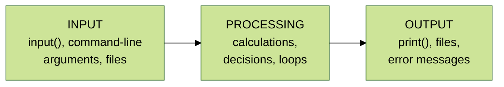
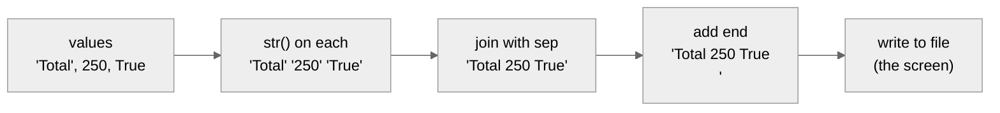
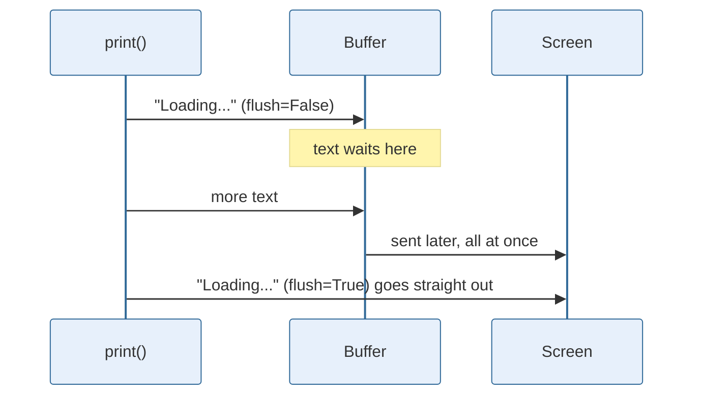
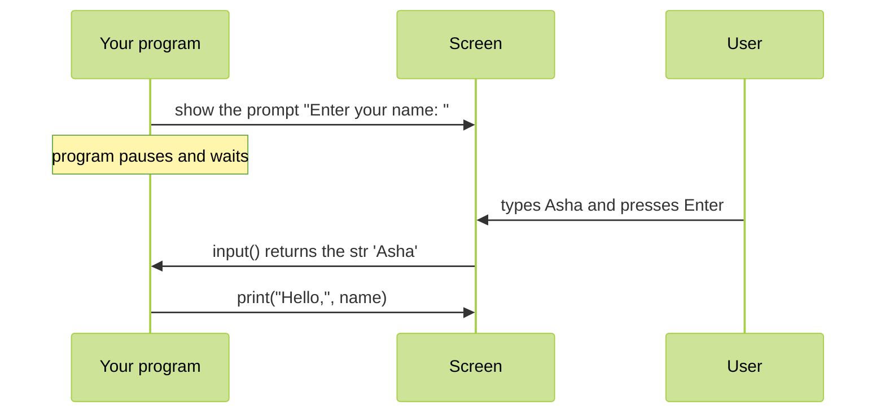
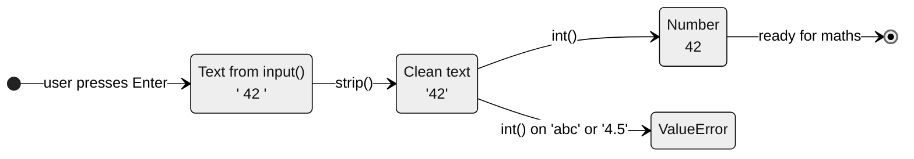
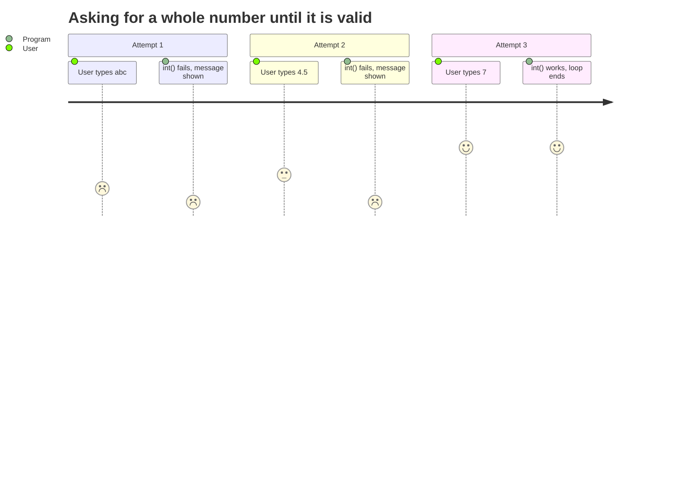
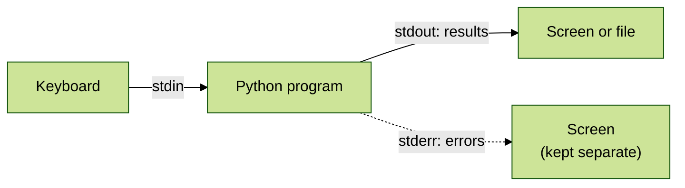
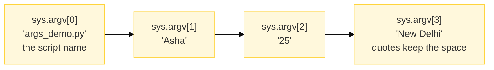
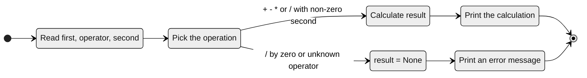

<p align="center">
  
</p>

# 03.2 Input and Output

A program is useful only when it can **talk** to people. It shows results (**output**) and receives data (**input**). In Python, the two everyday tools for this are `print()` and `input()`. This topic covers both in depth, plus command-line arguments, error output and a quick recap of formatting.

> **Extra topic.** This topic is not part of the syllabus PDFs. You use input and output in almost every program, so it gets its own topic.

**In this topic**

1. [The big picture: input, processing, output](#1-the-big-picture-input-processing-output)
2. [print(): the basics](#2-print-the-basics)
3. [print() with sep](#3-print-with-sep)
4. [print() with end](#4-print-with-end)
5. [print() with file and flush](#5-print-with-file-and-flush)
6. [Formatting output: a quick recap](#6-formatting-output-a-quick-recap)
7. [input(): the basics](#7-input-the-basics)
8. [Converting input to numbers](#8-converting-input-to-numbers)
9. [Reading several values in one line](#9-reading-several-values-in-one-line)
10. [Handling bad input](#10-handling-bad-input)
11. [Why you must never use eval() on input](#11-why-you-must-never-use-eval-on-input)
12. [Standard streams: stdin, stdout and stderr](#12-standard-streams-stdin-stdout-and-stderr)
13. [Command-line arguments with sys.argv](#13-command-line-arguments-with-sysargv)
14. [Command-line arguments with argparse](#14-command-line-arguments-with-argparse)
15. [Complete programs](#15-complete-programs)
16. [Common errors](#16-common-errors)
17. [Quick revision](#17-quick-revision)
18. [Interview questions](#18-interview-questions)
19. [Practice questions](#19-practice-questions)

## 1. The big picture: input, processing, output

Almost every program follows the same three steps, often called **IPO**:



<table width="100%">
<tr>
<th align="left" width="16%">Step</th>
<th align="left" width="26%">Meaning</th>
<th align="left" width="24%">Python tools</th>
<th align="left" width="34%">Example in a shop bill</th>
</tr>
<tr><td><b>Input</b></td><td>Getting data into the program</td><td><code>input()</code>, <code>sys.argv</code>, <code>argparse</code></td><td>Ask for the price and quantity</td></tr>
<tr><td><b>Processing</b></td><td>Working on the data</td><td>Operators, <code>if</code>, loops, functions</td><td>Multiply, apply a discount</td></tr>
<tr><td><b>Output</b></td><td>Showing the result</td><td><code>print()</code>, <code>sys.stderr</code>, files</td><td>Print the bill</td></tr>
</table>

## 2. print(): the basics

`print()` shows values on the screen. Its full form is:

```text
print(*values, sep=' ', end='\n', file=sys.stdout, flush=False)
```

<table width="100%">
<tr>
<th align="left" width="14%">Parameter</th>
<th align="left" width="16%">Default</th>
<th align="left" width="40%">What it controls</th>
<th align="left" width="30%">Section</th>
</tr>
<tr><td><code>*values</code></td><td>nothing</td><td>Any number of values to show, of any type</td><td>This section</td></tr>
<tr><td><code>sep</code></td><td><code>' '</code> (a space)</td><td>What goes <b>between</b> the values</td><td><a href="#3-print-with-sep">Section 3</a></td></tr>
<tr><td><code>end</code></td><td><code>'\n'</code> (new line)</td><td>What goes <b>after</b> the last value</td><td><a href="#4-print-with-end">Section 4</a></td></tr>
<tr><td><code>file</code></td><td><code>sys.stdout</code> (the screen)</td><td><b>Where</b> the text goes</td><td><a href="#5-print-with-file-and-flush">Section 5</a></td></tr>
<tr><td><code>flush</code></td><td><code>False</code></td><td>Whether to show the text <b>immediately</b></td><td><a href="#5-print-with-file-and-flush">Section 5</a></td></tr>
</table>

What `print()` does with your values, step by step:



```python
# Print one string
print("Hello, World!")

# Print a number
print(2026)

# Print a decimal number
print(3.75)

# Print a Boolean value
print(True)

# Print None
print(None)

# Print a list
print([10, 20, 30])

# Print a dictionary
print({"name": "Asha", "age": 25})

# Print several values: a space is added between them
print("Name:", "Asha", "Age:", 25)

# Print the result of a calculation
print(10 * 5 + 2)

# Print the result of a function call
print(len("Python"))

# print() with no values prints an empty line
print()

# Print text that contains quotes
print('She said "hi"')

# Print a value from a variable
city = "Pune"

# Variables are printed by their value, not their name
print(city)

# The * in front of a list "unpacks" it into separate values
print(*[1, 2, 3])

# print() itself returns None
result = print("printing...")

# Show what print() returned
print(result)
```

**Output**

```text
Hello, World!
2026
3.75
True
None
[10, 20, 30]
{'name': 'Asha', 'age': 25}
Name: Asha Age: 25
52
6

She said "hi"
Pune
1 2 3
printing...
None
```

### str() vs repr(): two ways to show a value

`print()` uses `str()`, the friendly form for people. `repr()` gives the exact form a programmer would type, which is useful for spotting spaces and quotes.

```python
# A string with a space at the end
text = "Asha "

# print() shows the friendly form: the trailing space is invisible
print(text)

# repr() shows the quotes, so the space is visible
print(repr(text))

# A string with a tab and a new line inside
code = "a\tb\n"

# repr() shows the escape characters instead of acting on them
print(repr(code))

# For numbers, both forms look the same
print(str(42), repr(42))

# f-strings: !r means use repr()
print(f"{text!r}")
```

**Output**

```text
Asha 
'Asha '
'a\tb\n'
42 42
'Asha '
```

## 3. print() with sep

`sep` (separator) is the text placed **between** the values. The default is a single space.

```python
# Default separator: one space
print("a", "b", "c")

# No separator at all
print("a", "b", "c", sep="")

# A comma and a space
print("red", "green", "blue", sep=", ")

# A dash, to build a date
print(2026, 11, 12, sep="-")

# A slash, to build a date in another style
print(12, 11, 2026, sep="/")

# A colon, to build a time
print(9, 30, 0, sep=":")

# A new line: each value on its own line
print("line 1", "line 2", "line 3", sep="\n")

# A tab: values in columns
print("Name", "Age", "City", sep="\t")

# A longer separator
print("Home", "Products", "Laptops", sep=" > ")

# sep works with numbers too
print(1, 2, 3, 4, 5, sep=" + ")

# With only one value, sep is never used
print("alone", sep="***")

# Combine sep with unpacking a list
print(*["2026", "11", "12"], sep=".")

# Build a file path
print("home", "asha", "notes.txt", sep="/")

# An email address from its parts
print("asha", "example.com", sep="@")
```

**Output**

```text
a b c
abc
red, green, blue
2026-11-12
12/11/2026
9:30:0
line 1
line 2
line 3
Name	Age	City
Home > Products > Laptops
1 + 2 + 3 + 4 + 5
alone
2026.11.12
home/asha/notes.txt
asha@example.com
```

## 4. print() with end

`end` is the text added **after** the last value. The default is `'\n'`, a new line, which is why each `print()` normally starts a new line.

```python
# Default end: this print finishes with a new line
print("first")

# So this one starts on a new line
print("second")

# end="" keeps the next print on the same line
print("Hello, ", end="")

# This continues the same line
print("World!")

# end=" " puts a space instead of a new line
print("one", end=" ")

# Still on the same line
print("two", end=" ")

# The default end finishes the line
print("three")

# Print a loop on one line
for number in range(1, 6):

    # A comma and space after each number
    print(number, end=", ")

# Finish the line with an empty print()
print()

# end can be any text
print("Loading", end="...")

# Continues after the three dots
print("done")

# Two new lines leave an empty line after the text
print("Paragraph 1", end="\n\n")

# Starts after the empty line
print("Paragraph 2")

# sep and end together
print("a", "b", "c", sep="-", end=" <- letters\n")

# Draw a row of stars with a loop
for star in range(5):

    # No new line, just a space
    print("*", end=" ")

# Move to the next line
print()

# Print a countdown on one line
for count in range(3, 0, -1):

    # A space after each number
    print(count, end=" ")

# Final word on the same line
print("Go!")
```

**Output**

```text
first
second
Hello, World!
one two three
1, 2, 3, 4, 5, 
Loading...done
Paragraph 1

Paragraph 2
a-b-c <- letters
* * * * * 
3 2 1 Go!
```

### A small pattern with sep and end

```python
# Print a 3 by 4 grid of numbers
for row in range(1, 4):

    # Print each column on the same line
    for column in range(1, 5):

        # Width 4, no new line after each number
        print(f"{row * column:4}", end="")

    # End the row with a new line
    print()
```

**Output**

```text
   1   2   3   4
   2   4   6   8
   3   6   9  12
```

**How this program runs:** the outer loop runs once for each row. Inside it, the inner loop prints 4 numbers on the **same** line because `end=""`. After the inner loop, the empty `print()` moves to a new line, ready for the next row. You will learn loops in detail in [Topic 05](../05.%20Flow%20control/README.md) and patterns in Topic 17.

## 5. print() with file and flush

### file: where the output goes

By default, `print()` writes to `sys.stdout`, the screen. With `file=` you can send the text somewhere else, such as a file or the error stream.

```python
# Load the sys module to reach the standard streams
import sys

# These two lines do exactly the same thing
print("to the screen")

# Writing to sys.stdout is what print() does by default
print("to the screen", file=sys.stdout)

# sys.stdout.write() is the lower-level way: no sep, no automatic new line
sys.stdout.write("written directly\n")

# Open a file for writing; print() can write into it
with open("greeting.txt", "w") as out_file:

    # This line goes into the file, not to the screen
    print("Hello from a file!", file=out_file)

    # sep and end still work when printing to a file
    print("a", "b", "c", sep=",", file=out_file)

# Open the same file for reading
with open("greeting.txt") as in_file:

    # Show what was written
    print(in_file.read(), end="")
```

**Output**

```text
to the screen
to the screen
written directly
Hello from a file!
a,b,c
```

> `with open(...)` opens a file and closes it automatically at the end of the block. You will learn file handling in [Topic 13](../13.%20File%20handling/README.md).

### Printing into a string with io.StringIO

```python
# Load StringIO, which behaves like a file but stores text in memory
from io import StringIO

# Create an empty in-memory "file"
buffer = StringIO()

# Print into it instead of the screen
print("Report line 1", file=buffer)

# Print a second line into it
print("Report line 2", file=buffer)

# Get everything that was printed, as one string
text = buffer.getvalue()

# Show the captured text with repr() so the new lines are visible
print(repr(text))
```

**Output**

```text
'Report line 1\nReport line 2\n'
```

### flush: show the text now

Python collects printed text in a **buffer** and sends it out in batches, because this is faster. Usually you do not notice. But when a program prints a message, then does slow work, the message may appear late. `flush=True` forces the text out **immediately**.



```python
# Load the time module to create a short pause
import time

# Show the message at once, even though there is no new line yet
print("Downloading", end="", flush=True)

# Print three dots, one at a time
for step in range(3):

    # Pretend to do slow work
    time.sleep(0.1)

    # Each dot appears immediately
    print(".", end="", flush=True)

# Finish the line
print(" done")
```

**Output**

```text
Downloading... done
```

## 6. Formatting output: a quick recap

[Topic 03.1](../03.1%20Strings/README.md#15-formatting-with-f-strings) covers formatting in depth. Here are the patterns you will use most when printing results.

```python
# A name to show
name = "Asha"

# A price with many decimals
price = 1234.5

# A percentage stored as a fraction
rate = 0.075

# Put values into text with an f-string
print(f"Customer: {name}")

# Exactly 2 decimal places
print(f"Price: {price:.2f}")

# Thousands separator and 2 decimals
print(f"Price: {price:,.2f}")

# Percentage with 1 decimal place
print(f"Tax rate: {rate:.1%}")

# Left align in 10 characters, then a value
print(f"{'Item':<10}|")

# Right align in 10 characters
print(f"{'Total':>10}|")

# Centre a title with a fill character
print(f"{' BILL ':=^24}")

# Zero padding for an invoice number
print(f"Invoice #{42:05d}")

# The same result with the older % style
print("Price: %.2f" % price)

# The same result with str.format()
print("Price: {:.2f}".format(price))
```

**Output**

```text
Customer: Asha
Price: 1234.50
Price: 1,234.50
Tax rate: 7.5%
Item      |
     Total|
========= BILL =========
Invoice #00042
Price: 1234.50
Price: 1234.50
```

## 7. input(): the basics

`input()` pauses the program, waits for the user to type something and press **Enter**, and returns what they typed.

```text
variable = input(prompt)
```



> **How to read the outputs below.** `input()` examples need a person typing, so they cannot run automatically. Each output shows what you see in the terminal, with what the user typed written after the prompt. The typed text is stated above each output.

```python
# Show a prompt and wait; store whatever the user types
name = input("Enter your name: ")

# Use the value
print("Hello,", name)
```

**Output** (the user types `Asha`)

```text
Enter your name: Asha
Hello, Asha
```

### input() always returns a string

This is the most important fact about `input()`. Even if the user types digits, you get **text**:

```python
# The user types a number
value = input("Type a number: ")

# Show the value and its type
print(value, type(value))

# * on a string repeats it; it does not multiply
print(value * 2)
```

**Output** (the user types `25`)

```text
Type a number: 25
25 <class 'str'>
2525
```

`"25" * 2` repeats the text and gives `"2525"`, not `50`. You must convert the text to a number first (see [Section 8](#8-converting-input-to-numbers)).

### More input() variations

<table width="100%">
<tr>
<th align="left" width="6%">#</th>
<th align="left" width="34%">Code</th>
<th align="left" width="18%">User types</th>
<th align="left" width="18%">Value stored</th>
<th align="left" width="24%">Note</th>
</tr>
<tr><td>1</td><td><code>input("Name: ")</code></td><td><code>Asha</code></td><td><code>'Asha'</code></td><td>Prompt shown first</td></tr>
<tr><td>2</td><td><code>input()</code></td><td><code>Asha</code></td><td><code>'Asha'</code></td><td>No prompt: the cursor just waits</td></tr>
<tr><td>3</td><td><code>input("Age: ")</code></td><td><code>25</code></td><td><code>'25'</code></td><td>Text, not a number</td></tr>
<tr><td>4</td><td><code>input("Price: ")</code></td><td><code>99.50</code></td><td><code>'99.50'</code></td><td>Text, not a float</td></tr>
<tr><td>5</td><td><code>input("City: ")</code></td><td>(just Enter)</td><td><code>''</code></td><td>Empty string</td></tr>
<tr><td>6</td><td><code>input("Name: ")</code></td><td><code>&nbsp;&nbsp;Asha&nbsp;&nbsp;</code></td><td><code>'  Asha  '</code></td><td>Spaces are kept; use <code>.strip()</code></td></tr>
<tr><td>7</td><td><code>input("Name: ").strip()</code></td><td><code>&nbsp;&nbsp;Asha&nbsp;&nbsp;</code></td><td><code>'Asha'</code></td><td>Spaces removed</td></tr>
<tr><td>8</td><td><code>input("Yes/No: ").lower()</code></td><td><code>YES</code></td><td><code>'yes'</code></td><td>Easy to compare</td></tr>
<tr><td>9</td><td><code>input("Name: ").title()</code></td><td><code>asha patil</code></td><td><code>'Asha Patil'</code></td><td>Tidy capitals</td></tr>
<tr><td>10</td><td><code>input("Words: ").split()</code></td><td><code>red green blue</code></td><td><code>['red', 'green', 'blue']</code></td><td>A list of words</td></tr>
<tr><td>11</td><td><code>int(input("Age: "))</code></td><td><code>25</code></td><td><code>25</code></td><td>Converted to int</td></tr>
<tr><td>12</td><td><code>float(input("Price: "))</code></td><td><code>99.50</code></td><td><code>99.5</code></td><td>Converted to float</td></tr>
</table>

### A prompt on its own line

```python
# Print the question on its own line
print("Enter your name:")

# input() with no prompt: the user types on the next line
name = input()

# Use the value
print("Hi", name)
```

**Output** (the user types `Ravi`)

```text
Enter your name:
Ravi
Hi Ravi
```

### Cleaning the answer before using it

```python
# Remove extra spaces and make the answer small letters in one line
answer = input("Continue? (yes/no): ").strip().lower()

# Accept both "yes" and "y"
print("Continuing" if answer in ("yes", "y") else "Stopping")
```

**Output** (the user types `  YES ` with spaces around it)

```text
Continue? (yes/no):   YES 
Continuing
```

**How this program runs:** `input()` returns `'  YES '`. `.strip()` removes the spaces, giving `'YES'`, and `.lower()` gives `'yes'`. Because `'yes'` is in the tuple `("yes", "y")`, the program prints `Continuing`. Cleaning input like this makes your program forgiving about how people type.

## 8. Converting input to numbers

Wrap `input()` in a conversion function to get a number:

<table width="100%">
<tr>
<th align="left" width="28%">Code</th>
<th align="left" width="16%">User types</th>
<th align="left" width="20%">Result</th>
<th align="left" width="36%">Note</th>
</tr>
<tr><td><code>int(input())</code></td><td><code>42</code></td><td><code>42</code></td><td>Whole numbers only</td></tr>
<tr><td><code>int(input())</code></td><td><code>-7</code></td><td><code>-7</code></td><td>A minus sign is fine</td></tr>
<tr><td><code>int(input())</code></td><td><code>&nbsp;42&nbsp;</code></td><td><code>42</code></td><td><code>int()</code> ignores spaces around the number</td></tr>
<tr><td><code>int(input())</code></td><td><code>4.5</code></td><td><code>ValueError</code></td><td>Use <code>float()</code> for decimals</td></tr>
<tr><td><code>int(input())</code></td><td><code>twenty</code></td><td><code>ValueError</code></td><td>Words are not numbers</td></tr>
<tr><td><code>float(input())</code></td><td><code>4.5</code></td><td><code>4.5</code></td><td>Decimals</td></tr>
<tr><td><code>float(input())</code></td><td><code>42</code></td><td><code>42.0</code></td><td>Whole numbers work too</td></tr>
<tr><td><code>float(input())</code></td><td><code>1e3</code></td><td><code>1000.0</code></td><td>Scientific notation works</td></tr>
<tr><td><code>int(float(input()))</code></td><td><code>4.9</code></td><td><code>4</code></td><td>Accept a decimal, keep the whole part</td></tr>
<tr><td><code>int(input(), 2)</code></td><td><code>1010</code></td><td><code>10</code></td><td>Read a binary number</td></tr>
</table>

```python
# Read the first whole number
first = int(input("First number: "))

# Read the second whole number
second = int(input("Second number: "))

# Add them as numbers, not as text
print("Sum:", first + second)
```

**Output** (the user types `10` and then `20`)

```text
First number: 10
Second number: 20
Sum: 30
```

```python
# Read a price as a decimal number
price = float(input("Price: "))

# Add 18 percent tax and round to 2 decimal places
print("With 18% tax:", round(price * 1.18, 2))
```

**Output** (the user types `450`)

```text
Price: 450
With 18% tax: 531.0
```



## 9. Reading several values in one line

Users often type several values on one line, separated by spaces or commas. Combine `input()` with `split()` and `map()`.

<table width="100%">
<tr>
<th align="left" width="6%">#</th>
<th align="left" width="38%">Code</th>
<th align="left" width="18%">User types</th>
<th align="left" width="38%">Result</th>
</tr>
<tr><td>1</td><td><code>input().split()</code></td><td><code>10 20 30</code></td><td><code>['10', '20', '30']</code> (still text)</td></tr>
<tr><td>2</td><td><code>input().split(",")</code></td><td><code>10,20,30</code></td><td><code>['10', '20', '30']</code></td></tr>
<tr><td>3</td><td><code>map(int, input().split())</code></td><td><code>10 20 30</code></td><td>A map object that gives 10, 20, 30</td></tr>
<tr><td>4</td><td><code>list(map(int, input().split()))</code></td><td><code>10 20 30</code></td><td><code>[10, 20, 30]</code></td></tr>
<tr><td>5</td><td><code>a, b = input().split()</code></td><td><code>Asha Pune</code></td><td><code>a='Asha'</code>, <code>b='Pune'</code></td></tr>
<tr><td>6</td><td><code>a, b = map(int, input().split())</code></td><td><code>4 7</code></td><td><code>a=4</code>, <code>b=7</code></td></tr>
<tr><td>7</td><td><code>[int(x) for x in input().split()]</code></td><td><code>1 2 3</code></td><td><code>[1, 2, 3]</code> (same as #4)</td></tr>
<tr><td>8</td><td><code>sum(map(int, input().split()))</code></td><td><code>1 2 3</code></td><td><code>6</code></td></tr>
</table>

**What does `map()` do?** `map(function, items)` applies the function to **every** item. `map(int, ["10", "20"])` gives `10` and `20`. You will learn it properly in Topic 10.1.

```python
# Read one line and split it into two words
data = input("Enter name and city: ")

# Unpack the two words into two names
name, city = data.split()

# Use both values
print(name, "lives in", city)
```

**Output** (the user types `Asha Pune`)

```text
Enter name and city: Asha Pune
Asha lives in Pune
```

```python
# Read three numbers on one line and convert each one to int
a, b, c = map(int, input("Enter three numbers: ").split())

# Add them
print("Total:", a + b + c)
```

**Output** (the user types `10 20 30`)

```text
Enter three numbers: 10 20 30
Total: 60
```

```python
# Read marks separated by commas and convert each one to float
numbers = list(map(float, input("Enter marks separated by commas: ").split(",")))

# Show the list of numbers
print(numbers)

# Work out the average
print("Average:", sum(numbers) / len(numbers))
```

**Output** (the user types `78,85.5,92`)

```text
Enter marks separated by commas: 78,85.5,92
[78.0, 85.5, 92.0]
Average: 85.16666666666667
```

If the user types the wrong number of values, unpacking fails:

```python
# Expect exactly three numbers
a, b, c = map(int, input("Enter three numbers: ").split())
```

**Output** (the user types only `10 20`; last line of the error message)

```text
Enter three numbers: 10 20
ValueError: not enough values to unpack (expected 3, got 2)
```

## 10. Handling bad input

People make typing mistakes. If you convert bad text with `int()`, the program crashes:

```python
# The user may type something that is not a number
age = int(input("Your age: "))

# This line is never reached when the input is bad
print(age)
```

**Output** (the user types `twenty`; last line of the error message)

```text
Your age: twenty
ValueError: invalid literal for int() with base 10: 'twenty'
```

The fix is to **try** the conversion and **catch** the error. You will learn `try` and `except` fully in [Topic 14](../14.%20Exception%20handling/README.md). Here is the common pattern: keep asking until the input is valid.

```python
# Repeat until we get a valid whole number
while True:

    # Ask for the input as text
    text = input("Enter a whole number: ")

    # Try to convert it
    try:

        # This line raises ValueError if the text is not a whole number
        number = int(text)

        # Conversion worked, so leave the loop
        break

    # Run this block only when int() fails
    except ValueError:

        # Explain the problem and loop again
        print(f"'{text}' is not a whole number. Try again.")

# Here the number is guaranteed to be valid
print("You entered", number)
```

**Output** (the user types `abc`, then `4.5`, then `7`)

```text
Enter a whole number: abc
'abc' is not a whole number. Try again.
Enter a whole number: 4.5
'4.5' is not a whole number. Try again.
Enter a whole number: 7
You entered 7
```

**How this program runs**



1. `while True:` starts a loop that repeats until `break`.
2. `int(text)` is tried inside `try`. For `abc` and `4.5`, it raises `ValueError`, so Python jumps to `except`, prints a message, and the loop asks again.
3. For `7`, the conversion works, `break` ends the loop, and the last line prints the valid number.

## 11. Why you must never use eval() on input

`eval()` takes a string and **runs it as Python code**. Some old tutorials use `eval(input())` to read numbers or lists. This is **dangerous**: the user can type any Python code, and your program will run it, including code that deletes files or reads secrets.

```python
# eval() runs a string as Python code and returns the result
print(eval("2 + 3 * 4"))

# It can build a list from text
print(eval("[1, 2, 3]"))

# But it runs ANY expression, including function calls
print(eval("len('hello') * 100"))
```

**Output**

```text
14
[1, 2, 3]
500
```

If `eval()` can call `len()`, it can call anything else, for example a function that deletes your files. **Never pass user input to `eval()`.**

**Safe alternatives**

<table width="100%">
<tr>
<th align="left" width="26%">You want</th>
<th align="left" width="34%">Safe code</th>
<th align="left" width="40%">Why it is safe</th>
</tr>
<tr><td>A whole number</td><td><code>int(input())</code></td><td>Accepts only number text</td></tr>
<tr><td>A decimal number</td><td><code>float(input())</code></td><td>Accepts only number text</td></tr>
<tr><td>A list, tuple or dict typed as text</td><td><code>ast.literal_eval(input())</code></td><td>Accepts only literal values, never function calls</td></tr>
<tr><td>Data from other programs</td><td><code>json.loads(text)</code></td><td>Accepts only JSON data (Topic 23.1)</td></tr>
</table>

```python
# Load the ast module, which has a safe evaluator for literal values
import ast

# Safe: a list written as text becomes a real list
print(ast.literal_eval("[1, 2, 3]"))

# Safe: a dictionary written as text
print(ast.literal_eval("{'a': 1, 'b': 2}"))

# Safe: a tuple written as text
print(ast.literal_eval("(4, 5)"))

# Try something that is not a plain literal
try:

    # A function call is refused instead of being run
    ast.literal_eval("len('hello')")

# literal_eval() raises ValueError for anything that is not a literal
except ValueError:

    # Report the refusal
    print("Refused: function calls are not allowed")
```

**Output**

```text
[1, 2, 3]
{'a': 1, 'b': 2}
(4, 5)
Refused: function calls are not allowed
```

## 12. Standard streams: stdin, stdout and stderr

Every running program has three **standard streams**, which are channels for text:

<table width="100%">
<tr>
<th align="left" width="14%">Stream</th>
<th align="left" width="18%">In Python</th>
<th align="left" width="22%">Direction</th>
<th align="left" width="22%">Used by</th>
<th align="left" width="24%">Purpose</th>
</tr>
<tr><td><b>stdin</b></td><td><code>sys.stdin</code></td><td>Into the program</td><td><code>input()</code></td><td>Reading what the user types</td></tr>
<tr><td><b>stdout</b></td><td><code>sys.stdout</code></td><td>Out of the program</td><td><code>print()</code></td><td>Normal results</td></tr>
<tr><td><b>stderr</b></td><td><code>sys.stderr</code></td><td>Out of the program</td><td><code>print(..., file=sys.stderr)</code>, error tracebacks</td><td>Errors and warnings</td></tr>
</table>



Both stdout and stderr appear on the screen by default. The difference matters when you **redirect** output, for example to save results into a file: errors still appear on the screen instead of being mixed into the results.

```python
# Load the sys module
import sys

# A normal result goes to stdout
print("normal output")

# An error message goes to stderr
print("error message", file=sys.stderr)
```

Save this as `err.py` and run it in three ways:

<table width="100%">
<tr>
<th align="left" width="38%">Command</th>
<th align="left" width="28%">What you see</th>
<th align="left" width="34%">Why</th>
</tr>
<tr><td><code>python3 err.py</code></td><td>normal output<br/>error message</td><td>Both streams go to the screen</td></tr>
<tr><td><code>python3 err.py 2&gt;/dev/null</code></td><td>normal output</td><td><code>2&gt;</code> redirects stderr away</td></tr>
<tr><td><code>python3 err.py &gt;/dev/null</code></td><td>error message</td><td><code>&gt;</code> redirects stdout away</td></tr>
</table>

> On Windows, use `NUL` instead of `/dev/null`.

## 13. Command-line arguments with sys.argv

Instead of asking questions while the program runs, you can give values **when you start it**:

```bash
# Run the program and pass three values after its name
python3 args_demo.py Asha 25 "New Delhi"
```

Python puts these words into the list `sys.argv` (**arg**ument **v**ector):



```python
# Load the sys module, which holds argv
import sys

# Item 0 is always the script name
print("Script name:", sys.argv[0])

# The whole list
print("All arguments:", sys.argv)

# The number of real arguments (without the script name)
print("Number of arguments:", len(sys.argv) - 1)

# Show each argument with its position and type
for position, value in enumerate(sys.argv[1:], start=1):

    # Every argument is a string
    print(f"Argument {position}: {value!r} is a {type(value).__name__}")
```

**Output** of `python3 args_demo.py Asha 25 "New Delhi"`

```text
Script name: args_demo.py
All arguments: ['args_demo.py', 'Asha', '25', 'New Delhi']
Number of arguments: 3
Argument 1: 'Asha' is a str
Argument 2: '25' is a str
Argument 3: 'New Delhi' is a str
```

**Output** of `python3 args_demo.py` (no arguments)

```text
Script name: args_demo.py
All arguments: ['args_demo.py']
Number of arguments: 0
```

Like `input()`, **every argument is a string**. Convert numbers yourself.

### A program that adds two numbers from the command line

```python
# Load the sys module
import sys

# We need exactly 2 numbers, plus the script name, so 3 items
if len(sys.argv) != 3:

    # Explain how to use the program, on the error stream
    print("Usage: python3 add_args.py <number1> <number2>", file=sys.stderr)

    # Stop the program with exit code 1, which means "failed"
    sys.exit(1)

# Convert the first argument to a number
first = float(sys.argv[1])

# Convert the second argument to a number
second = float(sys.argv[2])

# Print the sum
print(f"{first} + {second} = {first + second}")
```

**Output** of `python3 add_args.py 10 2.5`

```text
10.0 + 2.5 = 12.5
```

**Output** of `python3 add_args.py 10` (one number missing)

```text
Usage: python3 add_args.py <number1> <number2>
```

**How this program runs:** `len(sys.argv)` is 3 only when two numbers are given. Otherwise, the program prints a usage message to stderr and calls `sys.exit(1)`, which stops it with **exit code 1**. Exit code 0 means success, anything else means failure. Other programs and scripts can check this code.

## 14. Command-line arguments with argparse

For anything more than one or two arguments, use the standard library module `argparse`. It checks the arguments, converts types, and builds a `--help` message for you.

```python
# Load the argparse module
import argparse

# Create a parser with a short description of the program
parser = argparse.ArgumentParser(description="Greet a person.")

# A required positional argument
parser.add_argument("name", help="the person's name")

# An optional argument that must be a whole number, default 1
parser.add_argument("--times", type=int, default=1, help="how many times to greet")

# An on/off switch: True if --shout is given
parser.add_argument("--shout", action="store_true", help="print in capital letters")

# Read and check the command-line arguments
args = parser.parse_args()

# Build the greeting
message = f"Hello, {args.name}!"

# Make it capital letters if --shout was given
if args.shout:

    # Replace the message with its capital letter version
    message = message.upper()

# Print the greeting the requested number of times
for _ in range(args.times):

    # Print one greeting
    print(message)
```

<table width="100%">
<tr>
<th align="left" width="40%">Command</th>
<th align="left" width="60%">Output</th>
</tr>
<tr><td><code>python3 greet_cli.py Asha</code></td><td><code>Hello, Asha!</code></td></tr>
<tr><td><code>python3 greet_cli.py Ravi --times 2 --shout</code></td><td><code>HELLO, RAVI!</code><br/><code>HELLO, RAVI!</code></td></tr>
<tr><td><code>python3 greet_cli.py</code></td><td><code>greet_cli.py: error: the following arguments are required: name</code></td></tr>
<tr><td><code>python3 greet_cli.py Asha --times two</code></td><td><code>greet_cli.py: error: argument --times: invalid int value: 'two'</code></td></tr>
</table>

**Output** of `python3 greet_cli.py --help` (written for you by argparse)

```text
usage: greet_cli.py [-h] [--times TIMES] [--shout] name

Greet a person.

positional arguments:
  name           the person's name

options:
  -h, --help     show this help message and exit
  --times TIMES  how many times to greet
  --shout        print in capital letters
```

<table width="100%">
<tr>
<th align="left" width="22%">Feature</th>
<th align="left" width="39%"><code>sys.argv</code></th>
<th align="left" width="39%"><code>argparse</code></th>
</tr>
<tr><td>Type conversion</td><td>You do it yourself</td><td><code>type=int</code> does it</td></tr>
<tr><td>Missing arguments</td><td>You check <code>len(sys.argv)</code></td><td>Clear error message automatically</td></tr>
<tr><td>Optional flags</td><td>You parse them yourself</td><td><code>--name</code> style options built in</td></tr>
<tr><td>Help message</td><td>You write it</td><td><code>--help</code> generated for you</td></tr>
<tr><td>Best for</td><td>Tiny scripts with 1 or 2 values</td><td>Any real command-line tool</td></tr>
</table>

## 15. Complete programs

### Program 1: Simple calculator

```python
# Read the first number
first = float(input("First number : "))

# Read the operator and remove any spaces around it
operator = input("Operator (+ - * /): ").strip()

# Read the second number
second = float(input("Second number: "))

# Addition
if operator == "+":

    # Add the numbers
    result = first + second

# Subtraction
elif operator == "-":

    # Subtract the second from the first
    result = first - second

# Multiplication
elif operator == "*":

    # Multiply the numbers
    result = first * second

# Division
elif operator == "/":

    # Dividing by zero is impossible
    if second == 0:

        # Mark the result as missing
        result = None

    # Otherwise divide normally
    else:

        # Divide the first by the second
        result = first / second

# Any other symbol
else:

    # Mark the result as missing
    result = None

# Report a problem if there is no result
if result is None:

    # Explain what went wrong
    print("Cannot calculate: check the operator, or division by zero.")

# Otherwise show the calculation
else:

    # :g shows numbers without unnecessary zeros
    print(f"{first:g} {operator} {second:g} = {result:g}")
```

**Output, run 1** (the user types `12`, `*`, `3.5`)

```text
First number : 12
Operator (+ - * /): *
Second number: 3.5
12 * 3.5 = 42
```

**Output, run 2** (the user types `10`, `/`, `0`)

```text
First number : 10
Operator (+ - * /): /
Second number: 0
Cannot calculate: check the operator, or division by zero.
```

**How this program runs**



1. Three `input()` calls read the numbers and the operator. The numbers are converted with `float()` so decimals work.
2. The `if` / `elif` chain checks the operator and runs exactly one calculation.
3. Division by zero and unknown operators set `result` to `None` instead of crashing.
4. At the end, `result is None` decides whether to print the answer or an error message. `:g` prints `42.0` as `42`.

### Program 2: Unit converter

```python
# Show the menu, one option per line
print("1. Celsius to Fahrenheit")

# Second option
print("2. Kilometres to miles")

# Third option
print("3. Kilograms to pounds")

# Read the user's choice as text and remove spaces
choice = input("Choose 1, 2 or 3: ").strip()

# Read the value to convert
value = float(input("Enter the value: "))

# Option 1: F = C x 9 / 5 + 32
if choice == "1":

    # Print the temperature with 1 decimal place
    print(f"{value:.1f} C = {value * 9 / 5 + 32:.1f} F")

# Option 2: 1 km is 0.621371 miles
elif choice == "2":

    # Print the distance with 2 decimal places
    print(f"{value:.2f} km = {value * 0.621371:.2f} miles")

# Option 3: 1 kg is 2.20462 pounds
elif choice == "3":

    # Print the weight with 2 decimal places
    print(f"{value:.2f} kg = {value * 2.20462:.2f} lb")

# Anything else
else:

    # Tell the user the choice was not valid
    print("Unknown choice:", choice)
```

**Output, run 1** (the user types `1`, then `37`)

```text
1. Celsius to Fahrenheit
2. Kilometres to miles
3. Kilograms to pounds
Choose 1, 2 or 3: 1
Enter the value: 37
37.0 C = 98.6 F
```

**Output, run 2** (the user types `2`, then `10`)

```text
1. Celsius to Fahrenheit
2. Kilometres to miles
3. Kilograms to pounds
Choose 1, 2 or 3: 2
Enter the value: 10
10.00 km = 6.21 miles
```

**How this program runs:** the menu is printed first. The choice stays as **text** (`"1"`, `"2"`, `"3"`), because we only compare it, never calculate with it. The value is converted with `float()` because we calculate with it. One branch of the `if` / `elif` chain runs, and the f-string prints the result with a fixed number of decimal places.

## 16. Common errors

<table width="100%">
<tr>
<th align="left" width="26%">Code</th>
<th align="left" width="34%">Problem</th>
<th align="left" width="20%">Cause</th>
<th align="left" width="20%">Fix</th>
</tr>
<tr><td><code>age = input(); age + 1</code></td><td><code>TypeError: can only concatenate str (not "int") to str</code></td><td><code>input()</code> returns text</td><td><code>int(input())</code></td></tr>
<tr><td><code>int(input())</code> with <code>4.5</code></td><td><code>ValueError: invalid literal for int() with base 10: '4.5'</code></td><td>Decimal text</td><td><code>float(input())</code></td></tr>
<tr><td><code>a, b = input().split()</code> with one word</td><td><code>ValueError: not enough values to unpack (expected 2, got 1)</code></td><td>Wrong number of values</td><td>Check <code>len()</code> first</td></tr>
<tr><td><code>"5" * 2</code></td><td>No error, but gives <code>'55'</code></td><td>Text repetition</td><td>Convert to int first</td></tr>
<tr><td><code>print("a" "b", sep="-")</code></td><td>No error, but prints <code>ab</code></td><td>Missing comma joins the strings into one value</td><td><code>print("a", "b", sep="-")</code></td></tr>
<tr><td><code>sys.argv[1]</code> with no arguments</td><td><code>IndexError: list index out of range</code></td><td>Nothing was passed</td><td>Check <code>len(sys.argv)</code></td></tr>
<tr><td><code>eval(input())</code></td><td>Security risk</td><td>Runs any code the user types</td><td><code>int()</code>, <code>float()</code>, <code>ast.literal_eval()</code></td></tr>
</table>

## 17. Quick revision

<table width="100%">
<tr>
<th align="left" width="6%">#</th>
<th align="left" width="36%">Question</th>
<th align="left" width="42%">Answer</th>
<th align="left" width="16%">Read again</th>
</tr>
<tr><td>1</td><td>Default <code>sep</code> and <code>end</code> of <code>print()</code></td><td>A space, and a new line</td><td><a href="#2-print-the-basics">Section 2</a></td></tr>
<tr><td>2</td><td>Print values with no space between them</td><td><code>sep=""</code></td><td><a href="#3-print-with-sep">Section 3</a></td></tr>
<tr><td>3</td><td>Keep the next print on the same line</td><td><code>end=""</code></td><td><a href="#4-print-with-end">Section 4</a></td></tr>
<tr><td>4</td><td>Send <code>print()</code> output to a file</td><td><code>print(..., file=f)</code></td><td><a href="#5-print-with-file-and-flush">Section 5</a></td></tr>
<tr><td>5</td><td>Show text immediately</td><td><code>flush=True</code></td><td><a href="#5-print-with-file-and-flush">Section 5</a></td></tr>
<tr><td>6</td><td>What does <code>print()</code> return?</td><td><code>None</code></td><td><a href="#2-print-the-basics">Section 2</a></td></tr>
<tr><td>7</td><td>Type returned by <code>input()</code></td><td>Always <code>str</code></td><td><a href="#7-input-the-basics">Section 7</a></td></tr>
<tr><td>8</td><td>Read a whole number</td><td><code>int(input())</code></td><td><a href="#8-converting-input-to-numbers">Section 8</a></td></tr>
<tr><td>9</td><td>Read three numbers on one line</td><td><code>a, b, c = map(int, input().split())</code></td><td><a href="#9-reading-several-values-in-one-line">Section 9</a></td></tr>
<tr><td>10</td><td>Survive bad input</td><td><code>try</code> / <code>except ValueError</code> in a loop</td><td><a href="#10-handling-bad-input">Section 10</a></td></tr>
<tr><td>11</td><td>Safe replacement for <code>eval()</code></td><td><code>ast.literal_eval()</code></td><td><a href="#11-why-you-must-never-use-eval-on-input">Section 11</a></td></tr>
<tr><td>12</td><td>Where error messages should go</td><td><code>sys.stderr</code></td><td><a href="#12-standard-streams-stdin-stdout-and-stderr">Section 12</a></td></tr>
<tr><td>13</td><td>What is <code>sys.argv[0]</code>?</td><td>The script name</td><td><a href="#13-command-line-arguments-with-sysargv">Section 13</a></td></tr>
<tr><td>14</td><td>Type of each command-line argument</td><td><code>str</code></td><td><a href="#13-command-line-arguments-with-sysargv">Section 13</a></td></tr>
<tr><td>15</td><td>Module for real command-line tools</td><td><code>argparse</code></td><td><a href="#14-command-line-arguments-with-argparse">Section 14</a></td></tr>
</table>

## 18. Interview questions

Try to answer each question aloud first, then click it to see a model answer.

<details>
<summary><b>Q1. What does <code>input()</code> return?</b></summary>

Always a string (`str`), even when the user types digits. The trailing new line from the Enter key is removed. Convert with `int()` or `float()` when you need a number.

</details>

<details>
<summary><b>Q2. What are <code>sep</code> and <code>end</code> in <code>print()</code>?</b></summary>

`sep` is placed between the values (default a space). `end` is placed after the last value (default a new line `"\n"`). For example, `print(1, 2, 3, sep="-", end="!")` prints `1-2-3!` with no new line.

</details>

<details>
<summary><b>Q3. How do you read several integers from one line?</b></summary>

`a, b, c = map(int, input().split())` for a fixed number, or `numbers = list(map(int, input().split()))` for any number. `split()` breaks the text into pieces and `map(int, ...)` converts each piece.

</details>

<details>
<summary><b>Q4. Why is <code>eval(input())</code> dangerous?</b></summary>

`eval()` runs any Python expression. A user could type code that deletes files, reads secrets or crashes the program, and `eval()` would run it. Use `int()`, `float()` or `ast.literal_eval()` instead.

</details>

<details>
<summary><b>Q5. What is the difference between <code>print()</code> and <code>sys.stdout.write()</code>?</b></summary>

`print()` accepts any number of values of any type, converts them with `str()`, adds `sep` between them and `end` after them. `sys.stdout.write()` accepts exactly one string, adds nothing (no space, no new line) and returns the number of characters written.

</details>

<details>
<summary><b>Q6. What is the difference between stdout and stderr?</b></summary>

Both are output streams that show on the screen by default. stdout is for normal results; stderr is for errors and warnings. Keeping them separate lets you redirect results to a file while errors still appear on the screen.

</details>

<details>
<summary><b>Q7. What is <code>sys.argv</code>?</b></summary>

A list of the command-line words used to start the program. `sys.argv[0]` is the script name, and the arguments follow from index 1. All items are strings.

</details>

<details>
<summary><b>Q8. Why use <code>argparse</code> instead of <code>sys.argv</code>?</b></summary>

`argparse` validates the arguments, converts their types, supports optional `--flags` and default values, shows clear error messages, and builds a `--help` message automatically. With `sys.argv` you must do all of that yourself.

</details>

<details>
<summary><b>Q9. What does <code>flush=True</code> do?</b></summary>

Output is usually buffered and sent in batches. `flush=True` sends the text out immediately. It is useful for progress messages printed without a new line before slow work.

</details>

<details>
<summary><b>Q10. How do you handle invalid input without crashing?</b></summary>

Put the conversion inside `try`, catch `ValueError` in `except`, show a message, and ask again in a `while True` loop that ends with `break` once the value is valid.

</details>

<details>
<summary><b>Q11. What does <code>print()</code> return?</b></summary>

`None`. It is called for its effect (showing text), not for a result. So `x = print("hi")` prints `hi` and stores `None` in `x`.

</details>

<details>
<summary><b>Q12. What is the difference between <code>str()</code> and <code>repr()</code>?</b></summary>

`str()` gives a readable form for users and is what `print()` uses. `repr()` gives an unambiguous form for programmers, usually valid Python code, for example with quotes around strings and escape codes such as `\n` shown visibly.

</details>

## 19. Practice questions

1. Print your name, age and city on one line separated by ` | `, using one `print()` call and `sep`.
2. Print the numbers 1 to 10 on a single line separated by commas, with no comma after the last number.
3. Ask the user for their name and birth year. Print their age in 2026.
4. Read two decimal numbers on one line (for example `4.5 2`) and print their sum, difference, product and quotient, each with 2 decimal places.
5. Read a list of whole numbers on one line and print the largest, the smallest and the average.
6. Ask for a temperature in Fahrenheit and print it in Celsius: C = (F - 32) x 5 / 9.
7. Keep asking for a number between 1 and 10 until the user types a valid one. Handle both non-numbers and numbers out of range.
8. Write a script that prints its command-line arguments in reverse order, one per line.
9. Write a script `area.py` that takes `length` and `width` from `sys.argv` and prints the area. Print a usage message to stderr if they are missing.
10. Rewrite question 9 with `argparse`, adding an optional `--unit` argument with default `m`.
11. Print a receipt to a file named `receipt.txt` using `print(..., file=...)`, then read the file and print its contents.
12. Explain why `print("5" + "5")` and `print(5 + 5)` give different results.

<p align="center">
  <a href="../03.1%20Strings/README.md">Previous: 03.1 Strings</a> &nbsp;|&nbsp; <a href="../README.md">Course home</a> &nbsp;|&nbsp; <a href="../04.%20Operators/README.md">Next: 04. Operators</a>
</p>
