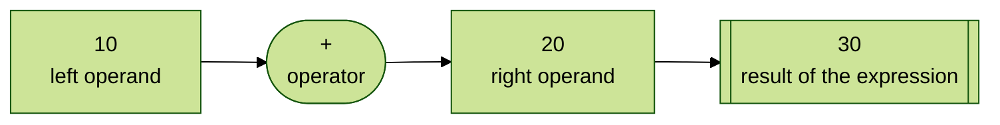
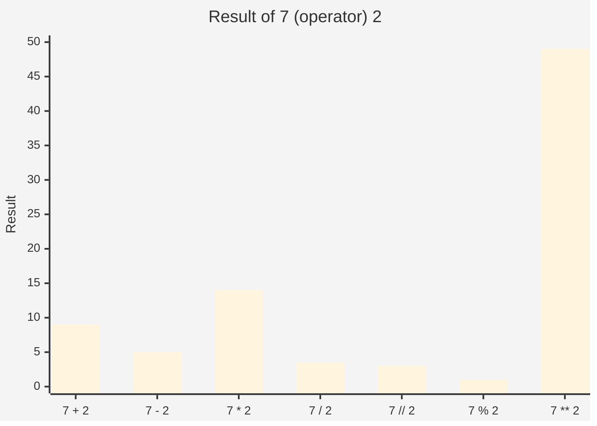
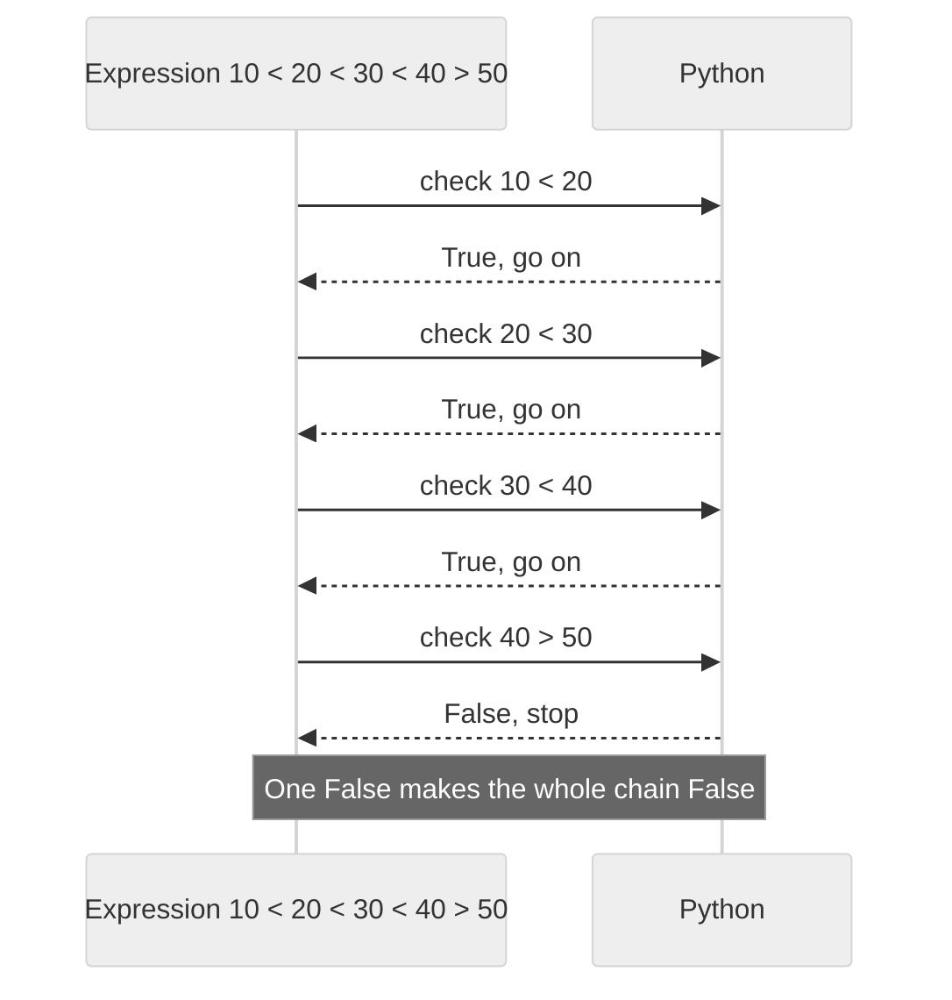
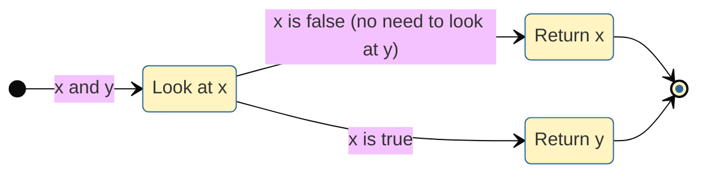
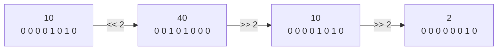
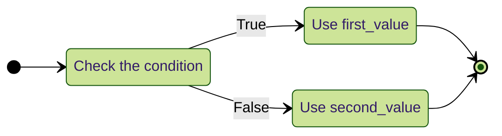
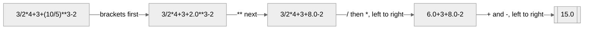
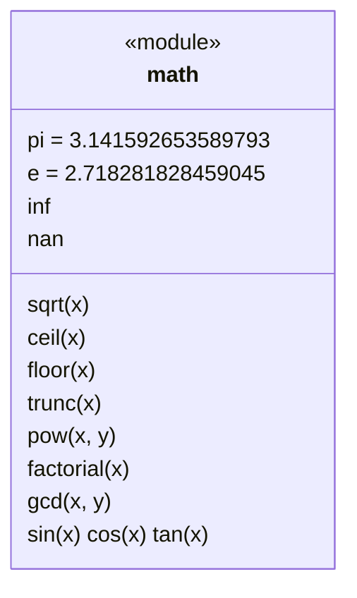
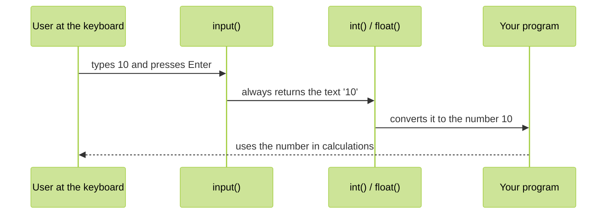

<p align="center">
  
</p>

# 04. Operators

Programs calculate, compare and decide. All of that is done with **operators**: small symbols such as `+`, `>`, `and` and `in`. This topic covers every operator family in Python, how Python decides which operator runs first, the `math` module, and the input and output statements from the syllabus notes.

**In this topic**

1. [What is an operator?](#1-what-is-an-operator)
2. [Arithmetic operators](#2-arithmetic-operators)
3. [Relational (comparison) operators](#3-relational-comparison-operators)
4. [Equality operators](#4-equality-operators)
5. [Logical operators](#5-logical-operators)
6. [Bitwise operators](#6-bitwise-operators)
7. [Assignment operators](#7-assignment-operators)
8. [Ternary operator](#8-ternary-operator)
9. [Special operators: identity and membership](#9-special-operators-identity-and-membership)
10. [Walrus operator :=](#10-walrus-operator-)
11. [Operator precedence and associativity](#11-operator-precedence-and-associativity)
12. [Mathematical functions: the math module](#12-mathematical-functions-the-math-module)
13. [Input and output statements](#13-input-and-output-statements)
14. [Command line arguments](#14-command-line-arguments)
15. [The print() function in detail](#15-the-print-function-in-detail)
16. [A complete program: number analyser](#16-a-complete-program-number-analyser)
17. [Common errors](#17-common-errors)
18. [Quick revision](#18-quick-revision)
19. [Interview questions](#19-interview-questions)
20. [Practice questions](#20-practice-questions)

## 1. What is an operator?

> **An operator is a symbol that performs a certain operation.**

The values an operator works on are called **operands**. Together they form an **expression**, which produces a result.



Python provides these operator families:

<table width="100%">
<tr>
<th align="left" width="5%">#</th>
<th align="left" width="22%">Family</th>
<th align="left" width="24%">Operators</th>
<th align="left" width="27%">Used for</th>
<th align="left" width="12%">Result type</th>
<th align="left" width="10%">Section</th>
</tr>
<tr><td>1</td><td>Arithmetic</td><td><code>+ - * / // % **</code></td><td>Calculations</td><td>Number</td><td><a href="#2-arithmetic-operators">2</a></td></tr>
<tr><td>2</td><td>Relational (comparison)</td><td><code>&gt; &gt;= &lt; &lt;=</code></td><td>Comparing order</td><td><code>bool</code></td><td><a href="#3-relational-comparison-operators">3</a></td></tr>
<tr><td>3</td><td>Equality</td><td><code>== !=</code></td><td>Same value or not</td><td><code>bool</code></td><td><a href="#4-equality-operators">4</a></td></tr>
<tr><td>4</td><td>Logical</td><td><code>and or not</code></td><td>Combining conditions</td><td>Any type</td><td><a href="#5-logical-operators">5</a></td></tr>
<tr><td>5</td><td>Bitwise</td><td><code>&amp; | ^ ~ &lt;&lt; &gt;&gt;</code></td><td>Working on individual bits</td><td><code>int</code></td><td><a href="#6-bitwise-operators">6</a></td></tr>
<tr><td>6</td><td>Assignment</td><td><code>= += -= *= ...</code></td><td>Storing values</td><td>-</td><td><a href="#7-assignment-operators">7</a></td></tr>
<tr><td>7</td><td>Ternary (conditional)</td><td><code>x if condition else y</code></td><td>Choosing between two values</td><td>Any type</td><td><a href="#8-ternary-operator">8</a></td></tr>
<tr><td>8</td><td>Special</td><td><code>is is not in not in</code></td><td>Identity and membership</td><td><code>bool</code></td><td><a href="#9-special-operators-identity-and-membership">9</a></td></tr>
</table>

Operators are also grouped by how many operands they take:

- **Unary**: one operand, for example `-x`, `not x`, `~x`.
- **Binary**: two operands, for example `a + b`, `a > b`.
- **Ternary**: three parts, for example `a if condition else b`.

## 2. Arithmetic operators

<table width="100%">
<tr>
<th align="left" width="10%">Operator</th>
<th align="left" width="22%">Name</th>
<th align="left" width="16%">Example</th>
<th align="left" width="12%">Result</th>
<th align="left" width="40%">Remember</th>
</tr>
<tr><td><code>+</code></td><td>Addition</td><td><code>10 + 3</code></td><td><code>13</code></td><td>Also joins strings</td></tr>
<tr><td><code>-</code></td><td>Subtraction</td><td><code>10 - 3</code></td><td><code>7</code></td><td>Also unary minus: <code>-x</code></td></tr>
<tr><td><code>*</code></td><td>Multiplication</td><td><code>10 * 3</code></td><td><code>30</code></td><td>Also repeats strings</td></tr>
<tr><td><code>/</code></td><td>Division</td><td><code>10 / 3</code></td><td><code>3.3333333333333335</code></td><td><b>Always</b> gives a float</td></tr>
<tr><td><code>//</code></td><td>Floor division</td><td><code>10 // 3</code></td><td><code>3</code></td><td>Rounds <b>down</b> to the nearest whole number</td></tr>
<tr><td><code>%</code></td><td>Modulo (remainder)</td><td><code>10 % 3</code></td><td><code>1</code></td><td>The remainder after floor division</td></tr>
<tr><td><code>**</code></td><td>Exponent (power)</td><td><code>10 ** 3</code></td><td><code>1000</code></td><td>10 x 10 x 10</td></tr>
</table>

The results of each operator for `7` and `2`:



### The example from the notes: two ints

**Example: Addition**

```python
# The first number
a = 10

# The second number
b = 2

# Addition
print('a+b=', a + b)
```

**Output**

```text
a+b= 12
```

**Example: Subtraction**

```python
# The first number
a = 10

# The second number
b = 2

# Subtraction
print('a-b=', a - b)
```

**Output**

```text
a-b= 8
```

**Example: Multiplication**

```python
# The first number
a = 10

# The second number
b = 2

# Multiplication
print('a*b=', a * b)
```

**Output**

```text
a*b= 20
```

**Example: Division: always a float**

```python
# The first number
a = 10

# The second number
b = 2

# Division: always a float
print('a/b=', a / b)
```

**Output**

```text
a/b= 5.0
```

**Example: Floor division: both are ints, so the result is an int**

```python
# The first number
a = 10

# The second number
b = 2

# Floor division: both are ints, so the result is an int
print('a//b=', a // b)
```

**Output**

```text
a//b= 5
```

**Example: Remainder**

```python
# The first number
a = 10

# The second number
b = 2

# Remainder
print('a%b=', a % b)
```

**Output**

```text
a%b= 0
```

**Example: Power: 10 to the power 2**

```python
# The first number
a = 10

# The second number
b = 2

# Power: 10 to the power 2
print('a**b=', a ** b)
```

**Output**

```text
a**b= 100
```

Save this as `test.py` and run it with `python3 test.py` (on Windows: `py test.py` or `python test.py`).

### The same operators with a float

**Example: Addition**

```python
# A float and an int
a = 10.5

# The second number
b = 2

# Addition
print('a+b=', a + b)
```

**Output**

```text
a+b= 12.5
```

**Example: Subtraction**

```python
# A float and an int
a = 10.5

# The second number
b = 2

# Subtraction
print('a-b=', a - b)
```

**Output**

```text
a-b= 8.5
```

**Example: Multiplication**

```python
# A float and an int
a = 10.5

# The second number
b = 2

# Multiplication
print('a*b=', a * b)
```

**Output**

```text
a*b= 21.0
```

**Example: Division**

```python
# A float and an int
a = 10.5

# The second number
b = 2

# Division
print('a/b=', a / b)
```

**Output**

```text
a/b= 5.25
```

**Example: Floor division: one operand is a float, so the result is a float**

```python
# A float and an int
a = 10.5

# The second number
b = 2

# Floor division: one operand is a float, so the result is a float
print('a//b=', a // b)
```

**Output**

```text
a//b= 5.0
```

**Example: Remainder of 10.5 divided by 2**

```python
# A float and an int
a = 10.5

# The second number
b = 2

# Remainder of 10.5 divided by 2
print('a%b=', a % b)
```

**Output**

```text
a%b= 0.5
```

**Example: Power: 10.5 x 10.5**

```python
# A float and an int
a = 10.5

# The second number
b = 2

# Power: 10.5 x 10.5
print('a**b=', a ** b)
```

**Output**

```text
a**b= 110.25
```

### / versus //

> `/` **always** performs floating point division, so it always returns a `float`.
> `//` can return an `int` or a `float`: if **both** operands are ints, the result is an int; if **at least one** is a float, the result is a float.

**Example: True division of two ints: still a float**

```python
# True division of two ints: still a float
print(10 / 2)
```

**Output**

```text
5.0
```

**Example: Floor division of two ints: an int**

```python
# Floor division of two ints: an int
print(10 // 2)
```

**Output**

```text
5
```

**Example: True division with a float**

```python
# True division with a float
print(10.0 / 2)
```

**Output**

```text
5.0
```

**Example: Floor division with a float: a float**

```python
# Floor division with a float: a float
print(10.0 // 2)
```

**Output**

```text
5.0
```

**Example: Floor division rounds DOWN, towards negative infinity**

```python
# Floor division rounds DOWN, towards negative infinity
print(7 // 2)
```

**Output**

```text
3
```

**Example: For negative results, "down" means further from zero**

```python
# For negative results, "down" means further from zero
print(-7 // 2)
```

**Output**

```text
-4
```

**Example: Compare with int(), which cuts towards zero**

```python
# Compare with int(), which cuts towards zero
print(int(-7 / 2))
```

**Output**

```text
-3
```

**Example: Floor division with a negative divisor**

```python
# Floor division with a negative divisor
print(7 // -2)
```

**Output**

```text
-4
```

### The remainder operator %

**Example: 17 divided by 5 is 3, remainder 2**

```python
# 17 divided by 5 is 3, remainder 2
print(17 % 5)
```

**Output**

```text
2
```

**Example: An even number has remainder 0 when divided by 2**

```python
# An even number has remainder 0 when divided by 2
print(10 % 2)
```

**Output**

```text
0
```

**Example: An odd number has remainder 1 when divided by 2**

```python
# An odd number has remainder 1 when divided by 2
print(7 % 2)
```

**Output**

```text
1
```

**Example: The last digit of a number**

```python
# The last digit of a number
print(1234 % 10)
```

**Output**

```text
4
```

**Example: The last two digits of a number**

```python
# The last two digits of a number
print(1234 % 100)
```

**Output**

```text
34
```

**Example: A smaller number divided by a bigger one: the remainder is the number itself**

```python
# A smaller number divided by a bigger one: the remainder is the number itself
print(3 % 7)
```

**Output**

```text
3
```

**Example: With negatives, the result takes the sign of the divisor**

```python
# With negatives, the result takes the sign of the divisor
print(-7 % 3)
```

**Output**

```text
2
```

**Example: Remainder works with floats too**

```python
# Remainder works with floats too
print(7.5 % 2)
```

**Output**

```text
1.5
```

**Example: `divmod()` gives floor division and remainder together**

```python
# divmod() gives floor division and remainder together
print(divmod(17, 5))
```

**Output**

```text
(3, 2)
```

### The power operator **

**Example: 2 to the power 10**

```python
# 2 to the power 10
print(2 ** 10)
```

**Output**

```text
1024
```

**Example: Any number to the power 0 is 1**

```python
# Any number to the power 0 is 1
print(5 ** 0)
```

**Output**

```text
1
```

**Example: A negative power gives a fraction: 1 / (2 x 2)**

```python
# A negative power gives a fraction: 1 / (2 x 2)
print(2 ** -2)
```

**Output**

```text
0.25
```

**Example: A power of 0.5 is the square root**

```python
# A power of 0.5 is the square root
print(16 ** 0.5)
```

**Output**

```text
4.0
```

**Example: A power of 1/3 is the cube root**

```python
# A power of 1/3 is the cube root
print(27 ** (1 / 3))
```

**Output**

```text
3.0
```

**Example: Very large results are fine, because int has no size limit**

```python
# Very large results are fine, because int has no size limit
print(2 ** 100)
```

**Output**

```text
1267650600228229401496703205376
```

**Example: ** is evaluated right to left: 2 ** (3 ** 2) = 2 ** 9**

```python
# ** is evaluated right to left: 2 ** (3 ** 2) = 2 ** 9
print(2 ** 3 ** 2)
```

**Output**

```text
512
```

**Example: Unary minus is applied AFTER **: -(2 ** 2)**

```python
# Unary minus is applied AFTER **: -(2 ** 2)
print(-2 ** 2)
```

**Output**

```text
-4
```

**Example: Use brackets to square a negative number**

```python
# Use brackets to square a negative number
print((-2) ** 2)
```

**Output**

```text
4
```

### + and * with strings

`+` and `*` also work on strings:

<table width="100%">
<tr>
<th align="left" width="16%">Operator</th>
<th align="left" width="26%">Name with strings</th>
<th align="left" width="30%">Rule</th>
<th align="left" width="28%">Example</th>
</tr>
<tr><td><code>+</code></td><td>String concatenation operator</td><td><b>Both</b> operands must be <code>str</code></td><td><code>"durga" + "10"</code> gives <code>'durga10'</code></td></tr>
<tr><td><code>*</code></td><td>String multiplication (repetition) operator</td><td>One operand <code>str</code>, the other <b>int</b></td><td><code>2 * "durga"</code> gives <code>'durgadurga'</code></td></tr>
</table>

**Example: Join two strings**

```python
# Join two strings
print("durga" + "10")
```

**Output**

```text
durga10
```

**Example: Repeat a string: int on the left**

```python
# Repeat a string: int on the left
print(2 * "durga")
```

**Output**

```text
durgadurga
```

**Example: Repeat a string: int on the right**

```python
# Repeat a string: int on the right
print("durga" * 2)
```

**Output**

```text
durgadurga
```

**Example: Repeat zero or negative times: empty string**

```python
# Repeat zero or negative times: empty string
print(repr("durga" * 0), repr("durga" * -1))
```

**Output**

```text
'' ''
```

**Example: Build a line of 15 dashes**

```python
# Build a line of 15 dashes
print("-" * 15)
```

**Output**

```text
---------------
```

**Example: + with two numbers is addition, not joining**

```python
# + with two numbers is addition, not joining
print(10 + 20)
```

**Output**

```text
30
```

**Example: Convert the number first if you want to join it**

```python
# Convert the number first if you want to join it
print("durga" + str(10))
```

**Output**

```text
durga10
```

The wrong combinations raise errors:

```python
# A string and an int cannot be joined with +
print("durga" + 10)
```

**Output** (last line of the error message)

```text
TypeError: can only concatenate str (not "int") to str
```

> The notes show the old error message `TypeError: must be str, not int`. Python 3.12 says `can only concatenate str (not "int") to str`.

```python
# A string cannot be repeated a decimal number of times
print(2.5 * "durga")
```

**Output** (last line of the error message)

```text
TypeError: can't multiply sequence by non-int of type 'float'
```

```python
# A string cannot be multiplied by another string
print("durga" * "durga")
```

**Output** (last line of the error message)

```text
TypeError: can't multiply sequence by non-int of type 'str'
```

### Division by zero

> For any number `x`, `x / 0`, `x // 0` and `x % 0` **always** raise `ZeroDivisionError`, for ints and floats alike.

```python
# Divide an int by zero
print(10 / 0)
```

**Output** (last line of the error message)

```text
ZeroDivisionError: division by zero
```

```python
# Divide a float by zero
print(10.0 / 0)
```

**Output** (last line of the error message)

```text
ZeroDivisionError: float division by zero
```

```python
# Remainder with zero
print(10 % 0)
```

**Output** (last line of the error message)

```text
ZeroDivisionError: integer modulo by zero
```

## 3. Relational (comparison) operators

`>`, `>=`, `<`, `<=` compare the **order** of two values and return `True` or `False`.

**Example: Is a greater than b?**

```python
# Two numbers
a = 10

# The second number
b = 20

# Is a greater than b?
print("a > b is ", a > b)
```

**Output**

```text
a > b is  False
```

**Example: Is a greater than or equal to b?**

```python
# Two numbers
a = 10

# The second number
b = 20

# Is a greater than or equal to b?
print("a >= b is ", a >= b)
```

**Output**

```text
a >= b is  False
```

**Example: Is a less than b?**

```python
# Two numbers
a = 10

# The second number
b = 20

# Is a less than b?
print("a < b is ", a < b)
```

**Output**

```text
a < b is  True
```

**Example: Is a less than or equal to b?**

```python
# Two numbers
a = 10

# The second number
b = 20

# Is a less than or equal to b?
print("a <= b is ", a <= b)
```

**Output**

```text
a <= b is  True
```

### Comparing strings

Strings are compared **character by character**, using each character's Unicode number (see [Topic 03.1](../03.1%20Strings/README.md#17-unicode-ord-chr-and-encoding)).

**Example: Equal strings are not greater**

```python
# Two equal strings
a = "durga"

# The same text
b = "durga"

# Equal strings are not greater
print("a > b is ", a > b)
```

**Output**

```text
a > b is  False
```

**Example: But they are greater than OR equal**

```python
# Two equal strings
a = "durga"

# The same text
b = "durga"

# But they are greater than OR equal
print("a >= b is ", a >= b)
```

**Output**

```text
a >= b is  True
```

**Example: Not less**

```python
# Two equal strings
a = "durga"

# The same text
b = "durga"

# Not less
print("a < b is ", a < b)
```

**Output**

```text
a < b is  False
```

**Example: Less than or equal: yes, because they are equal**

```python
# Two equal strings
a = "durga"

# The same text
b = "durga"

# Less than or equal: yes, because they are equal
print("a <= b is ", a <= b)
```

**Output**

```text
a <= b is  True
```

**Example: "apple" comes before "banana" in alphabetical order**

```python
# "apple" comes before "banana" in alphabetical order
print("apple" < "banana")
```

**Output**

```text
True
```

**Example: The first different character decides: "t" > "r"**

```python
# The first different character decides: "t" > "r"
print("cat" > "car")
```

**Output**

```text
True
```

**Example: A prefix is smaller than the longer word**

```python
# A prefix is smaller than the longer word
print("app" < "apple")
```

**Output**

```text
True
```

**Example: Capital letters (65 to 90) come before small letters (97 to 122)**

```python
# Capital letters (65 to 90) come before small letters (97 to 122)
print("Zoo" < "ant")
```

**Output**

```text
True
```

**Example: Digits as text are compared as characters, not as numbers**

```python
# Digits as text are compared as characters, not as numbers
print("10" < "9")
```

**Output**

```text
True
```

**Example: Compare as numbers after converting**

```python
# Compare as numbers after converting
print(int("10") < int("9"))
```

**Output**

```text
False
```

### Comparing booleans and mixed types

**Example: True is 1, so True is not greater than True**

```python
# True is 1, so True is not greater than True
print(True > True)
```

**Output**

```text
False
```

**Example: But it is greater than or equal**

```python
# But it is greater than or equal
print(True >= True)
```

**Output**

```text
True
```

**Example: 10 is greater than 1 (True)**

```python
# 10 is greater than 1 (True)
print(10 > True)
```

**Output**

```text
True
```

**Example: 0 (False) is not greater than 1 (True)**

```python
# 0 (False) is not greater than 1 (True)
print(False > True)
```

**Output**

```text
False
```

**Example: An int and a float can be compared**

```python
# An int and a float can be compared
print(10 > 9.99)
```

**Output**

```text
True
```

Comparing incompatible types for **order** raises an error:

```python
# A number and a string have no natural order
print(10 > 'durga')
```

**Output** (last line of the error message)

```text
TypeError: '>' not supported between instances of 'int' and 'str'
```

### Using a comparison in an if statement

```python
# Two numbers
a = 10

# The second number
b = 20

# The comparison gives True or False, and if uses it to decide
if a > b:

    # Runs only when a > b is True
    print("a is greater than b")

# Runs when a > b is False
else:

    # This message is printed here
    print("a is not greater than b")
```

**Output**

```text
a is not greater than b
```

### Chaining comparisons

> **Chaining is possible.** `a < b < c` means `a < b and b < c`. If **all** comparisons are `True`, the result is `True`. If **at least one** is `False`, the result is `False`.



**Example: A single comparison**

```python
# A single comparison
print(10 < 20)
```

**Output**

```text
True
```

**Example: Two comparisons chained**

```python
# Two comparisons chained
print(10 < 20 < 30)
```

**Output**

```text
True
```

**Example: Three comparisons chained**

```python
# Three comparisons chained
print(10 < 20 < 30 < 40)
```

**Output**

```text
True
```

**Example: The last comparison is False, so the result is False**

```python
# The last comparison is False, so the result is False
print(10 < 20 < 30 < 40 > 50)
```

**Output**

```text
False
```

**Example: An age to check**

```python
# An age to check
age = 25

# Check that the age is inside a range
print(18 <= age <= 60)
```

**Output**

```text
True
```

**Example: Outside the range**

```python
# Outside the range
print(1 <= 0 <= 10)
```

**Output**

```text
False
```

**Example: Different operators can be mixed in one chain**

```python
# Different operators can be mixed in one chain
print(1 < 5 > 3)
```

**Output**

```text
True
```

**Example: The middle value is used twice, but evaluated only once**

```python
# The middle value is used twice, but evaluated only once
print(3 < 4 <= 4)
```

**Output**

```text
True
```

## 4. Equality operators

`==` (equal) and `!=` (not equal) compare **values**. They work for **any** types, even incompatible ones: then they simply return `False` (or `True` for `!=`) instead of raising an error.

**Example: Different numbers**

```python
# Different numbers
print(10 == 20)
```

**Output**

```text
False
```

**Example: Not equal?**

```python
# Not equal?
print(10 != 20)
```

**Output**

```text
True
```

**Example: True is 1, not 10**

```python
# True is 1, not 10
print(10 == True)
```

**Output**

```text
False
```

**Example: True is equal to 1**

```python
# True is equal to 1
print(1 == True)
```

**Output**

```text
True
```

**Example: Same Boolean values**

```python
# Same Boolean values
print(False == False)
```

**Output**

```text
True
```

**Example: Same text**

```python
# Same text
print("durga" == "durga")
```

**Output**

```text
True
```

**Example: Equality is case sensitive**

```python
# Equality is case sensitive
print("durga" == "Durga")
```

**Output**

```text
False
```

**Example: Incompatible types: no error, just False**

```python
# Incompatible types: no error, just False
print(10 == "durga")
```

**Output**

```text
False
```

**Example: A number and its text form are not equal**

```python
# A number and its text form are not equal
print(10 == "10")
```

**Output**

```text
False
```

**Example: Int and float with the same value are equal**

```python
# int and float with the same value are equal
print(10 == 10.0)
```

**Output**

```text
True
```

**Example: Lists with the same items in the same order are equal**

```python
# Lists with the same items in the same order are equal
print([1, 2] == [1, 2])
```

**Output**

```text
True
```

**Example: Order matters for lists**

```python
# Order matters for lists
print([1, 2] == [2, 1])
```

**Output**

```text
False
```

**Example: Order does not matter for sets**

```python
# Order does not matter for sets
print({1, 2} == {2, 1})
```

**Output**

```text
True
```

### Chaining equality operators

**Example: The first comparison is False, so the whole chain is False**

```python
# The first comparison is False, so the whole chain is False
print(10 == 20 == 30 == 40)
```

**Output**

```text
False
```

**Example: All values are the same**

```python
# All values are the same
print(10 == 10 == 10 == 10)
```

**Output**

```text
True
```

**Example: Means: 5 == 5 and 5 != 6**

```python
# Means: 5 == 5 and 5 != 6
print(5 == 5 != 6)
```

**Output**

```text
True
```

### Comparing floats safely

```python
# Floats can carry tiny rounding errors
print(0.1 + 0.2 == 0.3)

# Load the math module
import math

# isclose() checks that two floats are close enough
print(math.isclose(0.1 + 0.2, 0.3))
```

**Output**

```text
False
True
```

## 5. Logical operators

`and`, `or` and `not` combine or reverse conditions. They can be applied to **all** types.

### With bool values

<table width="100%">
<tr>
<th align="left" width="14%">x</th>
<th align="left" width="14%">y</th>
<th align="left" width="18%"><code>x and y</code></th>
<th align="left" width="18%"><code>x or y</code></th>
<th align="left" width="18%"><code>not x</code></th>
<th align="left" width="18%">Remember</th>
</tr>
<tr><td>True</td><td>True</td><td>True</td><td>True</td><td>False</td><td rowspan="4"><code>and</code>: both must be True<br/><code>or</code>: at least one True<br/><code>not</code>: the opposite</td></tr>
<tr><td>True</td><td>False</td><td>False</td><td>True</td><td>False</td></tr>
<tr><td>False</td><td>True</td><td>False</td><td>True</td><td>True</td></tr>
<tr><td>False</td><td>False</td><td>False</td><td>False</td><td>True</td></tr>
</table>

**Example: And: True only if both are True**

```python
# and: True only if both are True
print(True and False)
```

**Output**

```text
False
```

**Example: Or: True if at least one is True**

```python
# or: True if at least one is True
print(True or False)
```

**Output**

```text
True
```

**Example: Not: the complement (opposite)**

```python
# not: the complement (opposite)
print(not False)
```

**Output**

```text
True
```

**Example: An age**

```python
# An age
age = 25

# Whether the person has an ID card
has_id = True

# A typical use: both conditions must be true
print(age >= 18 and has_id)
```

**Output**

```text
True
```

**Example: Is it a weekend?**

```python
# Is it a weekend?
is_weekend = False

# Is it a holiday?
is_holiday = True

# One of the two conditions is enough
print(is_weekend or is_holiday)
```

**Output**

```text
True
```

### With non-bool values

For other types, Python uses **truthiness** (from [Topic 03](../03.%20Data%20types/README.md#bool)):

- `0` (and `0.0`, `0j`) means False; any non-zero number means True.
- An **empty** string (or list, dict, set, tuple) means False; non-empty means True.
- `None` means False.

The important rule: **`and` and `or` return one of the operands, not necessarily `True` or `False`.**

<table width="100%">
<tr>
<th align="left" width="14%">Expression</th>
<th align="left" width="38%">Rule</th>
<th align="left" width="24%">Example</th>
<th align="left" width="24%">Result</th>
</tr>
<tr><td><code>x and y</code></td><td>If <code>x</code> is false, return <code>x</code>; otherwise return <code>y</code></td><td><code>10 and 20</code><br/><code>0 and 20</code></td><td><code>20</code><br/><code>0</code></td></tr>
<tr><td><code>x or y</code></td><td>If <code>x</code> is true, return <code>x</code>; otherwise return <code>y</code></td><td><code>10 or 20</code><br/><code>0 or 20</code></td><td><code>10</code><br/><code>20</code></td></tr>
<tr><td><code>not x</code></td><td>If <code>x</code> is false, return <code>True</code>; otherwise <code>False</code></td><td><code>not 10</code><br/><code>not 0</code></td><td><code>False</code><br/><code>True</code></td></tr>
</table>



**Example: X is true (10), so and returns y**

```python
# x is true (10), so and returns y
print(10 and 20)
```

**Output**

```text
20
```

**Example: X is false (0), so and returns x**

```python
# x is false (0), so and returns x
print(0 and 20)
```

**Output**

```text
0
```

**Example: X is true, so or returns x**

```python
# x is true, so or returns x
print(10 or 20)
```

**Output**

```text
10
```

**Example: X is false, so or returns y**

```python
# x is false, so or returns y
print(0 or 20)
```

**Output**

```text
20
```

**Example: Not of a non-zero number**

```python
# not of a non-zero number
print(not 10)
```

**Output**

```text
False
```

**Example: Not of zero**

```python
# not of zero
print(not 0)
```

**Output**

```text
True
```

**Example: Both strings are non-empty, so and returns the second**

```python
# Both strings are non-empty, so and returns the second
print("durga" and "durgasoft")
```

**Output**

```text
durgasoft
```

**Example: The first string is empty (false), so and returns it**

```python
# The first string is empty (false), so and returns it
print(repr("" and "durga"))
```

**Output**

```text
''
```

**Example: The first is true, so and returns the second, which is empty**

```python
# The first is true, so and returns the second, which is empty
print(repr("durga" and ""))
```

**Output**

```text
''
```

**Example: The first is empty, so or returns the second**

```python
# The first is empty, so or returns the second
print("" or "durga")
```

**Output**

```text
durga
```

**Example: The first is non-empty, so or returns it**

```python
# The first is non-empty, so or returns it
print("durga" or "")
```

**Output**

```text
durga
```

**Example: Not of an empty string**

```python
# not of an empty string
print(not "")
```

**Output**

```text
True
```

**Example: Not of a non-empty string**

```python
# not of a non-empty string
print(not "durga")
```

**Output**

```text
False
```

**Example: A name that was left empty**

```python
# A name that was left empty
name = ""

# A useful pattern: a default value when the input is empty
print(name or "Guest")
```

**Output**

```text
Guest
```

**Example: None is false too**

```python
# None is false too
print(None or "no value")
```

**Output**

```text
no value
```

**Example: Chained or returns the first true value**

```python
# Chained or returns the first true value
print(0 or "" or [] or "found")
```

**Output**

```text
found
```

### Short-circuit evaluation

Python stops as soon as the answer is known:

- `False and anything` is always False, so `anything` is **not evaluated**.
- `True or anything` is always True, so `anything` is **not evaluated**.

```python
# A function that announces when it runs
def check(value):

    # Show that this function was called
    print("  checking", value)

    # Return the value unchanged
    return value

# The left side is False, so the right side is never called
print("Result:", check(False) and check(True))

# The left side is True, so and must look at the right side
print("Result:", check(True) and check(False))

# The left side is True, so or never calls the right side
print("Result:", check(True) or check(False))
```

**Output**

```text
  checking False
Result: False
  checking True
  checking False
Result: False
  checking True
Result: True
```

Short-circuiting prevents errors:

```python
# A count that could be zero
count = 0

# Without the first check, 10 / count would raise ZeroDivisionError
print(count != 0 and 10 / count > 2)
```

**Output**

```text
False
```

## 6. Bitwise operators

Bitwise operators work on the individual **bits** (0s and 1s) of whole numbers. They apply **only to `int` and `bool`**. Using them on other types gives an error.

<table width="100%">
<tr>
<th align="left" width="10%">Operator</th>
<th align="left" width="18%">Name</th>
<th align="left" width="36%">Rule</th>
<th align="left" width="16%">Example</th>
<th align="left" width="20%">Result</th>
</tr>
<tr><td><code>&amp;</code></td><td>Bitwise AND</td><td>1 only if <b>both</b> bits are 1</td><td><code>4 &amp; 5</code></td><td><code>4</code></td></tr>
<tr><td><code>|</code></td><td>Bitwise OR</td><td>1 if <b>at least one</b> bit is 1</td><td><code>4 | 5</code></td><td><code>5</code></td></tr>
<tr><td><code>^</code></td><td>Bitwise XOR</td><td>1 only if the bits are <b>different</b></td><td><code>4 ^ 5</code></td><td><code>1</code></td></tr>
<tr><td><code>~</code></td><td>Bitwise complement</td><td>Every 1 becomes 0 and every 0 becomes 1</td><td><code>~5</code></td><td><code>-6</code></td></tr>
<tr><td><code>&lt;&lt;</code></td><td>Left shift</td><td>Move bits left, fill the empty places with 0</td><td><code>10 &lt;&lt; 2</code></td><td><code>40</code></td></tr>
<tr><td><code>&gt;&gt;</code></td><td>Right shift</td><td>Move bits right, fill with the sign bit</td><td><code>10 &gt;&gt; 2</code></td><td><code>2</code></td></tr>
</table>

> **Correction:** the table in the notes swaps the descriptions of `>>` and `<<`. `<<` is the **left** shift and `>>` is the **right** shift.

### Walking through 4 & 5, 4 | 5 and 4 ^ 5

<table width="100%">
<tr>
<th align="left" width="28%">Row</th>
<th align="center" width="12%">Bit 2 (4)</th>
<th align="center" width="12%">Bit 1 (2)</th>
<th align="center" width="12%">Bit 0 (1)</th>
<th align="left" width="36%">Decimal</th>
</tr>
<tr><td>4</td><td align="center">1</td><td align="center">0</td><td align="center">0</td><td>4</td></tr>
<tr><td>5</td><td align="center">1</td><td align="center">0</td><td align="center">1</td><td>5</td></tr>
<tr><td><b>4 &amp; 5</b> (both 1)</td><td align="center">1</td><td align="center">0</td><td align="center">0</td><td><b>4</b></td></tr>
<tr><td><b>4 | 5</b> (at least one 1)</td><td align="center">1</td><td align="center">0</td><td align="center">1</td><td><b>5</b></td></tr>
<tr><td><b>4 ^ 5</b> (different)</td><td align="center">0</td><td align="center">0</td><td align="center">1</td><td><b>1</b></td></tr>
</table>

**Example: Bitwise AND**

```python
# Bitwise AND
print(4 & 5)
```

**Output**

```text
4
```

**Example: Bitwise OR**

```python
# Bitwise OR
print(4 | 5)
```

**Output**

```text
5
```

**Example: Bitwise XOR**

```python
# Bitwise XOR
print(4 ^ 5)
```

**Output**

```text
1
```

**Example: See the bits with bin()**

```python
# See the bits with bin()
print(bin(4), bin(5), bin(4 & 5))
```

**Output**

```text
0b100 0b101 0b100
```

**Example: 12 is 1100, 10 is 1010: AND keeps only the shared 1s (1000)**

```python
# 12 is 1100, 10 is 1010: AND keeps only the shared 1s (1000)
print(12 & 10)
```

**Output**

```text
8
```

**Example: OR combines all 1s (1110)**

```python
# OR combines all 1s (1110)
print(12 | 10)
```

**Output**

```text
14
```

**Example: XOR keeps only the different bits (0110)**

```python
# XOR keeps only the different bits (0110)
print(12 ^ 10)
```

**Output**

```text
6
```

**Example: XOR with itself is always 0**

```python
# XOR with itself is always 0
print(7 ^ 7)
```

**Output**

```text
0
```

**Example: XOR with 0 gives the same number**

```python
# XOR with 0 gives the same number
print(7 ^ 0)
```

**Output**

```text
7
```

**Example: X & 1 is 1 for odd numbers and 0 for even numbers**

```python
# x & 1 is 1 for odd numbers and 0 for even numbers
print(7 & 1, 8 & 1)
```

**Output**

```text
1 0
```

Bitwise operators do not work on floats:

```python
# Floats have no bitwise operations
print(10.5 & 5.6)
```

**Output** (last line of the error message)

```text
TypeError: unsupported operand type(s) for &: 'float' and 'float'
```

### The complement operator ~

> The complement is applied to **all** bits, including the leftmost one. The **most significant bit** is the **sign bit**: 0 means positive, 1 means negative. Positive numbers are stored directly; negative numbers are stored in **2's complement** form.

So `~5` flips `0...0101` into `1...1010`. The sign bit is now 1, so the number is negative. In 2's complement, `1...1010` means `-6`.

> **Easy rule:** `~x` is always `-(x + 1)`.

**Example: Complement of 5 is -(5 + 1)**

```python
# Complement of 5 is -(5 + 1)
print(~5)
```

**Output**

```text
-6
```

**Example: Complement of 0**

```python
# Complement of 0
print(~0)
```

**Output**

```text
-1
```

**Example: Complement of a negative number**

```python
# Complement of a negative number
print(~-6)
```

**Output**

```text
5
```

**Example: Applying ~ twice gives back the original**

```python
# Applying ~ twice gives back the original
print(~~5)
```

**Output**

```text
5
```

**Example: Check the easy rule for several numbers**

```python
# Check the easy rule for several numbers
print([~x == -(x + 1) for x in [0, 1, 5, 100, -3]])
```

**Output**

```text
[True, True, True, True, True]
```

### Shift operators

**Left shift `<<`:** every bit moves left; the empty places on the right are filled with **0**. Each shift by 1 **doubles** the number.



**Right shift `>>`:** every bit moves right; the empty places on the left are filled with the **sign bit** (0 for positive, 1 for negative). Each shift by 1 **halves** the number, rounding down.

**Example: 10 is 1010; shifted left by 2 it is 101000 = 40**

```python
# 10 is 1010; shifted left by 2 it is 101000 = 40
print(10 << 2)
```

**Output**

```text
40
```

**Example: 10 shifted right by 2: 1010 becomes 10 = 2**

```python
# 10 shifted right by 2: 1010 becomes 10 = 2
print(10 >> 2)
```

**Output**

```text
2
```

**Example: Left shift by n multiplies by 2 to the power n**

```python
# Left shift by n multiplies by 2 to the power n
print(3 << 4, 3 * 2 ** 4)
```

**Output**

```text
48 48
```

**Example: Right shift by n is floor division by 2 to the power n**

```python
# Right shift by n is floor division by 2 to the power n
print(100 >> 3, 100 // 2 ** 3)
```

**Output**

```text
12 12
```

**Example: Shifting right too far gives 0**

```python
# Shifting right too far gives 0
print(10 >> 10)
```

**Output**

```text
0
```

**Example: A negative number keeps its sign when shifted right**

```python
# A negative number keeps its sign when shifted right
print(-16 >> 2)
```

**Output**

```text
-4
```

**Example: 1 << n is a quick way to get 2 to the power n**

```python
# 1 << n is a quick way to get 2 to the power n
print(1 << 10)
```

**Output**

```text
1024
```

### Bitwise operators on booleans

`True` is 1 and `False` is 0, so bitwise operators work on them too:

**Example: AND of True and False**

```python
# AND of True and False
print(True & False)
```

**Output**

```text
False
```

**Example: OR of True and False**

```python
# OR of True and False
print(True | False)
```

**Output**

```text
True
```

**Example: XOR of True and False**

```python
# XOR of True and False
print(True ^ False)
```

**Output**

```text
True
```

**Example: Complement of True (1) is -(1 + 1)**

```python
# Complement of True (1) is -(1 + 1)
print(~True)
```

**Output**

```text
-2
```

**Example: 1 shifted left by 2 is 4**

```python
# 1 shifted left by 2 is 4
print(True << 2)
```

**Output**

```text
4
```

**Example: 1 shifted right by 2 is 0**

```python
# 1 shifted right by 2 is 0
print(True >> 2)
```

**Output**

```text
0
```

> **Note on `~True`:** it works in Python 3.12 but shows a `DeprecationWarning`, and it is planned to be removed in Python 3.16. To reverse a bool, use `not`. If you really want the bits, write `~int(True)`.

> **Do not confuse** `&` with `and`. For conditions, always use `and`, `or`, `not`. `&` and `|` do not short-circuit and they bind more tightly than comparisons, so `a > 1 & b > 2` does not mean what it looks like.

## 7. Assignment operators

The assignment operator `=` gives a value to a variable:

```python
# Store 10 in x
x = 10
```

It can be combined with another operator to make a **compound assignment operator**: `x += 10` means `x = x + 10`.

<table width="100%">
<tr>
<th align="left" width="12%">Operator</th>
<th align="left" width="22%">Same as</th>
<th align="left" width="22%">Example (x = 10)</th>
<th align="left" width="14%">x becomes</th>
<th align="left" width="30%">Family</th>
</tr>
<tr><td><code>+=</code></td><td><code>x = x + y</code></td><td><code>x += 20</code></td><td><code>30</code></td><td>Arithmetic</td></tr>
<tr><td><code>-=</code></td><td><code>x = x - y</code></td><td><code>x -= 3</code></td><td><code>7</code></td><td>Arithmetic</td></tr>
<tr><td><code>*=</code></td><td><code>x = x * y</code></td><td><code>x *= 3</code></td><td><code>30</code></td><td>Arithmetic</td></tr>
<tr><td><code>/=</code></td><td><code>x = x / y</code></td><td><code>x /= 4</code></td><td><code>2.5</code></td><td>Arithmetic</td></tr>
<tr><td><code>%=</code></td><td><code>x = x % y</code></td><td><code>x %= 3</code></td><td><code>1</code></td><td>Arithmetic</td></tr>
<tr><td><code>//=</code></td><td><code>x = x // y</code></td><td><code>x //= 3</code></td><td><code>3</code></td><td>Arithmetic</td></tr>
<tr><td><code>**=</code></td><td><code>x = x ** y</code></td><td><code>x **= 2</code></td><td><code>100</code></td><td>Arithmetic</td></tr>
<tr><td><code>&amp;=</code></td><td><code>x = x &amp; y</code></td><td><code>x &amp;= 5</code></td><td><code>0</code></td><td>Bitwise</td></tr>
<tr><td><code>|=</code></td><td><code>x = x | y</code></td><td><code>x |= 5</code></td><td><code>15</code></td><td>Bitwise</td></tr>
<tr><td><code>^=</code></td><td><code>x = x ^ y</code></td><td><code>x ^= 5</code></td><td><code>15</code></td><td>Bitwise</td></tr>
<tr><td><code>&gt;&gt;=</code></td><td><code>x = x &gt;&gt; y</code></td><td><code>x &gt;&gt;= 1</code></td><td><code>5</code></td><td>Bitwise</td></tr>
<tr><td><code>&lt;&lt;=</code></td><td><code>x = x &lt;&lt; y</code></td><td><code>x &lt;&lt;= 1</code></td><td><code>20</code></td><td>Bitwise</td></tr>
</table>

```python
# Start with 10
x = 10

# Add 20
x += 20

# Print the new value
print(x)

# Start again with 10
x = 10

# Bitwise AND with 5: 1010 & 0101 = 0000
x &= 5

# Print the new value
print(x)
```

**Output**

```text
30
0
```

```python
# A running total
total = 0

# Add three prices one by one
total += 120

# Second price
total += 80

# Third price
total += 45

# Print the total
print(total)

# Take away a discount
total -= 25

# Print the new total
print(total)

# Double it
total *= 2

# Print it
print(total)

# Divide by 4: /= always gives a float
total /= 4

# Print it
print(total)

# Floor divide by 7
total //= 7

# Print it
print(total)

# Square it
total **= 2

# Print it
print(total)

# Keep only the remainder after dividing by 7
total %= 7

# Print it
print(total)
```

**Output**

```text
245
220
440
110.0
15.0
225.0
1.0
```

Compound operators also work on strings and lists:

**Example: Print the message**

```python
# Build a message piece by piece
message = "Hello"

# += joins text for strings
message += ", Asha"

# Print the message
print(message)
```

**Output**

```text
Hello, Asha
```

**Example: Repeat a string with *=**

```python
# Build a message piece by piece
message = "Hello"

# += joins text for strings
message += ", Asha"

# Repeat a string with *=
line = "="

# Make it 10 characters long
line *= 10

# Print the line
print(line)
```

**Output**

```text
==========
```

**Example: `+=` on a list adds the items of another list**

```python
# Build a message piece by piece
message = "Hello"

# += joins text for strings
message += ", Asha"

# += on a list adds the items of another list
numbers = [1, 2]

# Add two more items
numbers += [3, 4]

# Print the list
print(numbers)
```

**Output**

```text
[1, 2, 3, 4]
```

### Python has no ++ or -- operators

In C and Java, `x++` adds 1. **Python has no `++` or `--`.** Use `x += 1`.

**Example: ++x is just the unary plus applied twice: +(+x), so x does not change**

```python
# Start with 10
x = 10

# ++x is just the unary plus applied twice: +(+x), so x does not change
print(++x)
```

**Output**

```text
10
```

**Example: --x is minus of minus: -(-x), again no change**

```python
# Start with 10
x = 10

# --x is minus of minus: -(-x), again no change
print(--x)
```

**Output**

```text
10
```

**Example: The value of x is still 10**

```python
# Start with 10
x = 10

# The value of x is still 10
print(x)
```

**Output**

```text
10
```

**Example: The Python way to increase by 1**

```python
# Start with 10
x = 10

# The Python way to increase by 1
x += 1

# Now x is 11
print(x)
```

**Output**

```text
11
```

```python
# A number
x = 10

# x++ is not valid Python syntax
x++
```

**Output** (last line of the error message)

```text
SyntaxError: invalid syntax
```

## 8. Ternary operator

The **ternary operator** (conditional expression) chooses between two values in one line.

**Syntax:**

```text
x = first_value if condition else second_value
```

If the condition is `True`, `first_value` is used; otherwise `second_value` is used.



```python
# Two numbers, assigned in one line
a, b = 10, 20

# 30 if a < b, otherwise 40
x = 30 if a < b else 40

# Print the chosen value
print(x)
```

**Output**

```text
30
```

**Example: Even or odd**

```python
# A number to test
n = 7

# Even or odd
print("even" if n % 2 == 0 else "odd")
```

**Output**

```text
odd
```

**Example: An age to test**

```python
# A number to test
n = 7

# An age to test
age = 15

# Adult or minor
print("adult" if age >= 18 else "minor")
```

**Output**

```text
minor
```

**Example: A mark to test**

```python
# A number to test
n = 7

# A mark to test
marks = 72

# Pass or fail
print("Pass" if marks >= 40 else "Fail")
```

**Output**

```text
Pass
```

**Example: A negative number**

```python
# A number to test
n = 7

# A negative number
value = -9

# The absolute value of the number, without abs()
print(value if value >= 0 else -value)
```

**Output**

```text
9
```

**Example: Two numbers**

```python
# A number to test
n = 7

# Two numbers
p, q = 14, 31

# The larger of the two
print(p if p > q else q)
```

**Output**

```text
31
```

**Example: A count of items**

```python
# A number to test
n = 7

# A count of items
count = 1

# Choose the word "item" or "items"
print(f"{count} {'item' if count == 1 else 'items'}")
```

**Output**

```text
1 item
```

**Example: A temperature in degrees**

```python
# A number to test
n = 7

# A temperature in degrees
temperature = 34

# A ternary inside an f-string
print(f"It is {'hot' if temperature > 30 else 'pleasant'} today")
```

**Output**

```text
It is hot today
```

**Example: Whether the customer is a member**

```python
# A number to test
n = 7

# Whether the customer is a member
is_member = True

# The price
price = 500

# Members get 10 percent off: choose the multiplier with a ternary
print(price * (0.9 if is_member else 1.0))
```

**Output**

```text
450.0
```

### Example from the notes: minimum of two numbers

The notes read numbers from the keyboard. Here `smallest` is used instead of the name `min`, because `min` is a built-in function (see [Topic 02](../02.%20Identifiers/README.md#9-common-errors)).

```python
# Read the first number from the keyboard and convert it to int
a = int(input("Enter First Number:"))

# Read the second number
b = int(input("Enter Second Number:"))

# Choose the smaller number with the ternary operator
smallest = a if a < b else b

# Print the result
print("Minimum Value:", smallest)
```

**Output** (user types `10` and `30`)

```text
Enter First Number:10
Enter Second Number:30
Minimum Value: 10
```

### Nested ternary operators

> **Nesting of ternary operators is possible.** The `else` part can itself be another ternary expression.

**Minimum of 3 numbers:**

```python
# Read three numbers
a = int(input("Enter First Number:"))

# Second number
b = int(input("Enter Second Number:"))

# Third number
c = int(input("Enter Third Number:"))

# a if it is smallest; otherwise compare b and c
smallest = a if a < b and a < c else b if b < c else c

# Print the result
print("Minimum Value:", smallest)
```

**Output** (user types `40`, `15`, `27`)

```text
Enter First Number:40
Enter Second Number:15
Enter Third Number:27
Minimum Value: 15
```

**Maximum of 3 numbers:**

```python
# Read three numbers
a = int(input("Enter First Number:"))

# Second number
b = int(input("Enter Second Number:"))

# Third number
c = int(input("Enter Third Number:"))

# a if it is largest; otherwise compare b and c
largest = a if a > b and a > c else b if b > c else c

# Print the result
print("Maximum Value:", largest)
```

**Output** (user types `40`, `15`, `27`)

```text
Enter First Number:40
Enter Second Number:15
Enter Third Number:27
Maximum Value: 40
```

**How the nested ternary runs** (for 40, 15, 27, maximum):

1. Python checks `a > b and a > c`: `40 > 15` and `40 > 27` are both True.
2. So the whole expression is `a`, which is 40. The `else` part is never looked at.
3. If the first check had been False, Python would work out the inner ternary `b if b > c else c`.

**Comparing two numbers with a nested ternary inside print():**

```python
# Read two numbers
a = int(input("Enter First Number:"))

# Second number
b = int(input("Enter Second Number:"))

# Pick one of three messages
print("Both numbers are equal" if a == b else "First Number is Less than Second Number" if a < b else "First Number Greater than Second Number")
```

**Output** (three separate runs)

```text
Enter First Number:10
Enter Second Number:10
Both numbers are equal

Enter First Number:10
Enter Second Number:20
First Number is Less than Second Number

Enter First Number:20
Enter Second Number:10
First Number Greater than Second Number
```

> **Tip:** nested ternaries quickly become hard to read. For more than two choices, an `if`/`elif`/`else` block (Topic 05) is usually clearer. For the smallest or largest value, the built-in `min()` and `max()` are simplest: `min(a, b, c)`.

## 9. Special operators: identity and membership

Python has two groups of special operators: **identity** operators and **membership** operators.

### Identity operators: is and is not

Identity operators compare **addresses** (identities), not values. You learned this idea in [Topic 02.1](../02.1%20Variables%20and%20memory%20model/README.md#4--versus-is).

<table width="100%">
<tr>
<th align="left" width="16%">Operator</th>
<th align="left" width="40%">Returns True when</th>
<th align="left" width="22%">Same as</th>
<th align="left" width="22%">Use it for</th>
</tr>
<tr><td><code>r1 is r2</code></td><td>Both names point to the <b>same object</b></td><td><code>id(r1) == id(r2)</code></td><td><code>x is None</code></td></tr>
<tr><td><code>r1 is not r2</code></td><td>The names point to <b>different objects</b></td><td><code>id(r1) != id(r2)</code></td><td><code>x is not None</code></td></tr>
</table>

**Example: Same object**

```python
# Two names for the small int 10
a = 10

# Python reuses the cached 10 object
b = 10

# Same object
print(a is b)
```

**Output**

```text
True
```

**Example: Two names for True**

```python
# Two names for the small int 10
a = 10

# Python reuses the cached 10 object
b = 10

# Two names for True
x = True

# There is only one True object
y = True

# Same object
print(x is y)
```

**Output**

```text
True
```

**Example: Two names for the same short string**

```python
# Two names for the small int 10
a = 10

# Python reuses the cached 10 object
b = 10

# Two names for the same short string
s1 = "durga"

# Python reuses the existing string
s2 = "durga"

# Same object
print(s1 is s2)
```

**Output**

```text
True
```

**Example: Their identities are different**

```python
# Two lists with the same content
list1 = ["one", "two", "three"]

# A separate list, created separately
list2 = ["one", "two", "three"]

# Their identities are different
print(id(list1) == id(list2))
```

**Output**

```text
False
```

**Example: So they are not the same object**

```python
# Two lists with the same content
list1 = ["one", "two", "three"]

# A separate list, created separately
list2 = ["one", "two", "three"]

# So they are not the same object
print(list1 is list2)
```

**Output**

```text
False
```

**Example: Is not gives the opposite**

```python
# Two lists with the same content
list1 = ["one", "two", "three"]

# A separate list, created separately
list2 = ["one", "two", "three"]

# is not gives the opposite
print(list1 is not list2)
```

**Output**

```text
True
```

**Example: But their content is equal**

```python
# Two lists with the same content
list1 = ["one", "two", "three"]

# A separate list, created separately
list2 = ["one", "two", "three"]

# But their content is equal
print(list1 == list2)
```

**Output**

```text
True
```

**Example: A second name for list1**

```python
# Two lists with the same content
list1 = ["one", "two", "three"]

# A separate list, created separately
list2 = ["one", "two", "three"]

# A second name for list1
list3 = list1

# Now both names point to the same object
print(list1 is list3)
```

**Output**

```text
True
```

**Example: A variable with no value**

```python
# Two lists with the same content
list1 = ["one", "two", "three"]

# A separate list, created separately
list2 = ["one", "two", "three"]

# A variable with no value
value = None

# The right way to check for None
print(value is None)
```

**Output**

```text
True
```

> **Rule:** use `is` for **address comparison** and `==` for **content comparison**. In everyday code, use `is` only with `None`, `True` and `False`.

### Membership operators: in and not in

Membership operators check whether an object is **present** in a collection (string, list, tuple, set, dict, range).

<table width="100%">
<tr>
<th align="left" width="14%">Operator</th>
<th align="left" width="36%">Returns True when</th>
<th align="left" width="26%">Works on</th>
<th align="left" width="24%">Note</th>
</tr>
<tr><td><code>in</code></td><td>The object is present in the collection</td><td>str, list, tuple, set, dict, range</td><td>For a dict, checks the <b>keys</b></td></tr>
<tr><td><code>not in</code></td><td>The object is not present in the collection</td><td>Same</td><td>Opposite of <code>in</code></td></tr>
</table>

**Example: Is the letter h present?**

```python
# A sentence
x = "hello learning Python is very easy!!!"

# Is the letter h present?
print('h' in x)
```

**Output**

```text
True
```

**Example: Is the letter d present?**

```python
# A sentence
x = "hello learning Python is very easy!!!"

# Is the letter d present?
print('d' in x)
```

**Output**

```text
False
```

**Example: Is the letter d absent?**

```python
# A sentence
x = "hello learning Python is very easy!!!"

# Is the letter d absent?
print('d' not in x)
```

**Output**

```text
True
```

**Example: Is the word Python present?**

```python
# A sentence
x = "hello learning Python is very easy!!!"

# Is the word Python present?
print('Python' in x)
```

**Output**

```text
True
```

**Example: In is case sensitive for strings**

```python
# A sentence
x = "hello learning Python is very easy!!!"

# in is case sensitive for strings
print('python' in x)
```

**Output**

```text
False
```

```python
# A list of names
list1 = ["sunny", "bunny", "chinny", "pinny"]

# Is sunny in the list?
print("sunny" in list1)

# Is tunny in the list?
print("tunny" in list1)

# Is tunny absent?
print("tunny" not in list1)

# For lists, in checks whole items, not parts of items
print("sun" in list1)

# Membership in a tuple
print(3 in (1, 2, 3))

# A set (very fast for large collections)
print("pune" in {"pune", "mumbai"})

# A dict of names and ages
ages = {"asha": 25, "ravi": 30}

# For a dict, in checks the KEYS
print("asha" in ages)

# Values are not checked by in
print(25 in ages)

# Check the values explicitly
print(25 in ages.values())

# A range
print(15 in range(10, 20))

# A menu choice typed by a user
choice = "b"

# A practical use: validate the choice
print("valid" if choice in "abcd" else "invalid")
```

**Output**

```text
True
False
True
False
True
True
True
False
True
True
valid
```

## 10. Walrus operator :=

**Extra, not in the notes.** Python 3.8 added the **assignment expression** operator `:=`, nicknamed the **walrus operator** because `:=` looks like a walrus's eyes and tusks. It assigns a value **and** gives that value back, so you can use it inside another expression.

```python
# A list of numbers
numbers = [4, 8, 15, 16, 23, 42]

# Calculate the length once, store it in n, and use it in the condition
if (n := len(numbers)) > 5:

    # n is available here too
    print(f"The list is long: {n} items")
```

**Output**

```text
The list is long: 6 items
```

```python
# A list of prices
prices = [120, 45, 300, 80]

# Keep only prices whose 18 percent tax is more than 20, and remember that tax
taxes = [tax for p in prices if (tax := round(p * 0.18, 2)) > 20]

# Print the taxes that were kept
print(taxes)
```

**Output**

```text
[21.6, 54.0]
```

> Use `:=` only when it makes code shorter **and** clearer. A normal `=` on its own line is usually easier to read.

## 11. Operator precedence and associativity

When an expression has several operators, **operator precedence** decides which one is evaluated first.

```python
# * runs before +: 3 + 20
print(3 + 10 * 2)

# Brackets run first: 13 * 2
print((3 + 10) * 2)
```

**Output**

```text
23
26
```

### The precedence table

From **highest** (evaluated first) to **lowest**:

<table width="100%">
<tr>
<th align="left" width="6%">Level</th>
<th align="left" width="28%">Operators</th>
<th align="left" width="30%">Description</th>
<th align="left" width="16%">Associativity</th>
<th align="left" width="20%">Example</th>
</tr>
<tr><td>1</td><td><code>( )</code></td><td>Parentheses</td><td>-</td><td><code>(3 + 10) * 2</code></td></tr>
<tr><td>2</td><td><code>**</code></td><td>Exponent</td><td><b>Right to left</b></td><td><code>2 ** 3 ** 2</code> is <code>512</code></td></tr>
<tr><td>3</td><td><code>+x</code>, <code>-x</code>, <code>~x</code></td><td>Unary plus, unary minus, bitwise complement</td><td>Right to left</td><td><code>-2 ** 2</code> is <code>-4</code></td></tr>
<tr><td>4</td><td><code>* / // %</code></td><td>Multiplication, division, floor division, modulo</td><td>Left to right</td><td><code>20 / 2 * 5</code> is <code>50.0</code></td></tr>
<tr><td>5</td><td><code>+ -</code></td><td>Addition, subtraction</td><td>Left to right</td><td><code>10 - 3 - 2</code> is <code>5</code></td></tr>
<tr><td>6</td><td><code>&lt;&lt; &gt;&gt;</code></td><td>Left and right shift</td><td>Left to right</td><td><code>1 + 1 &lt;&lt; 2</code> is <code>8</code></td></tr>
<tr><td>7</td><td><code>&amp;</code></td><td>Bitwise AND</td><td>Left to right</td><td></td></tr>
<tr><td>8</td><td><code>^</code></td><td>Bitwise XOR</td><td>Left to right</td><td></td></tr>
<tr><td>9</td><td><code>|</code></td><td>Bitwise OR</td><td>Left to right</td><td></td></tr>
<tr><td>10</td><td><code>&gt; &gt;= &lt; &lt;= == !=</code>, <code>is</code>, <code>is not</code>, <code>in</code>, <code>not in</code></td><td>Comparisons, identity and membership (all the <b>same</b> level)</td><td>Chained</td><td><code>1 &lt; 2 == 2</code></td></tr>
<tr><td>11</td><td><code>not</code></td><td>Logical NOT</td><td>Right to left</td><td><code>not 1 == 2</code> is <code>True</code></td></tr>
<tr><td>12</td><td><code>and</code></td><td>Logical AND</td><td>Left to right</td><td></td></tr>
<tr><td>13</td><td><code>or</code></td><td>Logical OR</td><td>Left to right</td><td></td></tr>
<tr><td>14</td><td><code>x if c else y</code></td><td>Ternary (conditional expression)</td><td>Right to left</td><td></td></tr>
<tr><td>15</td><td><code>:=</code></td><td>Walrus (assignment expression)</td><td>Right to left</td><td></td></tr>
</table>

> **Corrections to the notes:**
> 1. In Python, comparisons, `is`/`is not` and `in`/`not in` all have the **same** precedence level; the notes list them as separate levels.
> 2. `=`, `+=` and the other assignments are **statements**, not operators inside expressions, so they are not part of the precedence order. They always happen last, after the whole right side is worked out.
> 3. `**` binds more tightly than the unary minus on its **left**: `-2 ** 2` is `-4`.

### Examples from the notes

**Example: `(50` * 10) / 5**

```python
# Four values
a = 30

# Second value
b = 20

# Third value
c = 10

# Fourth value
d = 5

# (50 * 10) / 5
print((a + b) * c / d)
```

**Output**

```text
100.0
```

**Example: 50 * (10 / 5)**

```python
# Four values
a = 30

# Second value
b = 20

# Third value
c = 10

# Fourth value
d = 5

# 50 * (10 / 5)
print((a + b) * (c / d))
```

**Output**

```text
100.0
```

**Example: 30 + (200 / 5)**

```python
# Four values
a = 30

# Second value
b = 20

# Third value
c = 10

# Fourth value
d = 5

# 30 + (200 / 5)
print(a + (b * c) / d)
```

**Output**

```text
70.0
```

### Step by step: 3/2*4+3+(10/5)**3-2



**Example: The full expression from the notes**

```python
# The full expression from the notes
print(3 / 2 * 4 + 3 + (10 / 5) ** 3 - 2)
```

**Output**

```text
15.0
```

**Example: Step 1: brackets**

```python
# Step 1: brackets
print(3 / 2 * 4 + 3 + 2.0 ** 3 - 2)
```

**Output**

```text
15.0
```

**Example: Step 2: power**

```python
# Step 2: power
print(3 / 2 * 4 + 3 + 8.0 - 2)
```

**Output**

```text
15.0
```

**Example: Step 3: division and multiplication, left to right**

```python
# Step 3: division and multiplication, left to right
print(1.5 * 4 + 3 + 8.0 - 2)
```

**Output**

```text
15.0
```

**Example: Step 4: addition and subtraction, left to right**

```python
# Step 4: addition and subtraction, left to right
print(6.0 + 3 + 8.0 - 2)
```

**Output**

```text
15.0
```

### More precedence and associativity examples

**Example: Left to right for / and *: (20 / 2) * 5**

```python
# Left to right for / and *: (20 / 2) * 5
print(20 / 2 * 5)
```

**Output**

```text
50.0
```

**Example: Left to right for -: (10 - 3) - 2**

```python
# Left to right for -: (10 - 3) - 2
print(10 - 3 - 2)
```

**Output**

```text
5
```

**Example: Right to left for **: 2 ** (3 ** 2)**

```python
# Right to left for **: 2 ** (3 ** 2)
print(2 ** 3 ** 2)
```

**Output**

```text
512
```

**Example: Brackets change the order: (2 ** 3) ** 2**

```python
# Brackets change the order: (2 ** 3) ** 2
print((2 ** 3) ** 2)
```

**Output**

```text
64
```

**Example: Unary minus after **: -(2 ** 2)**

```python
# Unary minus after **: -(2 ** 2)
print(-2 ** 2)
```

**Output**

```text
-4
```

**Example: + runs before <<: (1 + 1) << 2**

```python
# + runs before <<: (1 + 1) << 2
print(1 + 1 << 2)
```

**Output**

```text
8
```

**Example: Comparison runs before not: not (1 == 2)**

```python
# Comparison runs before not: not (1 == 2)
print(not 1 == 2)
```

**Output**

```text
True
```

**Example: And runs before or: True or (False and False)**

```python
# and runs before or: True or (False and False)
print(True or False and False)
```

**Output**

```text
True
```

**Example: Brackets change it: (True or False) and False**

```python
# Brackets change it: (True or False) and False
print((True or False) and False)
```

**Output**

```text
False
```

**Example: % has the same level as *, so left to right: (10 * 3) % 7**

```python
# % has the same level as *, so left to right: (10 * 3) % 7
print(10 * 3 % 7)
```

**Output**

```text
2
```

**Example: Arithmetic runs before comparison: (2 + 3) > 4**

```python
# Arithmetic runs before comparison: (2 + 3) > 4
print(2 + 3 > 4)
```

**Output**

```text
True
```

**Example: Arithmetic, then comparisons, then and**

```python
# Arithmetic, then comparisons, then and
print(1 + 1 == 2 and 3 * 3 == 9)
```

**Output**

```text
True
```

> **Best practice:** when in doubt, add brackets. They cost nothing and make your intention clear to every reader.

## 12. Mathematical functions: the math module

A **module** is a collection of functions, variables and classes. The `math` module contains many functions for mathematical operations. To use a module, you must first **import** it.



### Three ways to import

```python
# Way 1: import the whole module
import math

# Use the module name, a dot, then the function
print(math.sqrt(16))

# Variables are used the same way
print(math.pi)
```

**Output**

```text
4.0
3.141592653589793
```

```python
# Way 2: import the module with a short alias name, using as
import math as m

# Use the alias instead of the full name
print(m.sqrt(16))

# Variables through the alias
print(m.pi)
```

**Output**

```text
4.0
3.141592653589793
```

```python
# Way 3: import particular members explicitly
from math import sqrt, pi

# No module name needed now
print(sqrt(16))

# The variable is used directly
print(pi)
```

**Output**

```text
4.0
3.141592653589793
```

If you import only the members, the module name itself is **not** defined:

```python
# Import only sqrt and pi
from math import sqrt, pi

# The name math was never created
print(math.pi)
```

**Output** (last line of the error message)

```text
NameError: name 'math' is not defined. Did you forget to import 'math'
```

<table width="100%">
<tr>
<th align="left" width="26%">Import style</th>
<th align="left" width="26%">How you call it</th>
<th align="left" width="24%">Advantage</th>
<th align="left" width="24%">Disadvantage</th>
</tr>
<tr><td><code>import math</code></td><td><code>math.sqrt(16)</code></td><td>Clear where each name comes from</td><td>More typing</td></tr>
<tr><td><code>import math as m</code></td><td><code>m.sqrt(16)</code></td><td>Shorter</td><td>Readers must know the alias</td></tr>
<tr><td><code>from math import sqrt</code></td><td><code>sqrt(16)</code></td><td>Shortest</td><td>Names can clash with your own</td></tr>
</table>

### Important functions of the math module

<table width="100%">
<tr>
<th align="left" width="16%">Function</th>
<th align="left" width="32%">What it does</th>
<th align="left" width="22%">Example</th>
<th align="left" width="12%">Result</th>
<th align="left" width="18%">Note</th>
</tr>
<tr><td><code>sqrt(x)</code></td><td>Square root</td><td><code>math.sqrt(16)</code></td><td><code>4.0</code></td><td>Always a float</td></tr>
<tr><td><code>ceil(x)</code></td><td>Round <b>up</b> to a whole number</td><td><code>math.ceil(4.1)</code></td><td><code>5</code></td><td>Ceiling</td></tr>
<tr><td><code>floor(x)</code></td><td>Round <b>down</b> to a whole number</td><td><code>math.floor(4.9)</code></td><td><code>4</code></td><td>Floor</td></tr>
<tr><td><code>trunc(x)</code></td><td>Cut off the decimal part</td><td><code>math.trunc(-4.9)</code></td><td><code>-4</code></td><td>Towards zero</td></tr>
<tr><td><code>pow(x, y)</code></td><td>x to the power y</td><td><code>math.pow(2, 3)</code></td><td><code>8.0</code></td><td>Always a float</td></tr>
<tr><td><code>factorial(x)</code></td><td>x! = 1 x 2 x ... x x</td><td><code>math.factorial(5)</code></td><td><code>120</code></td><td>Whole numbers only</td></tr>
<tr><td><code>gcd(x, y)</code></td><td>Greatest common divisor</td><td><code>math.gcd(12, 18)</code></td><td><code>6</code></td><td></td></tr>
<tr><td><code>sin(x)</code>, <code>cos(x)</code>, <code>tan(x)</code></td><td>Trigonometry</td><td><code>math.sin(math.pi / 2)</code></td><td><code>1.0</code></td><td>x is in radians</td></tr>
</table>

**Example: Square root**

```python
# Load the math module
import math

# Square root
print(math.sqrt(144))
```

**Output**

```text
12.0
```

**Example: Round up**

```python
# Load the math module
import math

# Round up
print(math.ceil(4.1))
```

**Output**

```text
5
```

**Example: Round up a negative number: up means towards zero here**

```python
# Load the math module
import math

# Round up a negative number: up means towards zero here
print(math.ceil(-4.1))
```

**Output**

```text
-4
```

**Example: Round down**

```python
# Load the math module
import math

# Round down
print(math.floor(4.9))
```

**Output**

```text
4
```

**Example: Round down a negative number: down means away from zero**

```python
# Load the math module
import math

# Round down a negative number: down means away from zero
print(math.floor(-4.9))
```

**Output**

```text
-5
```

**Example: `trunc()` always cuts towards zero**

```python
# Load the math module
import math

# trunc() always cuts towards zero
print(math.trunc(4.9), math.trunc(-4.9))
```

**Output**

```text
4 -4
```

**Example: `math.pow()` always returns a float**

```python
# Load the math module
import math

# math.pow() always returns a float
print(math.pow(2, 3))
```

**Output**

```text
8.0
```

**Example: The ** operator keeps ints as ints**

```python
# Load the math module
import math

# The ** operator keeps ints as ints
print(2 ** 3)
```

**Output**

```text
8
```

**Example: Factorial: 5 x 4 x 3 x 2 x 1**

```python
# Load the math module
import math

# Factorial: 5 x 4 x 3 x 2 x 1
print(math.factorial(5))
```

**Output**

```text
120
```

**Example: Greatest common divisor of 12 and 18**

```python
# Load the math module
import math

# Greatest common divisor of 12 and 18
print(math.gcd(12, 18))
```

**Output**

```text
6
```

**Example: Sine of 90 degrees (pi / 2 radians)**

```python
# Load the math module
import math

# Sine of 90 degrees (pi / 2 radians)
print(math.sin(math.pi / 2))
```

**Output**

```text
1.0
```

**Example: Cosine of 0**

```python
# Load the math module
import math

# Cosine of 0
print(math.cos(0))
```

**Output**

```text
1.0
```

**Example: Convert degrees to radians first, then take the tangent of 45 degrees**

```python
# Load the math module
import math

# Convert degrees to radians first, then take the tangent of 45 degrees
print(round(math.tan(math.radians(45)), 2))
```

**Output**

```text
1.0
```

**Example: The built-in round() rounds to the nearest value (halves go to the even number)**

```python
# Load the math module
import math

# The built-in round() rounds to the nearest value (halves go to the even number)
print(round(2.5), round(3.5), round(3.14159, 2))
```

**Output**

```text
2 4 3.14
```

### Important variables of the math module

**Example: Pi: the ratio of a circle's circumference to its diameter**

```python
# Load the math module
import math

# pi: the ratio of a circle's circumference to its diameter
print(math.pi)
```

**Output**

```text
3.141592653589793
```

**Example: E: the base of natural logarithms**

```python
# Load the math module
import math

# e: the base of natural logarithms
print(math.e)
```

**Output**

```text
2.718281828459045
```

**Example: Inf: infinity, bigger than every number**

```python
# Load the math module
import math

# inf: infinity, bigger than every number
print(math.inf, math.inf > 10 ** 100)
```

**Output**

```text
inf True
```

**Example: Nan: "not a number", the result of undefined calculations**

```python
# Load the math module
import math

# nan: "not a number", the result of undefined calculations
print(math.nan)
```

**Output**

```text
nan
```

**Example: Nan is not even equal to itself**

```python
# Load the math module
import math

# nan is not even equal to itself
print(math.nan == math.nan)
```

**Output**

```text
False
```

**Example: Check for nan with isnan()**

```python
# Load the math module
import math

# Check for nan with isnan()
print(math.isnan(math.nan))
```

**Output**

```text
True
```

### Program: area of a circle

```python
# Import only pi from the math module
from math import pi

# The radius of the circle
r = 16

# Area = pi x r x r; ** runs before *
print("Area of Circle is :", pi * r ** 2)
```

**Output**

```text
Area of Circle is : 804.247719318987
```

**How this program runs:** `r ** 2` is evaluated first (256), because `**` has higher precedence than `*`. Then `pi * 256` gives the area. Rounding it with `round(pi * r ** 2, 2)` would show `804.25`.

## 13. Input and output statements

The syllabus notes include input and output statements in this chapter. They are covered here as in the notes, and in more depth in [Topic 03.2](../03.2%20Input%20and%20output/README.md).

### Reading input in Python 2 and Python 3

<table width="100%">
<tr>
<th align="left" width="18%">Function</th>
<th align="left" width="16%">Version</th>
<th align="left" width="40%">Behaviour</th>
<th align="left" width="26%">Status</th>
</tr>
<tr><td><code>raw_input()</code></td><td>Python 2</td><td>Always reads the data as a <b>string</b></td><td>Not available in Python 3</td></tr>
<tr><td><code>input()</code></td><td>Python 2</td><td>Read the data and converted it automatically (10 became int, 10.5 float, True bool)</td><td>Replaced in Python 3</td></tr>
<tr><td><code>input()</code></td><td>Python 3</td><td>Exactly the same as Python 2's <code>raw_input()</code>: <b>every value is a string</b></td><td>Use this</td></tr>
</table>

> **In short:** Python 2's `raw_input()` was **renamed** to `input()` in Python 3. Python 3 has only `input()`, and it always returns a `str`.



```python
# Read a value and show its type
value = input("Enter value:")

# Show the type
print(type(value))
```

**Output** (three runs, typing `10`, `10.5` and `True`)

```text
Enter value:10
<class 'str'>

Enter value:10.5
<class 'str'>

Enter value:True
<class 'str'>
```

### Program: read 2 numbers and print the sum

**Version 1: read first, convert later**

```python
# Read the first number as text
x = input("Enter First Number:")

# Read the second number as text
y = input("Enter Second Number:")

# Convert the first text to int
i = int(x)

# Convert the second text to int
j = int(y)

# Print the sum of the numbers
print("The Sum:", i + j)
```

**Output** (user types `100` and `200`)

```text
Enter First Number:100
Enter Second Number:200
The Sum: 300
```

**Version 2: read and convert in one step**

```python
# Read the first number and convert it at once
x = int(input("Enter First Number:"))

# Read the second number and convert it at once
y = int(input("Enter Second Number:"))

# Print the sum
print("The Sum:", x + y)
```

**Version 3: everything in one line** (works, but harder to read)

```python
# Read, convert and add both numbers inside print()
print("The Sum:", int(input("Enter First Number:")) + int(input("Enter Second Number:")))
```

Versions 2 and 3 give the same output as version 1.

### Program: read employee data

```python
# Read the employee number as an int
eno = int(input("Enter Employee No:"))

# Read the name as text
ename = input("Enter Employee Name:")

# Read the salary as a float
esal = float(input("Enter Employee Salary:"))

# Read the address as text
eaddr = input("Enter Employee Address:")

# Read yes or no and turn it into True or False
married = input("Employee Married ?[yes|no]:").strip().lower() == "yes"

# Print a heading
print("Please Confirm Information")

# Print the employee number
print("Employee No      :", eno)

# Print the name
print("Employee Name    :", ename)

# Print the salary
print("Employee Salary  :", esal)

# Print the address
print("Employee Address :", eaddr)

# Print the married status
print("Employee Married :", married)
```

**Output** (user types `100`, `Sunny`, `1000`, `Mumbai`, `no`)

```text
Enter Employee No:100
Enter Employee Name:Sunny
Enter Employee Salary:1000
Enter Employee Address:Mumbai
Employee Married ?[yes|no]:no
Please Confirm Information
Employee No      : 100
Employee Name    : Sunny
Employee Salary  : 1000.0
Employee Address : Mumbai
Employee Married : False
```

> **Correction:** the notes use `married = bool(input(...))`. That is a bug: `bool()` of **any** non-empty text is `True`, so typing `False` also gives `True`. The version above compares the answer with `"yes"` instead.

```python
# The bug: the text "False" is not empty, so bool() gives True
print(bool("False"))
```

**Output**

```text
True
```

### Reading several values in one line

```python
# Read one line, split it at spaces, and convert each piece to int
a, b = [int(x) for x in input("Enter 2 numbers :").split()]

# Multiply the two numbers
print("Product is :", a * b)
```

**Output** (user types `10 20`)

```text
Enter 2 numbers :10 20
Product is : 200
```

> `split()` uses whitespace as the separator by default, but you can pass any separator.

```python
# Read one line, split it at commas, and convert each piece to float
a, b, c = [float(x) for x in input("Enter 3 float numbers :").split(",")]

# Add the three numbers
print("The Sum is :", a + b + c)
```

**Output** (user types `10.5,20.6,20.1`)

```text
Enter 3 float numbers :10.5,20.6,20.1
The Sum is : 51.2
```

### eval()

`eval()` takes a string and **evaluates it as a Python expression**.

**Example: Print the result**

```python
# Evaluate an expression written as text
x = eval("10+20+30")

# Print the result
print(x)
```

**Output**

```text
60
```

**Example: `eval()` follows normal precedence: 10 + ((2 * 3) / 4)**

```python
# Evaluate an expression written as text
x = eval("10+20+30")

# eval() follows normal precedence: 10 + ((2 * 3) / 4)
print(eval("10+2*3/4"))
```

**Output**

```text
11.5
```

**Example: `eval()` can build a list from text**

```python
# Evaluate an expression written as text
x = eval("10+20+30")

# eval() can build a list from text
print(eval("[10, 20, 30]"), type(eval("[10, 20, 30]")))
```

**Output**

```text
[10, 20, 30] <class 'list'>
```

**Example: A tuple**

```python
# Evaluate an expression written as text
x = eval("10+20+30")

# a tuple
print(eval("(1, 2)"))
```

**Output**

```text
(1, 2)
```

**Example: Or a set**

```python
# Evaluate an expression written as text
x = eval("10+20+30")

# or a set
print(eval("{5, 6}"))
```

**Output**

```text
{5, 6}
```

```python
# Read a list typed by the user and build it with eval()
items = eval(input("Enter List:"))

# Show its type
print(type(items))

# Show the list
print(items)
```

**Output** (user types `[10, 20, 30]`)

```text
Enter List:[10, 20, 30]
<class 'list'>
[10, 20, 30]
```

> **Security warning:** `eval()` runs **any** Python code the user types, including code that deletes files. Never use `eval()` on input you do not trust. To read lists, numbers, tuples or dicts safely, use `ast.literal_eval()`, which accepts only plain values:
>
> ```python
> # Load the ast module
> import ast
>
> # literal_eval() builds values from text but never runs code
> items = ast.literal_eval(input("Enter List:"))
> ```

## 14. Command line arguments

**Command line arguments** are the values you pass **when you start** the program:

```text
python3 test.py 10 20 30
```

Here `10 20 30` are command line arguments. Inside the program they are available in `argv`, which lives in the `sys` module.

- `argv` is **not an array**; it is a **list**.
- `argv[0]` is the **name of the program**, not the first argument.
- `argv[1]` is the first real command line argument.

<table width="100%">
<tr>
<th align="left" width="20%">Index</th>
<th align="left" width="20%"><code>argv[0]</code></th>
<th align="left" width="20%"><code>argv[1]</code></th>
<th align="left" width="20%"><code>argv[2]</code></th>
<th align="left" width="20%"><code>argv[3]</code></th>
</tr>
<tr><td>Value for <code>python3 test.py 10 20 30</code></td><td><code>'test.py'</code></td><td><code>'10'</code></td><td><code>'20'</code></td><td><code>'30'</code></td></tr>
</table>

> **Correction:** the notes write `import argv`, which fails with `ModuleNotFoundError: No module named 'argv'`. The correct import is `from sys import argv`.

### Program: display command line arguments

```python
# Import argv from the sys module
from sys import argv

# argv is a list
print(type(argv))

# How many arguments, including the program name
print("The Number of Command Line Arguments:", len(argv))

# The whole list
print("The List of Command Line Arguments:", argv)

# A heading
print("Command Line Arguments one by one:")

# Print each argument
for x in argv:

    # The current argument
    print(x)
```

**Output** of `python3 test.py 10 20 30`

```text
<class 'list'>
The Number of Command Line Arguments: 4
The List of Command Line Arguments: ['test.py', '10', '20', '30']
Command Line Arguments one by one:
test.py
10
20
30
```

### Program: sum of command line arguments

```python
# Import argv from the sys module
from sys import argv

# Start the total at zero (total, not sum, to avoid hiding the built-in sum())
total = 0

# Skip argv[0], the program name
args = argv[1:]

# Go through each argument
for x in args:

    # Arguments are strings, so convert to int
    n = int(x)

    # Add it to the total
    total = total + n

# Print the result
print("The Sum:", total)
```

**Output** of `python3 test.py 10 20 30 40`

```text
The Sum: 100
```

### Note 1: arguments that contain spaces

A space separates arguments. If one argument itself contains a space, wrap it in **double quotes**.

```python
# Import argv
from sys import argv

# Print only the first argument
print(argv[1])
```

<table width="100%">
<tr>
<th align="left" width="36%">Command</th>
<th align="left" width="20%"><code>argv[1]</code></th>
<th align="left" width="44%">Why</th>
</tr>
<tr><td><code>python3 test.py Sunny Leone</code></td><td><code>Sunny</code></td><td>Two separate arguments</td></tr>
<tr><td><code>python3 test.py "Sunny Leone"</code></td><td><code>Sunny Leone</code></td><td>Double quotes keep it as one argument</td></tr>
<tr><td><code>python3 test.py 'Sunny Leone'</code></td><td>macOS/Linux: <code>Sunny Leone</code><br/>Windows cmd: <code>'Sunny</code></td><td>The Windows command prompt does not treat single quotes as quotes</td></tr>
</table>

> **Correction:** the notes say single quotes never work. That is true for the **Windows command prompt** only. On macOS and Linux terminals, single quotes work the same as double quotes.

### Note 2: arguments are always strings

```python
# Import argv
from sys import argv

# Joining two strings
print(argv[1] + argv[2])

# Adding two numbers after converting
print(int(argv[1]) + int(argv[2]))
```

**Output** of `python3 test.py 10 20`

```text
1020
30
```

### Note 3: an index out of range raises an error

```python
# Import argv
from sys import argv

# There is no 100th argument
print(argv[100])
```

**Output** of `python3 test.py 10 20` (last line of the error message)

```text
IndexError: list index out of range
```

> For real command line tools, the `argparse` module parses arguments and shows help messages when the user types something wrong.

**Summary of ways to get input:** `input()` (Python 3), `raw_input()` (Python 2 only), and command line arguments.

## 15. The print() function in detail

The notes describe 8 forms of `print()`.

<table width="100%">
<tr>
<th align="left" width="8%">Form</th>
<th align="left" width="24%">Form name</th>
<th align="left" width="38%">Example</th>
<th align="left" width="30%">Prints</th>
</tr>
<tr><td>1</td><td>No arguments</td><td><code>print()</code></td><td>An empty line</td></tr>
<tr><td>2</td><td>A string</td><td><code>print("Hello World")</code></td><td><code>Hello World</code></td></tr>
<tr><td>3</td><td>Many arguments</td><td><code>print("Values:", a, b, c)</code></td><td>Values separated by spaces</td></tr>
<tr><td>3</td><td>With <code>sep</code></td><td><code>print(a, b, c, sep=",")</code></td><td><code>10,20,30</code></td></tr>
<tr><td>4</td><td>With <code>end</code></td><td><code>print("Hello", end=" ")</code></td><td>No new line at the end</td></tr>
<tr><td>5</td><td>Any object</td><td><code>print([10, 20])</code></td><td><code>[10, 20]</code></td></tr>
<tr><td>6</td><td>String and variables</td><td><code>print("Hello", s, "Your Age is", a)</code></td><td>Mixed text and values</td></tr>
<tr><td>7</td><td>Formatted string with <code>%</code></td><td><code>print("a is %i" % a)</code></td><td><code>a is 10</code></td></tr>
<tr><td>8</td><td>Replacement operator <code>{}</code></td><td><code>print("{0}".format(name))</code></td><td>The value in the braces' place</td></tr>
</table>

### Forms 1 and 2

```python
# Form 1: print() with no argument prints an empty line
print()

# Form 2: print a string
print("Hello World")

# Escape characters work inside the string
print("Hello \n World")

# A tab between the words
print("Hello\tWorld")

# The repetition operator inside print()
print(3 * "Hello")

# The repetition operator the other way round
print("Hello" * 3)

# The + operator joins strings
print("Hello" + "World")

# A comma puts a space between the values
print("Hello", "World")
```

**Output**

```text

Hello World
Hello 
 World
Hello	World
HelloHelloHello
HelloHelloHello
HelloWorld
Hello World
```

> If **both** operands are strings, `+` is the concatenation operator. If **both** are numbers, `+` is addition. If one is a string and the other a number, you get a `TypeError`.

### Form 3: many arguments and sep

**Example: Values are separated by a space by default**

```python
# Three values in one line
a, b, c = 10, 20, 30

# Values are separated by a space by default
print("The Values are :", a, b, c)
```

**Output**

```text
The Values are : 10 20 30
```

**Example: Choose a comma as the separator**

```python
# Three values in one line
a, b, c = 10, 20, 30

# Choose a comma as the separator
print(a, b, c, sep=',')
```

**Output**

```text
10,20,30
```

**Example: Choose a colon as the separator**

```python
# Three values in one line
a, b, c = 10, 20, 30

# Choose a colon as the separator
print(a, b, c, sep=':')
```

**Output**

```text
10:20:30
```

**Example: No separator at all**

```python
# Three values in one line
a, b, c = 10, 20, 30

# No separator at all
print(a, b, c, sep='')
```

**Output**

```text
102030
```

### Form 4: end

By default, every `print()` ends with `\n` (a new line). The `end` argument changes that.

**Example: Each print() ends with a new line by default**

```python
# Each print() ends with a new line by default
print("Hello")
```

**Output**

```text
Hello
```

**Example: The second word on its own line**

```python
# The second word on its own line
print("Durga")
```

**Output**

```text
Durga
```

**Example: The third word on its own line**

```python
# The third word on its own line
print("Soft")
```

**Output**

```text
Soft
```

**Example: `end='` ' replaces the new line with a space**

```python
# end=' ' replaces the new line with a space
print("Hello", end=' ')
```

**Output**

```text
Hello 
```

**Example: The second word follows on the same line**

```python
# The second word follows on the same line
print("Durga", end=' ')
```

**Output**

```text
Durga 
```

**Example: The last print() ends the line normally**

```python
# The last print() ends the line normally
print("Soft")
```

**Output**

```text
Soft
```

**Example: Sep and end can be used together**

```python
# sep and end can be used together
print("a", "b", "c", sep="-", end=".\n")
```

**Output**

```text
a-b-c.
```

### Forms 5 and 6: objects and mixed values

```python
# A list
l = [10, 20, 30, 40]

# A tuple
t = (10, 20, 30, 40)

# Form 5: print any object
print(l)

# Print the tuple
print(t)

# Values for form 6
s = "Durga"

# An age
a = 48

# First subject
s1 = "java"

# Second subject
s2 = "Python"

# Form 6: text and variables mixed
print("Hello", s, "Your Age is", a)

# Another mixed print
print("You are teaching", s1, "and", s2)
```

**Output**

```text
[10, 20, 30, 40]
(10, 20, 30, 40)
Hello Durga Your Age is 48
You are teaching java and Python
```

### Form 7: formatted string with %

<table width="100%">
<tr>
<th align="left" width="18%">Code</th>
<th align="left" width="34%">Meaning</th>
<th align="left" width="24%">Example</th>
<th align="left" width="24%">Result</th>
</tr>
<tr><td><code>%i</code></td><td>int</td><td><code>"%i" % 10</code></td><td><code>'10'</code></td></tr>
<tr><td><code>%d</code></td><td>int</td><td><code>"%d" % 10</code></td><td><code>'10'</code></td></tr>
<tr><td><code>%f</code></td><td>float</td><td><code>"%.2f" % 3.14159</code></td><td><code>'3.14'</code></td></tr>
<tr><td><code>%s</code></td><td>String (any value as text)</td><td><code>"%s" % [1, 2]</code></td><td><code>'[1, 2]'</code></td></tr>
</table>

**Syntax:** `print("formatted string" % (variable list))`

**Example: One value: no brackets needed**

```python
# Three values
a = 10

# Second value
b = 20

# Third value
c = 30

# One value: no brackets needed
print("a value is %i" % a)
```

**Output**

```text
a value is 10
```

**Example: Two values: put them in a tuple**

```python
# Three values
a = 10

# Second value
b = 20

# Third value
c = 30

# Two values: put them in a tuple
print("b value is %d and c value is %d" % (b, c))
```

**Output**

```text
b value is 20 and c value is 30
```

**Example: A name**

```python
# Three values
a = 10

# Second value
b = 20

# Third value
c = 30

# A name
s = "Durga"

# A list (named items, not list, to keep the built-in list() usable)
items = [10, 20, 30, 40]

# %s works for any object
print("Hello %s ...The List of Items are %s" % (s, items))
```

**Output**

```text
Hello Durga ...The List of Items are [10, 20, 30, 40]
```

**Example: %f with 2 decimal places**

```python
# Three values
a = 10

# Second value
b = 20

# Third value
c = 30

# %f with 2 decimal places
print("Price: %.2f" % 99.5)
```

**Output**

```text
Price: 99.50
```

### Form 8: replacement operator {} with format()

**Example: Numbered placeholders: {0}, {1}, {2}**

```python
# A name
name = "Durga"

# A salary
salary = 10000

# A friend's name
gf = "Sunny"

# Numbered placeholders: {0}, {1}, {2}
print("Hello {0} your salary is {1} and Your Friend {2} is waiting".format(name, salary, gf))
```

**Output**

```text
Hello Durga your salary is 10000 and Your Friend Sunny is waiting
```

**Example: Named placeholders: {x}, {y}, {z}**

```python
# A name
name = "Durga"

# A salary
salary = 10000

# A friend's name
gf = "Sunny"

# Named placeholders: {x}, {y}, {z}
print("Hello {x} your salary is {y} and Your Friend {z} is waiting".format(x=name, y=salary, z=gf))
```

**Output**

```text
Hello Durga your salary is 10000 and Your Friend Sunny is waiting
```

**Example: The modern way: an f-string**

```python
# A name
name = "Durga"

# A salary
salary = 10000

# A friend's name
gf = "Sunny"

# The modern way: an f-string
print(f"Hello {name} your salary is {salary} and Your Friend {gf} is waiting")
```

**Output**

```text
Hello Durga your salary is 10000 and Your Friend Sunny is waiting
```

All formatting styles are compared in [Topic 03.1, Section 16](../03.1%20Strings/README.md#16-other-formatting-styles-format-and-).

## 16. A complete program: number analyser

This program uses arithmetic, comparison, logical, bitwise, ternary, membership and identity operators together.

```python
# Define a function that describes a whole number
def analyse(n):

    # % 2 gives the remainder: 0 means even
    parity = "even" if n % 2 == 0 else "odd"

    # The same answer using the bitwise AND with 1
    parity_check = "even" if n & 1 == 0 else "odd"

    # Chained comparison: is n between 1 and 100?
    in_range = 1 <= n <= 100

    # A power of two has exactly one 1 bit, so n & (n - 1) is 0
    power_of_two = n > 0 and n & (n - 1) == 0

    # The last digit, using %
    last_digit = abs(n) % 10

    # The number of digits, using //
    digits = 0

    # Work on a positive copy
    m = abs(n)

    # Remove the last digit until nothing is left
    while True:

        # Count this digit
        digits += 1

        # Drop the last digit
        m //= 10

        # Stop when no digits are left
        if m == 0:

            # Leave the loop
            break

    # Membership: is the last digit one of the "lucky" digits?
    lucky = last_digit in (3, 7, 9)

    # Print the report in one line
    print(f"{n:>5}: {parity:<4} (bit check: {parity_check}), in 1..100: {str(in_range):<5}, "
          f"power of 2: {str(power_of_two):<5}, digits: {digits}, lucky last digit: {lucky}")

    # Check that both parity methods agree, using identity on the bool results
    return (parity == "even") is (parity_check == "even")

# Analyse several numbers and collect whether the two parity checks agreed
results = [analyse(n) for n in [7, 16, 100, 1024, -45]]

# all() is True only if every check agreed
print("Both parity methods always agree:", all(results))
```

**Output**

```text
    7: odd  (bit check: odd), in 1..100: True , power of 2: False, digits: 1, lucky last digit: True
   16: even (bit check: even), in 1..100: True , power of 2: True , digits: 2, lucky last digit: False
  100: even (bit check: even), in 1..100: True , power of 2: False, digits: 3, lucky last digit: False
 1024: even (bit check: even), in 1..100: False, power of 2: True , digits: 4, lucky last digit: False
  -45: odd  (bit check: odd), in 1..100: False, power of 2: False, digits: 2, lucky last digit: False
Both parity methods always agree: True
```

**How this program runs**

1. `n % 2 == 0` and `n & 1 == 0` are two ways to test for even numbers. The last bit of an odd number is always 1.
2. `1 <= n <= 100` is a chained comparison, the same as `1 <= n and n <= 100`.
3. `n & (n - 1) == 0` is a classic bitwise trick: a power of two such as 16 (`10000`) and 15 (`01111`) share no 1 bits. Because `==` has lower precedence than `&` in Python, `n & (n - 1) == 0` works as intended here; `n > 0 and ...` short-circuits for zero and negative numbers.
4. `abs(n) % 10` gives the last digit, and repeated `//= 10` drops one digit each time to count them.
5. `last_digit in (3, 7, 9)` uses the membership operator.
6. The function returns whether both parity methods agree, and `all()` confirms they always do.

## 17. Common errors

<table width="100%">
<tr>
<th align="left" width="22%">Code</th>
<th align="left" width="38%">Error</th>
<th align="left" width="20%">Cause</th>
<th align="left" width="20%">Fix</th>
</tr>
<tr><td><code>"durga" + 10</code></td><td><code>TypeError: can only concatenate str (not "int") to str</code></td><td>Joining text and a number</td><td><code>"durga" + str(10)</code></td></tr>
<tr><td><code>2.5 * "durga"</code></td><td><code>TypeError: can't multiply sequence by non-int of type 'float'</code></td><td>Repeat count must be an int</td><td><code>2 * "durga"</code></td></tr>
<tr><td><code>10 / 0</code></td><td><code>ZeroDivisionError: division by zero</code></td><td>Dividing by zero</td><td>Check the divisor first</td></tr>
<tr><td><code>10 &gt; 'durga'</code></td><td><code>TypeError: '&gt;' not supported between instances of 'int' and 'str'</code></td><td>No order between types</td><td>Convert to the same type</td></tr>
<tr><td><code>10.5 &amp; 5.6</code></td><td><code>TypeError: unsupported operand type(s) for &amp;: 'float' and 'float'</code></td><td>Bitwise on floats</td><td>Use ints</td></tr>
<tr><td><code>x++</code></td><td><code>SyntaxError: invalid syntax</code></td><td>No <code>++</code> in Python</td><td><code>x += 1</code></td></tr>
<tr><td><code>print(math.pi)</code> after <code>from math import pi</code></td><td><code>NameError: name 'math' is not defined</code></td><td>Only <code>pi</code> was imported</td><td><code>print(pi)</code> or <code>import math</code></td></tr>
<tr><td><code>bool(input())</code></td><td>No error, but <code>"False"</code> gives <code>True</code></td><td>Non-empty text is truthy</td><td>Compare the text: <code>== "yes"</code></td></tr>
<tr><td><code>0.1 + 0.2 == 0.3</code></td><td>No error, but <code>False</code></td><td>Float rounding</td><td><code>math.isclose()</code></td></tr>
</table>

## 18. Quick revision

<table width="100%">
<tr>
<th align="left" width="6%">#</th>
<th align="left" width="36%">Question</th>
<th align="left" width="42%">Answer</th>
<th align="left" width="16%">Read again</th>
</tr>
<tr><td>1</td><td>Six operator families in the notes</td><td>Arithmetic, relational, logical, bitwise, assignment, special</td><td><a href="#1-what-is-an-operator">Section 1</a></td></tr>
<tr><td>2</td><td>Type returned by <code>/</code></td><td>Always <code>float</code></td><td><a href="#2-arithmetic-operators">Section 2</a></td></tr>
<tr><td>3</td><td><code>10 // 2</code> vs <code>10.0 // 2</code></td><td><code>5</code> vs <code>5.0</code></td><td><a href="#2-arithmetic-operators">Section 2</a></td></tr>
<tr><td>4</td><td><code>-7 // 2</code></td><td><code>-4</code> (rounds down)</td><td><a href="#2-arithmetic-operators">Section 2</a></td></tr>
<tr><td>5</td><td><code>x / 0</code> and <code>x % 0</code></td><td><code>ZeroDivisionError</code></td><td><a href="#2-arithmetic-operators">Section 2</a></td></tr>
<tr><td>6</td><td><code>10 &lt; 20 &lt; 30 &lt; 40 &gt; 50</code></td><td><code>False</code>: one False makes the chain False</td><td><a href="#3-relational-comparison-operators">Section 3</a></td></tr>
<tr><td>7</td><td><code>10 == "durga"</code></td><td><code>False</code>, no error</td><td><a href="#4-equality-operators">Section 4</a></td></tr>
<tr><td>8</td><td><code>0 and 20</code>, <code>0 or 20</code></td><td><code>0</code>, <code>20</code></td><td><a href="#5-logical-operators">Section 5</a></td></tr>
<tr><td>9</td><td>Short-circuit</td><td><code>and</code> stops at the first false value, <code>or</code> at the first true value</td><td><a href="#5-logical-operators">Section 5</a></td></tr>
<tr><td>10</td><td>Bitwise operators work on</td><td><code>int</code> and <code>bool</code> only</td><td><a href="#6-bitwise-operators">Section 6</a></td></tr>
<tr><td>11</td><td><code>~x</code></td><td><code>-(x + 1)</code>, so <code>~5</code> is <code>-6</code></td><td><a href="#6-bitwise-operators">Section 6</a></td></tr>
<tr><td>12</td><td><code>10 &lt;&lt; 2</code>, <code>10 &gt;&gt; 2</code></td><td><code>40</code>, <code>2</code></td><td><a href="#6-bitwise-operators">Section 6</a></td></tr>
<tr><td>13</td><td>Does Python have <code>++</code>?</td><td>No, use <code>x += 1</code></td><td><a href="#7-assignment-operators">Section 7</a></td></tr>
<tr><td>14</td><td>Ternary syntax</td><td><code>a if condition else b</code></td><td><a href="#8-ternary-operator">Section 8</a></td></tr>
<tr><td>15</td><td><code>is</code> vs <code>==</code></td><td>Address comparison vs content comparison</td><td><a href="#9-special-operators-identity-and-membership">Section 9</a></td></tr>
<tr><td>16</td><td><code>in</code> on a dict checks</td><td>The keys</td><td><a href="#9-special-operators-identity-and-membership">Section 9</a></td></tr>
<tr><td>17</td><td>Associativity of <code>**</code></td><td>Right to left: <code>2 ** 3 ** 2</code> is <code>512</code></td><td><a href="#11-operator-precedence-and-associativity">Section 11</a></td></tr>
<tr><td>18</td><td><code>math.ceil(4.1)</code>, <code>math.floor(4.9)</code></td><td><code>5</code>, <code>4</code></td><td><a href="#12-mathematical-functions-the-math-module">Section 12</a></td></tr>
<tr><td>19</td><td>Python 3 <code>input()</code> returns</td><td>Always a <code>str</code></td><td><a href="#13-input-and-output-statements">Section 13</a></td></tr>
<tr><td>20</td><td><code>argv[0]</code></td><td>The program name</td><td><a href="#14-command-line-arguments">Section 14</a></td></tr>
</table>

## 19. Interview questions

Try to answer each question aloud first, then click it to see a model answer.

<details>
<summary><b>Q1. What is the difference between <code>/</code> and <code>//</code>?</b></summary>

`/` is true division and always returns a float: `7 / 2` is `3.5`. `//` is floor division: it rounds the result down to the nearest whole number, `7 // 2` is `3` and `-7 // 2` is `-4`. `//` returns an int if both operands are ints, and a float otherwise.

</details>

<details>
<summary><b>Q2. What does <code>%</code> return for negative numbers?</b></summary>

The result always has the sign of the divisor, and it satisfies `a == (a // b) * b + a % b`. So `-7 % 3` is `2`, because `-7 // 3` is `-3` and `-3 * 3 + 2 = -7`.

</details>

<details>
<summary><b>Q3. What does <code>0 or "default"</code> return? Why?</b></summary>

`"default"`. `or` returns the first truthy operand, or the last operand if none are truthy. `0` is falsy, so Python returns the second operand. This is a common way to give default values: `name = user_input or "Guest"`.

</details>

<details>
<summary><b>Q4. What is short-circuit evaluation?</b></summary>

Python stops evaluating a logical expression as soon as the result is known. In `a and b`, if `a` is falsy, `b` is never evaluated. In `a or b`, if `a` is truthy, `b` is never evaluated. It saves time and prevents errors, for example `x != 0 and 10 / x > 1`.

</details>

<details>
<summary><b>Q5. What is the difference between <code>and</code> and <code>&amp;</code>?</b></summary>

`and` is a logical operator: it works on truthiness, short-circuits, and returns one of the operands. `&` is a bitwise operator: it works on the bits of ints and bools, always evaluates both sides, and has higher precedence than comparisons.

</details>

<details>
<summary><b>Q6. Why is <code>~5</code> equal to <code>-6</code>?</b></summary>

`~` flips every bit, including the sign bit. Python stores negative numbers in two's complement, in which flipping all bits of `x` gives `-(x + 1)`. So `~5` is `-6`.

</details>

<details>
<summary><b>Q7. Does Python support <code>++</code> and <code>--</code>?</b></summary>

No. `x++` is a syntax error. `++x` is valid but means `+(+x)`, which does not change `x`. Use `x += 1` and `x -= 1`.

</details>

<details>
<summary><b>Q8. What is the ternary operator in Python?</b></summary>

A conditional expression: `value_if_true if condition else value_if_false`. For example `status = "adult" if age >= 18 else "minor"`. It can be nested, but nested ternaries should be kept short for readability.

</details>

<details>
<summary><b>Q9. What is the difference between <code>is</code> and <code>==</code>?</b></summary>

`==` compares values (content). `is` compares identity (whether two names refer to the same object in memory). Two equal lists are `==` but not `is`. Use `is` mainly for `None`.

</details>

<details>
<summary><b>Q10. How does <code>in</code> work with a dictionary?</b></summary>

It checks the keys, not the values. `"a" in {"a": 1}` is `True`, but `1 in {"a": 1}` is `False`. Use `value in d.values()` to search values.

</details>

<details>
<summary><b>Q11. What is the result of <code>2 ** 3 ** 2</code> and <code>-2 ** 2</code>?</b></summary>

`512` and `-4`. `**` is right-associative, so `2 ** 3 ** 2` is `2 ** 9`. And `**` binds more tightly than the unary minus on its left, so `-2 ** 2` is `-(2 ** 2)`.

</details>

<details>
<summary><b>Q12. How do chained comparisons work?</b></summary>

`a < b < c` is evaluated as `a < b and b < c`, but `b` is evaluated only once. The whole chain is True only if every comparison is True, and evaluation stops at the first False.

</details>

<details>
<summary><b>Q13. What is the difference between <code>math.floor()</code>, <code>math.trunc()</code> and <code>int()</code>?</b></summary>

`floor()` rounds down (towards negative infinity): `floor(-4.9)` is `-5`. `trunc()` and `int()` cut off the decimal part (towards zero): both give `-4` for `-4.9`. For positive numbers all three give the same result.

</details>

<details>
<summary><b>Q14. What is the difference between <code>input()</code> in Python 2 and Python 3?</b></summary>

Python 2's `input()` evaluated the typed text, converting it to int, float and so on, and `raw_input()` returned a string. In Python 3, `raw_input()` was renamed to `input()`, so `input()` always returns a string and you convert it yourself.

</details>

<details>
<summary><b>Q15. Why is <code>eval(input())</code> dangerous?</b></summary>

`eval()` runs any Python expression, so a user could type code that deletes files or reads secrets. For reading literal values such as numbers, lists and dicts, use `ast.literal_eval()`, which accepts only plain values and never runs code.

</details>

<details>
<summary><b>Q16. What does the walrus operator do?</b></summary>

`:=` (Python 3.8+) assigns a value inside an expression and returns it, for example `if (n := len(items)) > 10:`. It avoids calculating the same value twice.

</details>

## 20. Practice questions

1. Predict, then run: `17 / 5`, `17 // 5`, `17 % 5`, `-17 // 5`, `-17 % 5`, `2 ** -1`.
2. Write a program that reads a number of seconds and prints it as hours, minutes and seconds using `//` and `%`.
3. Predict the result of `10 < 20 > 15 == 15` and explain it as separate comparisons.
4. Predict the output: `print(0 and 5, 0 or 5, "" or "x", [] and [1], not [])`.
5. Write a function with a `print()` inside and use it to prove that `False and f()` never calls `f()`.
6. Work out by hand: `6 & 3`, `6 | 3`, `6 ^ 3`, `~6`, `6 << 3`, `6 >> 1`. Check with Python and `bin()`.
7. Swap two numbers without a third variable using XOR: `a ^= b; b ^= a; a ^= b`. Trace the bits for `a = 5`, `b = 9`.
8. Write the maximum of four numbers using only nested ternary operators. Then do it with `max()`.
9. Evaluate step by step: `5 + 3 * 2 ** 2 // 4 - 1`. Check your answer in Python.
10. Read a list of numbers in one line separated by commas, and print their sum, average, and the largest number.
11. Write a program that takes two numbers as command line arguments and prints their sum, difference, product and quotient. Print a helpful message if fewer than two arguments are given.
12. Use the `math` module to print the area and circumference of a circle with a radius read from the keyboard, rounded to 2 decimal places.
13. Using `in`, check whether a typed character is a vowel.
14. Print `10`, `20` and `30` separated by ` | ` and ending with `!` using one `print()` call with `sep` and `end`.

<p align="center">
  <a href="../03.2%20Input%20and%20output/README.md">Previous: 03.2 Input and output</a> &nbsp;|&nbsp; <a href="../README.md">Course home</a> &nbsp;|&nbsp; <a href="../05.%20Flow%20control/README.md">Next: 05. Flow control</a>
</p>
