<p align="center">
  
</p>

# 05. Flow Control

Until now, every program ran from the first line to the last line, once. Real programs must **make decisions** ("if the marks are above 40, print Pass"), **repeat work** ("print every item in the cart") and **stop or skip** at the right moment ("stop when an item costs more than 500"). This is called **flow control**.

The second part of this topic follows the syllabus notes into the **string programs** that use these statements: looping over characters, searching, splitting, formatting with `format()`, and ten classic string programs.

**In this topic**

1. [What is flow control?](#1-what-is-flow-control)
2. [Indentation: how Python groups statements](#2-indentation-how-python-groups-statements)
3. [if](#3-if)
4. [if-else](#4-if-else)
5. [if-elif-else](#5-if-elif-else)
6. [Nested if](#6-nested-if)
7. [Syllabus programs on decisions](#7-syllabus-programs-on-decisions)
8. [match-case (Python 3.10+)](#8-match-case-python-310)
9. [for loop](#9-for-loop)
10. [while loop](#10-while-loop)
11. [Infinite loops](#11-infinite-loops)
12. [Nested loops and patterns](#12-nested-loops-and-patterns)
13. [break](#13-break)
14. [continue](#14-continue)
15. [Loops with an else block](#15-loops-with-an-else-block)
16. [pass](#16-pass)
17. [del statement](#17-del-statement)
18. [Strings with flow control (syllabus part 2)](#18-strings-with-flow-control-syllabus-part-2)
19. [Formatting strings with format()](#19-formatting-strings-with-format)
20. [Important string programs](#20-important-string-programs)
21. [Common errors](#21-common-errors)
22. [Quick revision](#22-quick-revision)
23. [Interview questions](#23-interview-questions)
24. [Practice questions](#24-practice-questions)

## 1. What is flow control?

> **Flow control describes the order in which statements are executed at run time.**

Python has three groups of flow control statements:

<table width="100%">
<tr>
<th align="left" width="18%">Group</th>
<th align="left" width="22%">Statements</th>
<th align="left" width="26%">Purpose</th>
<th align="left" width="20%">Everyday example</th>
<th align="left" width="14%">Sections</th>
</tr>
<tr><td><b>Conditional</b> (selection)</td><td><code>if</code>, <code>if-else</code>, <code>if-elif-else</code> (and <code>match</code> since 3.10)</td><td>Choose which statements run</td><td>"If it rains, take an umbrella"</td><td>3 to 8</td></tr>
<tr><td><b>Iterative</b> (loops)</td><td><code>for</code>, <code>while</code></td><td>Run statements many times</td><td>"Wash every plate in the sink"</td><td>9 to 12</td></tr>
<tr><td><b>Transfer</b> (jump)</td><td><code>break</code>, <code>continue</code>, <code>pass</code></td><td>Leave a loop, skip a round, or do nothing</td><td>"Stop when the box is full"</td><td>13 to 16</td></tr>
</table>

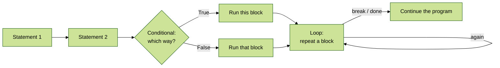

Without flow control, a program is a straight line. With it, the program can **branch** and **loop**.

## 2. Indentation: how Python groups statements

Many languages use `{ }` to group statements into a block. **Python uses indentation** (spaces at the start of a line). Every statement in a block must have the **same** indentation, and the line that opens the block ends with a colon `:`.

```python
# A value to test
marks = 72

# The colon starts a block
if marks >= 40:

    # This line is inside the if block (4 spaces)
    print("Pass")

    # This line is also inside the block
    print("Well done")

# This line has no indentation, so it is outside the block and always runs
print("Result printed")
```

**Output**

```text
Pass
Well done
Result printed
```

If the block is missing its indentation, Python stops before running anything:

```python
# The print line should be indented under the if
x = 10

# Check whether x > 5
if x > 5:
print(x)
```

**Output** (last line of the error message)

```text
IndentationError: expected an indented block after 'if' statement on line 5
```

> **Rule:** use **4 spaces** per level (PEP 8). Never mix tabs and spaces.

## 3. if

```text
if condition:
    statement-1
    statement-2
```

If the condition is `True`, the indented statements run. If it is `False`, they are skipped. For a single statement, the short form `if condition: statement` on one line is also allowed.

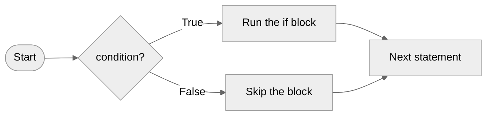

### The syllabus example

```python
# Ask the user for a name
name = input("Enter Name:")

# Run the greeting only when the name is durga
if name == "durga":

    # This line runs only for durga
    print("Hello Durga Good Morning")

# This line is outside the if, so it always runs
print("How are you!!!")
```

**Output, run 1** (user types `durga`)

```text
Enter Name:durga
Hello Durga Good Morning
How are you!!!
```

**Output, run 2** (user types `Ravi`)

```text
Enter Name:Ravi
How are you!!!
```

**How this program runs:** in run 1 the condition `name == "durga"` is `True`, so both prints run. In run 2 it is `False`, so the greeting is skipped and only the last line runs.

### More if examples

```python
# 1. A simple comparison
age = 20

# Check whether age >= 18
if age >= 18:
    print("1. Can vote")

# 2. The one-line form for a single statement
if age > 10: print("2. Older than 10")

# 3. Checking equality of text
city = "Pune"

# Check whether city == "Pune"
if city == "Pune":
    print("3. Welcome to Pune")

# 4. Checking membership with in
fruit = "mango"

# Check whether fruit in ["apple", "mango", "banana"]
if fruit in ["apple", "mango", "banana"]:
    print("4. Fruit is in stock")

# 5. A condition with and: both parts must be True
temperature = 28

# Check whether temperature > 20 and temperature < 35
if temperature > 20 and temperature < 35:
    print("5. Pleasant weather")

# 6. A condition with or: at least one part must be True
day = "Sunday"

# Check whether day == "Saturday" or day == "Sunday"
if day == "Saturday" or day == "Sunday":
    print("6. Weekend")

# 7. A condition with not
is_raining = False

# Check whether not is_raining
if not is_raining:
    print("7. No umbrella needed")

# 8. A chained comparison, the Python way to check a range
score = 75

# Check whether 60 <= score <= 80
if 60 <= score <= 80:
    print("8. Score is between 60 and 80")

# 9. Truthiness: a non-empty list counts as True
cart = ["pen"]

# Check whether cart
if cart:
    print("9. Cart has items")

# 10. Truthiness: an empty string counts as False, so this block is skipped
nickname = ""

# Check whether nickname
if nickname:
    print("10. This line does not run")

# 11. A string method as the condition
code = "PY-2026"

# Check whether code.startswith("PY")
if code.startswith("PY"):
    print("11. Python course code")

# 12. A calculation in the condition
number = 14

# Check whether number % 2 == 0
if number % 2 == 0:
    print("12. Even number")

# 13. Checking for None with is
result = None

# Check whether result is None
if result is None:
    print("13. No result yet")

# 14. A false condition: the block is skipped and nothing prints
if 5 > 10:
    print("14. This line does not run")
```

**Output**

```text
1. Can vote
2. Older than 10
3. Welcome to Pune
4. Fruit is in stock
5. Pleasant weather
6. Weekend
7. No umbrella needed
8. Score is between 60 and 80
9. Cart has items
11. Python course code
12. Even number
13. No result yet
```

> To keep the examples compact, several small examples are shown in one block, each numbered in its output. Only the conditions that are `True` print a line.

## 4. if-else

```text
if condition:
    Action-1
else:
    Action-2
```

If the condition is `True`, Action-1 runs; otherwise Action-2 runs. **Exactly one** of the two always runs.

```python
# Ask the user for a name
name = input("Enter Name:")

# Check the name
if name == "durga":

    # Runs when the condition is True
    print("Hello Durga Good Morning")

# Runs when the condition is False
else:

    # The greeting for everyone else
    print("Hello Guest Good Morning")

# Always runs
print("How are you!!!")
```

**Output, run 1** (user types `durga`)

```text
Enter Name:durga
Hello Durga Good Morning
How are you!!!
```

**Output, run 2** (user types `Ravi`)

```text
Enter Name:Ravi
Hello Guest Good Morning
How are you!!!
```

### More if-else examples

```python
# 1. Pass or fail
marks = 35

# Check whether marks >= 40
if marks >= 40:
    print("1. Pass")

# Otherwise, when no condition above was True
else:
    print("1. Fail")

# 2. Even or odd
n = 7

# Check whether n % 2 == 0
if n % 2 == 0:
    print("2.", n, "is even")

# Otherwise, when no condition above was True
else:
    print("2.", n, "is odd")

# 3. Positive or not
n = -4

# Check whether n > 0
if n > 0:
    print("3. Positive")

# Otherwise, when no condition above was True
else:
    print("3. Zero or negative")

# 4. Leap year rule: divisible by 4 and not by 100, or divisible by 400
year = 2024

# Check whether (year % 4 == 0 and year % 100 != 0) or year % 400 == 0
if (year % 4 == 0 and year % 100 != 0) or year % 400 == 0:
    print("4.", year, "is a leap year")

# Otherwise, when no condition above was True
else:
    print("4.", year, "is not a leap year")

# 5. Login check
password = "secret"

# Check whether password == "Secret"
if password == "Secret":
    print("5. Login successful")

# Otherwise, when no condition above was True
else:
    print("5. Wrong password (case matters)")

# 6. Empty or not
items = []

# Check whether items
if items:
    print("6. You have", len(items), "items")

# Otherwise, when no condition above was True
else:
    print("6. Your cart is empty")

# 7. Discount or not
total = 1200

# Check whether total > 1000
if total > 1000:
    print("7. Discount applied:", total * 0.1)

# Otherwise, when no condition above was True
else:
    print("7. No discount")

# 8. Bigger of two numbers
a, b = 15, 9

# Check whether a > b
if a > b:
    print("8. Bigger:", a)

# Otherwise, when no condition above was True
else:
    print("8. Bigger:", b)

# 9. Character type check
ch = "7"

# Check whether ch.isdigit()
if ch.isdigit():
    print("9. Digit")

# Otherwise, when no condition above was True
else:
    print("9. Not a digit")

# 10. Membership check
vowels = "aeiou"

# Set letter to "k"
letter = "k"

# Check whether letter in vowels
if letter in vowels:
    print("10. Vowel")

# Otherwise, when no condition above was True
else:
    print("10. Consonant")
```

**Output**

```text
1. Fail
2. 7 is odd
3. Zero or negative
4. 2024 is a leap year
5. Wrong password (case matters)
6. Your cart is empty
7. Discount applied: 120.0
8. Bigger: 15
9. Digit
10. Consonant
```

### The conditional expression (one-line if-else)

For choosing between **two values**, Python has a short form: `value_if_true if condition else value_if_false`.

```python
# Choose a word in one line
marks = 55

# The result is "Pass" when the condition is True, otherwise "Fail"
result = "Pass" if marks >= 40 else "Fail"

# Print the chosen word
print(result)

# Pick the bigger of two numbers in one line
a, b = 3, 8

# max-like choice using a conditional expression
print(a if a > b else b)

# Choose singular or plural
count = 1

# "item" when count is 1, "items" otherwise
print(count, "item" if count == 1 else "items")
```

**Output**

```text
Pass
8
1 item
```

## 5. if-elif-else

```text
if condition1:
    Action-1
elif condition2:
    Action-2
elif condition3:
    Action-3
else:
    Default Action
```

Python checks the conditions **from top to bottom**. The first condition that is `True` wins, its action runs, and all the remaining conditions are skipped. If none is `True`, the `else` action runs.

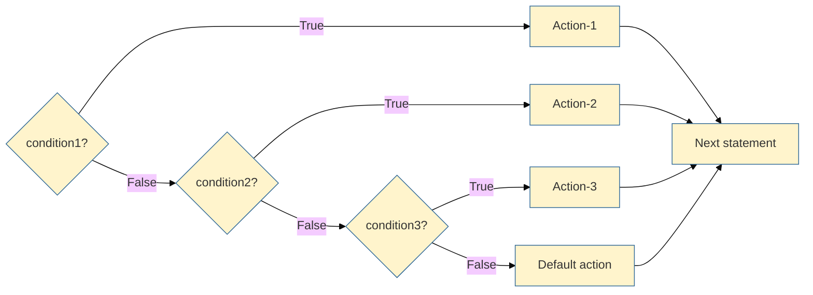

### The syllabus example

```python
# Ask for a favourite brand
brand = input("Enter Your Favourite Brand:")

# First check
if brand == "RC":

    # Runs for RC
    print("It is childrens brand")

# Second check, only if the first was False
elif brand == "KF":

    # Runs for KF
    print("It is not that much kick")

# Third check
elif brand == "FO":

    # Runs for FO
    print("Buy one get Free One")

# Runs when no condition matched
else:

    # The default message
    print("Other Brands are not recommended")
```

**Output, run 1** (user types `RC`)

```text
Enter Your Favourite Brand:RC
It is childrens brand
```

**Output, run 2** (user types `KF`)

```text
Enter Your Favourite Brand:KF
It is not that much kick
```

**Output, run 3** (user types `FO`)

```text
Enter Your Favourite Brand:FO
Buy one get Free One
```

**Output, run 4** (user types `KALYANI`)

```text
Enter Your Favourite Brand:KALYANI
Other Brands are not recommended
```

### More if-elif-else examples

```python
# Define a function so we can test many values with the same if-elif-else
def grade(marks):

    # Check from the highest band down
    if marks >= 90:
        return "A+"

    # Otherwise, check whether marks >= 75
    elif marks >= 75:
        return "A"

    # Otherwise, check whether marks >= 60
    elif marks >= 60:
        return "B"

    # Otherwise, check whether marks >= 40
    elif marks >= 40:
        return "C"

    # Otherwise, when no condition above was True
    else:
        return "Fail"

# Test the function with 8 different marks
for m in [95, 90, 80, 75, 61, 40, 39, 0]:

    # Print each mark and its grade
    print(m, "->", grade(m))
```

**Output**

```text
95 -> A+
90 -> A+
80 -> A
75 -> A
61 -> B
40 -> C
39 -> Fail
0 -> Fail
```

**Why the order matters:** for `95`, the first condition `marks >= 90` is already `True`, so Python never checks `>= 75`, even though that is also true.

```python
# Define a function that names the sign of a number
def sign(n):

    # Three possible cases
    if n > 0:
        return "positive"

    # Otherwise, check whether n < 0
    elif n < 0:
        return "negative"

    # Otherwise, when no condition above was True
    else:
        return "zero"

# Test three values
for n in [12, -3, 0]:

    # Print the number and its sign
    print(n, "is", sign(n))
```

**Output**

```text
12 is positive
-3 is negative
0 is zero
```

```python
# Define a function that gives a ticket price by age
def ticket_price(age):

    # Children under 5 travel free
    if age < 5:
        return 0

    # Otherwise, check whether age < 12
    elif age < 12:
        return 50

    # Otherwise, check whether age < 60
    elif age < 60:
        return 100

    # Otherwise, when no condition above was True
    else:
        return 60

# Test several ages
for age in [3, 8, 30, 65]:

    # Print the age and the price
    print(f"Age {age:2}: Rs. {ticket_price(age)}")
```

**Output**

```text
Age  3: Rs. 0
Age  8: Rs. 50
Age 30: Rs. 100
Age 65: Rs. 60
```

```python
# Define a function that describes the time of day
def greeting(hour):

    # Morning, afternoon, evening or night
    if 5 <= hour < 12:
        return "Good morning"

    # Otherwise, check whether 12 <= hour < 17
    elif 12 <= hour < 17:
        return "Good afternoon"

    # Otherwise, check whether 17 <= hour < 21
    elif 17 <= hour < 21:
        return "Good evening"

    # Otherwise, when no condition above was True
    else:
        return "Good night"

# Test four hours
for hour in [7, 13, 19, 23]:

    # Print the hour and the greeting
    print(hour, greeting(hour))
```

**Output**

```text
7 Good morning
13 Good afternoon
19 Good evening
23 Good night
```

### else is optional

The `else` part is always optional. So four forms are possible:

<table width="100%">
<tr>
<th align="left" width="6%">#</th>
<th align="left" width="18%">Form</th>
<th align="left" width="40%">When nothing matches</th>
<th align="left" width="36%">Typical use</th>
</tr>
<tr><td>1</td><td><code>if</code></td><td>Nothing runs</td><td>An extra action only in one case</td></tr>
<tr><td>2</td><td><code>if-else</code></td><td>The else block runs</td><td>Exactly two outcomes</td></tr>
<tr><td>3</td><td><code>if-elif-else</code></td><td>The else block runs</td><td>Many outcomes plus a default</td></tr>
<tr><td>4</td><td><code>if-elif</code></td><td>Nothing runs</td><td>Many outcomes, no default needed</td></tr>
</table>

```python
# if-elif without else: nothing prints when no condition matches
colour = "purple"

# Check two known colours only
if colour == "red":
    print("Stop")

# Otherwise, check whether colour == "green"
elif colour == "green":
    print("Go")

# This line shows the program continued without printing anything above
print("Checked", colour)
```

**Output**

```text
Checked purple
```

> **Correction:** the notes say "There is no switch statement in Python". That was true until Python 3.9. **Python 3.10 added the `match` statement**, which does the job of a switch and much more. See [Section 8](#8-match-case-python-310).

## 6. Nested if

An `if` inside another `if` is called a **nested if**. The inner check runs only when the outer condition is `True`.

```python
# Define a function that checks entry rules for a club
def can_enter(age, has_ticket):

    # Outer check: age
    if age >= 18:

        # Inner check: ticket, only for adults
        if has_ticket:
            return "Welcome in"

        # Otherwise, when no condition above was True
        else:
            return "Please buy a ticket"

    # Outer else: under 18
    else:
        return "Sorry, adults only"

# Test the four combinations
for age, ticket in [(25, True), (25, False), (15, True), (15, False)]:

    # Print the inputs and the answer
    print(age, ticket, "->", can_enter(age, ticket))
```

**Output**

```text
25 True -> Welcome in
25 False -> Please buy a ticket
15 True -> Sorry, adults only
15 False -> Sorry, adults only
```

### The syllabus demo program: what kind of character?

```python
# Ask for one character
s = input("Enter any character:")

# Letters and digits are alphanumeric
if s.isalnum():

    # Report the outer result
    print("Alpha Numeric Character")

    # Nested check: is it a letter?
    if s.isalpha():

        # Report it is a letter
        print("Alphabet character")

        # Deeper nested check: small or capital?
        if s.islower():

            # Small letter
            print("Lower case alphabet character")

        # Otherwise it is a capital letter
        else:

            # Capital letter
            print("Upper case alphabet character")

    # Alphanumeric but not a letter, so it is a digit
    else:

        # Report a digit
        print("it is a digit")

# Not alphanumeric: is it a space?
elif s.isspace():

    # Report a space
    print("It is space character")

# Anything else is a symbol
else:

    # Report a special character
    print("Non Space Special Character")
```

**Output, run 1** (user types `7`)

```text
Enter any character:7
Alpha Numeric Character
it is a digit
```

**Output, run 2** (user types `a`)

```text
Enter any character:a
Alpha Numeric Character
Alphabet character
Lower case alphabet character
```

**Output, run 3** (user types `A`)

```text
Enter any character:A
Alpha Numeric Character
Alphabet character
Upper case alphabet character
```

**Output, run 4** (user types ` `)

```text
Enter any character: 
It is space character
```

**Output, run 5** (user types `$`)

```text
Enter any character:$
Non Space Special Character
```

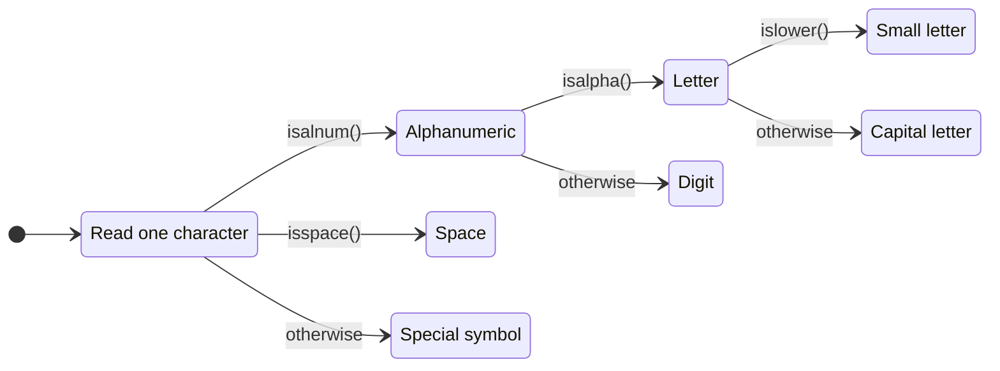

> **Tip:** deep nesting is hard to read. Often `and` or `elif` gives a flatter, clearer version. Nest only when the inner question makes sense only after the outer one.

## 7. Syllabus programs on decisions

All of these read numbers from the keyboard with `int(input(...))`.

### Biggest of 2 numbers

```python
# Read the first number
n1 = int(input("Enter First Number:"))

# Read the second number
n2 = int(input("Enter Second Number:"))

# Compare the two numbers
if n1 > n2:

    # The first one is bigger
    print("Biggest Number is:", n1)

# Otherwise the second one is bigger (or they are equal)
else:

    # Print the second number
    print("Biggest Number is:", n2)
```

**Output, run 1** (user types `10`, `20`)

```text
Enter First Number:10
Enter Second Number:20
Biggest Number is: 20
```

**Output, run 2** (user types `45`, `12`)

```text
Enter First Number:45
Enter Second Number:12
Biggest Number is: 45
```

### Biggest of 3 numbers

```python
# Read three numbers
n1 = int(input("Enter First Number:"))

# Second number
n2 = int(input("Enter Second Number:"))

# Third number
n3 = int(input("Enter Third Number:"))

# n1 must beat both of the others
if n1 > n2 and n1 > n3:

    # n1 is the biggest
    print("Biggest Number is:", n1)

# n1 is not the biggest, so compare the other two
elif n2 > n3:

    # n2 is the biggest
    print("Biggest Number is:", n2)

# Otherwise n3 is the biggest
else:

    # Print n3
    print("Biggest Number is:", n3)
```

**Output, run 1** (user types `10`, `20`, `30`)

```text
Enter First Number:10
Enter Second Number:20
Enter Third Number:30
Biggest Number is: 30
```

**Output, run 2** (user types `10`, `30`, `20`)

```text
Enter First Number:10
Enter Second Number:30
Enter Third Number:20
Biggest Number is: 30
```

**Output, run 3** (user types `30`, `10`, `20`)

```text
Enter First Number:30
Enter Second Number:10
Enter Third Number:20
Biggest Number is: 30
```

**How this program runs:** the first condition needs `n1` to be bigger than **both** others. If that fails, the biggest is either `n2` or `n3`, so one more comparison decides it. In real code, `max(n1, n2, n3)` does the same in one call.

### Smallest of 2 and of 3 numbers (the syllabus asks you to write these)

```python
# Read three numbers
a = int(input("Enter First Number:"))

# Second number
b = int(input("Enter Second Number:"))

# Third number
c = int(input("Enter Third Number:"))

# Smallest of the first two
if a < b:

    # a is smaller
    print("Smallest of first two:", a)

# Otherwise b is smaller or equal
else:

    # b is smaller
    print("Smallest of first two:", b)

# Smallest of all three
if a <= b and a <= c:

    # a is the smallest
    print("Smallest of three:", a)

# Then compare b and c
elif b <= c:

    # b is the smallest
    print("Smallest of three:", b)

# Otherwise c
else:

    # c is the smallest
    print("Smallest of three:", c)
```

**Output** (user types `8`, `3`, `5`)

```text
Enter First Number:8
Enter Second Number:3
Enter Third Number:5
Smallest of first two: 3
Smallest of three: 3
```

### Even or odd

```python
# Read a number
n = int(input("Enter Number:"))

# A number is even when the remainder after dividing by 2 is 0
if n % 2 == 0:

    # Even
    print(n, "is Even")

# Otherwise odd
else:

    # Odd
    print(n, "is Odd")
```

**Output, run 1** (user types `12`)

```text
Enter Number:12
12 is Even
```

**Output, run 2** (user types `7`)

```text
Enter Number:7
7 is Odd
```

### Is a number between 1 and 100?

> **Correction:** the question in the notes says "between 1 and 100", but the program checks 1 to 10. The version below checks 1 to 100, and uses Python's chained comparison.

```python
# Read a number
n = int(input("Enter Number:"))

# 1 <= n <= 100 means n >= 1 and n <= 100
if 1 <= n <= 100:

    # Inside the range
    print("The number", n, "is in between 1 to 100")

# Outside the range
else:

    # Report it
    print("The number", n, "is not in between 1 to 100")
```

**Output, run 1** (user types `55`)

```text
Enter Number:55
The number 55 is in between 1 to 100
```

**Output, run 2** (user types `150`)

```text
Enter Number:150
The number 150 is not in between 1 to 100
```

### A single digit in English words

```python
# Read one digit
n = int(input("Enter a digit from 0 to 9:"))

# Check each digit in turn
if n == 0:
    print("ZERO")

# Otherwise, check whether n == 1
elif n == 1:
    print("ONE")

# Otherwise, check whether n == 2
elif n == 2:
    print("TWO")

# Otherwise, check whether n == 3
elif n == 3:
    print("THREE")

# Otherwise, check whether n == 4
elif n == 4:
    print("FOUR")

# Otherwise, check whether n == 5
elif n == 5:
    print("FIVE")

# Otherwise, check whether n == 6
elif n == 6:
    print("SIX")

# Otherwise, check whether n == 7
elif n == 7:
    print("SEVEN")

# Otherwise, check whether n == 8
elif n == 8:
    print("EIGHT")

# Otherwise, check whether n == 9
elif n == 9:
    print("NINE")

# Otherwise, when no condition above was True
else:
    print("PLEASE ENTER A DIGIT FROM 0 TO 9")
```

**Output, run 1** (user types `7`)

```text
Enter a digit from 0 to 9:7
SEVEN
```

**Output, run 2** (user types `12`)

```text
Enter a digit from 0 to 9:12
PLEASE ENTER A DIGIT FROM 0 TO 9
```

The long chain works, but a list does the same job in three lines:

```python
# The words in digit order, so the index equals the digit
words = ["ZERO", "ONE", "TWO", "THREE", "FOUR", "FIVE", "SIX", "SEVEN", "EIGHT", "NINE"]

# Read one digit
n = int(input("Enter a digit from 0 to 9:"))

# Use the digit as the index when it is in range
print(words[n] if 0 <= n <= 9 else "PLEASE ENTER A DIGIT FROM 0 TO 9")
```

**Output, run 1** (user types `4`)

```text
Enter a digit from 0 to 9:4
FOUR
```

**Output, run 2** (user types `-1`)

```text
Enter a digit from 0 to 9:-1
PLEASE ENTER A DIGIT FROM 0 TO 9
```

## 8. match-case (Python 3.10+)

> **Extra.** Not in the syllabus notes. `match` compares one value against several **patterns** and runs the first one that fits. It replaces long `if-elif` chains that compare the same variable.

```text
match value:
    case pattern1:
        action-1
    case pattern2:
        action-2
    case _:
        default action
```

`case _:` is the default; `_` matches anything.

```python
# Define a function that names a day number with match
def day_name(n):

    # Compare n with each case in order
    match n:
        case 1:
            return "Monday"

        # Case: matches 2
        case 2:
            return "Tuesday"

        # Case: matches 3
        case 3:
            return "Wednesday"

        # Case: matches 6 | 7
        case 6 | 7:
            return "Weekend"

        # Default case: matches anything not matched above
        case _:
            return "Other day"

# Test five values
for n in [1, 3, 6, 7, 9]:

    # Print the number and its name
    print(n, day_name(n))
```

**Output**

```text
1 Monday
3 Wednesday
6 Weekend
7 Weekend
9 Other day
```

```python
# Define a function that handles text commands
def command(text):

    # Match strings exactly
    match text.lower():
        case "start":
            return "Starting..."

        # Case: matches "stop" | "quit" | "exit"
        case "stop" | "quit" | "exit":
            return "Stopping"

        # Case: matches "help"
        case "help":
            return "Commands: start, stop, help"

        # Default case: matches anything not matched above
        case _:
            return f"Unknown command: {text}"

# Test six commands
for c in ["start", "QUIT", "exit", "help", "jump", "Stop"]:

    # Print each command and the reply
    print(f"{c:6} -> {command(c)}")
```

**Output**

```text
start  -> Starting...
QUIT   -> Stopping
exit   -> Stopping
help   -> Commands: start, stop, help
jump   -> Unknown command: jump
Stop   -> Stopping
```

```python
# Define a function that describes a point (x, y) using tuple patterns
def where(point):

    # Each case unpacks the tuple
    match point:
        case (0, 0):
            return "origin"

        # Case: matches (0, y)
        case (0, y):
            return f"on the y-axis at {y}"

        # Case: matches (x, 0)
        case (x, 0):
            return f"on the x-axis at {x}"

        # Case: matches (x, y) if x == y
        case (x, y) if x == y:
            return f"on the diagonal at {x}"

        # Case: matches (x, y)
        case (x, y):
            return f"at ({x}, {y})"

# Test five points
for p in [(0, 0), (0, 5), (3, 0), (4, 4), (2, 7)]:

    # Print each point and its description
    print(p, "->", where(p))
```

**Output**

```text
(0, 0) -> origin
(0, 5) -> on the y-axis at 5
(3, 0) -> on the x-axis at 3
(4, 4) -> on the diagonal at 4
(2, 7) -> at (2, 7)
```

```python
# Define a function that classifies a value by its type
def describe(value):

    # Class patterns check the type; the name in brackets captures nothing here
    match value:
        case bool():
            return "a Boolean"

        # Case: matches int() | float()
        case int() | float():
            return "a number"

        # Case: matches str()
        case str():
            return "some text"

        # Case: matches [first, *rest]
        case [first, *rest]:
            return f"a list starting with {first}"

        # Case: matches {"name": name}
        case {"name": name}:
            return f"a dict with name {name}"

        # Default case: matches anything not matched above
        case _:
            return "something else"

# Test six values of different types
for v in [True, 42, 3.5, "hi", [9, 8, 7], {"name": "Asha"}]:

    # Print the value and its description
    print(repr(v), "is", describe(v))
```

**Output**

```text
True is a Boolean
42 is a number
3.5 is a number
'hi' is some text
[9, 8, 7] is a list starting with 9
{'name': 'Asha'} is a dict with name Asha
```

**Why `bool()` comes before `int()`:** `True` is also an `int` (Topic 03), so the more specific pattern must come first.

## 9. for loop

Use a `for` loop when you want to do something **for every item** in a sequence (a string, a list, a range or any collection).

```text
for x in sequence:
    body
```

The body runs once for every item, and `x` holds the current item.

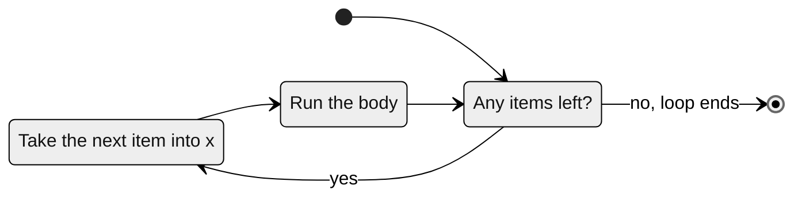

### The syllabus examples

```python
# Eg 1: print the characters of a string
s = "Sunny Leone"

# Each round, x is the next character
for x in s:

    # Print the character
    print(x)
```

**Output**

```text
S
u
n
n
y
 
L
e
o
n
e
```

```python
# Eg 2: print the characters with their index
s = input("Enter some String: ")

# Start the index at 0
i = 0

# Go through each character
for x in s:

    # Print the index and the character
    print("The character present at ", i, "index is :", x)

    # Move the index forward
    i = i + 1
```

**Output** (user types `Sunny Leone`)

```text
Enter some String: Sunny Leone
The character present at  0 index is : S
The character present at  1 index is : u
The character present at  2 index is : n
The character present at  3 index is : n
The character present at  4 index is : y
The character present at  5 index is :  
The character present at  6 index is : L
The character present at  7 index is : e
The character present at  8 index is : o
The character present at  9 index is : n
The character present at  10 index is : e
```

> `enumerate()` gives the index and the item together, so you do not need your own counter: `for i, x in enumerate(s):`.

```python
# Eg 3: print Hello 10 times
for x in range(10):

    # The body runs 10 times
    print("Hello", end=" ")
```

**Output**

```text
Hello Hello Hello Hello Hello Hello Hello Hello Hello Hello 
```

```python
# Eg 4: numbers from 0 to 10
for x in range(11):

    # Print on one line
    print(x, end=" ")
```

**Output**

```text
0 1 2 3 4 5 6 7 8 9 10 
```

```python
# Eg 5: odd numbers from 0 to 20
for x in range(21):

    # Keep only numbers with a remainder when divided by 2
    if x % 2 != 0:

        # Print the odd number
        print(x, end=" ")
```

**Output**

```text
1 3 5 7 9 11 13 15 17 19 
```

```python
# Eg 6: numbers from 10 down to 1
for x in range(10, 0, -1):

    # Print on one line
    print(x, end=" ")
```

**Output**

```text
10 9 8 7 6 5 4 3 2 1 
```

```python
# Load a safe converter that reads Python literals like lists from text
import ast

# Eg 7: read a list and add its numbers
numbers = ast.literal_eval(input("Enter List:"))

# Start the total at zero
total = 0

# Add each number to the total
for x in numbers:

    # Add the current number
    total = total + x

# Print the sum
print("The Sum=", total)
```

**Output, run 1** (user types `[10,20,30,40]`)

```text
Enter List:[10,20,30,40]
The Sum= 100
```

**Output, run 2** (user types `[45,67]`)

```text
Enter List:[45,67]
The Sum= 112
```

> **Correction:** the notes use `eval(input(...))` and the variable names `list` and `sum`. `eval()` runs **any** code the user types, which is dangerous. `ast.literal_eval()` accepts only plain values such as lists and numbers. Also, `list` and `sum` are built-in names, so we use `numbers` and `total` instead (see [Topic 02](../02.%20Identifiers/README.md#9-common-errors)). The built-in `sum(numbers)` does the whole loop in one call.

### More for loop examples

```python
# 1. Loop over a list of names
for name in ["Asha", "Ravi", "Meena"]:
    print("1. Hello", name)

# 2. Loop over a tuple
for day in ("Mon", "Tue"):
    print("2.", day)

# 3. Loop over a range with a start and a stop
for n in range(3, 6):
    print("3.", n)

# 4. Loop with a step of 5
for n in range(0, 20, 5):
    print("4.", n)

# 5. enumerate() gives the position and the item; start=1 counts from 1
for position, fruit in enumerate(["apple", "kiwi"], start=1):
    print("5.", position, fruit)

# 6. zip() walks two lists side by side
for subject, mark in zip(["Maths", "Science"], [88, 92]):
    print("6.", subject, mark)

# 7. Loop over a dictionary's keys and values
for roll, student in {101: "Asha", 102: "Ravi"}.items():
    print("7.", roll, student)

# 8. Loop over a set (order may vary for text, numbers shown here)
for n in {3, 1, 2}:
    print("8.", n)

# 9. Loop over the words of a sentence
for word in "learn python daily".split():
    print("9.", word.upper())

# 10. Build a total and a count together
total = 0

# Set count to 0
count = 0

# Go through each price in [120, 80, 50]
for price in [120, 80, 50]:
    total += price

    # Add 1 to count
    count += 1

# Print the label and the value: Average price
print("10. Average price:", total / count)

# 11. The loop variable keeps its last value after the loop
for k in range(4):
    pass

# Print the label and the value: k after the loop is
print("11. k after the loop is", k)

# 12. A loop over an empty list does not run at all
for item in []:
    print("12. This line never runs")

# Print the message: Empty loop finished
print("12. Empty loop finished")
```

**Output**

```text
1. Hello Asha
1. Hello Ravi
1. Hello Meena
2. Mon
2. Tue
3. 3
3. 4
3. 5
4. 0
4. 5
4. 10
4. 15
5. 1 apple
5. 2 kiwi
6. Maths 88
6. Science 92
7. 101 Asha
7. 102 Ravi
8. 1
8. 2
8. 3
9. LEARN
9. PYTHON
9. DAILY
10. Average price: 83.33333333333333
11. k after the loop is 3
12. Empty loop finished
```

### A multiplication table

```python
# The number whose table we print
n = 7

# i goes from 1 to 10
for i in range(1, 11):

    # Print one line of the table with aligned columns
    print(f"{n} x {i:2} = {n * i:3}")
```

**Output**

```text
7 x  1 =   7
7 x  2 =  14
7 x  3 =  21
7 x  4 =  28
7 x  5 =  35
7 x  6 =  42
7 x  7 =  49
7 x  8 =  56
7 x  9 =  63
7 x 10 =  70
```

## 10. while loop

Use a `while` loop to repeat statements **as long as a condition is True**. It is the right choice when you do not know in advance how many rounds are needed.

```text
while condition:
    body
```

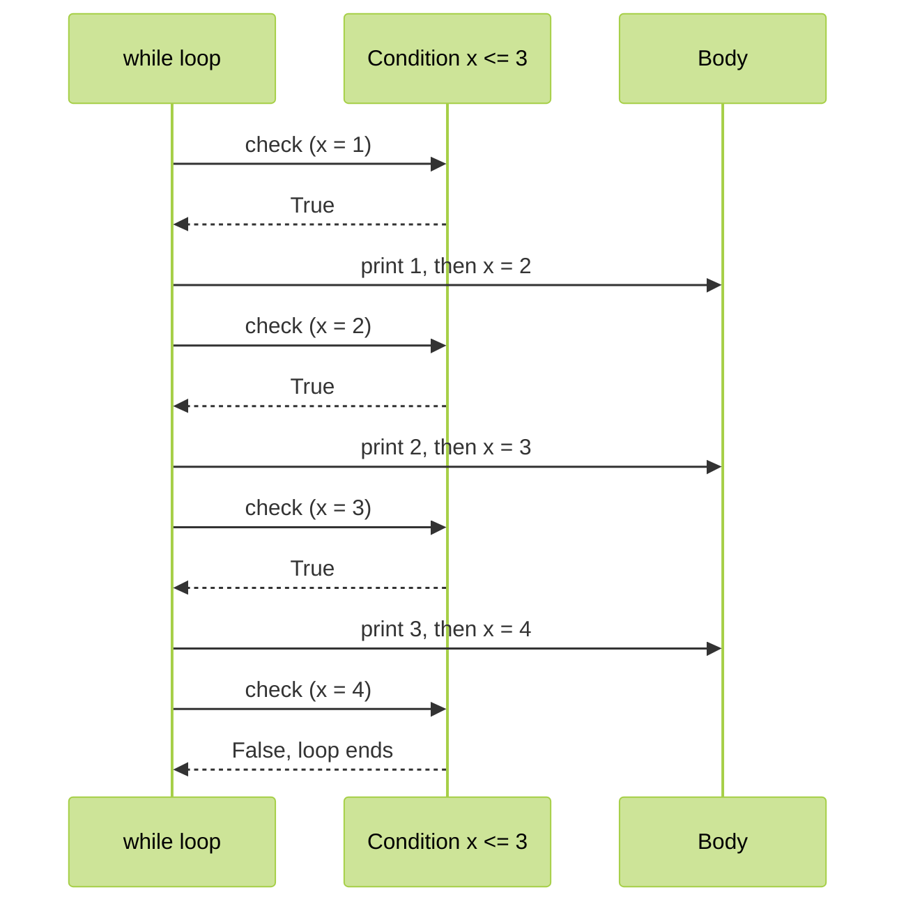

### The syllabus examples

```python
# Print numbers from 1 to 10 with a while loop
x = 1

# Repeat while x is at most 10
while x <= 10:

    # Print the current value on one line
    print(x, end=" ")

    # Move x forward; without this the loop would never end
    x = x + 1
```

**Output**

```text
1 2 3 4 5 6 7 8 9 10 
```

```python
# Sum of the first n numbers
n = int(input("Enter number:"))

# Start the total at zero
total = 0

# Start counting at 1
i = 1

# Repeat while i is at most n
while i <= n:

    # Add i to the total
    total = total + i

    # Move to the next number
    i = i + 1

# Print the result
print("The sum of first", n, "numbers is :", total)
```

**Output, run 1** (user types `5`)

```text
Enter number:5
The sum of first 5 numbers is : 15
```

**Output, run 2** (user types `100`)

```text
Enter number:100
The sum of first 100 numbers is : 5050
```

**How this program runs:** for `n = 5`, the loop adds 1, 2, 3, 4 and 5. When `i` becomes 6, the condition `6 <= 5` is `False`, so the loop ends and the total is 15.

```python
# Keep asking until the user types durga
name = ""

# The condition is checked before every round
while name != "durga":

    # Ask again
    name = input("Enter Name:")

# Runs after the loop ends
print("Thanks for confirmation")
```

**Output** (user types `ravi`, `asha`, `durga`)

```text
Enter Name:ravi
Enter Name:asha
Enter Name:durga
Thanks for confirmation
```

### More while loop examples

```python
# 1. Count down from 5
n = 5

# Repeat while n > 0
while n > 0:
    print("1.", n)

    # Subtract 1 from n
    n -= 1

# 2. Double a number until it passes 100
value = 3

# Repeat while value <= 100
while value <= 100:
    value *= 2

# Print the label and the value: First value over 100
print("2. First value over 100:", value)

# 3. Count the digits of a number
number = 98765

# Set digits to 0
digits = 0

# Repeat while number > 0
while number > 0:
    number //= 10

    # Add 1 to digits
    digits += 1

# Print the label and the value: Digits
print("3. Digits:", digits)

# 4. Add up the digits of a number
number = 4321

# Set digit_sum to 0
digit_sum = 0

# Repeat while number > 0
while number > 0:
    digit_sum += number % 10

    # Divide number by 10, dropping the remainder
    number //= 10

# Print the label and the value: Digit sum
print("4. Digit sum:", digit_sum)

# 5. Reverse a number
number = 1234

# Set reversed_number to 0
reversed_number = 0

# Repeat while number > 0
while number > 0:
    reversed_number = reversed_number * 10 + number % 10

    # Divide number by 10, dropping the remainder
    number //= 10

# Print the label and the value: Reversed
print("5. Reversed:", reversed_number)

# 6. Years for money to double at 8 percent interest
money = 1000

# Set years to 0
years = 0

# Repeat while money < 2000
while money < 2000:
    money *= 1.08

    # Add 1 to years
    years += 1

# Print the label and the value: Years to double
print("6. Years to double:", years)

# 7. Take items from a list until it is empty
stack = ["a", "b", "c"]

# Repeat while stack
while stack:
    print("7. Took", stack.pop())

# 8. Greatest common divisor with Euclid's method
a, b = 48, 18

# Repeat while b != 0
while b != 0:
    a, b = b, a % b

# Print the label and the value: GCD
print("8. GCD:", a)

# 9. A condition that is False at the start: the body never runs
x = 10

# Repeat while x < 5
while x < 5:
    print("9. This never runs")

# Print the message: Loop skipped
print("9. Loop skipped")
```

**Output**

```text
1. 5
1. 4
1. 3
1. 2
1. 1
2. First value over 100: 192
3. Digits: 5
4. Digit sum: 10
5. Reversed: 4321
6. Years to double: 10
7. Took c
7. Took b
7. Took a
8. GCD: 6
9. Loop skipped
```

### for or while?

<table width="100%">
<tr>
<th align="left" width="16%">Loop</th>
<th align="left" width="30%">Repeats</th>
<th align="left" width="28%">Best when</th>
<th align="left" width="26%">Example</th>
</tr>
<tr><td><code>for</code></td><td>Once for every item in a sequence</td><td>You know the items or the count</td><td>Print every name in a list</td></tr>
<tr><td><code>while</code></td><td>As long as a condition is <code>True</code></td><td>You do not know how many rounds are needed</td><td>Ask until the password is correct</td></tr>
</table>

## 11. Infinite loops

A loop whose condition never becomes `False` runs **forever**. The syllabus example:

```python
# Start a counter
i = 0

# True is always True, so this loop never stops on its own
while True:

    # Increase the counter
    i = i + 1

    # Print forever: Hello 1, Hello 2, Hello 3 ...
    print("Hello", i)
```

Press **Ctrl+C** to stop a program stuck in an infinite loop. `while True` is still very useful when combined with `break`, as in this safe version:

```python
# Start a counter
i = 0

# Loop "forever"
while True:

    # Increase the counter
    i = i + 1

    # Print the message
    print("Hello", i)

    # Leave the loop after 3 rounds
    if i == 3:

        # break ends the loop at once
        break
```

**Output**

```text
Hello 1
Hello 2
Hello 3
```

## 12. Nested loops and patterns

A loop inside another loop is a **nested loop**. For every single round of the outer loop, the inner loop runs **completely**.

```python
# Outer loop: i is 0, 1, 2, 3
for i in range(4):

    # Inner loop: j is 0, 1, 2, 3 for EACH value of i
    for j in range(4):

        # Print the pair
        print("i=", i, "   j=", j)
```

**Output**

```text
i= 0    j= 0
i= 0    j= 1
i= 0    j= 2
i= 0    j= 3
i= 1    j= 0
i= 1    j= 1
i= 1    j= 2
i= 1    j= 3
i= 2    j= 0
i= 2    j= 1
i= 2    j= 2
i= 2    j= 3
i= 3    j= 0
i= 3    j= 1
i= 3    j= 2
i= 3    j= 3
```

The body ran 4 x 4 = **16** times.

### Right-angled triangle

```python
# Read the number of rows
n = int(input("Enter number of rows:"))

# One round of the outer loop for each row
for i in range(1, n + 1):

    # Row i has i stars
    for j in range(1, i + 1):

        # Print a star and a space, staying on the same line
        print("*", end=" ")

    # Move to the next line after each row
    print()
```

**Output** (user types `7`)

```text
Enter number of rows:7
* 
* * 
* * * 
* * * * 
* * * * * 
* * * * * * 
* * * * * * * 
```

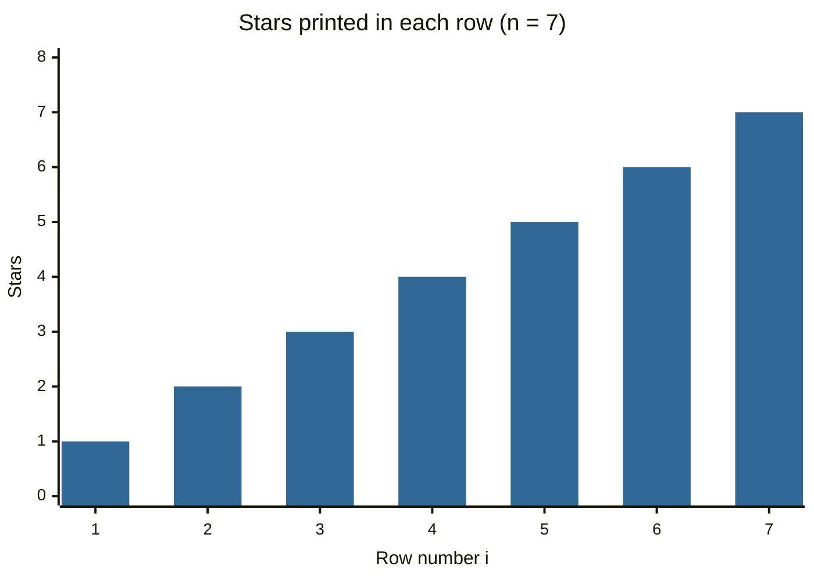

The **alternative way** from the notes uses string repetition instead of an inner loop:

```python
# Read the number of rows
n = int(input("Enter number of rows:"))

# Each row is "* " repeated i times
for i in range(1, n + 1):

    # One print per row
    print("* " * i)
```

**Output** (user types `5`)

```text
Enter number of rows:5
* 
* * 
* * * 
* * * * 
* * * * * 
```

### Pyramid (equilateral triangle)

```python
# Read the number of rows
n = int(input("Enter number of rows:"))

# One round for each row
for i in range(1, n + 1):

    # Print n - i spaces first, without moving to a new line
    print(" " * (n - i), end="")

    # Then i stars with spaces
    print("* " * i)
```

**Output** (user types `7`)

```text
Enter number of rows:7
      * 
     * * 
    * * * 
   * * * * 
  * * * * * 
 * * * * * * 
* * * * * * * 
```

**How this program runs:** row 1 has 6 spaces and 1 star, row 2 has 5 spaces and 2 stars, and so on. Fewer spaces and more stars on each row make the pyramid shape.

### More nested loop examples

```python
# 1. Inverted triangle
for i in range(4, 0, -1):
    print("1.", "* " * i)

# 2. Number triangle: each row counts up from 1
for i in range(1, 5):
    print("2.", " ".join(str(j) for j in range(1, i + 1)))

# 3. Same number repeated on each row
for i in range(1, 5):
    print("3.", (str(i) + " ") * i)

# 4. A small multiplication grid
for i in range(1, 4):
    print("4.", " ".join(f"{i * j:2}" for j in range(1, 6)))

# 5. Every pair of two lists
for colour in ["red", "blue"]:
    for size in ["S", "M"]:
        print("5.", colour, size)

# 6. Hollow square of size 4
size = 4

# Go through each row in range(size)
for row in range(size):
    line = ""

    # Go through each col in range(size)
    for col in range(size):
        line += "* " if row in (0, size - 1) or col in (0, size - 1) else "  "

    # Print the result
    print("6.", line)

# 7. Count the pairs that add up to 10
count = 0

# Go through each a in range(1, 10)
for a in range(1, 10):
    for b in range(1, 10):
        if a + b == 10:
            count += 1

# Print the label and the value: Pairs adding to 10
print("7. Pairs adding to 10:", count)
```

**Output**

```text
1. * * * * 
1. * * * 
1. * * 
1. * 
2. 1
2. 1 2
2. 1 2 3
2. 1 2 3 4
3. 1 
3. 2 2 
3. 3 3 3 
3. 4 4 4 4 
4.  1  2  3  4  5
4.  2  4  6  8 10
4.  3  6  9 12 15
5. red S
5. red M
5. blue S
5. blue M
6. * * * * 
6. *     * 
6. *     * 
6. * * * * 
7. Pairs adding to 10: 9
```

> Pattern programs get their own full topic: [Topic 17. Pattern programs](../17.%20Pattern%20programs/README.md).

## 13. break

`break` **ends the loop immediately**. The rest of the body and all remaining rounds are skipped, and the program continues after the loop.

```python
# Count from 0 to 9, but stop at 7
for i in range(10):

    # Check the stop condition first
    if i == 7:

        # Explain why we stop
        print("processing is enough..plz break")

        # Leave the loop
        break

    # Runs only for 0 to 6
    print(i)
```

**Output**

```text
0
1
2
3
4
5
6
processing is enough..plz break
```

```python
# A shopping cart with item prices
cart = [10, 20, 600, 60, 70]

# Check each item
for item in cart:

    # Stop at the first expensive item
    if item > 500:

        # Explain why
        print("To place this order insurance must be required")

        # Leave the loop; 60 and 70 are never checked
        break

    # Process a normal item
    print(item)
```

**Output**

```text
10
20
To place this order insurance must be required
```

```mermaid
%%{init: {"theme": "dark", "themeVariables": {"fontFamily": "Georgia"}}}%%
sequenceDiagram
    participant Loop as for item in cart
    participant Check as item > 500?
    Loop->>Check: 10
    Check-->>Loop: no, print 10
    Loop->>Check: 20
    Check-->>Loop: no, print 20
    Loop->>Check: 600
    Check-->>Loop: yes, print message
    Note over Loop: break: 60 and 70 are never visited
```

### More break examples

```python
# 1. Find the first even number in a list
for n in [3, 7, 8, 5, 10]:
    if n % 2 == 0:
        print("1. First even:", n)

        # Leave the loop at once
        break

# 2. Search for a name and stop when found
for name in ["Asha", "Ravi", "Meena", "John"]:
    if name == "Meena":
        print("2. Found Meena")

        # Leave the loop at once
        break

    # Print the label and the value: Checked
    print("2. Checked", name)

# 3. Find the first character that is a digit
for ch in "abc4def":
    if ch.isdigit():
        print("3. First digit:", ch)

        # Leave the loop at once
        break

# 4. Stop adding when the budget is used up
budget = 100

# Set spent to 0
spent = 0

# Go through each price in [30, 40, 50, 20]
for price in [30, 40, 50, 20]:
    if spent + price > budget:
        print("4. Cannot afford", price)

        # Leave the loop at once
        break

    # Add price to spent
    spent += price

# Print the label and the value: Spent
print("4. Spent:", spent)

# 5. break with while True: find the first square above 50
n = 1

# Loop forever until break
while True:
    if n * n > 50:
        print("5. First square above 50 is", n * n)

        # Leave the loop at once
        break

    # Add 1 to n
    n += 1

# 6. break leaves only the INNER loop in nested loops
for i in range(3):
    for j in range(3):
        if j == 1:
            break

        # Print the label and the value: i =
        print("6. i =", i, "j =", j)
```

**Output**

```text
1. First even: 8
2. Checked Asha
2. Checked Ravi
2. Found Meena
3. First digit: 4
4. Cannot afford 50
4. Spent: 70
5. First square above 50 is 64
6. i = 0 j = 0
6. i = 1 j = 0
6. i = 2 j = 0
```

## 14. continue

`continue` **skips the rest of the current round** and goes straight to the next round. The loop itself keeps going.

```python
# Print only odd numbers from 0 to 9
for i in range(10):

    # For even numbers, skip the rest of this round
    if i % 2 == 0:

        # Jump to the next value of i
        continue

    # Runs only for odd numbers
    print(i)
```

**Output**

```text
1
3
5
7
9
```

```python
# A cart where expensive items are skipped, not stopped
cart = [10, 20, 500, 700, 50, 60]

# Check each item
for item in cart:

    # Skip items of 500 or more
    if item >= 500:

        # Explain and skip
        print("We cannot process this item :", item)

        # Go to the next item; the print below is skipped
        continue

    # Process a normal item
    print(item)
```

**Output**

```text
10
20
We cannot process this item : 500
We cannot process this item : 700
50
60
```

```python
# Divide 100 by each number, skipping zeros
numbers = [10, 20, 0, 5, 0, 30]

# Check each number
for n in numbers:

    # Division by zero is not allowed
    if n == 0:

        # Explain and skip
        print("Hey how we can divide with zero..just skipping")

        # Go to the next number
        continue

    # Safe to divide
    print("100/{} = {}".format(n, 100 / n))
```

**Output**

```text
100/10 = 10.0
100/20 = 5.0
Hey how we can divide with zero..just skipping
100/5 = 20.0
Hey how we can divide with zero..just skipping
100/30 = 3.3333333333333335
```

### break vs continue

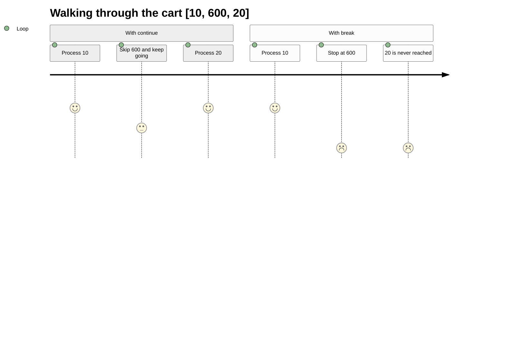

### More continue examples

```python
# 1. Skip vowels and keep consonants
result = ""

# Go through each ch in "education"
for ch in "education":
    if ch in "aeiou":
        continue

    # Add ch to result
    result += ch

# Print the result
print("1.", result)

# 2. Skip empty strings in a list
for word in ["apple", "", "kiwi", ""]:
    if not word:
        continue

    # Print the result
    print("2.", word)

# 3. Skip negative numbers when adding
total = 0

# Go through each n in [5, -2, 7, -1, 3]
for n in [5, -2, 7, -1, 3]:
    if n < 0:
        continue

    # Add n to total
    total += n

# Print the label and the value: Total of positives
print("3. Total of positives:", total)

# 4. Skip multiples of 3, keeping the rest in a list
kept = []

# Go through each n in range(1, 10)
for n in range(1, 10):
    if n % 3 == 0:
        continue

    # Add n to the end of kept
    kept.append(n)

# Print the result
print("4.", kept)

# 5. continue in a while loop: update the counter BEFORE continue
i = 0

# Set seen to []
seen = []

# Repeat while i < 6
while i < 6:
    i += 1

    # Check whether i == 3
    if i == 3:
        continue

    # Add i to the end of seen
    seen.append(i)

# Print the result
print("5.", seen)

# 6. Skip comment lines in some text
lines = ["# settings", "theme=dark", "# size", "font=12"]

# Go through each line in lines
for line in lines:
    if line.startswith("#"):
        continue

    # Print the result
    print("6.", line)
```

**Output**

```text
1. dctn
2. apple
2. kiwi
3. Total of positives: 15
4. [1, 2, 4, 5, 7, 8]
5. [1, 2, 4, 5, 6]
6. theme=dark
6. font=12
```

> **Trap:** in a `while` loop, if `continue` comes **before** the line that changes the counter, the counter never changes and the loop runs forever. Example 5 updates `i` first for this reason.

## 15. Loops with an else block

A `for` or `while` loop can have an `else` block. It runs **only if the loop finished without `break`**. Think of it as **"no break"**.

```python
# A cart with only small items
cart = [10, 20, 30, 40, 50]

# Check each item
for item in cart:

    # An expensive item would stop the loop
    if item >= 500:

        # Explain
        print("We cannot process this order")

        # Leave the loop; the else block will NOT run
        break

    # Process the item
    print(item)

# Runs because no break happened
else:

    # Success message
    print("Congrats ...all items processed successfully")
```

**Output**

```text
10
20
30
40
50
Congrats ...all items processed successfully
```

```python
# A cart with one expensive item
cart = [10, 20, 600, 30, 40, 50]

# Check each item
for item in cart:

    # The expensive item stops the loop
    if item >= 500:

        # Explain
        print("We cannot process this order")

        # break means the else block is skipped
        break

    # Process the item
    print(item)

# Does NOT run this time, because break happened
else:

    # Success message
    print("Congrats ...all items processed successfully")
```

**Output**

```text
10
20
We cannot process this order
```

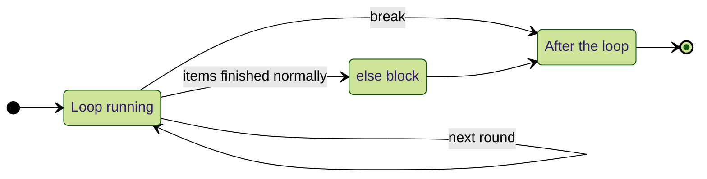

### More loop-else examples

```python
# Define a function: is n a prime number?
def is_prime(n):

    # Numbers below 2 are not prime
    if n < 2:
        return False

    # Try every possible divisor from 2 up to the square root of n
    for d in range(2, int(n ** 0.5) + 1):

        # A divisor means n is not prime
        if n % d == 0:
            break

    # No break: no divisor was found
    else:
        return True

    # We reach here only after a break
    return False

# Print the primes below 30
print([n for n in range(30) if is_prime(n)])
```

**Output**

```text
[2, 3, 5, 7, 11, 13, 17, 19, 23, 29]
```

```python
# Search a list and report "not found" with loop-else
names = ["Asha", "Ravi", "Meena"]

# Try two searches
for target in ["Ravi", "John"]:

    # Look at each name
    for name in names:

        # Found it
        if name == target:
            print(target, "found")

            # Leave the loop at once
            break

    # Runs only when the inner loop never hit break
    else:
        print(target, "not found")
```

**Output**

```text
Ravi found
John not found
```

```python
# while with else: up to 3 password attempts
attempts = ["abc", "1234", "open"]

# Index of the current attempt
i = 0

# Allow at most 3 tries
while i < len(attempts):

    # Correct password?
    if attempts[i] == "open":
        print("Access granted on attempt", i + 1)

        # Leave the loop at once
        break

    # Wrong one
    print("Wrong:", attempts[i])

    # Add 1 to i
    i += 1

# Runs only if all attempts were used without break
else:
    print("Account locked")
```

**Output**

```text
Wrong: abc
Wrong: 1234
Access granted on attempt 3
```

```python
# An empty loop has no break, so its else block runs
for x in []:
    print("never")

# Runs only when the loop ended without break
else:
    print("else ran for an empty loop")
```

**Output**

```text
else ran for an empty loop
```

### Syllabus questions on loops

<table width="100%">
<tr>
<th align="left" width="6%">#</th>
<th align="left" width="40%">Question</th>
<th align="left" width="54%">Answer</th>
</tr>
<tr><td>1</td><td>What is the difference between a for loop and a while loop?</td><td><code>for</code> repeats code for every item in a sequence. <code>while</code> repeats code as long as a condition is <code>True</code>.</td></tr>
<tr><td>2</td><td>How do you exit from a loop?</td><td>With the <code>break</code> statement.</td></tr>
<tr><td>3</td><td>How do you skip some rounds inside a loop?</td><td>With the <code>continue</code> statement.</td></tr>
<tr><td>4</td><td>When does the else part of a loop run?</td><td>When the loop finishes without <code>break</code>.</td></tr>
</table>

## 16. pass

`pass` is a keyword that **does nothing**. It is an empty statement (also called a null statement). Use it when Python's syntax **needs** a block but you have nothing to put in it yet.

<table width="100%">
<tr>
<th align="left" width="30%">Fact about pass</th>
<th align="left" width="70%">Meaning</th>
</tr>
<tr><td>It is an empty statement</td><td>It has no effect when it runs</td></tr>
<tr><td>It is a null statement</td><td>It does not create, change or return anything</td></tr>
<tr><td>It is a placeholder</td><td>It keeps a block valid until you write the real code</td></tr>
</table>

An `if` or `def` with no block at all is an error:

```python
# A block is required after the colon
if True:
```

**Output** (last line of the error message)

```text
IndentationError: expected an indented block after 'if' statement on line 2
```

```python
# A function also needs a body
def m1():
```

**Output** (last line of the error message)

```text
IndentationError: expected an indented block after function definition on line 2
```

> **Note:** the notes show `SyntaxError: unexpected EOF while parsing`. Python 3.12 gives the clearer message above. `IndentationError` is a special kind of `SyntaxError`.

With `pass`, both are valid:

```python
# An if block that does nothing
if True: pass

# A function with an empty body
def m1(): pass

# Calling it does nothing and returns None
print(m1())
```

**Output**

```text
None
```

### Use cases of pass

```python
# 1. An empty function you will write later
def calculate_tax():
    pass

# 2. An empty class you will fill later
class Student:
    pass

# 3. Ignoring some values in a loop on purpose
for i in range(100):

    # Print multiples of 9
    if i % 9 == 0:
        print(i, end=" ")

    # Do nothing for the others (the syllabus example)
    else:
        pass

# Move to a new line
print()

# 4. pass in an exception handler: ignore a bad value
for text in ["10", "x", "30"]:
    try:
        print("Number:", int(text))

    # int() raises ValueError for text that is not a number, so skip it
    except ValueError:
        pass
```

**Output**

```text
0 9 18 27 36 45 54 63 72 81 90 99 
Number: 10
Number: 30
```

The notes compare `pass` in a parent class to an **abstract method in Java**: the parent declares a method with an empty body, and child classes provide the real code. You will see this in [Topic 29. Oops part 4](../29.%20Oops%20part%204/README.md), where Python's `abc` module makes such methods truly abstract.

> `...` (the Ellipsis) is also accepted as an empty body: `def m1(): ...`. Both are common.

## 17. del statement

`del` is a keyword that **deletes a name** (unbinds a variable). After that, the object it pointed to can be garbage collected if no other name points to it ([Topic 02.1](../02.1%20Variables%20and%20memory%20model/README.md#10-how-python-frees-memory-garbage-collection)).

```python
# Create a variable
x = 10

# Use it
print(x)

# Delete the name x
del x

# The name no longer exists
print(x)
```

**Output** (last line of the error message)

```text
10
NameError: name 'x' is not defined
```

### del on immutable objects

You can delete a **variable** that points to an immutable object, but not an **element inside** an immutable object.

```python
# A string is immutable
s = "durga"

# Print it
print(s)

# Deleting one character is not allowed
del s[0]
```

**Output** (last line of the error message)

```text
durga
TypeError: 'str' object doesn't support item deletion
```

```python
# Deleting the whole variable is allowed
s = "durga"

# Remove the name s
del s

# Confirm the name is gone by checking the current names
print("s" in dir())
```

**Output**

```text
False
```

### More del examples

```python
# 1. Delete an item from a list by index
nums = [10, 20, 30, 40]

# Delete nums[1]
del nums[1]

# Print the result
print("1.", nums)

# 2. Delete a slice from a list
nums = [1, 2, 3, 4, 5, 6]

# Delete nums[1:4]
del nums[1:4]

# Print the result
print("2.", nums)

# 3. Delete a key from a dictionary
person = {"name": "Asha", "age": 25}

# Delete person["age"]
del person["age"]

# Print the result
print("3.", person)

# 4. Delete several names in one statement
a, b, c = 1, 2, 3

# Delete a, b
del a, b

# Print the result
print("4.", c)

# 5. del removes the name, not the object: another name still sees it
first = [1, 2]

# Set second to first
second = first

# Delete first
del first

# Print the result
print("5.", second)
```

**Output**

```text
1. [10, 30, 40]
2. [1, 5, 6]
3. {'name': 'Asha'}
4. 3
5. [1, 2]
```

### del versus None

<table width="100%">
<tr>
<th align="left" width="16%">Action</th>
<th align="left" width="22%">Kind of operation</th>
<th align="left" width="22%">Is the variable still usable?</th>
<th align="left" width="40%">What happens to the old object</th>
</tr>
<tr><td><code>del s</code></td><td>Unbind: the name is removed</td><td>No: <code>NameError</code></td><td>Can be garbage collected if no other name refers to it</td></tr>
<tr><td><code>s = None</code></td><td>Rebind: the name now points to <code>None</code></td><td>Yes, its value is <code>None</code></td><td>Can be garbage collected if no other name refers to it</td></tr>
</table>

```python
# Rebind the name to None instead of deleting it
s = "durga"

# The old string can now be freed, but the name still exists
s = None

# The variable is still usable
print(s)
```

**Output**

```text
None
```

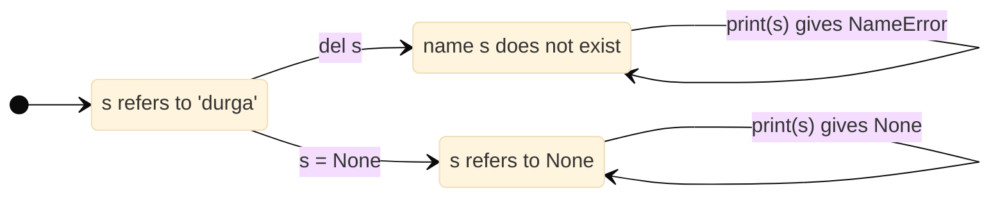

## 18. Strings with flow control (syllabus part 2)

The second half of the syllabus notes uses loops and decisions with **strings**. The string basics are covered in depth in [Topic 03.1 Strings](../03.1%20Strings/README.md); this section includes every example and program from the notes.

### Defining strings and quotes inside strings

A string is any sequence of characters inside single or double quotes. Python has no `char` type, so `'a'` is also a `str`. Triple quotes create multi-line strings.

<table width="100%">
<tr>
<th align="left" width="50%">Code</th>
<th align="left" width="12%">Valid?</th>
<th align="left" width="38%">Reason</th>
</tr>
<tr><td><code>s='This is ' single quote symbol'</code></td><td>No</td><td>The middle <code>'</code> ends the string early</td></tr>
<tr><td><code>s='This is \' single quote symbol'</code></td><td>Yes</td><td>The quote is escaped</td></tr>
<tr><td><code>s="This is ' single quote symbol"</code></td><td>Yes</td><td>Different outer quotes</td></tr>
<tr><td><code>s='This is " double quotes symbol'</code></td><td>Yes</td><td>Different outer quotes</td></tr>
<tr><td><code>s='The "Python Notes" by 'durga' is very helpful'</code></td><td>No</td><td>The <code>'</code> before durga ends the string</td></tr>
<tr><td><code>s="The "Python Notes" by 'durga' is very helpful"</code></td><td>No</td><td>The <code>"</code> before Python ends the string</td></tr>
<tr><td><code>s='The \"Python Notes\" by \'durga\' is very helpful'</code></td><td>Yes</td><td>All inner quotes are escaped</td></tr>
<tr><td><code>s='''The "Python Notes" by 'durga' is very helpful'''</code></td><td>Yes</td><td>Triple quotes accept both kinds</td></tr>
</table>

```python
# A one-character string is still a str
ch = 'a'

# There is no separate char type
print(type(ch))

# A multi-line string with triple quotes
s = '''durga
software
solutions'''

# The line breaks are kept
print(s)
```

**Output**

```text
<class 'str'>
durga
software
solutions
```

### Index-wise characters with positive and negative indexes

```python
# Read a string
s = input("Enter Some String:")

# Start the positive index at 0
i = 0

# Go through each character
for x in s:

    # Negative index = positive index - length
    print("The character present at positive index {} and at negative index {} is {}".format(i, i - len(s), x))

    # Next position
    i = i + 1
```

**Output** (user types `durga`)

```text
Enter Some String:durga
The character present at positive index 0 and at negative index -5 is d
The character present at positive index 1 and at negative index -4 is u
The character present at positive index 2 and at negative index -3 is r
The character present at positive index 3 and at negative index -2 is g
The character present at positive index 4 and at negative index -1 is a
```

### Slicing rules from the notes

`s[begin:end:step]`:

<table width="100%">
<tr>
<th align="left" width="22%">Step</th>
<th align="left" width="26%">Direction</th>
<th align="left" width="26%">Takes characters</th>
<th align="left" width="26%">Defaults for begin and end</th>
</tr>
<tr><td>Positive (default 1)</td><td>Forward, left to right</td><td>From begin to end - 1</td><td>begin = 0, end = length of the string</td></tr>
<tr><td>Negative</td><td>Backward, right to left</td><td>From begin to end + 1</td><td>begin = -1, end = -(length + 1)</td></tr>
</table>

- In the **backward** direction, if end is `-1`, the result is always empty.
- In the **forward** direction, if end is `0`, the result is always empty.
- In either direction, begin and end can be positive or negative.

```python
# The string from the notes
s = "Learning Python is very very easy!!!"

# From 1 to 6, step 1
print(repr(s[1:7:1]))

# The same, with the default step
print(repr(s[1:7]))

# Every second character from 1 to 6
print(repr(s[1:7:2]))

# From the start to index 6
print(repr(s[:7]))

# From index 7 to the end
print(repr(s[7:]))

# The whole string, two ways
print(repr(s[::]))

# The whole string with [:]
print(repr(s[:]))

# Reversed
print(repr(s[::-1]))

# Backward with end -1: always empty
print(repr(s[5:-1:-1]))

# Forward with end 0: always empty
print(repr(s[5:0]))

# Backward from index -2 to index -5 (exclusive)
print(repr(s[-2:-5:-1]))
```

**Output**

```text
'earnin'
'earnin'
'eri'
'Learnin'
'g Python is very very easy!!!'
'Learning Python is very very easy!!!'
'Learning Python is very very easy!!!'
'!!!ysae yrev yrev si nohtyP gninraeL'
''
''
'!!y'
```

### + and * with strings, and len()

```python
# + joins two strings
print("durga" + "soft")

# * repeats a string
print("durga" * 2)

# len() counts characters
print(len("durga"))
```

**Output**

```text
durgasoft
durgadurga
5
```

For `+`, both sides must be strings. For `*`, one side must be a string and the other an int.

### Forward and backward with a while loop

```python
# The text to walk through
s = "Learning Python is very easy !!!"

# Number of characters
n = len(s)

# Start at the first index
i = 0

# Label for the forward walk
print("Forward direction")

# Walk forward while i is inside the string
while i < n:

    # Print one character, staying on the line
    print(s[i], end=' ')

    # Next index
    i += 1

# Move to a new line
print()

# Label for the backward walk
print("Backward direction")

# Start at the last character
i = -1

# Walk backward until we pass the first character
while i >= -n:

    # Print one character
    print(s[i], end=' ')

    # Previous index
    i = i - 1
```

**Output**

```text
Forward direction
L e a r n i n g   P y t h o n   i s   v e r y   e a s y   ! ! ! 
Backward direction
! ! !   y s a e   y r e v   s i   n o h t y P   g n i n r a e L 
```

The alternative ways with `for`:

```python
# The same text
s = "Learning Python is very easy !!!"

# Forward with a plain for loop
for ch in s:

    # Print each character
    print(ch, end=' ')

# New line
print()

# Backward by looping over a reversed slice
for ch in s[::-1]:

    # Print each character
    print(ch, end=' ')
```

**Output**

```text
L e a r n i n g   P y t h o n   i s   v e r y   e a s y   ! ! ! 
! ! !   y s a e   y r e v   s i   n o h t y P   g n i n r a e L 
```

### Membership: in and not in

```python
# Read the main string
s = input("Enter main string:")

# Read the string to look for
subs = input("Enter sub string:")

# in checks whether subs appears inside s
if subs in s:

    # Found
    print(subs, "is found in main string")

# Not found
else:

    # Report it
    print(subs, "is not found in main string")
```

**Output, run 1** (user types `durgasoftwaresolutions`, `durga`)

```text
Enter main string:durgasoftwaresolutions
Enter sub string:durga
durga is found in main string
```

**Output, run 2** (user types `durgasoftwaresolutions`, `python`)

```text
Enter main string:durgasoftwaresolutions
Enter sub string:python
python is not found in main string
```

### Comparing strings

Comparison uses alphabetical (Unicode) order.

```python
# Read two strings
s1 = input("Enter first string:")

# Second string
s2 = input("Enter Second string:")

# Equal?
if s1 == s2:
    print("Both strings are equal")

# Alphabetically earlier?
elif s1 < s2:
    print("First String is less than Second String")

# Otherwise later
else:
    print("First String is greater than Second String")
```

**Output, run 1** (user types `durga`, `durga`)

```text
Enter first string:durga
Enter Second string:durga
Both strings are equal
```

**Output, run 2** (user types `durga`, `ravi`)

```text
Enter first string:durga
Enter Second string:ravi
First String is less than Second String
```

**Output, run 3** (user types `durga`, `anil`)

```text
Enter first string:durga
Enter Second string:anil
First String is greater than Second String
```

### Removing spaces before a decision

```python
# Read a city name; users often type extra spaces
city = input("Enter your city Name:")

# Remove spaces from both ends before comparing
scity = city.strip()

# Compare the cleaned name
if scity == 'Hyderabad':
    print("Hello Hyderabadi..Adab")

# Otherwise, check whether scity == 'Chennai'
elif scity == 'Chennai':
    print("Hello Madrasi...Vanakkam")

# Otherwise, check whether scity == "Bangalore"
elif scity == "Bangalore":
    print("Hello Kannadiga...Shubhodaya")

# Otherwise, when no condition above was True
else:
    print("your entered city is invalid")
```

**Output, run 1** (user types `   Hyderabad  `)

```text
Enter your city Name:   Hyderabad  
Hello Hyderabadi..Adab
```

**Output, run 2** (user types `Chennai`)

```text
Enter your city Name:Chennai
Hello Madrasi...Vanakkam
```

**Output, run 3** (user types `Delhi`)

```text
Enter your city Name:Delhi
your entered city is invalid
```

`rstrip()` removes spaces on the right, `lstrip()` on the left, and `strip()` on both sides.

### Finding substrings: find, rfind, index, rindex

```python
# The text from the notes
s = "Learning Python is very easy"

# First position of "Python"
print(s.find("Python"))

# Not found gives -1
print(s.find("Java"))

# First "r"
print(s.find("r"))

# Last "r"
print(s.rfind("r"))

# A second text to search with boundaries
s = "durgaravipavanshiva"

# First "a" anywhere
print(s.find('a'))

# First "a" between index 7 and 14
print(s.find('a', 7, 15))

# "z" between index 7 and 14
print(s.find('z', 7, 15))
```

**Output**

```text
9
-1
3
21
4
10
-1
```

`index()` is the same as `find()`, except that it raises `ValueError` when the substring is missing. The notes handle that with `try-except-else` (Topic 14):

```python
# Read the main string
s = input("Enter main string:")

# Read the substring
subs = input("Enter sub string:")

# Try to find the substring
try:

    # Raises ValueError if subs is missing
    n = s.index(subs)

# Runs when index() raised ValueError
except ValueError:

    # Report it
    print("substring not found")

# Runs when no error happened
else:

    # Report success
    print("substring found")
```

**Output, run 1** (user types `learning python is very easy`, `python`)

```text
Enter main string:learning python is very easy
Enter sub string:python
substring found
```

**Output, run 2** (user types `learning python is very easy`, `java`)

```text
Enter main string:learning python is very easy
Enter sub string:java
substring not found
```

### All positions of a substring

```python
# Read the main string
s = input("Enter main string:")

# Read the substring
subs = input("Enter sub string:")

# Remember whether we found anything
flag = False

# Start before the first index
pos = -1

# Length of the main string
n = len(s)

# Keep searching after the last match
while True:

    # Search from the position after the previous match
    pos = s.find(subs, pos + 1, n)

    # -1 means no more matches
    if pos == -1:
        break

    # Report the match
    print("Found at position", pos)

    # Remember that at least one match was found
    flag = True

# No match at all
if flag == False:

    # Report it
    print("Not Found")
```

**Output, run 1** (user types `abbababababacdefg`, `a`)

```text
Enter main string:abbababababacdefg
Enter sub string:a
Found at position 0
Found at position 3
Found at position 5
Found at position 7
Found at position 9
Found at position 11
```

**Output, run 2** (user types `abbababababacdefg`, `bb`)

```text
Enter main string:abbababababacdefg
Enter sub string:bb
Found at position 1
```

**Output, run 3** (user types `abbababababacdefg`, `z`)

```text
Enter main string:abbababababacdefg
Enter sub string:z
Not Found
```

### count()

```python
# The text from the notes
s = "abcabcabcabcadda"

# Count "a" in the whole string
print(s.count('a'))

# Count "ab"
print(s.count('ab'))

# Count "a" only between index 3 and 6
print(s.count('a', 3, 7))
```

**Output**

```text
6
4
2
```

### replace() and immutability

```python
# Replace a word
s = "Learning Python is very difficult"

# A new string with "easy" in place of "difficult"
s1 = s.replace("difficult", "easy")

# Print the new string
print(s1)

# Every occurrence is replaced
print("ababababababab".replace("a", "b"))
```

**Output**

```text
Learning Python is very easy
bbbbbbbbbbbbbb
```

**If strings are immutable, how does `replace()` change the content?** It does not. It creates a **new** string with the changes; the original object stays exactly as it was.

```python
# The original string
s = "abab"

# replace() builds a new string
s1 = s.replace("a", "b")

# The original is unchanged
print(s, s1)

# Two different objects in memory
print(id(s) == id(s1))
```

**Output**

```text
abab bbbb
False
```

### split() and join()

```python
# split() with the default separator (whitespace) returns a list
for x in "durga software solutions".split():

    # Print each word
    print(x)

# split() on a dash
for x in "22-02-2018".split('-'):

    # Print each part
    print(x)

# join() a tuple with a dash
print('-'.join(('sunny', 'bunny', 'chinny')))

# join() a list with a colon
print(':'.join(['hyderabad', 'singapore', 'london', 'dubai']))
```

**Output**

```text
durga
software
solutions
22
02
2018
sunny-bunny-chinny
hyderabad:singapore:london:dubai
```

### Changing case and checking start and end

```python
# The text from the notes
s = 'learning Python is very Easy'

# All capital
print(s.upper())

# All small
print(s.lower())

# Swap each letter's case
print(s.swapcase())

# Capitalise every word
print(s.title())

# Capitalise only the first letter
print(s.capitalize())

# Does it start with "learning"?
print(s.startswith('learning'))

# Does it end with "learning"?
print(s.endswith('learning'))

# Does it end with "Easy"?
print(s.endswith('Easy'))
```

**Output**

```text
LEARNING PYTHON IS VERY EASY
learning python is very easy
LEARNING pYTHON IS VERY eASY
Learning Python Is Very Easy
Learning python is very easy
True
False
True
```

### Checking the type of characters

```python
# Letters and digits only
print('Durga786'.isalnum())

# Not only letters, because of the digits
print('durga786'.isalpha())

# Only letters
print('durga'.isalpha())

# Not digits
print('durga'.isdigit())

# Only digits
print('786786'.isdigit())

# All letters are small
print('abc'.islower())

# A capital letter is present
print('Abc'.islower())

# Digits are ignored; the letters are all small
print('abc123'.islower())

# All letters are capital
print('ABC'.isupper())

# Not every word starts with a capital
print('Learning python is Easy'.istitle())

# Every word starts with a capital
print('Learning Python Is Easy'.istitle())

# Only whitespace
print('    '.isspace())
```

**Output**

```text
True
False
True
False
True
True
False
True
True
False
True
True
```

> **Small corrections:** `isalnum()` and `isalpha()` accept letters from **any** language, not only a to z. `isspace()` is `True` for any whitespace (spaces, tabs, new lines), not only spaces. `islower()` and `isupper()` look only at the letters, which is why `'abc123'.islower()` is `True`.

## 19. Formatting strings with format()

`format()` fills the `{}` placeholders in a string with values. The notes cover 12 cases. **f-strings** ([Topic 03.1](../03.1%20Strings/README.md#15-formatting-with-f-strings)) use exactly the same format codes and are recommended for new code; `format()` is still common and useful when a template is stored and reused.

```mermaid
%%{init: {"theme": "forest", "themeVariables": {"fontFamily": "Courier New"}}}%%
classDiagram
    class FormatSpec {
        fill : any character
        align : left, right, centre, sign
        sign : + or -
        zero : 0 padding
        width : minimum width
        precision : .3 digits or characters
        type : d f b o x X
    }
    class Example {
        "{:*^10.3f}"
        fill = *
        align = ^
        width = 10
        precision = .3
        type = f
    }
    FormatSpec <.. Example : uses
```

### Case 1: default, positional and keyword arguments

```python
# Values from the notes
name = 'durga'

# Salary value
salary = 10000

# Age value
age = 48

# Default: filled in order
print("{} 's salary is {} and his age is {}".format(name, salary, age))

# Positional: numbers choose the argument
print("{0} 's salary is {1} and his age is {2}".format(name, salary, age))

# Keyword: names choose the argument, in any order
print("{x} 's salary is {y} and his age is {z}".format(z=age, y=salary, x=name))
```

**Output**

```text
durga 's salary is 10000 and his age is 48
durga 's salary is 10000 and his age is 48
durga 's salary is 10000 and his age is 48
```

### Case 2: formatting numbers

<table width="100%">
<tr>
<th align="left" width="10%">Code</th>
<th align="left" width="40%">Meaning</th>
<th align="left" width="25%">Example</th>
<th align="left" width="25%">Result</th>
</tr>
<tr><td><code>d</code></td><td>Decimal integer</td><td><code>"{:d}".format(123)</code></td><td><code>123</code></td></tr>
<tr><td><code>f</code></td><td>Fixed point float, default precision 6</td><td><code>"{:f}".format(1.5)</code></td><td><code>1.500000</code></td></tr>
<tr><td><code>b</code></td><td>Binary</td><td><code>"{:b}".format(5)</code></td><td><code>101</code></td></tr>
<tr><td><code>o</code></td><td>Octal</td><td><code>"{:o}".format(8)</code></td><td><code>10</code></td></tr>
<tr><td><code>x</code></td><td>Hexadecimal, small letters</td><td><code>"{:x}".format(255)</code></td><td><code>ff</code></td></tr>
<tr><td><code>X</code></td><td>Hexadecimal, capital letters</td><td><code>"{:X}".format(255)</code></td><td><code>FF</code></td></tr>
</table>

```python
# Plain
print("The integer number is: {}".format(123))

# d: decimal integer
print("The integer number is: {:d}".format(123))

# Minimum width 5, padded with spaces on the left
print("The integer number is: {:5d}".format(123))

# Minimum width 5, padded with zeros
print("The integer number is: {:05d}".format(123))
```

**Output**

```text
The integer number is: 123
The integer number is: 123
The integer number is:   123
The integer number is: 00123
```

```python
# Plain float
print("The float number is: {}".format(123.4567))

# f: 6 decimal places by default
print("The float number is: {:f}".format(123.4567))

# Width 8 with 3 decimal places, rounded
print("The float number is: {:8.3f}".format(123.4567))

# Width 8, 3 decimals, padded with zeros
print("The float number is: {:08.3f}".format(123.4567))

# Missing decimals are filled with zeros
print("The float number is: {:08.3f}".format(123.45))

# A longer number simply uses more than 8 positions
print("The float number is: {:08.3f}".format(786786123.45))
```

**Output**

```text
The float number is: 123.4567
The float number is: 123.456700
The float number is:  123.457
The float number is: 0123.457
The float number is: 0123.450
The float number is: 786786123.450
```

**How `{:08.3f}` works:** the total width is **at least** 8, including the decimal point. Exactly 3 digits come after the point (rounded, or filled with 0). If the number is shorter than 8, zeros fill the left side. If it is longer, all its digits are shown.

```python
# The same number in binary, octal and hexadecimal
print("Binary Form:{0:b}".format(153))

# Octal
print("Octal Form:{0:o}".format(153))

# Hexadecimal, small letters
print("Hexa decimal Form:{0:x}".format(154))

# Hexadecimal, capital letters
print("Hexa decimal Form:{0:X}".format(154))
```

**Output**

```text
Binary Form:10011001
Octal Form:231
Hexa decimal Form:9a
Hexa decimal Form:9A
```

Binary, octal and hexadecimal formats work only for **ints**, not floats.

### Case 3: signed numbers

```python
# + shows the sign for positive numbers
print("int value with sign:{:+d}".format(123))

# Negative numbers always show the minus sign
print("int value with sign:{:+d}".format(-123))

# The same for floats
print("float value with sign:{:+f}".format(123.456))

# Negative float
print("float value with sign:{:+f}".format(-123.456))
```

**Output**

```text
int value with sign:+123
int value with sign:-123
float value with sign:+123.456000
float value with sign:-123.456000
```

### Case 4: alignment of numbers

<table width="100%">
<tr>
<th align="left" width="10%">Symbol</th>
<th align="left" width="40%">Meaning</th>
<th align="left" width="24%">Example</th>
<th align="left" width="26%">Result</th>
</tr>
<tr><td><code>&lt;</code></td><td>Left align in the remaining space</td><td><code>"{:&lt;5d}".format(12)</code></td><td><code>'12   '</code></td></tr>
<tr><td><code>&gt;</code></td><td>Right align (default for numbers)</td><td><code>"{:&gt;5d}".format(12)</code></td><td><code>'   12'</code></td></tr>
<tr><td><code>^</code></td><td>Centre</td><td><code>"{:^5d}".format(12)</code></td><td><code>' 12  '</code></td></tr>
<tr><td><code>=</code></td><td>Put the sign at the far left, padding after it</td><td><code>"{:=5d}".format(-12)</code></td><td><code>'-  12'</code></td></tr>
</table>

```python
# Default for numbers: right aligned
print(repr("{:5d}".format(12)))

# Left aligned
print(repr("{:<5d}".format(12)))

# Left aligned with 0 as the fill: the zeros go on the RIGHT
print(repr("{:<05d}".format(12)))

# Right aligned
print(repr("{:>5d}".format(12)))

# Right aligned with zeros
print(repr("{:>05d}".format(12)))

# Centred
print(repr("{:^5d}".format(12)))

# Sign at the far left
print(repr("{:=5d}".format(-12)))

# Centred float, width 10, 3 decimals
print(repr("{:^10.3f}".format(12.23456)))

# Sign at the far left for a float
print(repr("{:=8.3f}".format(-12.23456)))
```

**Output**

```text
'   12'
'12   '
'12000'
'   12'
'00012'
' 12  '
'-  12'
'  12.235  '
'- 12.235'
```

> `repr()` is used here so the spaces are visible. Note that `{:<05d}` gives `'12000'`: the zero fill is placed on the right, which changes how the number looks. Avoid it for real numbers.

### Case 5: formatting strings

```python
# Numbers are right aligned by default
print(repr("{:5d}".format(12)))

# Strings are left aligned by default
print(repr("{:5}".format("rat")))

# Right aligned
print(repr("{:>5}".format("rat")))

# Left aligned
print(repr("{:<5}".format("rat")))

# Centred
print(repr("{:^5}".format("rat")))

# Centred with * as the fill (any character works, like +, $ or a)
print(repr("{:*^5}".format("rat")))
```

**Output**

```text
'   12'
'rat  '
'  rat'
'rat  '
' rat '
'*rat*'
```

### Case 6: truncating strings

A precision on a **string** keeps only that many characters.

```python
# Keep the first 3 characters
print(repr("{:.3}".format("durgasoftware")))

# 3 characters in a width of 5
print(repr("{:5.3}".format("durgasoftware")))

# Right aligned
print(repr("{:>5.3}".format("durgasoftware")))

# Centred
print(repr("{:^5.3}".format("durgasoftware")))

# Centred with a fill character
print(repr("{:*^5.3}".format("durgasoftware")))
```

**Output**

```text
'dur'
'dur  '
'  dur'
' dur '
'*dur*'
```

### Case 7: dictionary values

```python
# A dictionary from the notes
person = {'age': 48, 'name': 'durga'}

# p is the name given to the dictionary inside the template
print("{p[name]}'s age is: {p[age]}".format(p=person))

# **person unpacks the keys as keyword arguments, which is more convenient
print("{name}'s age is: {age}".format(**person))
```

**Output**

```text
durga's age is: 48
durga's age is: 48
```

### Case 8: class members

```python
# A class with two class variables
class Person:

    # Class variable age
    age = 48

    # Class variable name
    name = "durga"

# Access attributes with a dot inside the braces
print("{p.name}'s age is :{p.age}".format(p=Person()))
```

**Output**

```text
durga's age is :48
```

```python
# A class whose objects each have their own name and age
class Person:

    # Runs when an object is created
    def __init__(self, name, age):

        # Store the name in the object
        self.name = name

        # Store the age in the object
        self.age = age

# Format the first object
print("{p.name}'s age is :{p.age}".format(p=Person('durga', 48)))

# Format the second object
print("{p.name}'s age is :{p.age}".format(p=Person('Ravi', 50)))
```

**Output**

```text
durga's age is :48
Ravi's age is :50
```

### Case 9: dynamic formatting

The format spec itself can contain placeholders.

```python
# A template whose fill, alignment and width are chosen later
string = "{:{fill}{align}{width}}"

# Centre in width 5 with *
print(string.format('cat', fill='*', align='^', width=5))

# Centre in width 6: the extra * goes on the right
print(string.format('cat', fill='*', align='^', width=6))

# Left align in width 6
print(string.format('cat', fill='*', align='<', width=6))

# Right align in width 6
print(string.format('cat', fill='*', align='>', width=6))
```

**Output**

```text
*cat*
*cat**
cat***
***cat
```

### Case 10: dynamic float format

```python
# A float template with a chosen alignment, width and precision
num = "{:{align}{width}.{precision}f}"

# Left aligned, width 8, 2 decimals
print(repr(num.format(123.236, align='<', width=8, precision=2)))

# Right aligned, width 8, 2 decimals
print(repr(num.format(123.236, align='>', width=8, precision=2)))
```

**Output**

```text
'123.24  '
'  123.24'
```

### Case 11: dates

```python
# Load the datetime module
import datetime

# A fixed date and time, so the output is the same every time
date = datetime.datetime(2026, 11, 12, 9, 30, 15)

# Day/month/year hour:minute:second
print("It's now:{:%d/%m/%Y  %H:%M:%S}".format(date))
```

**Output**

```text
It's now:12/11/2026  09:30:15
```

> The notes use `datetime.datetime.now()`, which prints the current date and time. A fixed date is used here so the output is predictable.

### Case 12: complex numbers

```python
# A complex number
complexNumber = 1 + 2j

# 0.real and 0.imag read attributes of argument 0
print("Real Part:{0.real} and Imaginary Part:{0.imag}".format(complexNumber))
```

**Output**

```text
Real Part:1.0 and Imaginary Part:2.0
```

## 20. Important string programs

Each program is shown with the input typed by the user and the real output.

### Q1. Reverse the given string

```python
# Read a string
s = input("Enter Some String:")

# 1st way: a slice with step -1
print(s[::-1])

# 2nd way: reversed() gives the characters backwards; join() glues them
print(''.join(reversed(s)))

# 3rd way: a while loop from the last index down to 0
i = len(s) - 1

# Start with an empty result
target = ''

# Walk backwards
while i >= 0:

    # Add the current character
    target = target + s[i]

    # Previous index
    i = i - 1

# Print the result of the 3rd way
print(target)
```

**Output** (user types `durga`)

```text
Enter Some String:durga
agrud
agrud
agrud
```

### Q2. Reverse the order of words

```python
# Read a sentence
s = input("Enter Some String:")

# Split into words
l = s.split()

# An empty list for the reversed words
l1 = []

# Start at the last word
i = len(l) - 1

# Walk backwards through the words
while i >= 0:

    # Add the current word
    l1.append(l[i])

    # Previous word
    i = i - 1

# Join the words with spaces
output = ' '.join(l1)

# Print the result
print(output)
```

**Output** (user types `Learning Python is very Easy`)

```text
Enter Some String:Learning Python is very Easy
Easy very is Python Learning
```

> A shorter way: `' '.join(s.split()[::-1])`.

### Q3. Reverse the content of each word

```python
# Read a sentence
s = input("Enter Some String:")

# Split into words
l = s.split()

# An empty list for the reversed words
l1 = []

# Start at the first word
i = 0

# Go through every word
while i < len(l):

    # Reverse the current word and store it
    l1.append(l[i][::-1])

    # Next word
    i = i + 1

# Join with spaces
output = ' '.join(l1)

# Print the result
print(output)
```

**Output** (user types `Durga Software Solutions`)

```text
Enter Some String:Durga Software Solutions
agruD erawtfoS snoituloS
```

### Q4. Characters at even and odd positions

```python
# Read a string
s = input("Enter Some String:")

# 1st way: slices with step 2
print("Characters at Even Position:", s[0::2])

# Odd positions start at index 1
print("Characters at Odd Position:", s[1::2])

# 2nd way: a while loop jumping by 2
i = 0

# Label
print("Characters at Even Position:")

# Even indexes
while i < len(s):

    # Print the character and a comma
    print(s[i], end=',')

    # Jump 2 places
    i = i + 2

# New line
print()

# Label
print("Characters at Odd Position:")

# Odd indexes start at 1
i = 1

# Odd indexes
while i < len(s):

    # Print the character and a comma
    print(s[i], end=',')

    # Jump 2 places
    i = i + 2
```

**Output** (user types `durgasoft`)

```text
Enter Some String:durgasoft
Characters at Even Position: draot
Characters at Odd Position: ugsf
Characters at Even Position:
d,r,a,o,t,
Characters at Odd Position:
u,g,s,f,
```

### Q5. Merge two strings by taking characters alternately

```python
# Read two strings
s1 = input("Enter First String:")

# Second string
s2 = input("Enter Second String:")

# The merged result
output = ''

# One index for each string
i, j = 0, 0

# Continue while either string still has characters
while i < len(s1) or j < len(s2):

    # Take the next character from s1 if any are left
    if i < len(s1):

        # Add it
        output = output + s1[i]

        # Move in s1
        i += 1

    # Take the next character from s2 if any are left
    if j < len(s2):

        # Add it
        output = output + s2[j]

        # Move in s2
        j += 1

# Print the merged string
print(output)
```

**Output, run 1** (user types `ravi`, `reja`)

```text
Enter First String:ravi
Enter Second String:reja
rraevjia
```

**Output, run 2** (user types `durga`, `ravisoft`)

```text
Enter First String:durga
Enter Second String:ravisoft
druarvgiasoft
```

> **Correction:** the notes show `rtaevjia` for `ravi` and `reja`. The program really produces `rraevjia` (r, r, a, e, v, j, i, a), as the output above shows.

### Q6. Letters first (sorted), then digits (sorted)

```python
# Read a string
s = input("Enter Some String:")

# Three empty strings: letters, digits and the result
s1 = s2 = output = ''

# Split the characters into letters and digits
for x in s:

    # Letters go to s1
    if x.isalpha():
        s1 = s1 + x

    # Everything else goes to s2
    else:
        s2 = s2 + x

# Add the letters in sorted order
for x in sorted(s1):
    output = output + x

# Then add the digits in sorted order
for x in sorted(s2):
    output = output + x

# Print the result
print(output)
```

**Output** (user types `B4A1D3`)

```text
Enter Some String:B4A1D3
ABD134
```

### Q7. Expand a letter by its count: a4b3c2 to aaaabbbcc

```python
# Read the coded string
s = input("Enter Some String:")

# The expanded result
output = ''

# Look at each character
for x in s:

    # A letter is added once and remembered
    if x.isalpha():

        # Add the letter
        output = output + x

        # Remember it for the digit that follows
        previous = x

    # A digit says how many times the letter appears in total
    else:

        # The letter is already added once, so add it (count - 1) more times
        output = output + previous * (int(x) - 1)

# Print the result
print(output)
```

**Output** (user types `a4b3c2`)

```text
Enter Some String:a4b3c2
aaaabbbcc
```

### Q8. Shift each letter by the digit after it: a4k3b2 to aeknbd

Remember: `chr(unicode)` gives the character, and `ord(character)` gives its Unicode number.

```python
# Read the coded string
s = input("Enter Some String:")

# The result
output = ''

# Look at each character
for x in s:

    # Keep letters and remember the last one
    if x.isalpha():

        # Add the letter
        output = output + x

        # Remember it
        previous = x

    # A digit: add the letter that many places later in the alphabet
    else:

        # ord('a') + 4 is the code of 'e'
        output = output + chr(ord(previous) + int(x))

# Print the result
print(output)
```

**Output** (user types `a4k3b2`)

```text
Enter Some String:a4k3b2
aeknbd
```

### Q9. Remove duplicate characters

```python
# Read a string
s = input("Enter Some String:")

# A list of characters already seen
l = []

# Keep only the first copy of each character
for x in s:

    # Add the character only if it is new
    if x not in l:
        l.append(x)

# Join the kept characters
output = ''.join(l)

# Print the result
print(output)
```

**Output** (user types `ABCDABBCDABBBCCCDDEEEF`)

```text
Enter Some String:ABCDABBCDABBBCCCDDEEEF
ABCDEF
```

> A shorter way that keeps the order: `''.join(dict.fromkeys(s))`.

### Q10. Count each character

```python
# Read a string
s = input("Enter the Some String:")

# A dictionary: character -> count
d = {}

# Count each character
for x in s:

    # Seen before: add 1
    if x in d:
        d[x] = d[x] + 1

    # First time: start at 1
    else:
        d[x] = 1

# Print every character and its count
for k, v in d.items():
    print("{} = {} Times".format(k, v))
```

**Output** (user types `ABCABCABBCDE`)

```text
Enter the Some String:ABCABCABBCDE
A = 3 Times
B = 4 Times
C = 3 Times
D = 1 Times
E = 1 Times
```

> The notes use `if x in d.keys()`; `if x in d` does the same and is the usual style. The standard library's `collections.Counter(s)` does all the counting in one call.

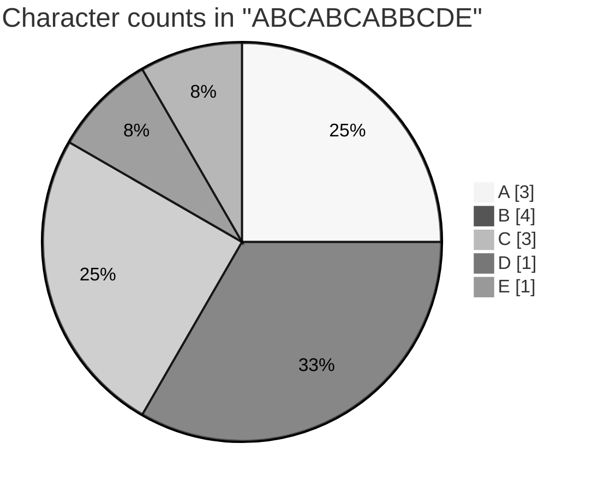

## 21. Common errors

<table width="100%">
<tr>
<th align="left" width="22%">Code</th>
<th align="left" width="34%">Error</th>
<th align="left" width="22%">Cause</th>
<th align="left" width="22%">Fix</th>
</tr>
<tr><td><code>if x &gt; 5</code> (no colon)</td><td><code>SyntaxError: expected ':'</code></td><td>Missing colon</td><td>End the line with <code>:</code></td></tr>
<tr><td><code>if x = 5:</code></td><td><code>SyntaxError: invalid syntax. Maybe you meant '==' or ':=' instead of '='?</code></td><td><code>=</code> assigns, <code>==</code> compares</td><td><code>if x == 5:</code></td></tr>
<tr><td>Body not indented</td><td><code>IndentationError: expected an indented block after 'if' statement</code></td><td>Block without indentation</td><td>Indent with 4 spaces</td></tr>
<tr><td><code>while i &lt; 5:</code> without changing <code>i</code></td><td>No error; runs forever</td><td>Condition never becomes False</td><td>Update the variable inside the loop</td></tr>
<tr><td><code>continue</code> before <code>i += 1</code> in a while loop</td><td>No error; runs forever</td><td>Counter is never updated</td><td>Update the counter first</td></tr>
<tr><td><code>del s[0]</code> on a string</td><td><code>TypeError: 'str' object doesn't support item deletion</code></td><td>Strings are immutable</td><td>Build a new string, e.g. <code>s[1:]</code></td></tr>
<tr><td>Using a name after <code>del</code></td><td><code>NameError: name 'x' is not defined</code></td><td>The name was removed</td><td>Do not use it, or assign it again</td></tr>
<tr><td><code>for i in range(5): print(i)</code> expecting 1 to 5</td><td>No error; prints 0 to 4</td><td><code>range</code> stops before the end</td><td><code>range(1, 6)</code></td></tr>
</table>

## 22. Quick revision

<table width="100%">
<tr>
<th align="left" width="6%">#</th>
<th align="left" width="36%">Question</th>
<th align="left" width="42%">Answer</th>
<th align="left" width="16%">Read again</th>
</tr>
<tr><td>1</td><td>Three groups of flow control</td><td>Conditional, iterative, transfer</td><td><a href="#1-what-is-flow-control">Section 1</a></td></tr>
<tr><td>2</td><td>How Python marks a block</td><td>A colon, then indentation (4 spaces)</td><td><a href="#2-indentation-how-python-groups-statements">Section 2</a></td></tr>
<tr><td>3</td><td>Is <code>else</code> required?</td><td>No, it is always optional</td><td><a href="#5-if-elif-else">Section 5</a></td></tr>
<tr><td>4</td><td>In <code>if-elif-else</code>, how many blocks run?</td><td>At most one: the first True condition, or else</td><td><a href="#5-if-elif-else">Section 5</a></td></tr>
<tr><td>5</td><td>Does Python have a switch statement?</td><td>Not by that name; <code>match</code> since Python 3.10</td><td><a href="#8-match-case-python-310">Section 8</a></td></tr>
<tr><td>6</td><td>Default case in <code>match</code></td><td><code>case _:</code></td><td><a href="#8-match-case-python-310">Section 8</a></td></tr>
<tr><td>7</td><td>Two loop types</td><td><code>for</code> and <code>while</code></td><td><a href="#9-for-loop">Section 9</a></td></tr>
<tr><td>8</td><td><code>range(10, 0, -1)</code> gives</td><td>10 down to 1</td><td><a href="#9-for-loop">Section 9</a></td></tr>
<tr><td>9</td><td>Stop an infinite loop in the terminal</td><td>Ctrl+C</td><td><a href="#11-infinite-loops">Section 11</a></td></tr>
<tr><td>10</td><td>In nested loops, how often does the inner loop run?</td><td>Completely, for every round of the outer loop</td><td><a href="#12-nested-loops-and-patterns">Section 12</a></td></tr>
<tr><td>11</td><td><code>break</code> does</td><td>Ends the loop at once</td><td><a href="#13-break">Section 13</a></td></tr>
<tr><td>12</td><td><code>continue</code> does</td><td>Skips to the next round</td><td><a href="#14-continue">Section 14</a></td></tr>
<tr><td>13</td><td>When does a loop's <code>else</code> run?</td><td>When the loop ends without <code>break</code></td><td><a href="#15-loops-with-an-else-block">Section 15</a></td></tr>
<tr><td>14</td><td><code>pass</code> does</td><td>Nothing; it is a placeholder for an empty block</td><td><a href="#16-pass">Section 16</a></td></tr>
<tr><td>15</td><td><code>del x</code> vs <code>x = None</code></td><td>Unbind (NameError later) vs rebind (value None)</td><td><a href="#17-del-statement">Section 17</a></td></tr>
<tr><td>16</td><td>Safer than <code>eval(input())</code></td><td><code>ast.literal_eval(input())</code></td><td><a href="#9-for-loop">Section 9</a></td></tr>
<tr><td>17</td><td><code>{:08.3f}</code> means</td><td>Width at least 8, 3 decimals, zero padded</td><td><a href="#19-formatting-strings-with-format">Section 19</a></td></tr>
<tr><td>18</td><td>Default alignment: numbers vs strings</td><td>Numbers right, strings left</td><td><a href="#19-formatting-strings-with-format">Section 19</a></td></tr>
</table>

## 23. Interview questions

Try to answer each question aloud first, then click it to see a model answer.

<details>
<summary><b>Q1. What are the flow control statements in Python?</b></summary>

Conditional statements (`if`, `if-else`, `if-elif-else`, and `match` from Python 3.10), iterative statements (`for`, `while`) and transfer statements (`break`, `continue`, `pass`). `return` (in functions) and `raise` (for errors) also transfer control.

</details>

<details>
<summary><b>Q2. What is the difference between a for loop and a while loop?</b></summary>

A `for` loop repeats once for every item in a sequence or iterable, so the number of rounds is known from the data. A `while` loop repeats as long as a condition is `True`, which suits cases where the number of rounds is not known in advance.

</details>

<details>
<summary><b>Q3. What is the difference between break, continue and pass?</b></summary>

`break` ends the whole loop immediately. `continue` skips the rest of the current round and starts the next one. `pass` does nothing at all; it only fills a block that syntax requires.

</details>

<details>
<summary><b>Q4. When does the else block of a loop run?</b></summary>

When the loop finishes normally, without `break`. That includes loops that run zero times. It is useful for searches: the `else` block means "not found".

</details>

<details>
<summary><b>Q5. Does Python have a switch-case statement?</b></summary>

Not with that name. Before Python 3.10, people used `if-elif-else` chains or dictionaries. Python 3.10 added `match-case` (structural pattern matching), which can match values, several alternatives with `|`, sequences, dictionaries, types and guard conditions with `if`.

</details>

<details>
<summary><b>Q6. Why does Python use indentation instead of braces?</b></summary>

It forces code to look the way it is structured, which makes programs consistent and easy to read. The colon opens a block, and every statement with the same indentation belongs to that block.

</details>

<details>
<summary><b>Q7. What is an infinite loop? When is <code>while True</code> useful?</b></summary>

A loop whose condition never becomes `False`, so it never ends on its own. `while True` with a `break` inside is a common, deliberate pattern for menus, retries and reading input until a valid value arrives.

</details>

<details>
<summary><b>Q8. In nested loops, which loop does break exit?</b></summary>

Only the innermost loop that contains it. To leave several loops, use a flag variable, put the loops in a function and `return`, or use the loop `else` with `continue`/`break` tricks.

</details>

<details>
<summary><b>Q9. What is the difference between <code>del x</code> and <code>x = None</code>?</b></summary>

`del x` removes the name, so using `x` afterwards raises `NameError`. `x = None` keeps the name but points it to `None`. In both cases the old object can be garbage collected if nothing else refers to it.

</details>

<details>
<summary><b>Q10. What is a conditional expression?</b></summary>

A one-line if-else that produces a value: `result = "Pass" if marks >= 40 else "Fail"`. It is for choosing between two values, not for running blocks of statements.

</details>

<details>
<summary><b>Q11. Why is <code>eval(input())</code> dangerous?</b></summary>

`eval()` runs any Python expression the user types, including code that deletes files or reads secrets. Use `int()`/`float()` for numbers or `ast.literal_eval()` for literal values such as lists and dictionaries.

</details>

<details>
<summary><b>Q12. What values are treated as False in an if condition?</b></summary>

`False`, `None`, zero of any number type, and empty containers or text: `""`, `[]`, `()`, `{}`, `set()`, `range(0)`. Everything else is treated as `True`.

</details>

<details>
<summary><b>Q13. How do you write a loop that runs a fixed number of times?</b></summary>

`for _ in range(n):`. The `_` name shows that the loop variable is not used.

</details>

<details>
<summary><b>Q14. What does <code>"{:^10.3f}".format(12.23456)</code> produce?</b></summary>

`'  12.235  '`: the number rounded to 3 decimals, centred in a width of 10.

</details>

<details>
<summary><b>Q15. How can you get both the index and the value in a for loop?</b></summary>

With `enumerate()`: `for index, value in enumerate(items):`. Add `start=1` to count from 1.

</details>

## 24. Practice questions

1. Read a year and print whether it is a leap year.
2. Read three sides of a triangle and print whether it is equilateral, isosceles or scalene.
3. Read marks and print the grade using `if-elif-else`. Then rewrite it using `match` with guards (`case m if m >= 90:`).
4. Print all numbers from 1 to 50 that are divisible by both 3 and 5.
5. Read a number and print its multiplication table from 1 to 12.
6. Read a number and print the sum of its digits using a `while` loop.
7. Print the first 10 Fibonacci numbers (0, 1, 1, 2, 3, 5 ...).
8. Read numbers until the user types 0, then print their total and average.
9. Print a pyramid of numbers where row `i` contains `1 2 ... i`.
10. Use `break` to find the first number above 100 that is divisible by 17.
11. Use `continue` to print the letters of `"programming"` without the vowels.
12. Use a loop with `else` to check whether a number is prime.
13. Write a guessing game: the secret number is 7; keep asking until the user guesses it, and count the attempts.
14. Read a sentence and print each word with its length, using `format()` to align the columns.
15. Reverse each word in a sentence, but keep the words in the same order.

<p align="center">
  <a href="../04.%20Operators/README.md">Previous: 04. Operators</a> &nbsp;|&nbsp; <a href="../README.md">Course home</a> &nbsp;|&nbsp; <a href="../06.%20List/README.md">Next: 06. List</a>
</p>
