<p align="center">
  
</p>

# 06. List

A **list** is the most used data structure in Python. Whenever you need to keep many values together, such as marks of students, items in a cart or lines of a file, a list is usually the first choice. This topic covers everything about lists: creating them, reading them, changing them, sorting them, copying them safely, and building them with list comprehensions.

**In this topic**

1. [What is a list?](#1-what-is-a-list)
2. [Creating lists](#2-creating-lists)
3. [Accessing elements by index](#3-accessing-elements-by-index)
4. [Accessing elements by slicing](#4-accessing-elements-by-slicing)
5. [Lists are mutable](#5-lists-are-mutable)
6. [Traversing a list](#6-traversing-a-list)
7. [Getting information: len(), count(), index()](#7-getting-information-len-count-index)
8. [Adding elements: append(), insert(), extend()](#8-adding-elements-append-insert-extend)
9. [Removing elements: remove(), pop(), clear(), del](#9-removing-elements-remove-pop-clear-del)
10. [Ordering elements: reverse() and sort()](#10-ordering-elements-reverse-and-sort)
11. [Aliasing and cloning](#11-aliasing-and-cloning)
12. [Operators on lists: +, * and comparisons](#12-operators-on-lists--and-comparisons)
13. [Membership operators: in and not in](#13-membership-operators-in-and-not-in)
14. [Nested lists and matrices](#14-nested-lists-and-matrices)
15. [List comprehensions](#15-list-comprehensions)
16. [Useful built-in functions with lists](#16-useful-built-in-functions-with-lists)
17. [Complete programs](#17-complete-programs)
18. [All list methods at a glance](#18-all-list-methods-at-a-glance)
19. [Common errors](#19-common-errors)
20. [Quick revision](#20-quick-revision)
21. [Interview questions](#21-interview-questions)
22. [Practice questions](#22-practice-questions)

## 1. What is a list?

> **If we want to represent a group of individual objects as a single entity, where insertion order is preserved and duplicates are allowed, we use a list.**

<table width="100%">
<tr>
<th align="left" width="5%">#</th>
<th align="left" width="27%">Property</th>
<th align="left" width="38%">Meaning</th>
<th align="left" width="30%">Example</th>
</tr>
<tr><td>1</td><td>Insertion order is preserved</td><td>Items stay in the order you put them in</td><td><code>[3, 1, 2]</code> stays <code>[3, 1, 2]</code></td></tr>
<tr><td>2</td><td>Duplicates are allowed</td><td>The same value can appear many times</td><td><code>[10, 10, 10]</code></td></tr>
<tr><td>3</td><td>Heterogeneous objects are allowed</td><td>Different types can live in one list</td><td><code>[10, "A", 2.5, True]</code></td></tr>
<tr><td>4</td><td>Dynamic (growable)</td><td>The size can grow or shrink while the program runs</td><td><code>append()</code>, <code>remove()</code></td></tr>
<tr><td>5</td><td>Square brackets, comma separated</td><td>That is how a list is written</td><td><code>[10, 20, 30]</code></td></tr>
<tr><td>6</td><td>Mutable</td><td>You can change the content after creating it</td><td><code>n[0] = 99</code></td></tr>
<tr><td>7</td><td>Indexed</td><td>Every item has a position; duplicates are told apart by their index</td><td><code>n[0]</code>, <code>n[-1]</code></td></tr>
</table>

Because duplicates are allowed and order is kept, the **index** is how you tell items apart. That is why the index plays a very important role in lists.

How a list compares with the other collection types you met in [Topic 03](../03.%20Data%20types/README.md):

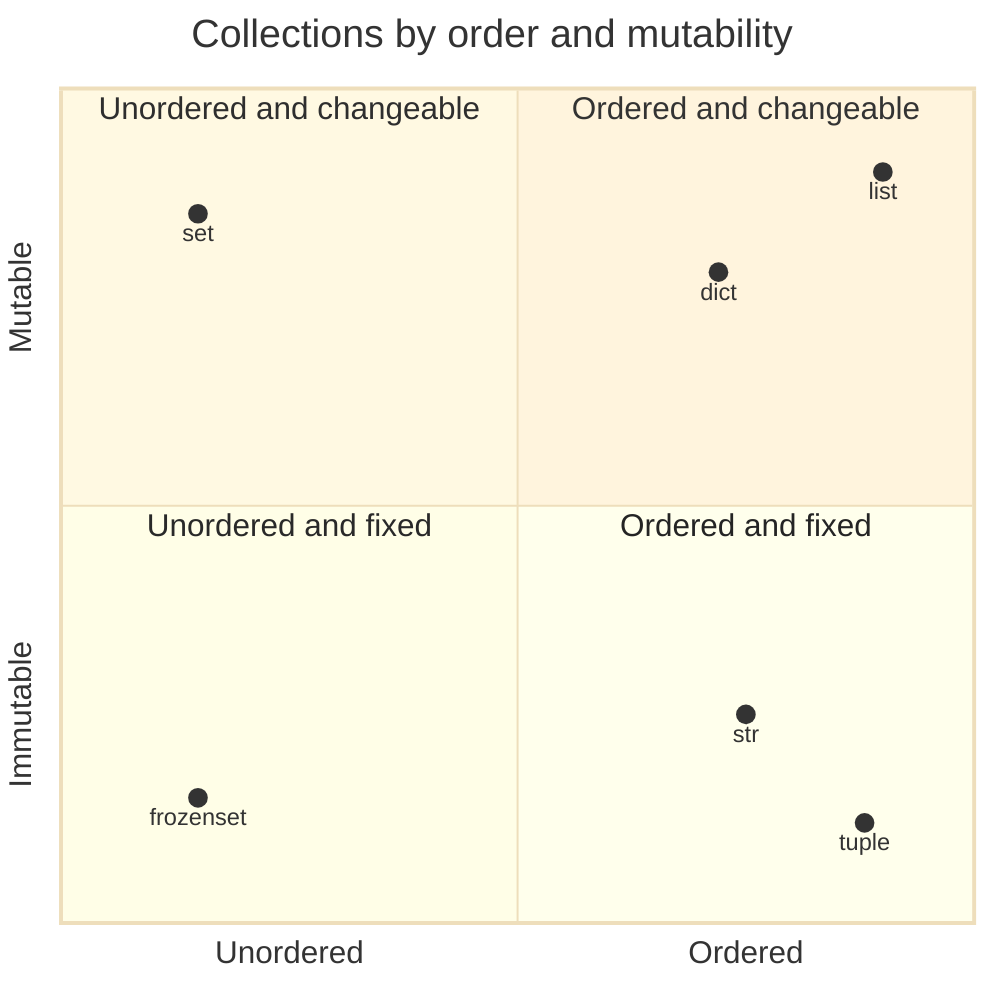

`list` sits in the top right corner: it is **ordered** and **mutable**, which makes it the most flexible collection.

## 2. Creating lists

### 1. An empty list

```python
# Create an empty list with square brackets
items = []

# Show the empty list
print(items)

# Confirm that the type is list
print(type(items))
```

**Output**

```text
[]
<class 'list'>
```

> The notes use `list` as the variable name. We use `items` instead, because naming a variable `list` hides the built-in `list()` function that we need later in this topic.

### 2. A list with known elements

```python
# A list of four numbers written directly
numbers = [10, 20, 30, 40]

# Show the list
print(numbers)
```

**Output**

```text
[10, 20, 30, 40]
```

### 3. A list from dynamic input

The notes use `eval(input(...))` to read a list typed by the user. `eval()` runs **any** Python code the user types, which is dangerous (see [Topic 03.2](../03.2%20Input%20and%20output/README.md)). The safe version is `ast.literal_eval()`, which accepts only plain values such as lists, numbers and strings.

```python
# Load the ast module, which can safely read Python values from text
import ast

# Ask the user to type a list, then turn the text into a real list safely
items = ast.literal_eval(input("Enter List:"))

# Show the list that was read
print(items)

# Confirm that the result really is a list
print(type(items))
```

**Output** (the user typed `[10,20,30,40]`)

```text
Enter List:[10,20,30,40]
[10, 20, 30, 40]
<class 'list'>
```

### 4. With the list() function

```python
# range(0, 10, 2) gives 0, 2, 4, 6, 8; list() collects them into a list
numbers = list(range(0, 10, 2))

# Show the list of even numbers
print(numbers)

# Confirm the type
print(type(numbers))
```

**Output**

```text
[0, 2, 4, 6, 8]
<class 'list'>
```

```python
# A string to break into characters
s = "durga"

# list() on a string makes one item per character
letters = list(s)

# Show the list of characters
print(letters)
```

**Output**

```text
['d', 'u', 'r', 'g', 'a']
```

### 5. With the split() function

```python
# A sentence with words separated by spaces
s = "Learning Python is very very easy !!!"

# split() breaks the sentence at every space and returns a list of words
words = s.split()

# Show the list of words
print(words)

# Confirm the type
print(type(words))
```

**Output**

```text
['Learning', 'Python', 'is', 'very', 'very', 'easy', '!!!']
<class 'list'>
```

### More ways to create a list

```python
# 1. A list of strings
fruits = ["apple", "banana", "cherry"]

# Show the new list fruits
print(1, fruits)

# 2. A list with mixed types
mixed = [10, "A", 2.5, True, None]

# Show the new list mixed
print(2, mixed)

# 3. A list with duplicates
repeats = [5, 5, 5, 7]

# Show the new list repeats
print(3, repeats)

# 4. A list of 5 zeros using repetition
zeros = [0] * 5

# Show the new list zeros
print(4, zeros)

# 5. A list from a range with a step of 10
tens = list(range(10, 60, 10))

# Show the new list tens
print(5, tens)

# 6. A countdown list using a negative step
countdown = list(range(5, 0, -1))

# Show the new list countdown
print(6, countdown)

# 7. A list from a tuple
from_tuple = list((1, 2, 3))

# Show the new list from_tuple
print(7, from_tuple)

# 8. A list of the keys of a dictionary
keys = list({"a": 1, "b": 2})

# Show the new list keys
print(8, keys)

# 9. A list split on commas
colours = "red,green,blue".split(",")

# Show the new list colours
print(9, colours)

# 10. A list of numbers from text, converting each piece with int()
marks = [int(x) for x in "78 85 92".split()]

# Show the new list marks
print(10, marks)

# 11. A list of squares using a list comprehension (Section 15)
squares = [x * x for x in range(1, 6)]

# Show the new list squares
print(11, squares)

# 12. A nested list: a list inside a list
nested = [10, 20, [30, 40]]

# Show the new list nested
print(12, nested)

# 13. A copy of another list using list()
copy_of_fruits = list(fruits)

# Show the new list copy_of_fruits
print(13, copy_of_fruits)

# 14. An empty list using list() with no argument
empty = list()

# Show the new list empty
print(14, empty)
```

**Output**

```text
1 ['apple', 'banana', 'cherry']
2 [10, 'A', 2.5, True, None]
3 [5, 5, 5, 7]
4 [0, 0, 0, 0, 0]
5 [10, 20, 30, 40, 50]
6 [5, 4, 3, 2, 1]
7 [1, 2, 3]
8 ['a', 'b']
9 ['red', 'green', 'blue']
10 [78, 85, 92]
11 [1, 4, 9, 16, 25]
12 [10, 20, [30, 40]]
13 ['apple', 'banana', 'cherry']
14 []
```

> **Nested lists:** a list can hold another list, like `[10, 20, [30, 40]]`. These are called **nested lists**. See [Section 14](#14-nested-lists-and-matrices).

## 3. Accessing elements by index

A list uses **zero-based** indexing: the first element has index `0`. It supports both **positive** indexes (left to right) and **negative** indexes (right to left).

<table width="100%">
<tr>
<th align="center" width="16%">Element</th>
<th align="center" width="14%">10</th>
<th align="center" width="14%">"A"</th>
<th align="center" width="14%">"B"</th>
<th align="center" width="14%">20</th>
<th align="center" width="14%">30</th>
<th align="center" width="14%">10</th>
</tr>
<tr><td align="center"><b>Positive index</b></td><td align="center">0</td><td align="center">1</td><td align="center">2</td><td align="center">3</td><td align="center">4</td><td align="center">5</td></tr>
<tr><td align="center"><b>Negative index</b></td><td align="center">-6</td><td align="center">-5</td><td align="center">-4</td><td align="center">-3</td><td align="center">-2</td><td align="center">-1</td></tr>
</table>

Notice that `10` appears twice, at index `0` and index `5`. The index is what tells them apart.

```python
# The list from the table above
data = [10, "A", "B", 20, 30, 10]

# 1. First element
print(1, data[0])

# 2. Second element
print(2, data[1])

# 3. Last element
print(3, data[-1])

# 4. Second last element
print(4, data[-2])

# 5. First element counted from the right
print(5, data[-6])

# 6. The two 10s are at different indexes
print(6, data[0], data[5])

# 7. Last element using the length
print(7, data[len(data) - 1])

# 8. An index stored in a variable
position = 3

# Use the variable as the index
print(8, data[position])

# 9. The item at index 2 is the string "B"; [0] takes its first character
print(9, data[2][0])

# 10. Indexes work on a list written directly
print(10, [5, 6, 7][1])
```

**Output**

```text
1 10
2 A
3 10
4 30
5 10
6 10 10
7 10
8 20
9 B
10 6
```

An index outside the list raises an error:

```python
# A list with indexes 0 to 3
numbers = [10, 20, 30, 40]

# Index 10 does not exist
print(numbers[10])
```

**Output** (last line of the error message)

```text
IndexError: list index out of range
```

## 4. Accessing elements by slicing

The slice operator takes a **part** of a list and returns a **new list**:

```text
list2 = list1[start:stop:step]
```

<table width="100%">
<tr>
<th align="left" width="14%">Part</th>
<th align="left" width="34%">Meaning</th>
<th align="left" width="26%">Default value</th>
<th align="left" width="26%">Remember</th>
</tr>
<tr><td><code>start</code></td><td>Index where the slice starts</td><td><code>0</code> (or the end, if step is negative)</td><td>Included</td></tr>
<tr><td><code>stop</code></td><td>Index where the slice stops</td><td>The length of the list (or the start, if step is negative)</td><td><b>Not</b> included</td></tr>
<tr><td><code>step</code></td><td>How far to jump each time</td><td><code>1</code></td><td>Negative goes backwards</td></tr>
</table>

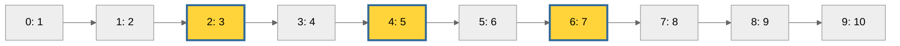

The highlighted boxes show `n[2:7:2]`: start at index 2, jump by 2, and stop before index 7. The result is `[3, 5, 7]`.

The examples from the notes:

```python
# The numbers 1 to 10
n = [1, 2, 3, 4, 5, 6, 7, 8, 9, 10]

# From index 2 up to 7, jumping by 2
print(n[2:7:2])

# From index 4 to the end, jumping by 2
print(n[4::2])

# From index 3 up to 7
print(n[3:7])

# From index 8 backwards down to index 2 (not included), jumping by 2
print(n[8:2:-2])

# A stop past the end is fine; the slice stops at the end
print(n[4:100])
```

**Output**

```text
[3, 5, 7]
[5, 7, 9]
[4, 5, 6, 7]
[9, 7, 5]
[5, 6, 7, 8, 9, 10]
```

More slicing variations:

```python
# A list of letters
letters = ["a", "b", "c", "d", "e", "f"]

# 1. The first three items
print(1, letters[:3])

# 2. Everything from index 3
print(2, letters[3:])

# 3. The last two items
print(3, letters[-2:])

# 4. Everything except the last item
print(4, letters[:-1])

# 5. Everything except the first and last items
print(5, letters[1:-1])

# 6. Every second item
print(6, letters[::2])

# 7. Every second item starting at index 1
print(7, letters[1::2])

# 8. The whole list reversed
print(8, letters[::-1])

# 9. A full copy of the list
print(9, letters[:])

# 10. Start after stop gives an empty list
print(10, letters[4:2])

# 11. Negative start and stop
print(11, letters[-4:-1])

# 12. The last three items in reverse
print(12, letters[:-4:-1])
```

**Output**

```text
1 ['a', 'b', 'c']
2 ['d', 'e', 'f']
3 ['e', 'f']
4 ['a', 'b', 'c', 'd', 'e']
5 ['b', 'c', 'd', 'e']
6 ['a', 'c', 'e']
7 ['b', 'd', 'f']
8 ['f', 'e', 'd', 'c', 'b', 'a']
9 ['a', 'b', 'c', 'd', 'e', 'f']
10 []
11 ['c', 'd', 'e']
12 ['f', 'e', 'd']
```

> Like strings, a **slice never raises IndexError**. Only a single index outside the list does.

## 5. Lists are mutable

Once a list is created, you **can change its content**. That is why list objects are called **mutable**.

```python
# Create a list
n = [10, 20, 30, 40]

# Show the original list
print(n)

# Replace the item at index 1
n[1] = 777

# Show the changed list; it is the same list object, changed in place
print(n)
```

**Output**

```text
[10, 20, 30, 40]
[10, 777, 30, 40]
```

More ways to change a list in place:

```python
# A list to change
n = [10, 20, 30, 40, 50]

# 1. Change the last item with a negative index
n[-1] = 500

# Show n after this change
print(1, n)

# 2. Replace a slice with new values of the same length
n[0:2] = [1, 2]

# Show n after this change
print(2, n)

# 3. Replace a slice with MORE values; the list grows
n[1:2] = [21, 22, 23]

# Show n after this change
print(3, n)

# 4. Replace a slice with FEWER values; the list shrinks
n[1:4] = [2]

# Show n after this change
print(4, n)

# 5. Assign an empty list to a slice to delete those items
n[0:1] = []

# Show n after this change
print(5, n)

# 6. Insert items at index 1 without removing anything
n[1:1] = [99, 98]

# Show n after this change
print(6, n)

# 7. The identity stays the same after all these changes
before = id(n)

# Change the first item in place
n[0] = 0

# The identity is unchanged, so it is still the same list
print(7, id(n) == before)
```

**Output**

```text
1 [10, 20, 30, 40, 500]
2 [1, 2, 30, 40, 500]
3 [1, 21, 22, 23, 30, 40, 500]
4 [1, 2, 30, 40, 500]
5 [2, 30, 40, 500]
6 [2, 99, 98, 30, 40, 500]
7 True
```

Compare this with strings and tuples, which are **immutable**: `"abc"[0] = "z"` raises a `TypeError`. For more on mutability, see [Topic 02.1](../02.1%20Variables%20and%20memory%20model/README.md#5-mutable-and-immutable-objects).

## 6. Traversing a list

**Traversal** means visiting every element of a list one by one, in order.

### 1. With a while loop

```python
# The numbers 0 to 10
n = [0, 1, 2, 3, 4, 5, 6, 7, 8, 9, 10]

# Start at the first index
i = 0

# Keep going while i is a valid index
while i < len(n):

    # Show the element at index i
    print(n[i], end=" ")

    # Move on to the next index
    i = i + 1
```

**Output**

```text
0 1 2 3 4 5 6 7 8 9 10 
```

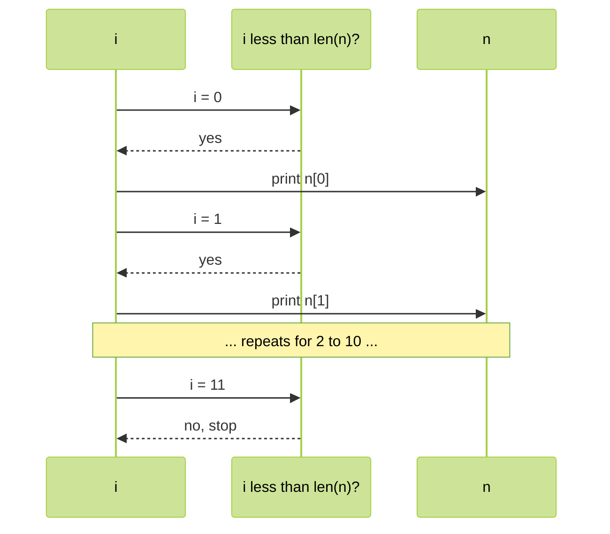

### 2. With a for loop

```python
# The numbers 0 to 10
n = [0, 1, 2, 3, 4, 5, 6, 7, 8, 9, 10]

# for takes each element in turn and puts it into n1
for n1 in n:

    # Show the current element
    print(n1, end=" ")
```

**Output**

```text
0 1 2 3 4 5 6 7 8 9 10 
```

### 3. Display only even numbers

```python
# The numbers 0 to 10
n = [0, 1, 2, 3, 4, 5, 6, 7, 8, 9, 10]

# Visit each number
for n1 in n:

    # Keep only numbers with no remainder when divided by 2
    if n1 % 2 == 0:

        # Show the even number
        print(n1, end=" ")
```

**Output**

```text
0 2 4 6 8 10 
```

### 4. Display elements with their positive and negative index

```python
# A list of three letters
letters = ["A", "B", "C"]

# Store the length, which is 3
x = len(letters)

# i takes the values 0, 1 and 2
for i in range(x):

    # The negative index of position i is i minus the length
    print(letters[i], "is available at positive index: ", i, "and at negative index: ", i - x)
```

**Output**

```text
A is available at positive index:  0 and at negative index:  -3
B is available at positive index:  1 and at negative index:  -2
C is available at positive index:  2 and at negative index:  -1
```

### More traversal patterns

```python
# The list to traverse
fruits = ["apple", "banana", "cherry"]

# 1. enumerate() gives the index and the item together
for index, fruit in enumerate(fruits):

    # Show both
    print(1, index, fruit)

# 2. enumerate() can start counting at 1
for number, fruit in enumerate(fruits, start=1):

    # Show a numbered list
    print(2, f"{number}. {fruit}")

# 3. reversed() visits the items from the last to the first
for fruit in reversed(fruits):

    # Show each fruit, last first
    print(3, fruit)

# 4. Visit every second item using a slice
for fruit in fruits[::2]:

    # Show the items at index 0 and 2
    print(4, fruit)

# 5. zip() walks two lists side by side
for fruit, price in zip(fruits, [40, 10, 120]):

    # Show the pair
    print(5, fruit, price)

# 6. Collect a running total while traversing
total = 0

# Visit each price
for price in [40, 10, 120]:

    # Add the price to the total
    total += price

# Show the final total
print(6, total)
```

**Output**

```text
1 0 apple
1 1 banana
1 2 cherry
2 1. apple
2 2. banana
2 3. cherry
3 cherry
3 banana
3 apple
4 apple
4 cherry
5 apple 40
5 banana 10
5 cherry 120
6 170
```

<table width="100%">
<tr>
<th align="left" width="24%">Pattern</th>
<th align="left" width="30%">Code</th>
<th align="left" width="24%">Gives you</th>
<th align="left" width="22%">Use it when</th>
</tr>
<tr><td>Plain <code>for</code></td><td><code>for x in items:</code></td><td>Each item</td><td>You only need the values</td></tr>
<tr><td><code>enumerate()</code></td><td><code>for i, x in enumerate(items):</code></td><td>Index and item</td><td>You need the position too</td></tr>
<tr><td><code>range(len())</code></td><td><code>for i in range(len(items)):</code></td><td>Index only</td><td>You must change <code>items[i]</code></td></tr>
<tr><td><code>while</code></td><td><code>while i &lt; len(items):</code></td><td>Full control</td><td>You move the index yourself</td></tr>
<tr><td><code>reversed()</code></td><td><code>for x in reversed(items):</code></td><td>Items, last first</td><td>You need reverse order</td></tr>
<tr><td><code>zip()</code></td><td><code>for a, b in zip(l1, l2):</code></td><td>Pairs</td><td>Two lists belong together</td></tr>
</table>

## 7. Getting information: len(), count(), index()

<table width="100%">
<tr>
<th align="left" width="16%">Function</th>
<th align="left" width="34%">Returns</th>
<th align="left" width="24%">If not found</th>
<th align="left" width="26%">Example</th>
</tr>
<tr><td><code>len(n)</code></td><td>The number of elements</td><td>-</td><td><code>len([10, 20])</code> is <code>2</code></td></tr>
<tr><td><code>n.count(x)</code></td><td>How many times <code>x</code> appears</td><td><code>0</code></td><td><code>[1, 2, 2].count(2)</code> is <code>2</code></td></tr>
<tr><td><code>n.index(x)</code></td><td>Index of the first <code>x</code></td><td><code>ValueError</code></td><td><code>[1, 2, 2].index(2)</code> is <code>1</code></td></tr>
</table>

### len()

```python
# 1. Length of a list of four numbers
print(1, len([10, 20, 30, 40]))

# 2. Length of an empty list
print(2, len([]))

# 3. A nested list counts as ONE element
print(3, len([10, 20, [30, 40]]))

# 4. Length of a list made by split()
print(4, len("one two three".split()))

# 5. The last valid index is always len - 1
fruits = ["apple", "banana", "cherry"]

# The last valid index is the length minus one
print(5, len(fruits) - 1)

# 6. Check whether a list is empty
print(6, len(fruits) == 0)
```

**Output**

```text
1 4
2 0
3 3
4 3
5 2
6 False
```

### count()

The example from the notes:

```python
# A list with repeated values
n = [1, 2, 2, 2, 2, 3, 3]

# 1 appears once
print(n.count(1))

# 2 appears four times
print(n.count(2))

# 3 appears twice
print(n.count(3))

# 4 does not appear at all
print(n.count(4))
```

**Output**

```text
1
4
2
0
```

More `count()` variations:

```python
# 1. Count a word in a list of words
words = "to be or not to be".split()

# Count how many times the word be appears
print(1, words.count("be"))

# 2. count() is case sensitive for strings
print(2, ["A", "a", "A"].count("a"))

# 3. True counts as equal to 1, so it is counted too
print(3, [1, True, 1.0, "1"].count(1))

# 4. Count a nested list as a whole item
print(4, [[1, 2], [1, 2], 3].count([1, 2]))

# 5. count() does not look inside nested lists
print(5, [[1, 2], 3].count(1))

# 6. Count how many marks are full marks
marks = [100, 95, 100, 88]

# Count the full marks
print(6, marks.count(100))
```

**Output**

```text
1 2
2 1
3 3
4 2
5 0
6 2
```

### index()

`index()` returns the index of the **first** occurrence of the item.

```python
# A list with repeated values
n = [1, 2, 2, 2, 2, 3, 3]

# 1 is first found at index 0
print(n.index(1))

# 2 is first found at index 1
print(n.index(2))

# 3 is first found at index 5
print(n.index(3))
```

**Output**

```text
0
1
5
```

If the item is not in the list, `index()` raises an error:

```python
# A list without the number 4
n = [1, 2, 2, 2, 2, 3, 3]

# Searching for 4 fails
print(n.index(4))
```

**Output** (last line of the error message)

```text
ValueError: 4 is not in list
```

Check with `in` first to avoid the error:

```python
# A list of numbers
n = [1, 2, 2, 2, 2, 3, 3]

# 1. in tells us 4 is missing
print(1, 4 in n)

# 2. Look for 4 only if it is present
print(2, n.index(4) if 4 in n else "4 is not present")

# 3. index() with a start position: first 2 at or after index 3
print(3, n.index(2, 3))

# 4. index() with start and stop: search only n[5:7]
print(4, n.index(3, 5, 7))

# 5. Find all positions of a value with enumerate
print(5, [i for i, value in enumerate(n) if value == 2])
```

**Output**

```text
1 False
2 4 is not present
3 3
4 5
5 [1, 2, 3, 4]
```

## 8. Adding elements: append(), insert(), extend()

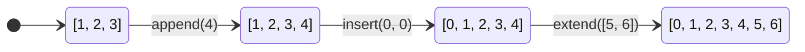

### 1. append()

`append(x)` adds **one** item at the **end** of the list.

```python
# Start with an empty list
letters = []

# Add "A" at the end
letters.append("A")

# Add "B" at the end
letters.append("B")

# Add "C" at the end
letters.append("C")

# Show the list built one item at a time
print(letters)
```

**Output**

```text
['A', 'B', 'C']
```

The example from the notes: add all numbers up to 100 that are divisible by 10.

```python
# Start with an empty list
tens = []

# Check every number from 0 to 100
for i in range(101):

    # Keep the number if 10 divides it exactly
    if i % 10 == 0:

        # Add it at the end of the list
        tens.append(i)

# Show the collected numbers
print(tens)
```

**Output**

```text
[0, 10, 20, 30, 40, 50, 60, 70, 80, 90, 100]
```

More `append()` variations:

```python
# A list to grow
cart = ["tea"]

# 1. Append a string
cart.append("milk")

# Show cart after this change
print(1, cart)

# 2. Append a number; mixed types are fine
cart.append(2)

# Show cart after this change
print(2, cart)

# 3. Append a list: it is added as ONE nested item
cart.append(["bread", "jam"])

# Show cart after this change
print(3, cart)

# 4. The length grew by 1, not by 2
print(4, len(cart))

# 5. append() returns None, so never assign its result
result = cart.append("eggs")

# append() gave back None
print(5, result)

# 6. Collect user-style inputs in a loop
squares = []

# Visit 1 to 5
for x in range(1, 6):

    # Add the square of x
    squares.append(x * x)

# Show the squares
print(6, squares)
```

**Output**

```text
1 ['tea', 'milk']
2 ['tea', 'milk', 2]
3 ['tea', 'milk', 2, ['bread', 'jam']]
4 4
5 None
6 [1, 4, 9, 16, 25]
```

### 2. insert()

`insert(index, x)` puts `x` **at** the given index and moves the rest to the right.

```python
# A list of five numbers
n = [1, 2, 3, 4, 5]

# Put 888 at index 1
n.insert(1, 888)

# 888 is now the second element
print(n)
```

**Output**

```text
[1, 888, 2, 3, 4, 5]
```

If the index is out of range, Python does not raise an error:

```python
# A list of five numbers
n = [1, 2, 3, 4, 5]

# Index 10 is past the end, so 777 goes to the last position
n.insert(10, 777)

# Index -10 is before the start, so 999 goes to the first position
n.insert(-10, 999)

# Show where both values landed
print(n)
```

**Output**

```text
[999, 1, 2, 3, 4, 5, 777]
```

> **Rule:** if the index is greater than the last index, the item goes at the **end**. If it is smaller than the first index, the item goes at the **start**.

More `insert()` variations:

```python
# A list to insert into
days = ["Mon", "Wed"]

# 1. Insert in the middle
days.insert(1, "Tue")

# Show days after this change
print(1, days)

# 2. Insert at the start
days.insert(0, "Sun")

# Show days after this change
print(2, days)

# 3. Insert at the end using len()
days.insert(len(days), "Thu")

# Show days after this change
print(3, days)

# 4. Insert with a negative index: BEFORE the last item
days.insert(-1, "X")

# Show days after this change
print(4, days)

# 5. Insert a list: it becomes one nested item
days.insert(0, [1, 2])

# Show days after this change
print(5, days)
```

**Output**

```text
1 ['Mon', 'Tue', 'Wed']
2 ['Sun', 'Mon', 'Tue', 'Wed']
3 ['Sun', 'Mon', 'Tue', 'Wed', 'Thu']
4 ['Sun', 'Mon', 'Tue', 'Wed', 'X', 'Thu']
5 [[1, 2], 'Sun', 'Mon', 'Tue', 'Wed', 'X', 'Thu']
```

### 3. extend()

`l1.extend(l2)` adds **every** item of `l2` to the end of `l1`.

```python
# The first order
order1 = ["Chicken", "Mutton", "Fish"]

# The second order
order2 = ["RC", "KF", "FO"]

# Add every item of order2 to the end of order1
order1.extend(order2)

# order1 now holds all six items
print(order1)
```

**Output**

```text
['Chicken', 'Mutton', 'Fish', 'RC', 'KF', 'FO']
```

`extend()` accepts any **iterable**. A string is iterable, so each character is added separately:

```python
# An order list
order = ["Chicken", "Mutton", "Fish"]

# A string is iterated letter by letter
order.extend("Mushroom")

# Each letter became its own item
print(order)
```

**Output**

```text
['Chicken', 'Mutton', 'Fish', 'M', 'u', 's', 'h', 'r', 'o', 'o', 'm']
```

More `extend()` variations:

```python
# A list to extend
n = [1, 2]

# 1. Extend with a list
n.extend([3, 4])

# Show n after this change
print(1, n)

# 2. Extend with a tuple
n.extend((5, 6))

# Show n after this change
print(2, n)

# 3. Extend with a range
n.extend(range(7, 9))

# Show n after this change
print(3, n)

# 4. Extend with an empty list: nothing changes
n.extend([])

# Show n after this change
print(4, n)

# 5. To add a whole word as one item, put it inside a list
words = ["Chicken"]

# The word inside a list is added as one item
words.extend(["Mushroom"])

# Show words after this change
print(5, words)

# 6. += on a list works like extend()
words += ["Paneer", "Rice"]

# Show words
print(6, words)
```

**Output**

```text
1 [1, 2, 3, 4]
2 [1, 2, 3, 4, 5, 6]
3 [1, 2, 3, 4, 5, 6, 7, 8]
4 [1, 2, 3, 4, 5, 6, 7, 8]
5 ['Chicken', 'Mushroom']
6 ['Chicken', 'Mushroom', 'Paneer', 'Rice']
```

<table width="100%">
<tr>
<th align="left" width="16%">Method</th>
<th align="left" width="24%">Adds</th>
<th align="left" width="18%">Where</th>
<th align="left" width="22%"><code>[1, 2]</code> with <code>[3, 4]</code></th>
<th align="left" width="20%">Length change</th>
</tr>
<tr><td><code>append(x)</code></td><td>One item (even if it is a list)</td><td>At the end</td><td><code>[1, 2, [3, 4]]</code></td><td>+1</td></tr>
<tr><td><code>insert(i, x)</code></td><td>One item</td><td>At index <code>i</code></td><td><code>insert(0, [3, 4])</code> gives <code>[[3, 4], 1, 2]</code></td><td>+1</td></tr>
<tr><td><code>extend(it)</code></td><td>Every item of the iterable</td><td>At the end</td><td><code>[1, 2, 3, 4]</code></td><td>+ number of items</td></tr>
</table>

## 9. Removing elements: remove(), pop(), clear(), del

### 1. remove()

`remove(x)` deletes the **first** occurrence of the value `x`.

```python
# A list with two 10s
n = [10, 20, 10, 30]

# Only the first 10 is removed
n.remove(10)

# The second 10 is still there
print(n)
```

**Output**

```text
[20, 10, 30]
```

If the value is not in the list, you get an error:

```python
# A list without 40
n = [10, 20, 10, 30]

# Removing 40 fails
n.remove(40)
```

**Output** (last line of the error message)

```text
ValueError: list.remove(x): x not in list
```

So check with `in` before removing:

```python
# A shopping list
cart = ["tea", "milk", "tea", "bread"]

# 1. Remove a value only if it is present
if "jam" in cart:

    # This line is skipped because jam is not in the cart
    cart.remove("jam")

# Show that nothing changed
print(1, cart)

# 2. Remove the first "tea"
cart.remove("tea")

# Show cart after this change
print(2, cart)

# 3. Remove EVERY "tea" with a while loop
while "tea" in cart:

    # Each round removes one more "tea"
    cart.remove("tea")

# Show the list without any tea
print(3, cart)

# 4. remove() returns None
print(4, cart.remove("milk"))

# 5. Show the final list
print(5, cart)
```

**Output**

```text
1 ['tea', 'milk', 'tea', 'bread']
2 ['milk', 'tea', 'bread']
3 ['milk', 'bread']
4 None
5 ['bread']
```

### 2. pop()

`pop()` removes the **last** element and **returns** it.

```python
# A list of four numbers
n = [10, 20, 30, 40]

# Remove and show the last element
print(n.pop())

# Remove and show the new last element
print(n.pop())

# Two elements are left
print(n)
```

**Output**

```text
40
30
[10, 20]
```

`pop()` on an empty list raises an error:

```python
# An empty list
n = []

# There is nothing to pop
print(n.pop())
```

**Output** (last line of the error message)

```text
IndexError: pop from empty list
```

`pop(index)` removes and returns the element at that index:

```python
# A list of six numbers
n = [10, 20, 30, 40, 50, 60]

# With no index, pop() takes the last element
print(n.pop())

# pop(1) takes the element at index 1
print(n.pop(1))

# Show what is left
print(n)
```

**Output**

```text
60
20
[10, 30, 40, 50]
```

```python
# A list with indexes 0 to 3
n = [10, 30, 40, 50]

# Index 10 does not exist
print(n.pop(10))
```

**Output** (last line of the error message)

```text
IndexError: pop index out of range
```

More `pop()` variations:

```python
# A queue of people
people = ["Asha", "Ravi", "Meena", "John"]

# 1. pop(0) removes the FIRST person
print(1, people.pop(0))

# 2. pop(-1) is the same as pop()
print(2, people.pop(-1))

# 3. Store the popped value in a variable
removed = people.pop()

# Show the removed person and who is left
print(3, removed, people)

# 4. Pop everything until the list is empty
stack = [1, 2, 3]

# Keep going while the list is not empty
while stack:

    # Each pop takes the current last item
    print(4, stack.pop())
```

**Output**

```text
1 Asha
2 John
3 Meena ['Ravi']
4 3
4 2
4 1
```

> **Notes from the syllabus:** `pop()` is the only list method that **changes the list and also returns a value**. With `append()` and `pop()` you can use a list as a **stack**, which follows **LIFO** (Last In, First Out) order.

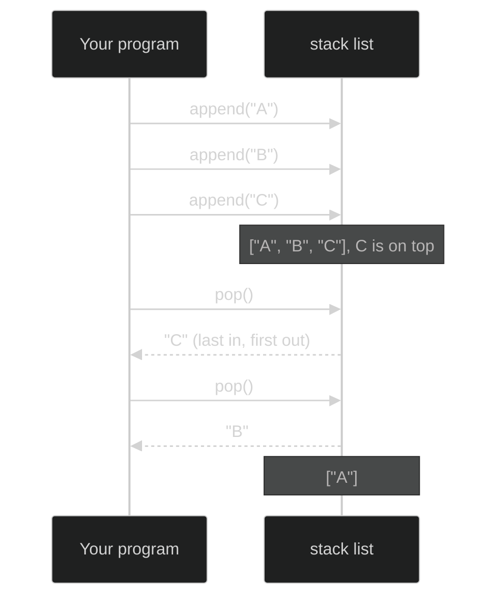

```python
# An empty stack
stack = []

# Push three plates onto the stack
stack.append("plate 1")

# The second plate goes on top of the first
stack.append("plate 2")

# The third plate is now on top
stack.append("plate 3")

# The last plate added is the first one taken off
print(stack.pop())

# Then the next one down
print(stack.pop())

# One plate is left
print(stack)
```

**Output**

```text
plate 3
plate 2
['plate 1']
```

### remove() vs pop()

<table width="100%">
<tr>
<th align="left" width="20%">Point</th>
<th align="left" width="40%"><code>remove(x)</code></th>
<th align="left" width="40%"><code>pop()</code> / <code>pop(i)</code></th>
</tr>
<tr><td>Removes by</td><td>Value</td><td>Position (last by default)</td></tr>
<tr><td>Returns</td><td><code>None</code> (the notes say "no value")</td><td>The removed element</td></tr>
<tr><td>Error when</td><td>The value is not in the list: <code>ValueError</code></td><td>The list is empty or the index is invalid: <code>IndexError</code></td></tr>
<tr><td>Typical use</td><td>"Remove the item called tea"</td><td>Stacks, queues, "take the last one"</td></tr>
</table>

### 3. clear()

`clear()` removes **all** elements. The list object still exists, but it is empty.

```python
# A list of four numbers
n = [10, 20, 30, 40]

# Show the full list
print(n)

# Remove every element
n.clear()

# The same list object is now empty
print(n)
```

**Output**

```text
[10, 20, 30, 40]
[]
```

### 4. The del statement

`del` removes elements by **index or slice**, or deletes the whole name.

```python
# A list of letters
letters = ["a", "b", "c", "d", "e", "f"]

# 1. Delete one element by index
del letters[0]

# Show letters after this change
print(1, letters)

# 2. Delete the last element
del letters[-1]

# Show letters after this change
print(2, letters)

# 3. Delete a slice
del letters[1:3]

# Show letters after this change
print(3, letters)

# 4. Delete every second element with a step
numbers = [0, 1, 2, 3, 4, 5]

# Delete the items at index 0, 2 and 4
del numbers[::2]

# Show numbers after this change
print(4, numbers)

# 5. Delete the whole content (like clear())
del numbers[:]

# Show numbers after this change
print(5, numbers)
```

**Output**

```text
1 ['b', 'c', 'd', 'e', 'f']
2 ['b', 'c', 'd', 'e']
3 ['b', 'e']
4 [1, 3, 5]
5 []
```

### Growing and shrinking

> **Lists are dynamic.** `append()`, `insert()` and `extend()` make a list **grow**. `remove()`, `pop()`, `clear()` and `del` make it **shrink**.

## 10. Ordering elements: reverse() and sort()

### 1. reverse()

```python
# A list in its original order
n = [10, 20, 30, 40]

# Reverse the order in place
n.reverse()

# The same list is now reversed
print(n)
```

**Output**

```text
[40, 30, 20, 10]
```

### 2. sort()

By default a list keeps insertion order. `sort()` arranges the elements in their **natural sorting order**:

- Numbers: **ascending** order.
- Strings: **alphabetical** order (by character codes, so capitals come before small letters).

```python
# Numbers in random order
n = [20, 5, 15, 10, 0]

# Sort the numbers in place, smallest first
n.sort()

# Show the sorted numbers
print(n)

# Words in random order
s = ["Dog", "Banana", "Cat", "Apple"]

# Sort the words in place, alphabetically
s.sort()

# Show the sorted words
print(s)
```

**Output**

```text
[0, 5, 10, 15, 20]
['Apple', 'Banana', 'Cat', 'Dog']
```

To use `sort()`, the list must contain values that can be **compared with each other**. Numbers and strings cannot be compared:

```python
# A list mixing numbers and strings
n = [20, 10, "A", "B"]

# Python 3 cannot compare str with int
n.sort()
```

**Output** (last line of the error message)

```text
TypeError: '<' not supported between instances of 'str' and 'int'
```

> **Python 2 vs Python 3:** in Python 2, `sort()` on `[20, "B", 10, "A"]` gave `[10, 20, 'A', 'B']` (numbers first, then strings). **In Python 3 this is a TypeError.**

### Sorting in reverse order

```python
# Numbers in random order
n = [40, 10, 30, 20]

# Default sort: ascending
n.sort()

# Show the ascending order
print(n)

# reverse=True sorts in descending order
n.sort(reverse=True)

# Show the descending order
print(n)

# reverse=False is the default: ascending again
n.sort(reverse=False)

# Show the ascending order again
print(n)
```

**Output**

```text
[10, 20, 30, 40]
[40, 30, 20, 10]
[10, 20, 30, 40]
```

### sort() with key, and sorted()

`key=` gives a function that decides **what to compare**. `sorted()` returns a **new** sorted list and leaves the original unchanged.

```python
# Words with mixed capital letters
words = ["banana", "Apple", "cherry", "date"]

# 1. Plain sort: capitals come first
print(1, sorted(words))

# 2. Ignore case by comparing lower-case versions
print(2, sorted(words, key=str.lower))

# 3. Sort by length of each word
print(3, sorted(words, key=len))

# 4. Sort by length, longest first
print(4, sorted(words, key=len, reverse=True))

# 5. Sort by the last letter
print(5, sorted(words, key=lambda w: w[-1]))

# 6. sorted() did not change the original list
print(6, words)

# 7. Sort numbers by their distance from 10
print(7, sorted([3, 12, 9, 20, 10], key=lambda x: abs(x - 10)))

# 8. Sort (name, marks) pairs by marks, highest first
students = [("Asha", 85), ("Ravi", 92), ("Meena", 78)]

# Sort the pairs by marks, highest first
print(8, sorted(students, key=lambda pair: pair[1], reverse=True))

# 9. Sort pairs by name (the first item) without a key
print(9, sorted(students))

# 10. Sort numbers stored as text by their numeric value
print(10, sorted(["10", "9", "100", "1"], key=int))

# 11. Without key=int, text is sorted character by character
print(11, sorted(["10", "9", "100", "1"]))

# 12. sort() returns None, so never write x = x.sort()
nums = [3, 1, 2]

# sort() prints None, and nums itself is now sorted
print(12, nums.sort(), nums)
```

**Output**

```text
1 ['Apple', 'banana', 'cherry', 'date']
2 ['Apple', 'banana', 'cherry', 'date']
3 ['date', 'Apple', 'banana', 'cherry']
4 ['banana', 'cherry', 'Apple', 'date']
5 ['banana', 'Apple', 'date', 'cherry']
6 ['banana', 'Apple', 'cherry', 'date']
7 [10, 9, 12, 3, 20]
8 [('Ravi', 92), ('Asha', 85), ('Meena', 78)]
9 [('Asha', 85), ('Meena', 78), ('Ravi', 92)]
10 ['1', '9', '10', '100']
11 ['1', '10', '100', '9']
12 None [1, 2, 3]
```

<table width="100%">
<tr>
<th align="left" width="18%">Tool</th>
<th align="left" width="26%">Changes the original?</th>
<th align="left" width="20%">Returns</th>
<th align="left" width="36%">Works on</th>
</tr>
<tr><td><code>items.sort()</code></td><td>Yes, in place</td><td><code>None</code></td><td>Lists only</td></tr>
<tr><td><code>sorted(items)</code></td><td>No</td><td>A new list</td><td>Any iterable: list, tuple, string, set, dict</td></tr>
<tr><td><code>items.reverse()</code></td><td>Yes, in place</td><td><code>None</code></td><td>Lists only</td></tr>
<tr><td><code>reversed(items)</code></td><td>No</td><td>An iterator</td><td>Any sequence</td></tr>
<tr><td><code>items[::-1]</code></td><td>No</td><td>A new list</td><td>Any sequence</td></tr>
</table>

## 11. Aliasing and cloning

### Aliasing

Giving **another name** to an existing list is called **aliasing**. Both names refer to the **same** object.

```python
# Create a list
x = [10, 20, 30, 40]

# y is just a second name for the same list
y = x

# Both names have the same identity
print(id(x) == id(y))
```

**Output**

```text
True
```

The problem: a change through one name is visible through the other.

```python
# Create a list
x = [10, 20, 30, 40]

# y is an alias of x
y = x

# Change the list through y
y[1] = 777

# x shows the change too, because it is the same list
print(x)
```

**Output**

```text
[10, 777, 30, 40]
```

### Cloning

**Cloning** means creating an exact **duplicate, independent** object. You can clone with the slice operator or with `copy()`.

```python
# Create a list
x = [10, 20, 30, 40]

# Method 1: a full slice makes a new list
y = x[:]

# Change the clone
y[1] = 777

# The original is untouched
print(x)

# Only the clone changed
print(y)
```

**Output**

```text
[10, 20, 30, 40]
[10, 777, 30, 40]
```

```python
# Create a list
x = [10, 20, 30, 40]

# Method 2: copy() makes a new list
y = x.copy()

# Change the clone
y[1] = 777

# The original is untouched
print(x)

# Only the clone changed
print(y)
```

**Output**

```text
[10, 20, 30, 40]
[10, 777, 30, 40]
```

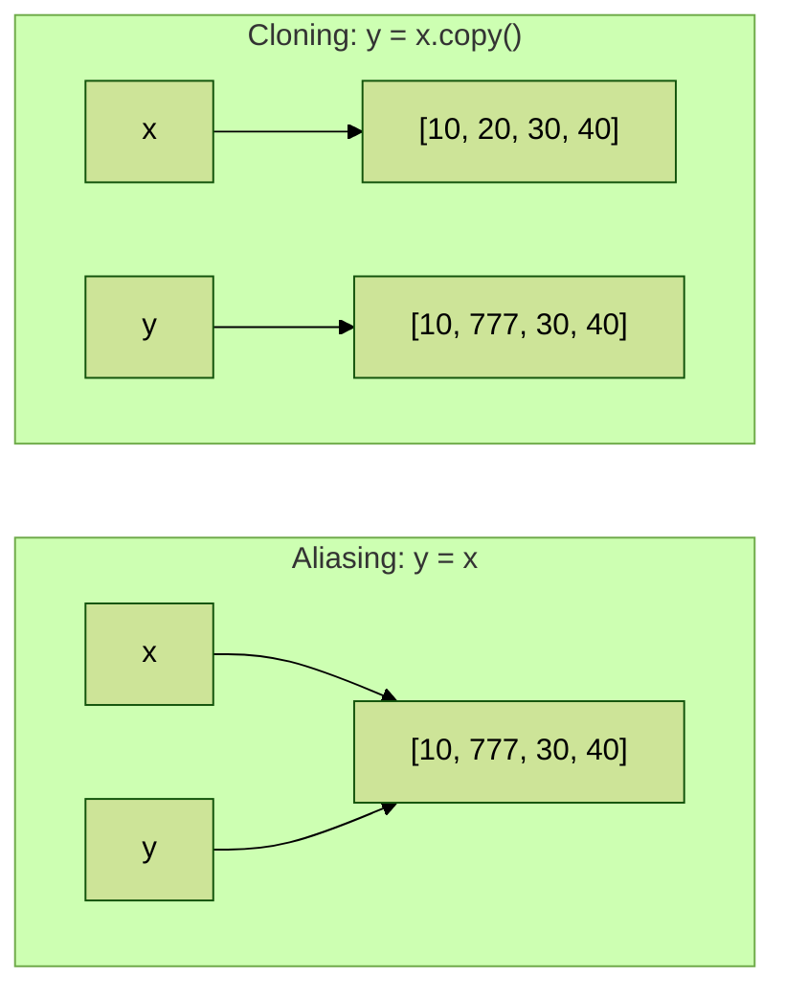

**Q. What is the difference between the `=` operator and `copy()`?**
`=` is for **aliasing** (a second name for the same object). `copy()` is for **cloning** (a new, independent object).

> **Correction: `copy()` and `[:]` make a shallow copy.** They create a new outer list, but items **inside** it that are lists are still shared. For nested lists, use `copy.deepcopy()`. Details in [Topic 02.1](../02.1%20Variables%20and%20memory%20model/README.md#7-copying-assignment-shallow-copy-and-deep-copy).

```python
# Load the copy module for deep copies
import copy

# A nested list
x = [[1, 2], [3, 4]]

# 1. Alias: same object
alias = x

# 2. Shallow copy: new outer list, shared inner lists
shallow = x.copy()

# 3. Another shallow copy using list()
shallow2 = list(x)

# 4. Deep copy: everything is new
deep = copy.deepcopy(x)

# Change an inner list through x
x[0].append(99)

# The alias sees the change
print(1, alias)

# The shallow copy sees the change in the inner list
print(2, shallow)

# The list() copy is shallow too
print(3, shallow2)

# Only the deep copy is unaffected
print(4, deep)

# 5. Replacing a whole item in x does NOT affect the shallow copy
x[1] = "new"

# x shows the new item, the shallow copy keeps the old inner list
print(5, x, shallow)
```

**Output**

```text
1 [[1, 2, 99], [3, 4]]
2 [[1, 2, 99], [3, 4]]
3 [[1, 2, 99], [3, 4]]
4 [[1, 2], [3, 4]]
5 [[1, 2, 99], 'new'] [[1, 2, 99], [3, 4]]
```

<table width="100%">
<tr>
<th align="left" width="22%">Way</th>
<th align="left" width="18%">New outer list?</th>
<th align="left" width="20%">New inner lists?</th>
<th align="left" width="40%">Safe for</th>
</tr>
<tr><td><code>y = x</code></td><td>No</td><td>No</td><td>Never a copy, only a second name</td></tr>
<tr><td><code>y = x[:]</code></td><td>Yes</td><td>No</td><td>Flat lists of numbers or strings</td></tr>
<tr><td><code>y = x.copy()</code></td><td>Yes</td><td>No</td><td>Flat lists of numbers or strings</td></tr>
<tr><td><code>y = list(x)</code></td><td>Yes</td><td>No</td><td>Flat lists of numbers or strings</td></tr>
<tr><td><code>y = copy.deepcopy(x)</code></td><td>Yes</td><td>Yes</td><td>Nested lists of any depth</td></tr>
</table>

## 12. Operators on lists: +, * and comparisons

### 1. Concatenation (+)

```python
# The first list
a = [10, 20, 30]

# The second list
b = [40, 50, 60]

# + joins them into a NEW list
c = a + b

# Show the combined list
print(c)
```

**Output**

```text
[10, 20, 30, 40, 50, 60]
```

Both sides of `+` must be lists:

```python
# A list
a = [10, 20, 30]

# Adding an int to a list is not allowed
c = a + 40
```

**Output** (last line of the error message)

```text
TypeError: can only concatenate list (not "int") to list
```

```python
# A list
a = [10, 20, 30]

# 1. Wrap the number in a list to make it valid
print(1, a + [40])

# 2. + creates a new list; a is unchanged
print(2, a)

# 3. Joining an empty list changes nothing
print(3, a + [])

# 4. Join three lists
print(4, [1] + [2, 3] + [4])

# 5. Join lists of different types
print(5, ["a"] + [1, 2.5])
```

**Output**

```text
1 [10, 20, 30, 40]
2 [10, 20, 30]
3 [10, 20, 30]
4 [1, 2, 3, 4]
5 ['a', 1, 2.5]
```

### 2. Repetition (*)

```python
# A short list
x = [10, 20, 30]

# Repeat it three times
y = x * 3

# Show the repeated list
print(y)
```

**Output**

```text
[10, 20, 30, 10, 20, 30, 10, 20, 30]
```

```python
# 1. A list of five zeros
print(1, [0] * 5)

# 2. The number can come first
print(2, 3 * ["ab"])

# 3. Repeating 0 times gives an empty list
print(3, [1, 2] * 0)

# 4. A row of dashes for a table
print(4, "".join(["-"] * 10))

# 5. Trap: repeating a nested list repeats the SAME inner list
grid = [[0] * 2] * 2

# Change the first cell of the first row
grid[0][0] = 9

# Show grid after this change
print(5, grid)
```

**Output**

```text
1 [0, 0, 0, 0, 0]
2 ['ab', 'ab', 'ab']
3 []
4 ----------
5 [[9, 0], [9, 0]]
```

> Trap 5 is explained in [Topic 02.1](../02.1%20Variables%20and%20memory%20model/README.md#trap-2-building-a-grid-with-). Use a list comprehension to build grids (Section 15).

### 3. Comparing lists

`==` and `!=` check three things: the **number** of elements, their **order**, and their **content** (case sensitive for strings).

```python
# Two equal lists
x = ["Dog", "Cat", "Rat"]

# Same items, same order
y = ["Dog", "Cat", "Rat"]

# Same items in capital letters
z = ["DOG", "CAT", "RAT"]

# x and y are equal
print(x == y)

# Capital letters make z different
print(x == z)

# != is the opposite of ==
print(x != z)
```

**Output**

```text
True
False
True
```

```python
# 1. Same items, different order: not equal
print(1, [1, 2, 3] == [3, 2, 1])

# 2. Different lengths: not equal
print(2, [1, 2] == [1, 2, 3])

# 3. 1 and 1.0 compare equal
print(3, [1, 2] == [1.0, 2.0])

# 4. Nested lists are compared inside too
print(4, [[1, 2], 3] == [[1, 2], 3])

# 5. Equal lists can still be different objects
a = [1, 2]

# A second, separate list with the same values
b = [1, 2]

# Same values, but not the same object
print(5, a == b, a is b)
```

**Output**

```text
1 False
2 False
3 True
4 True
5 True False
```

`<`, `<=`, `>` and `>=` compare lists **element by element** from the left, like words in a dictionary. The first pair that differs decides the result.

> **Correction:** the notes say "only the first element comparison will be performed". That is only true when the first elements are different. If they are equal, Python moves on to the second element, then the third, and so on.

The examples from the notes (the first elements already differ):

```python
# 50 versus 40 decides the result
x = [50, 20, 30]

# The length does not matter here
y = [40, 50, 60, 100, 200]

# 50 > 40, so x > y
print(x > y)

# Greater, so also greater-or-equal
print(x >= y)

# Not less
print(x < y)

# Not less-or-equal
print(x <= y)
```

**Output**

```text
True
True
False
False
```

```python
# "Dog" versus "Rat" decides the result
x = ["Dog", "Cat", "Rat"]

# The other list
y = ["Rat", "Cat", "Dog"]

# "D" comes before "R", so x is not greater
print(x > y)

# Not greater-or-equal either
print(x >= y)

# x is less than y
print(x < y)

# And less-or-equal
print(x <= y)
```

**Output**

```text
False
False
True
True
```

When the first elements are equal, the comparison continues:

```python
# 1. First elements equal, the second elements decide: 2 < 5
print(1, [1, 2, 99] < [1, 5, 0])

# 2. All equal so far, the third elements decide: 3 < 4
print(2, [1, 2, 3] < [1, 2, 4])

# 3. One list is the start of the other: the shorter one is smaller
print(3, [1, 2] < [1, 2, 0])

# 4. Fully equal lists are not less than each other
print(4, [1, 2] < [1, 2])

# 5. But they are less-or-equal
print(5, [1, 2] <= [1, 2])

# 6. Strings inside are compared by character codes
print(6, ["apple", "x"] < ["apricot", "a"])
```

**Output**

```text
1 True
2 True
3 True
4 False
5 True
6 True
```

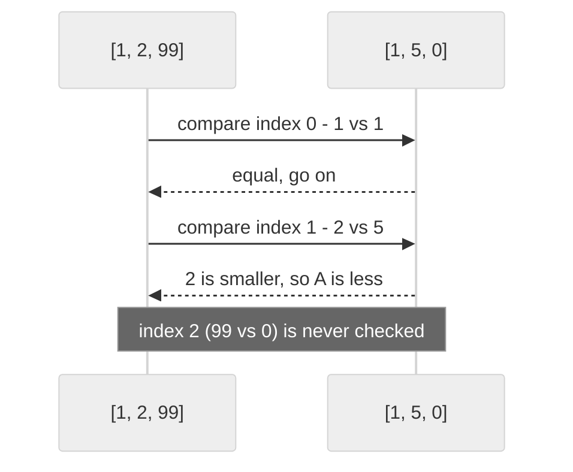

## 13. Membership operators: in and not in

```python
# A list of numbers
n = [10, 20, 30, 40]

# 10 is in the list
print(10 in n)

# so "10 not in n" is False
print(10 not in n)

# 50 is not in the list
print(50 in n)

# so "50 not in n" is True
print(50 not in n)
```

**Output**

```text
True
False
False
True
```

More membership examples:

```python
# A list of fruits
fruits = ["apple", "banana", "cherry"]

# 1. in is case sensitive
print(1, "Apple" in fruits)

# 2. in checks whole items, not parts of strings
print(2, "app" in fruits)

# 3. To search inside the strings, check each one
print(3, any("app" in f for f in fruits))

# 4. A nested list is matched as a whole item
print(4, [1, 2] in [[1, 2], [3, 4]])

# 5. in does not look inside nested lists
print(5, 1 in [[1, 2], [3, 4]])

# 6. 1 == 1.0, so 1.0 is found
print(6, 1.0 in [1, 2, 3])

# 7. Use in to guard remove()
if "banana" in fruits:

    # Safe, because banana is present
    fruits.remove("banana")

# Show the list without banana
print(7, fruits)
```

**Output**

```text
1 False
2 False
3 True
4 True
5 False
6 True
7 ['apple', 'cherry']
```

## 14. Nested lists and matrices

A list inside another list is called a **nested list**. You reach an inner element with **two indexes**, like a two-dimensional array.

```python
# A list whose third item is another list
n = [10, 20, [30, 40]]

# The whole nested list
print(n)

# The first element
print(n[0])

# The third element is a list
print(n[2])

# The first element of the inner list
print(n[2][0])

# The second element of the inner list
print(n[2][1])
```

**Output**

```text
[10, 20, [30, 40]]
10
[30, 40]
30
40
```

### Nested list as a matrix

A **matrix** (a grid of rows and columns) can be stored as a list of rows.

<table width="100%">
<tr>
<th align="center" width="16%"></th>
<th align="center" width="28%">column 0</th>
<th align="center" width="28%">column 1</th>
<th align="center" width="28%">column 2</th>
</tr>
<tr><td align="center"><b>row 0</b></td><td align="center">10<br/><code>n[0][0]</code></td><td align="center">20<br/><code>n[0][1]</code></td><td align="center">30<br/><code>n[0][2]</code></td></tr>
<tr><td align="center"><b>row 1</b></td><td align="center">40<br/><code>n[1][0]</code></td><td align="center">50<br/><code>n[1][1]</code></td><td align="center">60<br/><code>n[1][2]</code></td></tr>
<tr><td align="center"><b>row 2</b></td><td align="center">70<br/><code>n[2][0]</code></td><td align="center">80<br/><code>n[2][1]</code></td><td align="center">90<br/><code>n[2][2]</code></td></tr>
</table>

```python
# A 3 x 3 matrix stored as a list of rows
n = [[10, 20, 30], [40, 50, 60], [70, 80, 90]]

# Show the whole nested list
print(n)

# Heading for the row-wise view
print("Elements by Row wise:")

# Each item of n is one row
for r in n:

    # Show one row as a list
    print(r)

# Heading for the matrix view
print("Elements by Matrix style:")

# i goes over the row numbers 0, 1, 2
for i in range(len(n)):

    # j goes over the column numbers of row i
    for j in range(len(n[i])):

        # Show one element followed by a space, on the same line
        print(n[i][j], end=' ')

    # End the line after each row
    print()
```

**Output**

```text
[[10, 20, 30], [40, 50, 60], [70, 80, 90]]
Elements by Row wise:
[10, 20, 30]
[40, 50, 60]
[70, 80, 90]
Elements by Matrix style:
10 20 30 
40 50 60 
70 80 90 
```

**How this program runs:** the outer loop picks a row number `i`. For each row, the inner loop picks every column number `j` and prints `n[i][j]` on the same line. After the inner loop ends, `print()` moves to a new line, so each row appears on its own line.

More matrix examples:

```python
# A 2 x 3 matrix
m = [[1, 2, 3], [4, 5, 6]]

# 1. Number of rows
print(1, len(m))

# 2. Number of columns (length of the first row)
print(2, len(m[0]))

# 3. The element in row 1, column 2
print(3, m[1][2])

# 4. The last element of the last row
print(4, m[-1][-1])

# 5. Change one element
m[0][1] = 20

# Show m after this change
print(5, m)

# 6. A whole column, collected from every row
print(6, [row[1] for row in m])

# 7. The sum of every row
print(7, [sum(row) for row in m])

# 8. The sum of all elements
print(8, sum(sum(row) for row in m))

# 9. The transpose: rows become columns
print(9, [list(col) for col in zip(*m)])

# 10. Flatten the matrix into one list
print(10, [x for row in m for x in row])

# 11. The correct way to build a 3 x 3 grid of zeros
grid = [[0] * 3 for _ in range(3)]

# Change the first cell of the first row only
grid[0][0] = 5

# Show grid after this change
print(11, grid)
```

**Output**

```text
1 2
2 3
3 6
4 6
5 [[1, 20, 3], [4, 5, 6]]
6 [20, 5]
7 [24, 15]
8 39
9 [[1, 4], [20, 5], [3, 6]]
10 [1, 20, 3, 4, 5, 6]
11 [[5, 0, 0], [0, 0, 0], [0, 0, 0]]
```

## 15. List comprehensions

A **list comprehension** is a short, readable way to create a new list from any iterable (a list, tuple, string, range and so on), optionally with a condition.

```text
new_list = [expression for item in iterable if condition]
```

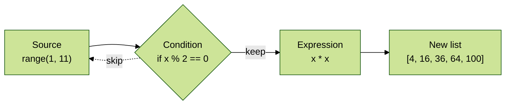

The same list built two ways:

```python
# The long way: start with an empty list
squares = []

# Visit each number from 1 to 5
for x in range(1, 6):

    # Add its square
    squares.append(x * x)

# Show the result
print(squares)

# The short way: a list comprehension does the same in one line
print([x * x for x in range(1, 6)])
```

**Output**

```text
[1, 4, 9, 16, 25]
[1, 4, 9, 16, 25]
```

The examples from the notes:

```python
# Squares of 1 to 10
s = [x * x for x in range(1, 11)]

# Show the squares
print(s)

# Powers of 2 from 2 to the 1 up to 2 to the 5
v = [2 ** x for x in range(1, 6)]

# Show the powers
print(v)

# Keep only the even squares from s
m = [x for x in s if x % 2 == 0]

# Show the even squares
print(m)
```

**Output**

```text
[1, 4, 9, 16, 25, 36, 49, 64, 81, 100]
[2, 4, 8, 16, 32]
[4, 16, 36, 64, 100]
```

```python
# A list of names
words = ["Balaiah", "Nag", "Venkatesh", "Chiranjeevi"]

# Take the first letter of every name
first_letters = [w[0] for w in words]

# Show the first letters
print(first_letters)
```

**Output**

```text
['B', 'N', 'V', 'C']
```

```python
# The first list of numbers
num1 = [10, 20, 30, 40]

# The second list of numbers
num2 = [30, 40, 50, 60]

# Numbers in num1 that are NOT in num2
num3 = [i for i in num1 if i not in num2]

# Show the difference
print(num3)

# Numbers that are in BOTH lists (common elements)
num4 = [i for i in num1 if i in num2]

# Show the common numbers
print(num4)
```

**Output**

```text
[10, 20]
[30, 40]
```

```python
# Split a sentence into words
words = "the quick brown fox jumps over the lazy dog".split()

# Show the words
print(words)

# For each word, make a small list of the word in capitals and its length
pairs = [[w.upper(), len(w)] for w in words]

# Show the list of pairs
print(pairs)
```

**Output**

```text
['the', 'quick', 'brown', 'fox', 'jumps', 'over', 'the', 'lazy', 'dog']
[['THE', 3], ['QUICK', 5], ['BROWN', 5], ['FOX', 3], ['JUMPS', 5], ['OVER', 4], ['THE', 3], ['LAZY', 4], ['DOG', 3]]
```

More list comprehension variations:

```python
# 1. Double every number
print(1, [n * 2 for n in [1, 2, 3]])

# 2. Keep only odd numbers
print(2, [n for n in range(10) if n % 2 == 1])

# 3. Convert text to numbers
print(3, [int(t) for t in ["4", "5", "6"]])

# 4. Clean a list of strings
print(4, [s.strip().lower() for s in ["  Apple", "BANANA "]])

# 5. An if-else INSIDE the expression (comes before for)
print(5, ["even" if n % 2 == 0 else "odd" for n in range(5)])

# 6. Lengths of words
print(6, [len(w) for w in ["hi", "hello", "hey"]])

# 7. Characters of a string that are vowels
print(7, [ch for ch in "programming" if ch in "aeiou"])

# 8. Two for clauses: every pair of items
print(8, [(a, b) for a in [1, 2] for b in ["x", "y"]])

# 9. Flatten a nested list
print(9, [x for row in [[1, 2], [3, 4]] for x in row])

# 10. Words longer than 3 letters
print(10, [w for w in "a big red balloon".split() if len(w) > 3])

# 11. Replace negative numbers with 0
print(11, [n if n > 0 else 0 for n in [5, -2, 8, -7]])

# 12. Build a 3 x 3 grid of zeros correctly
print(12, [[0] * 3 for _ in range(3)])
```

**Output**

```text
1 [2, 4, 6]
2 [1, 3, 5, 7, 9]
3 [4, 5, 6]
4 ['apple', 'banana']
5 ['even', 'odd', 'even', 'odd', 'even']
6 [2, 5, 3]
7 ['o', 'a', 'i']
8 [(1, 'x'), (1, 'y'), (2, 'x'), (2, 'y')]
9 [1, 2, 3, 4]
10 ['balloon']
11 [5, 0, 8, 0]
12 [[0, 0, 0], [0, 0, 0], [0, 0, 0]]
```

> **Tip:** a comprehension should stay readable. If it needs more than one condition and one loop, write a normal `for` loop instead.

## 16. Useful built-in functions with lists

<table width="100%">
<tr>
<th align="left" width="16%">Function</th>
<th align="left" width="30%">Returns</th>
<th align="left" width="24%">Example</th>
<th align="left" width="30%">Result</th>
</tr>
<tr><td><code>len()</code></td><td>Number of items</td><td><code>len([4, 8, 1])</code></td><td><code>3</code></td></tr>
<tr><td><code>sum()</code></td><td>Total of numbers</td><td><code>sum([4, 8, 1])</code></td><td><code>13</code></td></tr>
<tr><td><code>min()</code></td><td>Smallest item</td><td><code>min([4, 8, 1])</code></td><td><code>1</code></td></tr>
<tr><td><code>max()</code></td><td>Largest item</td><td><code>max([4, 8, 1])</code></td><td><code>8</code></td></tr>
<tr><td><code>sorted()</code></td><td>New sorted list</td><td><code>sorted([4, 8, 1])</code></td><td><code>[1, 4, 8]</code></td></tr>
<tr><td><code>any()</code></td><td>True if at least one item is truthy</td><td><code>any([0, 0, 3])</code></td><td><code>True</code></td></tr>
<tr><td><code>all()</code></td><td>True if every item is truthy</td><td><code>all([1, 0, 3])</code></td><td><code>False</code></td></tr>
<tr><td><code>zip()</code></td><td>Pairs from several lists</td><td><code>list(zip([1, 2], "ab"))</code></td><td><code>[(1, 'a'), (2, 'b')]</code></td></tr>
<tr><td><code>enumerate()</code></td><td>Index and item pairs</td><td><code>list(enumerate("ab"))</code></td><td><code>[(0, 'a'), (1, 'b')]</code></td></tr>
<tr><td><code>reversed()</code></td><td>Items in reverse order</td><td><code>list(reversed([1, 2]))</code></td><td><code>[2, 1]</code></td></tr>
</table>

Here are the marks used in the examples below:

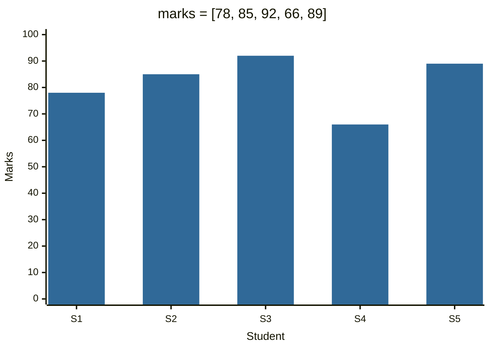

```python
# The marks shown in the chart
marks = [78, 85, 92, 66, 89]

# 1. Total of all marks
print(1, sum(marks))

# 2. Average mark
print(2, sum(marks) / len(marks))

# 3. Lowest mark
print(3, min(marks))

# 4. Highest mark
print(4, max(marks))

# 5. Marks from lowest to highest
print(5, sorted(marks))

# 6. Top 3 marks
print(6, sorted(marks, reverse=True)[:3])

# 7. Did anyone score above 90?
print(7, any(m > 90 for m in marks))

# 8. Did everyone pass with at least 40?
print(8, all(m >= 40 for m in marks))

# 9. Pair each name with a mark
names = ["Asha", "Ravi", "Meena", "John", "Sara"]

# Pair each name with the mark at the same position
print(9, list(zip(names, marks)))

# 10. The name of the top scorer
print(10, names[marks.index(max(marks))])

# 11. max() with key: the longest name
print(11, max(names, key=len))

# 12. min() and max() work on strings alphabetically
print(12, min(names), max(names))

# 13. sum() with a start value
print(13, sum([1, 2, 3], 100))

# 14. any() and all() on an empty list
print(14, any([]), all([]))
```

**Output**

```text
1 410
2 82.0
3 66
4 92
5 [66, 78, 85, 89, 92]
6 [92, 89, 85]
7 True
8 True
9 [('Asha', 78), ('Ravi', 85), ('Meena', 92), ('John', 66), ('Sara', 89)]
10 Meena
11 Meena
12 Asha Sara
13 106
14 False True
```

> The notes and many programs use `sum`, `max` or `min` as variable names. Avoid this: `sum = 0` hides the built-in `sum()` function for the rest of the program.

## 17. Complete programs

### Program 1: Unique vowels in a word (from the notes)

```python
# The five vowels to look for
vowels = ['a', 'e', 'i', 'o', 'u']

# Ask the user for a word
word = input("Enter the word to search for vowels: ")

# An empty list to collect each vowel found, once
found = []

# Look at each letter of the word in order
for letter in word:

    # Is this letter a vowel?
    if letter in vowels:

        # Add it only if it has not been found before
        if letter not in found:

            # Remember this vowel
            found.append(letter)

# Show the different vowels, in the order they first appeared
print(found)

# Show how many different vowels there are
print("The number of different vowels present in", word, "is", len(found))
```

**Output** (the user typed `durgasoftwaresolutions`)

```text
Enter the word to search for vowels: durgasoftwaresolutions
['u', 'a', 'o', 'e', 'i']
The number of different vowels present in durgasoftwaresolutions is 5
```

**How this program runs:**

1. The loop visits each letter: `d`, `u`, `r`, `g`, `a`, ...
2. `d` is not a vowel, so it is skipped. `u` is a vowel and not yet in `found`, so it is added.
3. When `o` appears the second time, `letter not in found` is `False`, so it is not added again.
4. At the end, `found` holds each vowel once, in the order of first appearance, and `len(found)` counts them.

The word contains some vowels several times. Counting every occurrence shows this:

```python
# The same word as in the program above
word = "durgasoftwaresolutions"

# Count each vowel in the word
print({v: word.count(v) for v in "aeiou"})
```

**Output**

```text
{'a': 2, 'e': 1, 'i': 1, 'o': 3, 'u': 2}
```

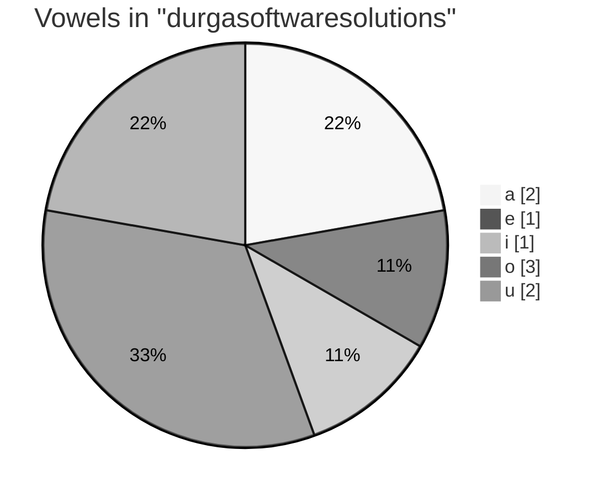

### Program 2: All list functions in one program

The notes end with: "List out all functions of list and write a program to use these functions."

```python
# Start with a list of marks
marks = [72, 85, 60]

# append(): add one mark at the end
marks.append(91)

# Show marks after this change
print("append    :", marks)

# insert(): put 55 at the start
marks.insert(0, 55)

# Show marks after this change
print("insert    :", marks)

# extend(): add several marks at the end
marks.extend([85, 40])

# Show marks after this change
print("extend    :", marks)

# count(): how many times 85 appears
print("count(85) :", marks.count(85))

# index(): position of the first 85
print("index(85) :", marks.index(85))

# remove(): delete the first 85
marks.remove(85)

# Show marks after this change
print("remove    :", marks)

# pop(): take the last mark off and show it
print("pop       :", marks.pop(), marks)

# sort(): arrange in ascending order
marks.sort()

# Show marks after this change
print("sort      :", marks)

# reverse(): turn the order around
marks.reverse()

# Show marks after this change
print("reverse   :", marks)

# copy(): an independent clone
backup = marks.copy()

# Show the new list backup
print("copy      :", backup)

# clear(): empty the original list
marks.clear()

# Show marks after this change
print("clear     :", marks, "backup still", backup)
```

**Output**

```text
append    : [72, 85, 60, 91]
insert    : [55, 72, 85, 60, 91]
extend    : [55, 72, 85, 60, 91, 85, 40]
count(85) : 2
index(85) : 2
remove    : [55, 72, 60, 91, 85, 40]
pop       : 40 [55, 72, 60, 91, 85]
sort      : [55, 60, 72, 85, 91]
reverse   : [91, 85, 72, 60, 55]
copy      : [91, 85, 72, 60, 55]
clear     : [] backup still [91, 85, 72, 60, 55]
```

### Program 3: Student marks report

```python
# Names and marks of five students
names = ["Asha", "Ravi", "Meena", "John", "Sara"]

# The marks, in the same order as the names
marks = [78, 85, 92, 36, 89]

# Pair names with marks and sort by mark, highest first
ranking = sorted(zip(names, marks), key=lambda pair: pair[1], reverse=True)

# Print a header
print(f"{'Rank':<6}{'Name':<8}{'Marks':>6}  Result")

# Visit each pair with a rank starting at 1
for rank, (name, mark) in enumerate(ranking, start=1):

    # 40 or more is a pass
    result = "Pass" if mark >= 40 else "Fail"

    # Print one aligned row
    print(f"{rank:<6}{name:<8}{mark:>6}  {result}")

# Collect the names of students who failed
failed = [name for name, mark in zip(names, marks) if mark < 40]

# Print the class average with 1 decimal
print(f"Average: {sum(marks) / len(marks):.1f}")

# Print who needs help
print("Failed:", failed)
```

**Output**

```text
Rank  Name     Marks  Result
1     Meena       92  Pass
2     Sara        89  Pass
3     Ravi        85  Pass
4     Asha        78  Pass
5     John        36  Fail
Average: 76.0
Failed: ['John']
```

**How this program runs:**

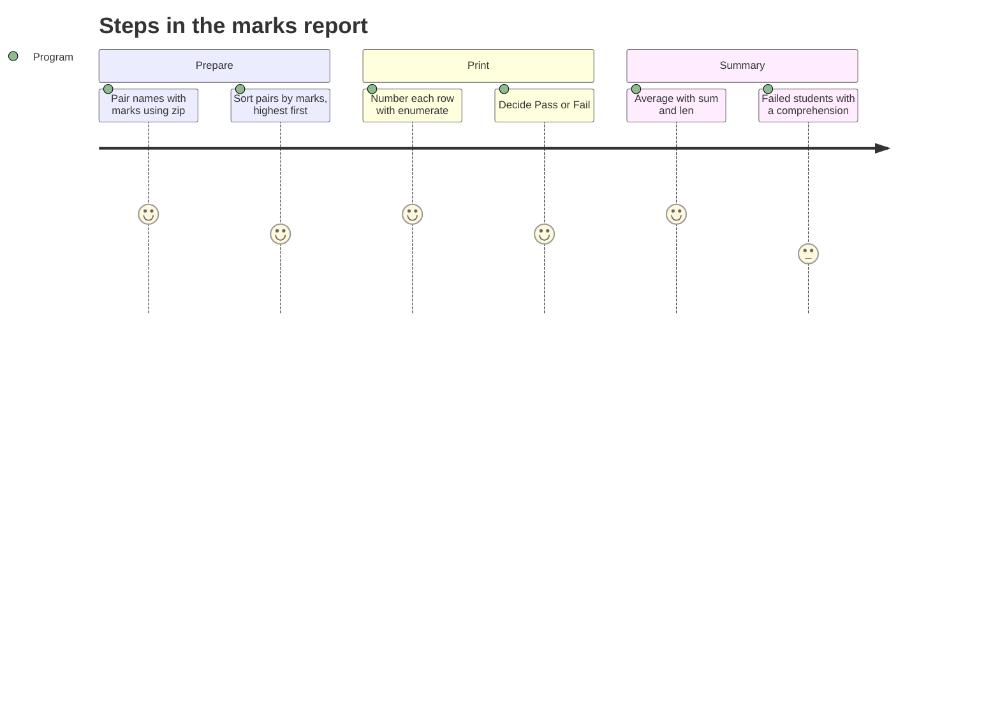

1. `zip(names, marks)` pairs each name with its mark.
2. `sorted(..., key=lambda pair: pair[1], reverse=True)` orders the pairs by mark, highest first.
3. `enumerate(ranking, start=1)` gives a rank number with each pair, and the pair is unpacked into `name` and `mark`.
4. A conditional expression chooses `"Pass"` or `"Fail"`, and an f-string aligns the columns.
5. A list comprehension collects the names of students below 40.

## 18. All list methods at a glance

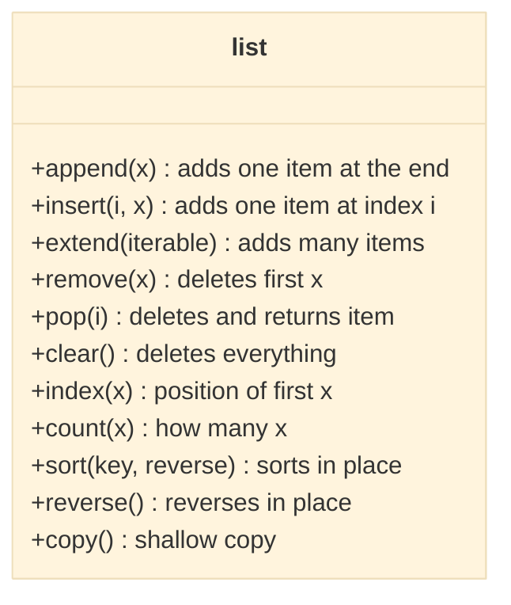

<table width="100%">
<tr>
<th align="left" width="5%">#</th>
<th align="left" width="18%">Method</th>
<th align="left" width="13%">Group</th>
<th align="left" width="22%">What it does</th>
<th align="left" width="14%">Returns</th>
<th align="left" width="28%">Error when</th>
</tr>
<tr><td>1</td><td><code>append(x)</code></td><td>Add</td><td>Adds one item at the end</td><td><code>None</code></td><td>-</td></tr>
<tr><td>2</td><td><code>insert(i, x)</code></td><td>Add</td><td>Adds one item at index <code>i</code></td><td><code>None</code></td><td>Never; out-of-range goes to start or end</td></tr>
<tr><td>3</td><td><code>extend(it)</code></td><td>Add</td><td>Adds every item of an iterable</td><td><code>None</code></td><td>Argument is not iterable</td></tr>
<tr><td>4</td><td><code>remove(x)</code></td><td>Remove</td><td>Deletes the first <code>x</code></td><td><code>None</code></td><td><code>x</code> not in list: <code>ValueError</code></td></tr>
<tr><td>5</td><td><code>pop(i)</code></td><td>Remove</td><td>Deletes and returns item <code>i</code> (last by default)</td><td>The item</td><td>Empty list or bad index: <code>IndexError</code></td></tr>
<tr><td>6</td><td><code>clear()</code></td><td>Remove</td><td>Deletes every item</td><td><code>None</code></td><td>-</td></tr>
<tr><td>7</td><td><code>index(x)</code></td><td>Info</td><td>Position of the first <code>x</code></td><td>An int</td><td><code>x</code> not in list: <code>ValueError</code></td></tr>
<tr><td>8</td><td><code>count(x)</code></td><td>Info</td><td>Number of times <code>x</code> appears</td><td>An int</td><td>-</td></tr>
<tr><td>9</td><td><code>sort()</code></td><td>Order</td><td>Sorts in place</td><td><code>None</code></td><td>Items cannot be compared: <code>TypeError</code></td></tr>
<tr><td>10</td><td><code>reverse()</code></td><td>Order</td><td>Reverses in place</td><td><code>None</code></td><td>-</td></tr>
<tr><td>11</td><td><code>copy()</code></td><td>Copy</td><td>Makes a shallow copy</td><td>A new list</td><td>-</td></tr>
</table>

## 19. Common errors

<table width="100%">
<tr>
<th align="left" width="22%">Code</th>
<th align="left" width="36%">Error</th>
<th align="left" width="20%">Cause</th>
<th align="left" width="22%">Fix</th>
</tr>
<tr><td><code>n[10]</code></td><td><code>IndexError: list index out of range</code></td><td>Index past the end</td><td>Check <code>len(n)</code></td></tr>
<tr><td><code>n.index(4)</code></td><td><code>ValueError: 4 is not in list</code></td><td>Value not present</td><td>Check with <code>in</code> first</td></tr>
<tr><td><code>n.remove(40)</code></td><td><code>ValueError: list.remove(x): x not in list</code></td><td>Value not present</td><td>Check with <code>in</code> first</td></tr>
<tr><td><code>[].pop()</code></td><td><code>IndexError: pop from empty list</code></td><td>Nothing to pop</td><td>Check <code>if n:</code> first</td></tr>
<tr><td><code>[20, "A"].sort()</code></td><td><code>TypeError: '&lt;' not supported between instances of 'str' and 'int'</code></td><td>Mixed types</td><td>Use <code>key=str</code> or keep one type</td></tr>
<tr><td><code>[1, 2] + 3</code></td><td><code>TypeError: can only concatenate list (not "int") to list</code></td><td>Adding a non-list</td><td><code>[1, 2] + [3]</code></td></tr>
<tr><td><code>n = n.sort()</code></td><td>No error, but <code>n</code> becomes <code>None</code></td><td><code>sort()</code> returns <code>None</code></td><td><code>n.sort()</code> or <code>n = sorted(n)</code></td></tr>
<tr><td><code>y = x</code> then change <code>y</code></td><td>No error, but <code>x</code> changes too</td><td>Aliasing</td><td><code>y = x.copy()</code></td></tr>
<tr><td><code>[[0] * 3] * 3</code></td><td>No error, but rows are shared</td><td>Repeats one inner list</td><td><code>[[0] * 3 for _ in range(3)]</code></td></tr>
</table>

## 20. Quick revision

<table width="100%">
<tr>
<th align="left" width="6%">#</th>
<th align="left" width="36%">Question</th>
<th align="left" width="42%">Answer</th>
<th align="left" width="16%">Read again</th>
</tr>
<tr><td>1</td><td>Main properties of a list</td><td>Ordered, duplicates allowed, mixed types, dynamic, mutable</td><td><a href="#1-what-is-a-list">Section 1</a></td></tr>
<tr><td>2</td><td>Ways to create a list</td><td><code>[]</code>, <code>list()</code>, <code>split()</code>, <code>range()</code>, comprehension, safe input</td><td><a href="#2-creating-lists">Section 2</a></td></tr>
<tr><td>3</td><td>Index of the first and last element</td><td><code>0</code> and <code>-1</code></td><td><a href="#3-accessing-elements-by-index">Section 3</a></td></tr>
<tr><td>4</td><td>Does a slice raise IndexError?</td><td>No</td><td><a href="#4-accessing-elements-by-slicing">Section 4</a></td></tr>
<tr><td>5</td><td>Get index and item together</td><td><code>enumerate()</code></td><td><a href="#6-traversing-a-list">Section 6</a></td></tr>
<tr><td>6</td><td><code>index()</code> when missing</td><td><code>ValueError</code></td><td><a href="#7-getting-information-len-count-index">Section 7</a></td></tr>
<tr><td>7</td><td><code>append([3, 4])</code> vs <code>extend([3, 4])</code></td><td>One nested item vs two items</td><td><a href="#8-adding-elements-append-insert-extend">Section 8</a></td></tr>
<tr><td>8</td><td><code>insert()</code> with a huge index</td><td>Goes to the end, no error</td><td><a href="#8-adding-elements-append-insert-extend">Section 8</a></td></tr>
<tr><td>9</td><td>The only method that changes the list and returns a value</td><td><code>pop()</code></td><td><a href="#9-removing-elements-remove-pop-clear-del">Section 9</a></td></tr>
<tr><td>10</td><td>Stack order with append and pop</td><td>LIFO: last in, first out</td><td><a href="#9-removing-elements-remove-pop-clear-del">Section 9</a></td></tr>
<tr><td>11</td><td><code>sort()</code> vs <code>sorted()</code></td><td>In place, returns None vs new list</td><td><a href="#10-ordering-elements-reverse-and-sort">Section 10</a></td></tr>
<tr><td>12</td><td>Sort descending</td><td><code>sort(reverse=True)</code></td><td><a href="#10-ordering-elements-reverse-and-sort">Section 10</a></td></tr>
<tr><td>13</td><td><code>=</code> vs <code>copy()</code></td><td>Aliasing vs cloning (shallow)</td><td><a href="#11-aliasing-and-cloning">Section 11</a></td></tr>
<tr><td>14</td><td>Copy a nested list safely</td><td><code>copy.deepcopy()</code></td><td><a href="#11-aliasing-and-cloning">Section 11</a></td></tr>
<tr><td>15</td><td>How <code>&lt;</code> compares lists</td><td>Element by element until one differs</td><td><a href="#12-operators-on-lists--and-comparisons">Section 12</a></td></tr>
<tr><td>16</td><td>Element in row 1, column 2 of <code>m</code></td><td><code>m[1][2]</code></td><td><a href="#14-nested-lists-and-matrices">Section 14</a></td></tr>
<tr><td>17</td><td>Comprehension syntax</td><td><code>[expr for x in iterable if cond]</code></td><td><a href="#15-list-comprehensions">Section 15</a></td></tr>
</table>

## 21. Interview questions

Try to answer each question aloud first, then click it to see a model answer.

<details>
<summary><b>Q1. What is a list? What are its main properties?</b></summary>

A list is an ordered, mutable collection written in square brackets. It keeps insertion order, allows duplicates, can hold different types, and can grow or shrink at any time.

</details>

<details>
<summary><b>Q2. What is the difference between <code>append()</code> and <code>extend()</code>?</b></summary>

`append(x)` adds `x` as **one** item, even if `x` is a list: `[1, 2].append([3, 4])` gives `[1, 2, [3, 4]]`. `extend(iterable)` adds **each** item of the iterable: `[1, 2].extend([3, 4])` gives `[1, 2, 3, 4]`.

</details>

<details>
<summary><b>Q3. What is the difference between <code>remove()</code>, <code>pop()</code>, <code>del</code> and <code>clear()</code>?</b></summary>

`remove(x)` deletes the first item equal to `x` and returns `None`. `pop(i)` deletes the item at index `i` (last by default) and returns it. `del items[i]` or `del items[a:b]` deletes by index or slice and returns nothing. `clear()` deletes every item but keeps the list object.

</details>

<details>
<summary><b>Q4. What is the difference between <code>sort()</code> and <code>sorted()</code>?</b></summary>

`list.sort()` sorts the list in place and returns `None`; it works only on lists. `sorted(iterable)` returns a new sorted list and leaves the original unchanged; it works on any iterable. Both accept `key=` and `reverse=`.

</details>

<details>
<summary><b>Q5. What is aliasing? What is cloning?</b></summary>

Aliasing is giving a second name to the same list (`y = x`); changes through either name affect both. Cloning is creating a new, independent list with the same content (`y = x.copy()` or `y = x[:]`).

</details>

<details>
<summary><b>Q6. What is the difference between a shallow copy and a deep copy of a list?</b></summary>

A shallow copy (`copy()`, `[:]`, `list()`) creates a new outer list but shares the inner objects, so changing an inner list shows in both. A deep copy (`copy.deepcopy()`) copies everything at every level, so the copy is fully independent.

</details>

<details>
<summary><b>Q7. How does Python compare two lists with <code>&lt;</code>?</b></summary>

Lexicographically: it compares the first elements; if they are equal it compares the second elements, and so on. The first difference decides the result. If one list runs out first and everything matched so far, the shorter list is smaller.

</details>

<details>
<summary><b>Q8. What happens when you call <code>insert()</code> with an index larger than the list?</b></summary>

No error. The item is added at the end. With an index smaller than `-len(list)`, it is added at the start.

</details>

<details>
<summary><b>Q9. How do you implement a stack and a queue with lists?</b></summary>

Stack (LIFO): `append()` to push and `pop()` to pop, both at the end, which is fast. Queue (FIFO): `append()` to add and `pop(0)` to remove from the front, but `pop(0)` is slow for long lists because every item shifts; use `collections.deque` and its `popleft()` for real queues.

</details>

<details>
<summary><b>Q10. Why does <code>[[0] * 3] * 3</code> cause a bug?</b></summary>

`* 3` on the outer list repeats a reference to the **same** inner list three times. Changing `grid[0][0]` changes every row. Build grids with a comprehension, `[[0] * 3 for _ in range(3)]`, which creates a new row each time.

</details>

<details>
<summary><b>Q11. What is a list comprehension? When should you not use one?</b></summary>

A compact expression that builds a list from an iterable: `[expr for x in iterable if cond]`. It is usually clearer and faster than a loop with `append()`. Avoid it when the logic needs several conditions, nested loops or side effects; a normal loop is easier to read then.

</details>

<details>
<summary><b>Q12. How do you remove duplicates from a list?</b></summary>

`list(set(items))` removes duplicates but loses the order. To keep the order, use `list(dict.fromkeys(items))`, or a loop that appends an item only if it is not already in the result (like the unique-vowels program).

</details>

<details>
<summary><b>Q13. Why does <code>[20, "A"].sort()</code> fail in Python 3?</b></summary>

Sorting needs `<` between items, and Python 3 does not define `<` between `int` and `str`, so it raises `TypeError`. Python 2 allowed it and put numbers before strings.

</details>

<details>
<summary><b>Q14. What do <code>sort()</code>, <code>append()</code> and <code>reverse()</code> return?</b></summary>

`None`. Methods that change a list in place return `None`, so writing `items = items.sort()` loses the list. `pop()` is the exception: it changes the list and returns the removed item.

</details>

<details>
<summary><b>Q15. How do you find the index of every occurrence of a value?</b></summary>

`[i for i, v in enumerate(items) if v == value]`. `index()` only gives the first occurrence.

</details>

## 22. Practice questions

1. Create a list of 5 cities. Print the first, the last and the middle city using positive and negative indexes.
2. Given `n = list(range(1, 21))`, use slicing to print: the first 5 numbers, the last 5, every third number, and the list reversed.
3. Read a list of numbers typed on one line (for example `4 8 15 16 23 42`) and print their sum, average, minimum and maximum.
4. Write a program that removes every occurrence of a given value from a list without using a list comprehension.
5. Show the difference between `append()` and `extend()` by adding `[7, 8]` to two copies of `[1, 2]`.
6. Insert `0` at the start, `99` in the middle and `100` at the end of `[10, 20, 30, 40]`.
7. Sort `["banana", "Apple", "cherry", "date"]` alphabetically ignoring case, and then by word length, longest first.
8. Create `x = [[1, 2], [3, 4]]`. Make an alias, a shallow copy and a deep copy, then change `x[0][0]` and print all four.
9. Predict, then run: `[1, 2, 3] < [1, 2, 4]`, `[2] > [1, 100]`, `[1, 2] < [1, 2, 0]`, `["b"] < ["a", "z"]`.
10. Build a 3 x 3 multiplication table as a nested list and print it in matrix style.
11. Using list comprehensions: squares of odd numbers from 1 to 15; words with more than 4 letters from a sentence; numbers in `a` but not in `b`.
12. Write a stack program: push 5 numbers with `append()`, then pop them all and print each one. In what order do they come out?
13. Remove duplicates from `[3, 1, 3, 2, 1, 4]` while keeping the original order.
14. Find the second largest number in a list without using `sort()` or `sorted()`.
15. Write a program that counts how many students passed (40 or more) from a list of marks, using `sum()` with a generator.

<p align="center">
  <a href="../05.%20Flow%20control/README.md">Previous: 05. Flow control</a> &nbsp;|&nbsp; <a href="../README.md">Course home</a> &nbsp;|&nbsp; <a href="../07.%20Tuple/README.md">Next: 07. Tuple</a>
</p>
