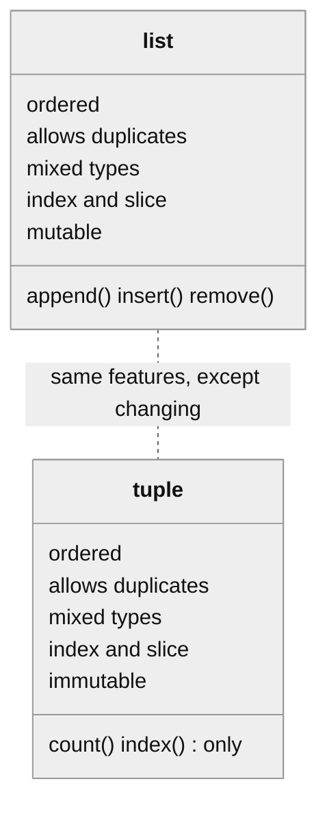
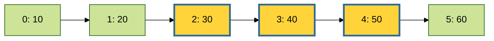
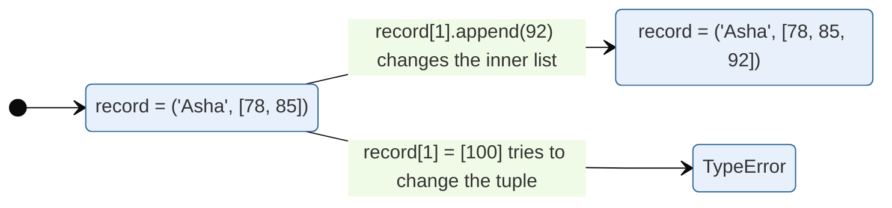
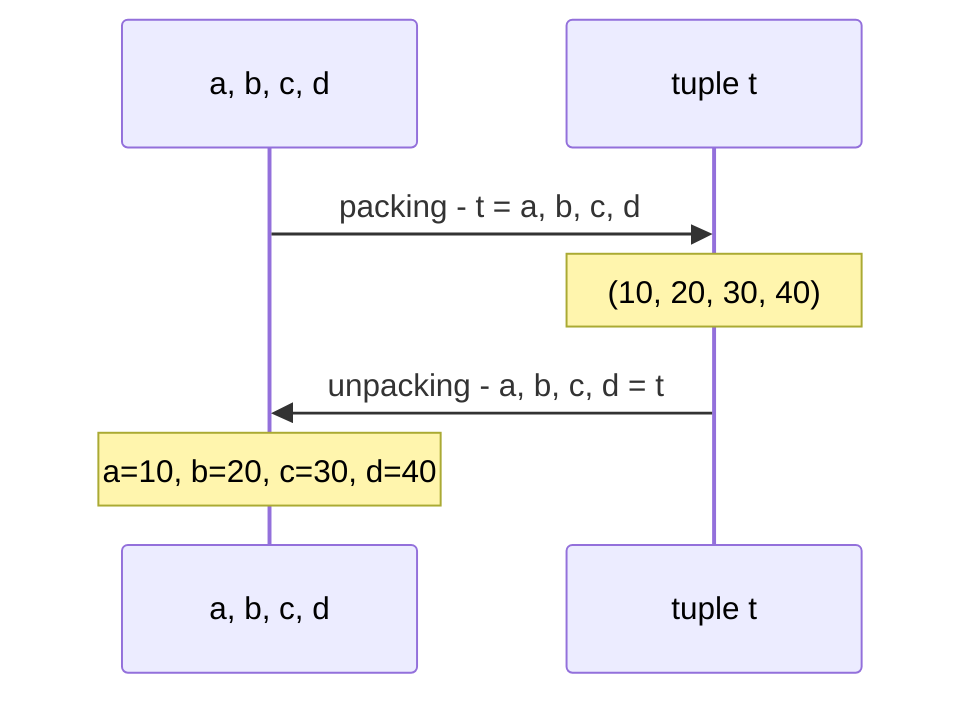
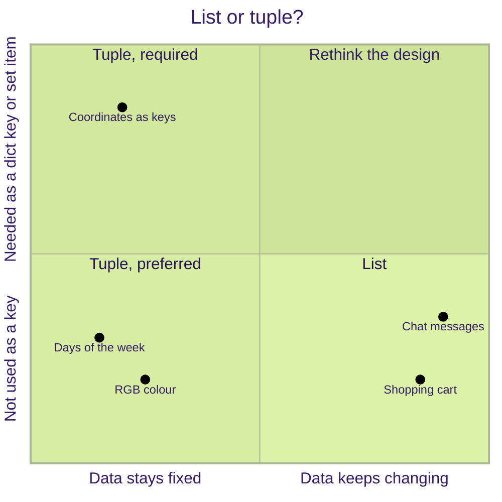

<p align="center">
  
</p>

# 07. Tuple

A **tuple** is a read-only list. It keeps items in order, allows duplicates and mixed types, and supports indexing and slicing, exactly like a list. The one big difference: once a tuple is created, **it can never be changed**. This topic shows how to create tuples, read from them, pack and unpack them, and when to choose a tuple instead of a list.

**In this topic**

1. [What is a tuple?](#1-what-is-a-tuple)
2. [Creating tuples](#2-creating-tuples)
3. [Which of these are valid tuples?](#3-which-of-these-are-valid-tuples)
4. [Accessing elements: index](#4-accessing-elements-index)
5. [Accessing elements: slice](#5-accessing-elements-slice)
6. [Tuples are immutable](#6-tuples-are-immutable)
7. [Operators on tuples](#7-operators-on-tuples)
8. [Important functions and methods](#8-important-functions-and-methods)
9. [cmp() in Python 2 and comparison in Python 3](#9-cmp-in-python-2-and-comparison-in-python-3)
10. [Tuple packing and unpacking](#10-tuple-packing-and-unpacking)
11. [Tuple comprehension does not exist](#11-tuple-comprehension-does-not-exist)
12. [Tuples as dictionary keys](#12-tuples-as-dictionary-keys)
13. [Named tuples](#13-named-tuples)
14. [Complete programs](#14-complete-programs)
15. [List vs tuple](#15-list-vs-tuple)
16. [Common errors](#16-common-errors)
17. [Quick revision](#17-quick-revision)
18. [Interview questions](#18-interview-questions)
19. [Practice questions](#19-practice-questions)

## 1. What is a tuple?

> **A tuple is exactly the same as a list, except that it is immutable.** Once a tuple object is created, you cannot change it. So a tuple is the **read-only version of a list**.

If your data is **fixed and never changes**, use a tuple. Examples: the days of the week, the RGB values of a colour, the (latitude, longitude) of a city, a date as (year, month, day).

<table width="100%">
<tr>
<th align="left" width="5%">#</th>
<th align="left" width="30%">Property</th>
<th align="left" width="40%">Meaning</th>
<th align="left" width="25%">Same as list?</th>
</tr>
<tr><td>1</td><td>Immutable</td><td>Items cannot be changed, added or removed</td><td><b>No</b>, lists are mutable</td></tr>
<tr><td>2</td><td>Insertion order is preserved</td><td>Items stay in the order you wrote them</td><td>Yes</td></tr>
<tr><td>3</td><td>Duplicates are allowed</td><td>The same value can appear many times</td><td>Yes</td></tr>
<tr><td>4</td><td>Heterogeneous objects are allowed</td><td>Different types can be mixed</td><td>Yes</td></tr>
<tr><td>5</td><td>Index and slicing are supported</td><td>Positive and negative indexes work; the index tells duplicates apart</td><td>Yes</td></tr>
<tr><td>6</td><td>Written with parentheses and commas</td><td><code>(10, 20, 30)</code>; the parentheses are optional but recommended</td><td>No, lists use <code>[ ]</code></td></tr>
<tr><td>7</td><td>Can be a dictionary key</td><td>Only if every item inside is also immutable</td><td>No, lists can never be keys</td></tr>
</table>



## 2. Creating tuples

**The comma makes the tuple, not the parentheses.** Parentheses are only for grouping and readability.

**Example 1: A tuple without parentheses**

```python
# Values separated by commas form a tuple, even without parentheses
t = 10, 20, 30, 40

# Print the tuple
print(t)

# Check its type
print(type(t))
```

**Output**

```text
(10, 20, 30, 40)
<class 'tuple'>
```

**Example 2: A tuple with parentheses (recommended)**

```python
# The same tuple written with parentheses, which is clearer
t = (10, 20, 30, 40)

# Print the tuple
print(t)
```

**Output**

```text
(10, 20, 30, 40)
```

**Example 3: An empty tuple**

```python
# Empty parentheses create an empty tuple
t = ()

# Check the type
print(type(t))

# An empty tuple has no items
print(len(t))
```

**Output**

```text
<class 'tuple'>
0
```

**Example 4: The single-value trap**

```python
# Parentheses around one value are just grouping, NOT a tuple
t = (10)

# This prints a plain number
print(t)

# The type is int, not tuple
print(type(t))
```

**Output**

```text
10
<class 'int'>
```

**Example 5: A single-value tuple needs a comma**

```python
# The trailing comma makes it a tuple
t = (10,)

# Python shows the comma too
print(t)

# Now the type is tuple
print(type(t))
```

**Output**

```text
(10,)
<class 'tuple'>
```

**Example 6: A single-value tuple without parentheses**

```python
# A value followed by a comma is also a one-item tuple
t = 10,

# Print it
print(t)

# Check the type
print(type(t))
```

**Output**

```text
(10,)
<class 'tuple'>
```

**Example 7: Mixed types and duplicates**

```python
# A tuple can hold different types and repeated values
person = ("Asha", 25, 5.4, True, 25)

# Print the tuple
print(person)
```

**Output**

```text
('Asha', 25, 5.4, True, 25)
```

**Example 8: tuple() from a list**

```python
# A list of numbers
numbers = [10, 20, 30]

# Convert the list into a tuple
t = tuple(numbers)

# Print the tuple
print(t)
```

**Output**

```text
(10, 20, 30)
```

**Example 9: tuple() from a range**

```python
# Convert a range of even numbers from 10 to 18 into a tuple
t = tuple(range(10, 20, 2))

# Print the tuple
print(t)
```

**Output**

```text
(10, 12, 14, 16, 18)
```

**Example 10: tuple() from a string**

```python
# A string is split into its characters
t = tuple("hello")

# Print the tuple of characters
print(t)
```

**Output**

```text
('h', 'e', 'l', 'l', 'o')
```

**Example 11: tuple() with no argument**

```python
# tuple() with nothing inside creates an empty tuple
t = tuple()

# Print it
print(t)
```

**Output**

```text
()
```

**Example 12: A tuple from a set**

```python
# A set of numbers (sets have no order)
values = {3, 1, 2}

# sorted() gives a list in order, and tuple() turns it into a tuple
t = tuple(sorted(values))

# Print the tuple
print(t)
```

**Output**

```text
(1, 2, 3)
```

**Example 13: A tuple from dictionary items**

```python
# A small dictionary
prices = {"tea": 20, "coffee": 30}

# items() gives (key, value) pairs; tuple() collects them
t = tuple(prices.items())

# Print the tuple of pairs
print(t)
```

**Output**

```text
(('tea', 20), ('coffee', 30))
```

**Example 14: Nested tuples**

```python
# A tuple whose items are tuples: three points (x, y)
points = ((0, 0), (3, 4), (6, 8))

# Print the second point
print(points[1])

# Print the y value of the second point
print(points[1][1])
```

**Output**

```text
(3, 4)
4
```

**Example 15: A function that returns several values returns a tuple**

```python
# A function that returns two values separated by a comma
def min_and_max(values):

    # The comma packs both results into one tuple
    return min(values), max(values)

# Call the function and store the result
result = min_and_max([4, 9, 1, 7])

# Print the result
print(result)

# The result is a tuple
print(type(result))
```

**Output**

```text
(1, 9)
<class 'tuple'>
```

## 3. Which of these are valid tuples?

<table width="100%">
<tr>
<th align="left" width="5%">#</th>
<th align="left" width="22%">Code</th>
<th align="left" width="12%">Tuple?</th>
<th align="left" width="21%">Type created</th>
<th align="left" width="40%">Reason</th>
</tr>
<tr><td>1</td><td><code>t = ()</code></td><td>Yes</td><td><code>tuple</code></td><td>Empty parentheses create an empty tuple</td></tr>
<tr><td>2</td><td><code>t = 10, 20, 30, 40</code></td><td>Yes</td><td><code>tuple</code></td><td>The commas create the tuple</td></tr>
<tr><td>3</td><td><code>t = 10</code></td><td>No</td><td><code>int</code></td><td>No comma</td></tr>
<tr><td>4</td><td><code>t = 10,</code></td><td>Yes</td><td><code>tuple</code></td><td>The trailing comma creates a one-item tuple</td></tr>
<tr><td>5</td><td><code>t = (10)</code></td><td>No</td><td><code>int</code></td><td>Parentheses alone only group; there is no comma</td></tr>
<tr><td>6</td><td><code>t = (10,)</code></td><td>Yes</td><td><code>tuple</code></td><td>One-item tuple with a comma</td></tr>
<tr><td>7</td><td><code>t = (10, 20, 30, 40)</code></td><td>Yes</td><td><code>tuple</code></td><td>Normal tuple</td></tr>
</table>

**Example 16: Checking all seven in code**

```python
# The seven candidates, written as text so we can test each one
candidates = ["()", "10, 20, 30, 40", "10", "10,", "(10)", "(10,)", "(10, 20, 30, 40)"]

# Evaluate each piece of code and show the type it creates
for code in candidates:

    # eval() is safe here because we wrote the text ourselves
    print(f"t = {code:18} -> {type(eval(code)).__name__}")
```

**Output**

```text
t = ()                 -> tuple
t = 10, 20, 30, 40     -> tuple
t = 10                 -> int
t = 10,                -> tuple
t = (10)               -> int
t = (10,)              -> tuple
t = (10, 20, 30, 40)   -> tuple
```

## 4. Accessing elements: index

Tuples support **positive** indexes (left to right, starting at 0) and **negative** indexes (right to left, starting at -1).

<table width="100%">
<tr>
<th align="center" width="16%">Item</th>
<th align="center" width="14%">10</th>
<th align="center" width="14%">20</th>
<th align="center" width="14%">30</th>
<th align="center" width="14%">40</th>
<th align="center" width="14%">50</th>
<th align="center" width="14%">60</th>
</tr>
<tr><td align="center"><b>Positive index</b></td><td align="center">0</td><td align="center">1</td><td align="center">2</td><td align="center">3</td><td align="center">4</td><td align="center">5</td></tr>
<tr><td align="center"><b>Negative index</b></td><td align="center">-6</td><td align="center">-5</td><td align="center">-4</td><td align="center">-3</td><td align="center">-2</td><td align="center">-1</td></tr>
</table>

**Example 17: First item**

```python
# A tuple of six numbers
t = (10, 20, 30, 40, 50, 60)

# Index 0 is the first item
print(t[0])
```

**Output**

```text
10
```

**Example 18: Last item**

```python
# A tuple of six numbers
t = (10, 20, 30, 40, 50, 60)

# Index -1 is the last item
print(t[-1])
```

**Output**

```text
60
```

**Example 19: Middle items**

```python
# A tuple of six numbers
t = (10, 20, 30, 40, 50, 60)

# Third item from the left
print(t[2])

# Third item from the right
print(t[-3])
```

**Output**

```text
30
40
```

**Example 20: An index that does not exist**

```python
# A tuple of six numbers
t = (10, 20, 30, 40, 50, 60)

# There is no index 100
print(t[100])
```

**Output** (last line of the error message)

```text
IndexError: tuple index out of range
```

**Example 21: Indexing a tuple of strings**

```python
# Days of the week never change, so a tuple is a good fit
days = ("Mon", "Tue", "Wed", "Thu", "Fri", "Sat", "Sun")

# Day number 3 (Thursday), because counting starts at 0
print(days[3])
```

**Output**

```text
Thu
```

**Example 22: Indexing inside a nested tuple**

```python
# Each item is a (name, marks) pair
students = (("Asha", 92), ("Ravi", 85))

# The first student's name
print(students[0][0])

# The second student's marks
print(students[1][1])
```

**Output**

```text
Asha
85
```

**Example 23: Going through a tuple with a for loop**

```python
# A tuple of colours
colours = ("red", "green", "blue")

# Visit each colour in order
for colour in colours:

    # Print the current colour
    print(colour)
```

**Output**

```text
red
green
blue
```

**Example 24: Index and value together with enumerate()**

```python
# A tuple of colours
colours = ("red", "green", "blue")

# enumerate() gives (index, value) pairs
for index, colour in enumerate(colours):

    # Print the position and the colour
    print(index, colour)
```

**Output**

```text
0 red
1 green
2 blue
```

**Example 25: Going through a tuple with a while loop and indexes**

```python
# A tuple of numbers
t = (5, 10, 15)

# Start at index 0
i = 0

# Continue while i is a valid index
while i < len(t):

    # Print the index and the item at that index
    print(i, t[i])

    # Move to the next index
    i += 1
```

**Output**

```text
0 5
1 10
2 15
```

## 5. Accessing elements: slice

A slice `t[start:stop:step]` returns a **new tuple**. The `stop` index is not included, and slices never raise `IndexError`.



The highlighted items are `t[2:5]`: from index 2 up to, but not including, index 5.

**Example 26: A middle slice**

```python
# A tuple of six numbers
t = (10, 20, 30, 40, 50, 60)

# From index 2 up to index 4
print(t[2:5])
```

**Output**

```text
(30, 40, 50)
```

**Example 27: A stop past the end**

```python
# A tuple of six numbers
t = (10, 20, 30, 40, 50, 60)

# Stop 100 is past the end, so the slice just goes to the end
print(t[2:100])
```

**Output**

```text
(30, 40, 50, 60)
```

**Example 28: Every second item**

```python
# A tuple of six numbers
t = (10, 20, 30, 40, 50, 60)

# Step 2 takes every second item
print(t[::2])
```

**Output**

```text
(10, 30, 50)
```

**Example 29: The first three items**

```python
# A tuple of six numbers
t = (10, 20, 30, 40, 50, 60)

# From the start up to index 2
print(t[:3])
```

**Output**

```text
(10, 20, 30)
```

**Example 30: The last two items**

```python
# A tuple of six numbers
t = (10, 20, 30, 40, 50, 60)

# The last two items, using a negative start
print(t[-2:])
```

**Output**

```text
(50, 60)
```

**Example 31: Reversed**

```python
# A tuple of six numbers
t = (10, 20, 30, 40, 50, 60)

# A step of -1 walks backwards
print(t[::-1])
```

**Output**

```text
(60, 50, 40, 30, 20, 10)
```

**Example 32: An empty slice**

```python
# A tuple of six numbers
t = (10, 20, 30, 40, 50, 60)

# Start after stop gives an empty tuple
print(t[4:1])
```

**Output**

```text
()
```

**Example 33: A slice is a new tuple**

```python
# A tuple of six numbers
t = (10, 20, 30, 40, 50, 60)

# Take a slice
part = t[1:3]

# The slice is also a tuple
print(type(part))
```

**Output**

```text
<class 'tuple'>
```

## 6. Tuples are immutable

Once a tuple is created, you cannot change its content.

**Example 34: Changing an item**

```python
# A tuple of four numbers
t = (10, 20, 30, 40)

# Try to replace the second item
t[1] = 70
```

**Output** (last line of the error message)

```text
TypeError: 'tuple' object does not support item assignment
```

**Example 35: Adding an item**

```python
# A tuple of four numbers
t = (10, 20, 30, 40)

# Tuples have no append() method
t.append(50)
```

**Output** (last line of the error message)

```text
AttributeError: 'tuple' object has no attribute 'append'
```

**Example 36: Removing an item**

```python
# A tuple of four numbers
t = (10, 20, 30, 40)

# Tuples have no remove() method
t.remove(10)
```

**Output** (last line of the error message)

```text
AttributeError: 'tuple' object has no attribute 'remove'
```

**Example 37: Deleting an item**

```python
# A tuple of four numbers
t = (10, 20, 30, 40)

# Deleting a single item is not allowed either
del t[0]
```

**Output** (last line of the error message)

```text
TypeError: 'tuple' object doesn't support item deletion
```

**Example 38: "Changing" a tuple really means building a new one**

```python
# The original tuple
t = (10, 20, 30, 40)

# Remember its identity
old_id = id(t)

# Build a new tuple from a slice, a new value and another slice
t = t[:1] + (70,) + t[2:]

# Print the new tuple
print(t)

# The name t now points to a different object
print(id(t) == old_id)
```

**Output**

```text
(10, 70, 30, 40)
False
```

**Example 39: Converting to a list, changing, converting back**

```python
# The original tuple
t = (10, 20, 30, 40)

# Make a changeable list copy
temp = list(t)

# Change the list
temp[1] = 70

# Turn it back into a tuple
t = tuple(temp)

# Print the result
print(t)
```

**Output**

```text
(10, 70, 30, 40)
```

### Immutability is shallow

A tuple cannot change **which objects it holds**. But if one of those objects is itself mutable, such as a list, **that object** can still change.

**Example 40: A list inside a tuple can change**

```python
# A tuple that holds a name and a list of marks
record = ("Asha", [78, 85])

# The tuple's second item is a list; the list itself can grow
record[1].append(92)

# The tuple now shows the extra mark
print(record)
```

**Output**

```text
('Asha', [78, 85, 92])
```

**Example 41: But the slot itself cannot be replaced**

```python
# A tuple that holds a name and a list of marks
record = ("Asha", [78, 85])

# Replacing the whole list is changing the tuple, which is not allowed
record[1] = [100]
```

**Output** (last line of the error message)

```text
TypeError: 'tuple' object does not support item assignment
```



> **Lesson:** "immutable" means the tuple's slots are fixed. Put only immutable items (numbers, strings, other tuples) inside a tuple if you need it to be completely unchangeable, for example as a dictionary key.

## 7. Operators on tuples

### Concatenation (+)

**Example 42: Joining two tuples**

```python
# The first tuple
t1 = (10, 20, 30)

# The second tuple
t2 = (40, 50, 60)

# + builds a new tuple with the items of both
t3 = t1 + t2

# Print the joined tuple
print(t3)
```

**Output**

```text
(10, 20, 30, 40, 50, 60)
```

**Example 43: Adding one item with +**

```python
# A tuple of three items
t = (1, 2, 3)

# To add one item, join a one-item tuple (note the comma)
t = t + (4,)

# Print the result
print(t)
```

**Output**

```text
(1, 2, 3, 4)
```

**Example 44: + needs two tuples**

```python
# A tuple of three items
t = (1, 2, 3)

# A tuple cannot be joined with a plain number
print(t + 4)
```

**Output** (last line of the error message)

```text
TypeError: can only concatenate tuple (not "int") to tuple
```

**Example 45: + with a list does not work**

```python
# A tuple and a list
t = (1, 2)

# Joining a tuple with a list raises an error
print(t + [3, 4])
```

**Output** (last line of the error message)

```text
TypeError: can only concatenate tuple (not "list") to tuple
```

### Repetition (*)

**Example 46: Repeating a tuple**

```python
# A tuple of three items
t1 = (10, 20, 30)

# * repeats the items 3 times in a new tuple
t2 = t1 * 3

# Print the repeated tuple
print(t2)
```

**Output**

```text
(10, 20, 30, 10, 20, 30, 10, 20, 30)
```

**Example 47: Building a tuple of zeros**

```python
# Five zeros in a tuple
zeros = (0,) * 5

# Print the tuple
print(zeros)
```

**Output**

```text
(0, 0, 0, 0, 0)
```

**Example 48: Repeating zero times**

```python
# Repeating 0 times gives an empty tuple
print((1, 2) * 0)
```

**Output**

```text
()
```

### Membership (in, not in)

**Example 49: in and not in**

```python
# A tuple of vowels
vowels = ("a", "e", "i", "o", "u")

# Is "e" in the tuple?
print("e" in vowels)

# Is "z" missing from the tuple?
print("z" not in vowels)
```

**Output**

```text
True
True
```

### Comparison

Tuples are compared **item by item**, from the left, until two items differ.

**Example 50: Equal tuples**

```python
# Same items in the same order are equal
print((1, 2, 3) == (1, 2, 3))

# Same items in a different order are not equal
print((1, 2, 3) == (3, 2, 1))
```

**Output**

```text
True
False
```

**Example 51: Less than**

```python
# The first items are equal (1), so Python compares the second items: 2 < 5
print((1, 2, 99) < (1, 5, 0))
```

**Output**

```text
True
```

**Example 52: A shorter tuple that matches the start**

```python
# (1, 2) matches the start of (1, 2, 3) and is shorter, so it is smaller
print((1, 2) < (1, 2, 3))
```

**Output**

```text
True
```

**Example 53: Comparing versions**

```python
# Version numbers as tuples compare correctly item by item
print((3, 12, 1) > (3, 9, 8))
```

**Output**

```text
True
```

## 8. Important functions and methods

A tuple has only **two methods**: `count()` and `index()`. Many built-in **functions** also work on tuples.

<table width="100%">
<tr>
<th align="left" width="16%">Name</th>
<th align="left" width="12%">Kind</th>
<th align="left" width="30%">What it does</th>
<th align="left" width="22%">Example</th>
<th align="left" width="20%">Result</th>
</tr>
<tr><td><code>len()</code></td><td>Function</td><td>Number of items</td><td><code>len((10, 20, 30, 40))</code></td><td><code>4</code></td></tr>
<tr><td><code>count()</code></td><td>Method</td><td>How many times a value appears</td><td><code>(10, 20, 10).count(10)</code></td><td><code>2</code></td></tr>
<tr><td><code>index()</code></td><td>Method</td><td>Index of the first match; <code>ValueError</code> if missing</td><td><code>(10, 20, 10).index(20)</code></td><td><code>1</code></td></tr>
<tr><td><code>sorted()</code></td><td>Function</td><td>Sorted items as a new <b>list</b></td><td><code>sorted((40, 10, 30))</code></td><td><code>[10, 30, 40]</code></td></tr>
<tr><td><code>min()</code>, <code>max()</code></td><td>Function</td><td>Smallest and largest item</td><td><code>max((40, 10, 30))</code></td><td><code>40</code></td></tr>
<tr><td><code>sum()</code></td><td>Function</td><td>Total of the numbers</td><td><code>sum((1, 2, 3))</code></td><td><code>6</code></td></tr>
<tr><td><code>any()</code>, <code>all()</code></td><td>Function</td><td>Is any / every item true?</td><td><code>all((1, 2, 0))</code></td><td><code>False</code></td></tr>
<tr><td><code>reversed()</code></td><td>Function</td><td>Items from last to first</td><td><code>tuple(reversed((1, 2, 3)))</code></td><td><code>(3, 2, 1)</code></td></tr>
</table>

**Example 54: len()**

```python
# A tuple of four numbers
t = (10, 20, 30, 40)

# Count the items
print(len(t))
```

**Output**

```text
4
```

**Example 55: count()**

```python
# A tuple with repeated values
t = (10, 20, 10, 10, 20)

# How many times does 10 appear?
print(t.count(10))

# How many times does 30 appear?
print(t.count(30))
```

**Output**

```text
3
0
```

**Example 56: index()**

```python
# A tuple with repeated values
t = (10, 20, 10, 10, 20)

# The index of the FIRST 10
print(t.index(10))

# The index of the first 20
print(t.index(20))
```

**Output**

```text
0
1
```

**Example 57: index() with a start position**

```python
# A tuple with repeated values
t = (10, 20, 10, 10, 20)

# Search for 10 starting from index 1
print(t.index(10, 1))
```

**Output**

```text
2
```

**Example 58: index() when the value is missing**

```python
# A tuple with repeated values
t = (10, 20, 10, 10, 20)

# 30 is not in the tuple
print(t.index(30))
```

**Output** (last line of the error message)

```text
ValueError: tuple.index(x): x not in tuple
```

**Example 59: sorted() returns a list and leaves the tuple unchanged**

```python
# An unsorted tuple
t = (40, 10, 30, 20)

# sorted() builds a new, sorted list
t1 = sorted(t)

# Print the sorted list
print(t1)

# The original tuple is unchanged
print(t)
```

**Output**

```text
[10, 20, 30, 40]
(40, 10, 30, 20)
```

**Example 60: sorted() in reverse order**

```python
# An unsorted tuple
t = (40, 10, 30, 20)

# reverse=True sorts from largest to smallest
t1 = sorted(t, reverse=True)

# Print the result
print(t1)
```

**Output**

```text
[40, 30, 20, 10]
```

**Example 61: Keeping the result as a tuple**

```python
# An unsorted tuple
t = (40, 10, 30, 20)

# Wrap sorted() in tuple() to get a tuple back
print(tuple(sorted(t)))
```

**Output**

```text
(10, 20, 30, 40)
```

**Example 62: Sorting words by length**

```python
# A tuple of words
words = ("banana", "kiwi", "apple", "fig")

# key=len sorts by the length of each word
print(sorted(words, key=len))
```

**Output**

```text
['fig', 'kiwi', 'apple', 'banana']
```

**Example 63: min() and max()**

```python
# An unsorted tuple
t = (40, 10, 30, 20)

# The smallest item
print(min(t))

# The largest item
print(max(t))
```

**Output**

```text
10
40
```

**Example 64: min() and max() on strings**

```python
# A tuple of names
names = ("Ravi", "Asha", "Meena")

# Alphabetically first
print(min(names))

# Alphabetically last
print(max(names))
```

**Output**

```text
Asha
Ravi
```

**Example 65: sum() and average**

```python
# A tuple of marks
marks = (78, 85, 92)

# The total
total = sum(marks)

# Print the total and the average
print(total, total / len(marks))
```

**Output**

```text
255 85.0
```

**Example 66: any() and all()**

```python
# A tuple with one zero in it
values = (5, 0, 3)

# True if at least one item is truthy
print(any(values))

# True only if every item is truthy; 0 is falsy
print(all(values))
```

**Output**

```text
True
False
```

**Example 67: reversed()**

```python
# A tuple of three items
t = (1, 2, 3)

# reversed() gives the items backwards; tuple() collects them
print(tuple(reversed(t)))
```

**Output**

```text
(3, 2, 1)
```

**Example 68: The only two methods**

```python
# List the public methods of tuple (names not starting with _)
print([name for name in dir(tuple) if not name.startswith("_")])
```

**Output**

```text
['count', 'index']
```

## 9. cmp() in Python 2 and comparison in Python 3

In **Python 2**, `cmp(t1, t2)` compared two tuples and returned:

<table width="100%">
<tr>
<th align="left" width="30%">Situation</th>
<th align="left" width="20%"><code>cmp()</code> result</th>
<th align="left" width="50%">Python 3 way</th>
</tr>
<tr><td>Both tuples are equal</td><td><code>0</code></td><td><code>t1 == t2</code></td></tr>
<tr><td>First is smaller</td><td><code>-1</code></td><td><code>t1 &lt; t2</code></td></tr>
<tr><td>First is greater</td><td><code>+1</code></td><td><code>t1 &gt; t2</code></td></tr>
</table>

> **`cmp()` does not exist in Python 3.** Calling it gives `NameError`. Use the comparison operators instead.

**Example 69: cmp() is gone**

```python
# Two tuples
t1 = (10, 20, 30)

# A second tuple
t2 = (40, 50, 60)

# cmp() was removed in Python 3
print(cmp(t1, t2))
```

**Output** (last line of the error message)

```text
NameError: name 'cmp' is not defined
```

**Example 70: Rebuilding cmp() in Python 3**

```python
# (a > b) - (a < b) gives 1, 0 or -1, just like the old cmp()
def cmp(a, b):

    # True counts as 1 and False as 0
    return (a > b) - (a < b)

# Three tuples from the notes
t1 = (10, 20, 30)

# A larger tuple
t2 = (40, 50, 60)

# A tuple equal to t1
t3 = (10, 20, 30)

# t1 is smaller than t2
print(cmp(t1, t2))

# t1 equals t3
print(cmp(t1, t3))

# t2 is greater than t3
print(cmp(t2, t3))
```

**Output**

```text
-1
0
1
```

## 10. Tuple packing and unpacking

**Packing:** putting several values into one tuple.
**Unpacking:** taking the values out of a tuple into separate variables.



**Example 71: Packing**

```python
# Four separate variables
a = 10

# The second value
b = 20

# The third value
c = 30

# The fourth value
d = 40

# Packing: the commas put all four values into one tuple
t = a, b, c, d

# Print the packed tuple
print(t)
```

**Output**

```text
(10, 20, 30, 40)
```

**Example 72: Unpacking**

```python
# A tuple of four values
t = (10, 20, 30, 40)

# Unpacking: each variable receives one value, in order
a, b, c, d = t

# Print the four variables
print("a=", a, "b=", b, "c=", c, "d=", d)
```

**Output**

```text
a= 10 b= 20 c= 30 d= 40
```

**Example 73: Too few variables**

```python
# A tuple of four values
t = (10, 20, 30, 40)

# Only three variables for four values
a, b, c = t
```

**Output** (last line of the error message)

```text
ValueError: too many values to unpack (expected 3)
```

**Example 74: Too many variables**

```python
# A tuple of two values
t = (10, 20)

# Three variables for only two values
a, b, c = t
```

**Output** (last line of the error message)

```text
ValueError: not enough values to unpack (expected 3, got 2)
```

**Example 75: Collecting the rest with *.**

```python
# A tuple of five values
t = (10, 20, 30, 40, 50)

# first gets one value, rest collects all the others into a LIST
first, *rest = t

# Print both parts
print(first, rest)
```

**Output**

```text
10 [20, 30, 40, 50]
```

**Example 76: * in the middle**

```python
# A tuple of five values
t = (10, 20, 30, 40, 50)

# The first and last values, with everything between in middle
first, *middle, last = t

# Print the three parts
print(first, middle, last)
```

**Output**

```text
10 [20, 30, 40] 50
```

**Example 77: Ignoring values with _**

```python
# A record of name, age and city
record = ("Asha", 25, "Pune")

# _ is the usual name for a value we do not need
name, _, city = record

# Print only the values we kept
print(name, city)
```

**Output**

```text
Asha Pune
```

**Example 78: Swapping two variables**

```python
# Two values
x = 1

# The second value
y = 2

# The right side packs (2, 1); the left side unpacks it
x, y = y, x

# Print the swapped values
print(x, y)
```

**Output**

```text
2 1
```

**Example 79: Unpacking a function result**

```python
# A function that returns a pair
def divide(a, b):

    # Return the quotient and the remainder as a tuple
    return a // b, a % b

# Unpack the pair into two names
quotient, remainder = divide(17, 5)

# Print both values
print(quotient, remainder)
```

**Output**

```text
3 2
```

**Example 80: Unpacking in a for loop**

```python
# A tuple of (name, marks) pairs
results = (("Asha", 92), ("Ravi", 85), ("Meena", 78))

# Each pair is unpacked into name and marks
for name, marks in results:

    # Print each student's line
    print(f"{name:6} {marks}")
```

**Output**

```text
Asha   92
Ravi   85
Meena  78
```

**Example 81: Nested unpacking**

```python
# A city name and its coordinates in one nested tuple
place = ("Pune", (18.52, 73.86))

# The inner brackets unpack the inner tuple
city, (lat, lon) = place

# Print the three values
print(city, lat, lon)
```

**Output**

```text
Pune 18.52 73.86
```

**Example 82: Unpacking a string**

```python
# Any sequence can be unpacked, including a string
a, b, c = "xyz"

# Print the three characters
print(a, b, c)
```

**Output**

```text
x y z
```

## 11. Tuple comprehension does not exist

A **list comprehension** uses `[ ]`. You might expect `( )` to give a "tuple comprehension", but **Python does not support tuple comprehension**. Round brackets around a comprehension create a **generator**: an object that produces values one at a time, only when asked.

**Example 83: Round brackets give a generator, not a tuple**

```python
# This looks like a tuple comprehension, but it is a generator expression
t = (x ** 2 for x in range(1, 6))

# Check the type
print(type(t))

# A generator can be looped over
for x in t:

    # Print each square
    print(x)
```

**Output**

```text
<class 'generator'>
1
4
9
16
25
```

**Example 84: A generator can be used only once**

```python
# A generator of squares
squares = (x ** 2 for x in range(1, 4))

# The first conversion uses up all the values
print(list(squares))

# The generator is now empty
print(list(squares))
```

**Output**

```text
[1, 4, 9]
[]
```

**Example 85: The right way to build a tuple from a comprehension**

```python
# Pass the generator to tuple() to collect the values
t = tuple(x ** 2 for x in range(1, 6))

# Now it is a real tuple
print(t)

# Check the type
print(type(t))
```

**Output**

```text
(1, 4, 9, 16, 25)
<class 'tuple'>
```

**Example 86: With a condition**

```python
# Only the even numbers from 1 to 10, collected into a tuple
evens = tuple(n for n in range(1, 11) if n % 2 == 0)

# Print the tuple
print(evens)
```

**Output**

```text
(2, 4, 6, 8, 10)
```

You will learn generators in detail in [Topic 21](../21.%20Generator%20functions/README.md).

## 12. Tuples as dictionary keys

Dictionary keys must be **hashable**: their value must never change. Tuples of immutable items are hashable, so they can be keys. Lists are not.

**Example 87: A tuple as a key**

```python
# Grid positions (row, column) mapped to what is there
board = {(0, 0): "X", (1, 1): "O"}

# Look up the item at row 1, column 1
print(board[(1, 1)])
```

**Output**

```text
O
```

**Example 88: Distances between cities**

```python
# A pair of cities as the key, the distance in km as the value
distance = {("Pune", "Mumbai"): 150, ("Pune", "Nashik"): 210}

# Look up one distance
print(distance[("Pune", "Nashik")])
```

**Output**

```text
210
```

**Example 89: A list cannot be a key**

```python
# Using a list as a key fails, because lists can change
board = {[0, 0]: "X"}
```

**Output** (last line of the error message)

```text
TypeError: unhashable type: 'list'
```

**Example 90: A tuple containing a list cannot be a key either**

```python
# The list inside makes the whole tuple unhashable
board = {(0, [1, 2]): "X"}
```

**Output** (last line of the error message)

```text
TypeError: unhashable type: 'list'
```

**Example 91: hash() shows what can be a key**

```python
# A tuple of numbers has a hash, so it can be a key
print(hash((1, 2)) == hash((1, 2)))

# Tuples can be put into a set, too
print({(1, 2), (1, 2), (3, 4)})
```

**Output**

```text
True
{(1, 2), (3, 4)}
```

## 13. Named tuples

**Extra (not in the notes).** A plain tuple uses positions: `person[0]`, `person[1]`. A **named tuple** lets you also use names, which makes code easier to read. It is still immutable.

**Example 92: Creating a named tuple**

```python
# Load namedtuple from the collections module
from collections import namedtuple

# Define a new tuple type called Point with fields x and y
Point = namedtuple("Point", ["x", "y"])

# Create a point
p = Point(3, 4)

# Print the whole point
print(p)
```

**Output**

```text
Point(x=3, y=4)
```

**Example 93: Access by name and by index**

```python
# Load namedtuple
from collections import namedtuple

# Define a Student type with three fields
Student = namedtuple("Student", ["name", "age", "city"])

# Create a student
s = Student("Asha", 25, "Pune")

# Access a field by name
print(s.name)

# Access the same field by index
print(s[0])
```

**Output**

```text
Asha
Asha
```

**Example 94: Named tuples are immutable**

```python
# Load namedtuple
from collections import namedtuple

# Define a Point type
Point = namedtuple("Point", ["x", "y"])

# Create a point
p = Point(3, 4)

# Try to change a field
p.x = 10
```

**Output** (last line of the error message)

```text
AttributeError: can't set attribute
```

**Example 95: _replace() makes a changed copy**

```python
# Load namedtuple
from collections import namedtuple

# Define a Point type
Point = namedtuple("Point", ["x", "y"])

# Create a point
p = Point(3, 4)

# _replace() returns a NEW point with x changed
q = p._replace(x=10)

# The original and the new point
print(p, q)
```

**Output**

```text
Point(x=3, y=4) Point(x=10, y=4)
```

## 14. Complete programs

### Program 1: Sum and average of a tuple entered from the keyboard

This is the program from the notes. The notes use `eval(input())`, which is **dangerous**: `eval()` runs any Python code the user types. Here we use `ast.literal_eval()`, which only accepts plain values such as numbers, strings, tuples and lists. The variable `sum` is also renamed to `total`, because `sum` is a built-in function.

```python
# Load the ast module, which can safely read Python values from text
import ast

# Read a tuple such as (10,20,30,40) and turn the text into a real tuple
t = ast.literal_eval(input("Enter Tuple of Numbers:"))

# Count the numbers
count = len(t)

# Start the total at zero
total = 0

# Go through each number in the tuple
for x in t:

    # Add the current number to the total
    total = total + x

# Print the total
print("The Sum=", total)

# Print the average
print("The Average=", total / count)
```

**Output, run 1** (user types `(10,20,30,40)`)

```text
Enter Tuple of Numbers:(10,20,30,40)
The Sum= 100
The Average= 25.0
```

**Output, run 2** (user types `(100,200,300)`)

```text
Enter Tuple of Numbers:(100,200,300)
The Sum= 600
The Average= 200.0
```

**How this program runs:**

1. `input()` returns the text `"(10,20,30,40)"`. `ast.literal_eval()` turns that text into the tuple `(10, 20, 30, 40)`.
2. `len(t)` is 4.
3. The loop adds 10, then 20, then 30, then 40 to `total`, giving 100.
4. The average is 100 / 4 = 25.0.

The shorter way uses built-ins: `print(sum(t), sum(t) / len(t))`.

### Program 2: Student report from a tuple of records

```python
# Each record is (name, maths, science, english); records never change, so tuples fit
records = (
    ("Asha", 92, 88, 95),
    ("Ravi", 75, 64, 80),
    ("Meena", 58, 71, 66),
)

# Print a header row
print(f"{'Name':8}{'Total':>7}{'Average':>9}  Grade")

# Go through each record
for name, *marks in records:

    # Add the three marks
    total = sum(marks)

    # Work out the average
    average = total / len(marks)

    # Choose a grade from the average
    grade = "A" if average >= 85 else "B" if average >= 70 else "C"

    # Print one aligned row
    print(f"{name:8}{total:>7}{average:>9.2f}  {grade}")
```

**Output**

```text
Name      Total  Average  Grade
Asha        275    91.67  A
Ravi        219    73.00  B
Meena       195    65.00  C
```

**How this program runs:** `for name, *marks in records` unpacks each record: the first item goes into `name` and the other three are collected into the list `marks`. Then `sum()`, a conditional expression and an f-string build each row.

### Program 3: Distance between two points

```python
# Load the math module for the square root
import math

# Define a function that takes two (x, y) tuples
def distance(p1, p2):

    # Unpack the first point
    x1, y1 = p1

    # Unpack the second point
    x2, y2 = p2

    # Apply the distance formula
    return math.sqrt((x2 - x1) ** 2 + (y2 - y1) ** 2)

# Two points as tuples
start = (0, 0)

# The second point
end = (3, 4)

# Print the distance between them
print(distance(start, end))
```

**Output**

```text
5.0
```

## 15. List vs tuple

List and tuple are exactly the same except for one difference: **lists are mutable, tuples are immutable**. In both, insertion order is preserved, duplicates are allowed, mixed types are allowed, and indexing and slicing are supported.

<table width="100%">
<tr>
<th align="left" width="5%">#</th>
<th align="left" width="19%">Point</th>
<th align="left" width="38%">List</th>
<th align="left" width="38%">Tuple</th>
</tr>
<tr><td>1</td><td>Syntax</td><td>Values inside <b>square brackets</b>; the brackets are mandatory. <code>l = [10, 20, 30, 40]</code></td><td>Values inside <b>parentheses</b>; the parentheses are optional. <code>t = (10, 20, 30, 40)</code> or <code>t = 10, 20, 30, 40</code></td></tr>
<tr><td>2</td><td>Changeable?</td><td><b>Mutable</b>: <code>l[1] = 70</code> works</td><td><b>Immutable</b>: <code>t[1] = 70</code> gives <code>TypeError: 'tuple' object does not support item assignment</code></td></tr>
<tr><td>3</td><td>When to use</td><td>Content that keeps changing</td><td>Content that is fixed and never changes</td></tr>
<tr><td>4</td><td>Dictionary key</td><td><b>Cannot</b> be a key (not hashable)</td><td><b>Can</b> be a key, if all items inside are immutable</td></tr>
<tr><td>5</td><td>Methods</td><td>Many: <code>append</code>, <code>insert</code>, <code>remove</code>, <code>sort</code> ...</td><td>Only <code>count</code> and <code>index</code></td></tr>
<tr><td>6</td><td>Memory</td><td>Uses more memory</td><td>Uses less memory</td></tr>
<tr><td>7</td><td>Safety</td><td>Data can be changed by mistake</td><td>Data is protected from changes</td></tr>
</table>

> **Correction:** the notes say `t[1] = 70` gives a `ValueError`. The real error is a **`TypeError`**, as Example 34 shows.

**Example 96: Memory used by a list and a tuple**

```python
# Load the sys module to measure object sizes
import sys

# The same five numbers as a list and as a tuple
as_list = [0, 1, 2, 3, 4]

# The tuple version
as_tuple = (0, 1, 2, 3, 4)

# Size in bytes of each container (Python 3.12, 64-bit)
print(sys.getsizeof(as_list), sys.getsizeof(as_tuple))
```

**Output**

```text
104 80
```



```mermaid
%%{init: {"theme": "base", "themeVariables": {"fontFamily": "Segoe UI", "xyChart": {"plotColorPalette": "#306998, #ffd43b"}}}}%%
xychart-beta
    title "Container size in bytes (Python 3.12, 64-bit)"
    x-axis "Number of items" [0, 1, 5, 10]
    y-axis "Bytes" 0 --> 150
    bar [56, 72, 104, 136]
    bar [40, 48, 80, 120]
```

The blue bars are lists and the yellow bars are tuples. A tuple is always smaller, because it never needs spare room to grow.



## 16. Common errors

<table width="100%">
<tr>
<th align="left" width="22%">Code</th>
<th align="left" width="40%">Error</th>
<th align="left" width="20%">Cause</th>
<th align="left" width="18%">Fix</th>
</tr>
<tr><td><code>t[1] = 70</code></td><td><code>TypeError: 'tuple' object does not support item assignment</code></td><td>Tuples are immutable</td><td>Build a new tuple</td></tr>
<tr><td><code>t.append(5)</code></td><td><code>AttributeError: 'tuple' object has no attribute 'append'</code></td><td>No add methods</td><td><code>t + (5,)</code></td></tr>
<tr><td><code>t[100]</code></td><td><code>IndexError: tuple index out of range</code></td><td>Index past the end</td><td>Check <code>len(t)</code></td></tr>
<tr><td><code>t.index(30)</code></td><td><code>ValueError: tuple.index(x): x not in tuple</code></td><td>Value missing</td><td>Check with <code>in</code> first</td></tr>
<tr><td><code>a, b, c = (1, 2, 3, 4)</code></td><td><code>ValueError: too many values to unpack (expected 3)</code></td><td>Count mismatch</td><td>Use <code>*rest</code></td></tr>
<tr><td><code>t = (10)</code></td><td>No error, but <code>t</code> is an <code>int</code></td><td>Missing comma</td><td><code>(10,)</code></td></tr>
<tr><td><code>(1, 2) + [3]</code></td><td><code>TypeError: can only concatenate tuple (not "list") to tuple</code></td><td>Mixed types</td><td><code>(1, 2) + (3,)</code></td></tr>
<tr><td><code>cmp(t1, t2)</code></td><td><code>NameError: name 'cmp' is not defined</code></td><td>Removed in Python 3</td><td>Use <code>&lt;</code>, <code>==</code>, <code>&gt;</code></td></tr>
</table>

## 17. Quick revision

<table width="100%">
<tr>
<th align="left" width="6%">#</th>
<th align="left" width="36%">Question</th>
<th align="left" width="42%">Answer</th>
<th align="left" width="16%">Read again</th>
</tr>
<tr><td>1</td><td>What is a tuple?</td><td>An immutable, ordered collection; the read-only version of a list</td><td><a href="#1-what-is-a-tuple">Section 1</a></td></tr>
<tr><td>2</td><td>What makes a tuple: the parentheses or the comma?</td><td>The comma</td><td><a href="#2-creating-tuples">Section 2</a></td></tr>
<tr><td>3</td><td>One-item tuple</td><td><code>(10,)</code> or <code>10,</code></td><td><a href="#2-creating-tuples">Section 2</a></td></tr>
<tr><td>4</td><td>Type of <code>(10)</code></td><td><code>int</code></td><td><a href="#2-creating-tuples">Section 2</a></td></tr>
<tr><td>5</td><td>Does slicing a tuple give a tuple?</td><td>Yes</td><td><a href="#5-accessing-elements-slice">Section 5</a></td></tr>
<tr><td>6</td><td>Can a list inside a tuple change?</td><td>Yes; immutability is shallow</td><td><a href="#6-tuples-are-immutable">Section 6</a></td></tr>
<tr><td>7</td><td>Operators that work on tuples</td><td><code>+</code>, <code>*</code>, <code>in</code>, comparisons</td><td><a href="#7-operators-on-tuples">Section 7</a></td></tr>
<tr><td>8</td><td>Tuple methods</td><td>Only <code>count()</code> and <code>index()</code></td><td><a href="#8-important-functions-and-methods">Section 8</a></td></tr>
<tr><td>9</td><td>What does <code>sorted(t)</code> return?</td><td>A new list</td><td><a href="#8-important-functions-and-methods">Section 8</a></td></tr>
<tr><td>10</td><td>Does <code>cmp()</code> exist in Python 3?</td><td>No</td><td><a href="#9-cmp-in-python-2-and-comparison-in-python-3">Section 9</a></td></tr>
<tr><td>11</td><td>Packing vs unpacking</td><td>Values into a tuple vs values out into variables</td><td><a href="#10-tuple-packing-and-unpacking">Section 10</a></td></tr>
<tr><td>12</td><td>Wrong number of variables when unpacking</td><td><code>ValueError</code></td><td><a href="#10-tuple-packing-and-unpacking">Section 10</a></td></tr>
<tr><td>13</td><td>What does <code>(x for x in ...)</code> create?</td><td>A generator, not a tuple</td><td><a href="#11-tuple-comprehension-does-not-exist">Section 11</a></td></tr>
<tr><td>14</td><td>Can a tuple be a dict key?</td><td>Yes, if all its items are immutable</td><td><a href="#12-tuples-as-dictionary-keys">Section 12</a></td></tr>
<tr><td>15</td><td>Which uses less memory?</td><td>Tuple</td><td><a href="#15-list-vs-tuple">Section 15</a></td></tr>
</table>

## 18. Interview questions

Try to answer each question aloud first, then click it to see a model answer.

<details>
<summary><b>Q1. What is the difference between a list and a tuple?</b></summary>

Both are ordered, allow duplicates and mixed types, and support indexing and slicing. A list is **mutable** and written with `[ ]`; a tuple is **immutable** and written with `( )` (or just commas). Tuples use less memory, have only two methods (`count`, `index`), and can be dictionary keys when all their items are immutable.

</details>

<details>
<summary><b>Q2. How do you create a tuple with one element?</b></summary>

Add a trailing comma: `t = (10,)` or `t = 10,`. Without the comma, `(10)` is just the integer 10 in brackets.

</details>

<details>
<summary><b>Q3. Is a tuple completely immutable?</b></summary>

No, its immutability is **shallow**. You cannot replace, add or remove items, but if an item is mutable (such as a list), that item's content can still change: `t = ([1],)` then `t[0].append(2)` works.

</details>

<details>
<summary><b>Q4. Why can a tuple be a dictionary key but a list cannot?</b></summary>

Keys must be hashable: their hash must never change. A tuple of immutable items never changes, so it is hashable. A list can change, so it is not hashable. A tuple that contains a list is also unhashable.

</details>

<details>
<summary><b>Q5. Does Python support tuple comprehension?</b></summary>

No. `(x for x in range(5))` creates a **generator expression**, not a tuple. To get a tuple, pass it to `tuple()`: `tuple(x for x in range(5))`.

</details>

<details>
<summary><b>Q6. What is tuple packing and unpacking?</b></summary>

Packing collects several values into one tuple: `t = 1, 2, 3`. Unpacking assigns a tuple's items to separate variables: `a, b, c = t`. The number of variables must match the number of items, unless one variable uses `*` to collect the rest.

</details>

<details>
<summary><b>Q7. How does <code>a, b = b, a</code> work?</b></summary>

The right side is evaluated first and packed into a temporary tuple `(b, a)`. Then that tuple is unpacked into `a` and `b`. So the values are swapped without a third variable.

</details>

<details>
<summary><b>Q8. Why are tuples faster or lighter than lists?</b></summary>

A tuple has a fixed size, so Python allocates exactly the memory it needs. A list keeps extra space so it can grow cheaply. Tuples of constants can also be created once when the code is compiled and reused.

</details>

<details>
<summary><b>Q9. What methods does a tuple have?</b></summary>

Only two: `count(value)` and `index(value)`. Functions like `len()`, `min()`, `max()`, `sum()` and `sorted()` also work on tuples, but they are built-in functions, not tuple methods.

</details>

<details>
<summary><b>Q10. What does <code>sorted()</code> return when given a tuple?</b></summary>

A new **list**, sorted. The tuple is unchanged. Use `tuple(sorted(t))` if you need a tuple back.

</details>

<details>
<summary><b>Q11. What happened to <code>cmp()</code>?</b></summary>

It was removed in Python 3. Compare tuples with `==`, `<` and `>`, which compare item by item. If you need -1, 0 or 1, use `(a > b) - (a < b)`.

</details>

<details>
<summary><b>Q12. What is a named tuple?</b></summary>

A tuple subclass from `collections.namedtuple` whose fields can be accessed by name (`p.x`) as well as by index (`p[0]`). It is immutable and as light as a normal tuple, which makes it a good choice for simple records.

</details>

<details>
<summary><b>Q13. When should you use a tuple instead of a list?</b></summary>

When the data is fixed (days of the week, coordinates, configuration values), when you want to protect data from accidental changes, when you need a dictionary key or set item, and when returning several values from a function.

</details>

## 19. Practice questions

1. Create a tuple of the 12 month names. Print the first 3 months, the last 3 months, and every third month.
2. Which of these are tuples: `t = 5`, `t = 5,`, `t = (5)`, `t = (5,)`, `t = ()`? Check with `type()`.
3. Given `t = (3, 7, 3, 9, 3)`, print how many times 3 appears and the index of the first 9.
4. Write a function `stats(numbers)` that returns the minimum, maximum and average as a tuple. Unpack the result into three variables.
5. Given `t = (10, 20, 30, 40, 50)`, use unpacking with `*` to get the first item, the last item and a list of the middle items.
6. "Change" the third item of `(1, 2, 3, 4)` to `99` in two different ways: with slicing and `+`, and with a list conversion.
7. Create `record = ("Asha", [80, 90])`. Add a mark to the list inside. Then try to replace the list. Explain both results.
8. Build a dictionary that maps `(row, column)` tuples to seat numbers for a 2 x 3 cinema hall.
9. Use a generator inside `tuple()` to build a tuple of the cubes of 1 to 6.
10. Sort the tuple `("banana", "kiwi", "apple", "fig")` by length and return the result as a tuple.
11. Compare the versions `(3, 9, 18)` and `(3, 12, 0)`. Which is newer? Explain how Python decides.
12. Create a named tuple `Book` with fields `title`, `author` and `year`. Create two books and print the title of the older one.
13. Ask the user for numbers separated by commas, turn them into a tuple of ints, and print the sum and average.

<p align="center">
  <a href="../06.%20List/README.md">Previous: 06. List</a> &nbsp;|&nbsp; <a href="../README.md">Course home</a> &nbsp;|&nbsp; <a href="../08.%20Set/README.md">Next: 08. Set</a>
</p>
