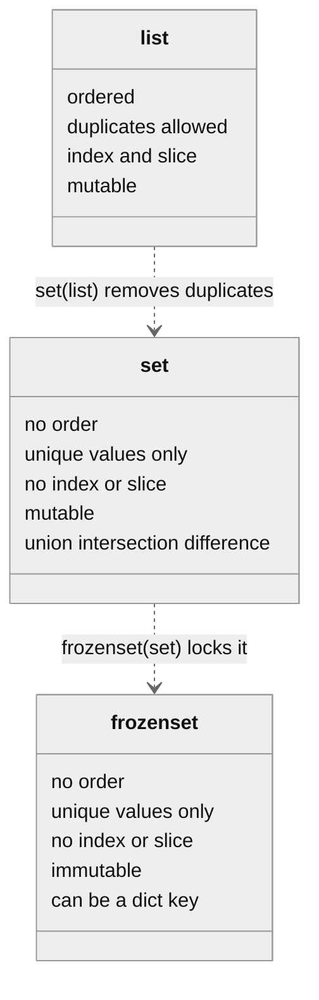
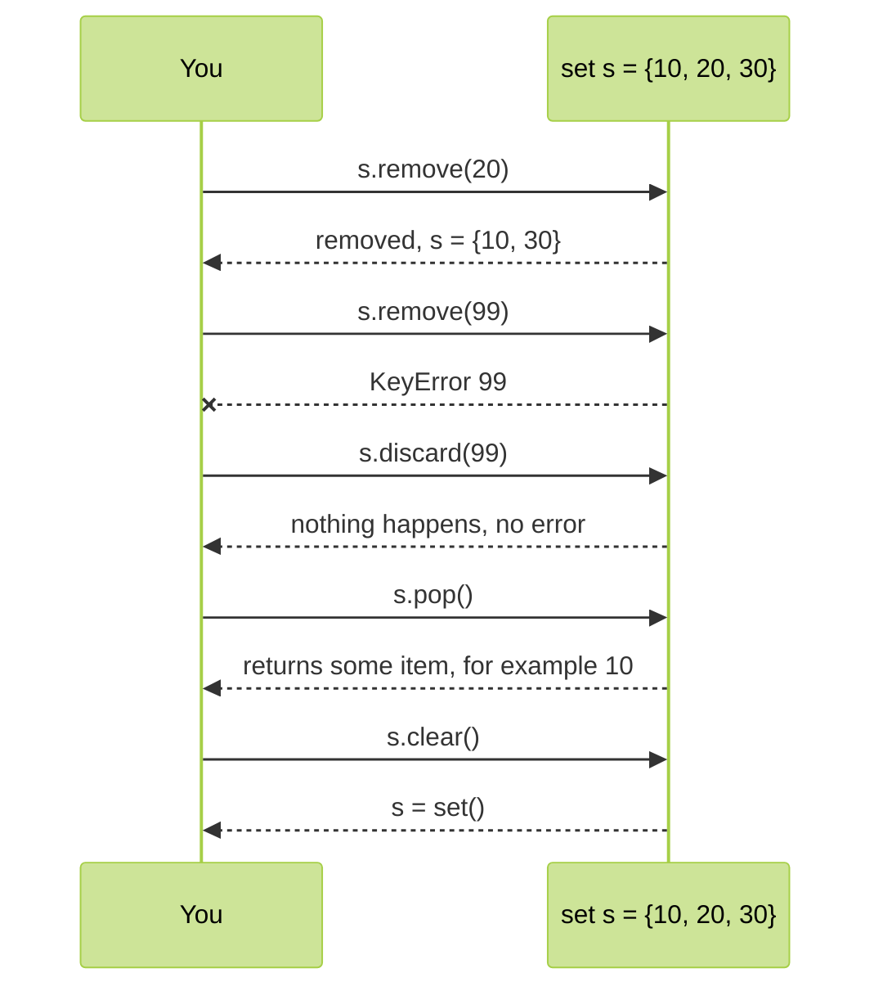
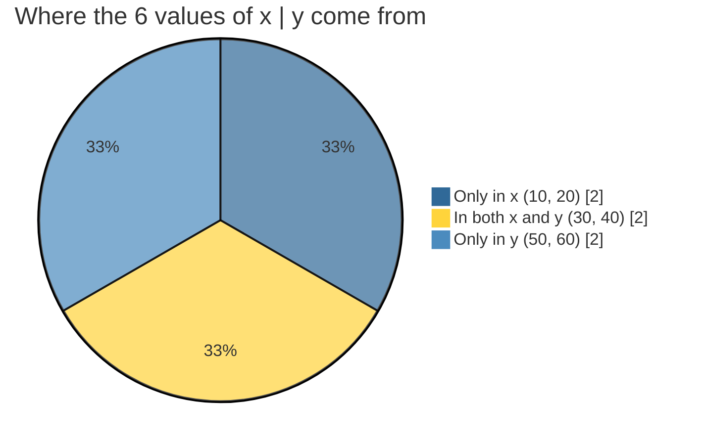
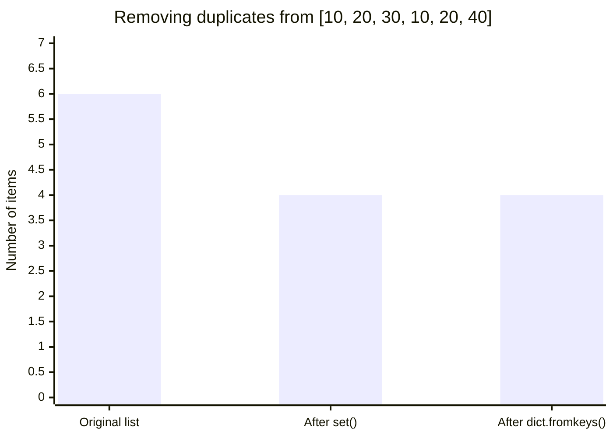
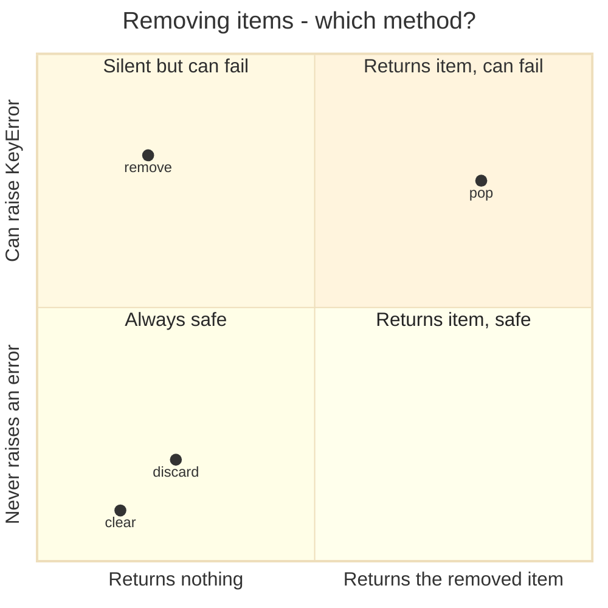

<p align="center">
  
</p>

# 08. Set

A **set** is a collection of **unique** values. Put the same value in twice and the set keeps only one copy. Sets do not keep any order and have no indexes, but they are extremely fast at answering "is this value in here?", and they support the mathematical operations you may know from school: union, intersection and difference.

**In this topic**

1. [What is a set?](#1-what-is-a-set)
2. [Creating sets](#2-creating-sets)
3. [The empty set trap](#3-the-empty-set-trap)
4. [What can go inside a set?](#4-what-can-go-inside-a-set)
5. [No indexing and no slicing](#5-no-indexing-and-no-slicing)
6. [Adding items: add() and update()](#6-adding-items-add-and-update)
7. [copy()](#7-copy)
8. [Removing items: pop(), remove(), discard() and clear()](#8-removing-items-pop-remove-discard-and-clear)
9. [Mathematical operations](#9-mathematical-operations)
10. [Comparing sets: subset, superset and disjoint](#10-comparing-sets-subset-superset-and-disjoint)
11. [Updating a set in place with operations](#11-updating-a-set-in-place-with-operations)
12. [Membership and looping](#12-membership-and-looping)
13. [Useful built-in functions](#13-useful-built-in-functions)
14. [Set comprehension](#14-set-comprehension)
15. [frozenset](#15-frozenset)
16. [Complete programs](#16-complete-programs)
17. [All set methods at a glance](#17-all-set-methods-at-a-glance)
18. [Common errors](#18-common-errors)
19. [Quick revision](#19-quick-revision)
20. [Interview questions](#20-interview-questions)
21. [Practice questions](#21-practice-questions)

## 1. What is a set?

> **If you want to represent a group of unique values as a single entity, use a set.**

<table width="100%">
<tr>
<th align="left" width="5%">#</th>
<th align="left" width="32%">Property</th>
<th align="left" width="38%">Meaning</th>
<th align="left" width="25%">Compare with list</th>
</tr>
<tr><td>1</td><td>Duplicates are not allowed</td><td>Each value is kept only once</td><td>Lists allow duplicates</td></tr>
<tr><td>2</td><td>Insertion order is not preserved</td><td>Items may come out in a different order; you can still sort them with <code>sorted()</code></td><td>Lists keep order</td></tr>
<tr><td>3</td><td>No indexing and no slicing</td><td><code>s[0]</code> and <code>s[1:3]</code> do not work</td><td>Lists support both</td></tr>
<tr><td>4</td><td>Heterogeneous elements are allowed</td><td>Different types can be mixed, as long as each item is hashable</td><td>Same</td></tr>
<tr><td>5</td><td>Mutable</td><td>You can add and remove items after creating the set</td><td>Same</td></tr>
<tr><td>6</td><td>Curly braces</td><td>Written as <code>{10, 20, 30}</code></td><td>Lists use <code>[ ]</code></td></tr>
<tr><td>7</td><td>Mathematical operations</td><td>Union, intersection, difference, symmetric difference</td><td>Not available for lists</td></tr>
<tr><td>8</td><td>Very fast membership test</td><td><code>x in s</code> is fast even for millions of items</td><td>Lists check items one by one</td></tr>
</table>



> **About the outputs on this page:** a set has no order, so Python may print its items in any order. For sets of whole numbers the order is usually the same every time. For sets of **strings**, the order can change from one run to the next, so the outputs marked "order may differ" may look different on your computer. The **items** are always the same.

## 2. Creating sets

**Example 1: A set with curly braces**

```python
# Values inside curly braces, separated by commas
s = {10, 20, 30, 40}

# Print the set
print(s)

# Check the type
print(type(s))
```

**Output**

```text
{40, 10, 20, 30}
<class 'set'>
```

**Example 2: Duplicates are removed automatically**

```python
# 10 and 20 are written twice
s = {10, 20, 10, 30, 20}

# Each value appears only once
print(s)
```

**Output**

```text
{10, 20, 30}
```

**Example 3: set() from a list removes duplicates**

```python
# A list with many repeated values
numbers = [10, 20, 30, 40, 10, 20, 10]

# Convert the list into a set
s = set(numbers)

# Print the set of unique values
print(s)
```

**Output**

```text
{40, 10, 20, 30}
```

**Example 4: set() from a range**

```python
# The numbers 0 to 4 as a set
s = set(range(5))

# Print the set
print(s)
```

**Output**

```text
{0, 1, 2, 3, 4}
```

**Example 5: set() from a string**

```python
# Each character becomes one item; repeated characters are kept once
s = set("banana")

# Print the set of distinct letters
print(s)
```

**Output** (order may differ)

```text
{'a', 'b', 'n'}
```

**Example 6: set() from a tuple**

```python
# A tuple with a repeated value
t = (1, 2, 2, 3)

# Convert it into a set
print(set(t))
```

**Output**

```text
{1, 2, 3}
```

**Example 7: Mixed types in one set**

```python
# Numbers, a string, a float and a bool can share one set
s = {10, "Asha", 2.5, True}

# Print the set
print(s)
```

**Output** (order may differ)

```text
{True, 10, 2.5, 'Asha'}
```

**Example 8: True and 1 count as the same value**

```python
# True equals 1, so only one of them is kept
s = {1, True, 2}

# Print the set
print(s)
```

**Output**

```text
{1, 2}
```

**Example 9: 1 and 1.0 count as the same value**

```python
# 1 == 1.0, so the second one is treated as a duplicate
s = {1, 1.0, 2}

# Print the set; the first one written is kept
print(s)
```

**Output**

```text
{1, 2}
```

**Example 10: Counting unique values with len()**

```python
# Votes for three colours, with many repeats
votes = ["red", "blue", "red", "green", "blue", "red"]

# len() of the set gives the number of different colours
print(len(set(votes)))
```

**Output**

```text
3
```

**Example 11: Sorting the items of a set**

```python
# A set has no order of its own
s = {40, 10, 30, 20}

# sorted() returns the items as a sorted list
print(sorted(s))
```

**Output**

```text
[10, 20, 30, 40]
```

## 3. The empty set trap

**Example 12: {} is an empty dictionary, not a set**

```python
# Empty curly braces create an empty DICTIONARY
s = {}

# Print it
print(s)

# The type is dict
print(type(s))
```

**Output**

```text
{}
<class 'dict'>
```

**Example 13: set() creates an empty set**

```python
# The only way to write an empty set is set()
s = set()

# Python shows an empty set as set()
print(s)

# The type is set
print(type(s))
```

**Output**

```text
set()
<class 'set'>
```

> **Rule:** an empty set must be created with `set()`. `{}` always means an empty dictionary.

## 4. What can go inside a set?

Every item in a set must be **hashable**: its value must never change. Numbers, strings, tuples (of hashable items) and frozensets are hashable. Lists, dictionaries and sets are not.

**Example 14: A tuple can be an item**

```python
# Tuples are hashable, so they can go inside a set
points = {(0, 0), (3, 4), (0, 0)}

# The repeated point is kept once
print(points)
```

**Output**

```text
{(3, 4), (0, 0)}
```

**Example 15: A list cannot be an item**

```python
# Lists can change, so they are not hashable
s = {[1, 2], 3}
```

**Output** (last line of the error message)

```text
TypeError: unhashable type: 'list'
```

**Example 16: A set cannot be an item of another set**

```python
# Sets can change too, so a set cannot contain a set
s = {{1, 2}, 3}
```

**Output** (last line of the error message)

```text
TypeError: unhashable type: 'set'
```

**Example 17: A frozenset can be an item**

```python
# A frozenset never changes, so it can go inside a set
s = {frozenset({1, 2}), 3}

# Print the set
print(s)
```

**Output**

```text
{3, frozenset({1, 2})}
```

## 5. No indexing and no slicing

A set has no order, so positions mean nothing.

**Example 18: Indexing a set**

```python
# A set of four numbers
s = {10, 20, 30, 40}

# There is no "first" item in a set
print(s[0])
```

**Output** (last line of the error message)

```text
TypeError: 'set' object is not subscriptable
```

**Example 19: Slicing a set**

```python
# A set of four numbers
s = {10, 20, 30, 40}

# Slicing is not allowed either
print(s[1:3])
```

**Output** (last line of the error message)

```text
TypeError: 'set' object is not subscriptable
```

**Example 20: Convert to a list when you need positions**

```python
# A set of four numbers
s = {10, 20, 30, 40}

# Sort the items into a list, then index the list
print(sorted(s)[0])
```

**Output**

```text
10
```

> **Correction:** the notes show the error `'set' object does not support indexing`. In Python 3.12 both indexing and slicing give **`'set' object is not subscriptable`**.

## 6. Adding items: add() and update()

<table width="100%">
<tr>
<th align="left" width="16%">Method</th>
<th align="left" width="26%">Adds</th>
<th align="left" width="26%">Arguments</th>
<th align="left" width="32%">Example</th>
</tr>
<tr><td><code>add(x)</code></td><td>One single item</td><td>Exactly one</td><td><code>s.add(40)</code></td></tr>
<tr><td><code>update(a, b, ...)</code></td><td>Every item of one or more iterables</td><td>Any number, each must be iterable (list, tuple, range, string, set ...)</td><td><code>s.update([40, 50], range(3))</code></td></tr>
</table>

### add()

**Example 21: Add one item**

```python
# A set of three numbers
s = {10, 20, 30}

# Add one new item
s.add(40)

# Print the set
print(s)
```

**Output**

```text
{40, 10, 20, 30}
```

**Example 22: Adding an existing item changes nothing**

```python
# A set of three numbers
s = {10, 20, 30}

# 20 is already there, so the set stays the same
s.add(20)

# Print the set
print(s)
```

**Output**

```text
{10, 20, 30}
```

**Example 23: add() takes exactly one argument**

```python
# A set of three numbers
s = {10, 20, 30}

# Passing three values to add() is an error
s.add(10, 20, 30)
```

**Output** (last line of the error message)

```text
TypeError: set.add() takes exactly one argument (3 given)
```

**Example 24: add() with a tuple adds the tuple as ONE item**

```python
# A set of numbers
s = {1, 2}

# The whole tuple (3, 4) becomes one item
s.add((3, 4))

# Print the set
print(s)
```

**Output**

```text
{1, 2, (3, 4)}
```

**Example 25: Building a set step by step in a loop**

```python
# Start with an empty set
seen = set()

# Add each number from a list that has repeats
for n in [3, 1, 3, 2, 1]:

    # add() ignores values that are already in the set
    seen.add(n)

# Print the unique values
print(seen)
```

**Output**

```text
{1, 2, 3}
```

### update()

**Example 26: update() with a list and a range**

```python
# A set of three numbers
s = {10, 20, 30}

# A list with one value (10) that is already in the set
values = [40, 50, 60, 10]

# Add all items of the list AND of range(5)
s.update(values, range(5))

# Print the set
print(s)
```

**Output**

```text
{0, 1, 2, 3, 4, 40, 10, 50, 20, 60, 30}
```

**Example 27: update() with a single number fails**

```python
# A set of three numbers
s = {10, 20, 30}

# 10 is not iterable, so update() cannot loop over it
s.update(10)
```

**Output** (last line of the error message)

```text
TypeError: 'int' object is not iterable
```

**Example 28: update() with two ranges**

```python
# An empty set
s = set()

# Add the odd and the even numbers below 10
s.update(range(1, 10, 2), range(0, 10, 2))

# Print the set
print(s)
```

**Output**

```text
{0, 1, 2, 3, 4, 5, 6, 7, 8, 9}
```

**Example 29: update() with a string adds each character**

```python
# A set with one word
s = {"hi"}

# A string is iterable, so each character is added separately
s.update("ok")

# Print the set
print(s)
```

**Output** (order may differ)

```text
{'k', 'hi', 'o'}
```

**Example 30: add() vs update() with the same string**

```python
# Two empty sets
a = set()

# The second empty set
b = set()

# add() puts the whole word in as one item
a.add("cat")

# update() puts each letter in as a separate item
b.update("cat")

# Compare the two results
print(a, b)
```

**Output** (order may differ)

```text
{'cat'} {'a', 't', 'c'}
```

### Which of these are valid for a set s?

<table width="100%">
<tr>
<th align="left" width="5%">#</th>
<th align="left" width="38%">Code</th>
<th align="left" width="12%">Valid?</th>
<th align="left" width="45%">Reason</th>
</tr>
<tr><td>1</td><td><code>s.add(10)</code></td><td>Yes</td><td>One argument</td></tr>
<tr><td>2</td><td><code>s.add(10, 20, 30)</code></td><td>No</td><td><code>TypeError: set.add() takes exactly one argument (3 given)</code></td></tr>
<tr><td>3</td><td><code>s.update(10)</code></td><td>No</td><td><code>TypeError: 'int' object is not iterable</code></td></tr>
<tr><td>4</td><td><code>s.update(range(1, 10, 2), range(0, 10, 2))</code></td><td>Yes</td><td>Both arguments are iterable</td></tr>
</table>

## 7. copy()

`copy()` returns a **new** set with the same items. Changing the copy does not change the original.

**Example 31: A copy is independent**

```python
# The original set
s = {10, 20, 30}

# Make a copy
s1 = s.copy()

# Change only the copy
s1.add(40)

# The original is unchanged
print(s)

# The copy has the extra item
print(s1)
```

**Output**

```text
{10, 20, 30}
{40, 10, 20, 30}
```

**Example 32: Assignment is not a copy**

```python
# The original set
s = {10, 20, 30}

# This is a second name for the SAME set
alias = s

# Change the set through the second name
alias.add(40)

# The original shows the change
print(s)
```

**Output**

```text
{40, 10, 20, 30}
```

**Example 33: Other ways to copy**

```python
# The original set
s = {1, 2, 3}

# set() also makes a copy
s2 = set(s)

# The copies are equal but are different objects
print(s2 == s, s2 is s)
```

**Output**

```text
True False
```

> `copy()` is a **shallow** copy. For sets this is all you ever need, because a set's items are always immutable.

## 8. Removing items: pop(), remove(), discard() and clear()

<table width="100%">
<tr>
<th align="left" width="14%">Method</th>
<th align="left" width="24%">Removes</th>
<th align="left" width="20%">Returns</th>
<th align="left" width="22%">If the item is missing</th>
<th align="left" width="20%">If the set is empty</th>
</tr>
<tr><td><code>pop()</code></td><td>An arbitrary item</td><td>The removed item</td><td>-</td><td><code>KeyError</code></td></tr>
<tr><td><code>remove(x)</code></td><td>The item <code>x</code></td><td><code>None</code></td><td><code>KeyError</code></td><td><code>KeyError</code></td></tr>
<tr><td><code>discard(x)</code></td><td>The item <code>x</code></td><td><code>None</code></td><td>No error</td><td>No error</td></tr>
<tr><td><code>clear()</code></td><td>Everything</td><td><code>None</code></td><td>-</td><td>No error</td></tr>
</table>



### pop()

**Example 34: pop() removes and returns an item**

```python
# A set of four numbers
s = {40, 10, 30, 20}

# Print the set
print(s)

# Remove one item and print it
print(s.pop())

# The set now has one item less
print(s)
```

**Output**

```text
{40, 10, 20, 30}
40
{10, 20, 30}
```

**Example 35: pop() until the set is empty**

```python
# A small set
s = {1, 2, 3}

# Keep popping while the set is not empty
while s:

    # Remove an item and print it
    print("took", s.pop())
```

**Output**

```text
took 1
took 2
took 3
```

**Example 36: pop() on an empty set**

```python
# An empty set
s = set()

# There is nothing to remove
s.pop()
```

**Output** (last line of the error message)

```text
KeyError: 'pop from an empty set'
```

> **Correction:** the notes say `pop()` removes a **random** item. It is not random: it removes an **arbitrary** item that depends on how the set is stored in memory. For small integers you will usually get the smallest one, but you must never rely on which item comes out.

### remove()

**Example 37: remove() an item that exists**

```python
# A set of four numbers
s = {40, 10, 30, 20}

# Remove 30
s.remove(30)

# Print the set
print(s)
```

**Output**

```text
{40, 10, 20}
```

**Example 38: remove() an item that is missing**

```python
# A set of four numbers
s = {40, 10, 30, 20}

# 50 is not in the set
s.remove(50)
```

**Output** (last line of the error message)

```text
KeyError: 50
```

**Example 39: remove() safely with a check**

```python
# A set of four numbers
s = {40, 10, 30, 20}

# Remove 50 only if it is there
if 50 in s:

    # This line does not run, because 50 is missing
    s.remove(50)

# The set is unchanged and no error happened
print(s)
```

**Output**

```text
{40, 10, 20, 30}
```

### discard()

**Example 40: discard() an item that exists**

```python
# A set of three numbers
s = {10, 20, 30}

# Remove 10
s.discard(10)

# Print the set
print(s)
```

**Output**

```text
{20, 30}
```

**Example 41: discard() an item that is missing**

```python
# A set of three numbers
s = {10, 20, 30}

# 50 is not there, but discard() does not complain
s.discard(50)

# Print the set
print(s)
```

**Output**

```text
{10, 20, 30}
```

**Example 42: remove() and discard() both return None**

```python
# A set of three numbers
s = {10, 20, 30}

# Store what remove() returns
result = s.remove(10)

# remove() gives back nothing
print(result)
```

**Output**

```text
None
```

### clear()

**Example 43: clear() empties the set**

```python
# A set of three numbers
s = {10, 20, 30}

# Print the set
print(s)

# Remove every item
s.clear()

# An empty set prints as set()
print(s)
```

**Output**

```text
{10, 20, 30}
set()
```

**Example 44: del deletes the name itself**

```python
# A set of three numbers
s = {10, 20, 30}

# del removes the variable, not just the items
del s

# The name s no longer exists
print(s)
```

**Output** (last line of the error message)

```text
NameError: name 's' is not defined
```

## 9. Mathematical operations

Python sets support the same operations as sets in mathematics. All of them return a **new** set; the original sets are not changed. We use these two sets in every example:

```text
x = {10, 20, 30, 40}
y = {30, 40, 50, 60}
```



<table width="100%">
<tr>
<th align="left" width="20%">Operation</th>
<th align="left" width="22%">Method</th>
<th align="left" width="10%">Operator</th>
<th align="left" width="26%">Meaning</th>
<th align="left" width="22%">Result for x and y</th>
</tr>
<tr><td><b>Union</b></td><td><code>x.union(y)</code></td><td><code>x | y</code></td><td>Everything in x <b>or</b> y</td><td><code>{10, 20, 30, 40, 50, 60}</code></td></tr>
<tr><td><b>Intersection</b></td><td><code>x.intersection(y)</code></td><td><code>x &amp; y</code></td><td>Only what is in <b>both</b></td><td><code>{30, 40}</code></td></tr>
<tr><td><b>Difference</b></td><td><code>x.difference(y)</code></td><td><code>x - y</code></td><td>In x but <b>not</b> in y</td><td><code>{10, 20}</code></td></tr>
<tr><td><b>Symmetric difference</b></td><td><code>x.symmetric_difference(y)</code></td><td><code>x ^ y</code></td><td>In x or y, but <b>not both</b></td><td><code>{10, 20, 50, 60}</code></td></tr>
</table>

### Union

**Example 45: union() method**

```python
# The first set
x = {10, 20, 30, 40}

# The second set
y = {30, 40, 50, 60}

# Every value from both sets, each once
print(x.union(y))
```

**Output**

```text
{40, 10, 50, 20, 60, 30}
```

**Example 46: The | operator**

```python
# The first set
x = {10, 20, 30, 40}

# The second set
y = {30, 40, 50, 60}

# | does the same as union()
print(x | y)
```

**Output**

```text
{40, 10, 50, 20, 60, 30}
```

**Example 47: union() of three sets**

```python
# Three small sets
a, b, c = {1, 2}, {2, 3}, {3, 4}

# union() accepts several sets at once
print(a.union(b, c))
```

**Output**

```text
{1, 2, 3, 4}
```

**Example 48: union() accepts any iterable, | needs sets**

```python
# A set of numbers
x = {1, 2}

# The method accepts a list
print(x.union([3, 4]))
```

**Output**

```text
{1, 2, 3, 4}
```

**Example 49: | with a list fails**

```python
# A set of numbers
x = {1, 2}

# The operator form needs a set on both sides
print(x | [3, 4])
```

**Output** (last line of the error message)

```text
TypeError: unsupported operand type(s) for |: 'set' and 'list'
```

### Intersection

**Example 50: intersection() method**

```python
# The first set
x = {10, 20, 30, 40}

# The second set
y = {30, 40, 50, 60}

# Only the values found in both sets
print(x.intersection(y))
```

**Output**

```text
{40, 30}
```

**Example 51: The & operator**

```python
# The first set
x = {10, 20, 30, 40}

# The second set
y = {30, 40, 50, 60}

# & does the same as intersection()
print(x & y)
```

**Output**

```text
{40, 30}
```

**Example 52: Sets with nothing in common**

```python
# Two sets with no shared value
x = {1, 2}

# The second set
y = {3, 4}

# The result is an empty set
print(x & y)
```

**Output**

```text
set()
```

**Example 53: Common friends**

```python
# Asha's friends
asha = {"Ravi", "Meena", "John"}

# Ravi's friends
ravi = {"Meena", "John", "Sara"}

# Friends they share, sorted so the order is fixed
print(sorted(asha & ravi))
```

**Output**

```text
['John', 'Meena']
```

### Difference

**Example 54: difference() method**

```python
# The first set
x = {10, 20, 30, 40}

# The second set
y = {30, 40, 50, 60}

# Values in x that are not in y
print(x.difference(y))
```

**Output**

```text
{10, 20}
```

**Example 55: The - operator**

```python
# The first set
x = {10, 20, 30, 40}

# The second set
y = {30, 40, 50, 60}

# - does the same as difference()
print(x - y)
```

**Output**

```text
{10, 20}
```

**Example 56: Order matters for difference**

```python
# The first set
x = {10, 20, 30, 40}

# The second set
y = {30, 40, 50, 60}

# Values in y that are not in x
print(y - x)
```

**Output**

```text
{50, 60}
```

**Example 57: Students who have not submitted**

```python
# Everyone in the class
students = {"Asha", "Ravi", "Meena", "John"}

# Students who submitted the homework
submitted = {"Ravi", "John"}

# Who still has to submit, sorted for a fixed order
print(sorted(students - submitted))
```

**Output**

```text
['Asha', 'Meena']
```

### Symmetric difference

**Example 58: symmetric_difference() method**

```python
# The first set
x = {10, 20, 30, 40}

# The second set
y = {30, 40, 50, 60}

# Values in exactly one of the two sets
print(x.symmetric_difference(y))
```

**Output**

```text
{10, 50, 20, 60}
```

**Example 59: The ^ operator**

```python
# The first set
x = {10, 20, 30, 40}

# The second set
y = {30, 40, 50, 60}

# ^ does the same as symmetric_difference()
print(x ^ y)
```

**Output**

```text
{10, 50, 20, 60}
```

**Example 60: Symmetric difference is union minus intersection**

```python
# The first set
x = {10, 20, 30, 40}

# The second set
y = {30, 40, 50, 60}

# Both ways give the same set
print((x ^ y) == (x | y) - (x & y))
```

**Output**

```text
True
```

**Example 61: The original sets are not changed**

```python
# The first set
x = {10, 20, 30, 40}

# The second set
y = {30, 40, 50, 60}

# Do an operation and throw the result away
x | y

# x is unchanged
print(x)
```

**Output**

```text
{40, 10, 20, 30}
```

## 10. Comparing sets: subset, superset and disjoint

<table width="100%">
<tr>
<th align="left" width="24%">Method</th>
<th align="left" width="12%">Operator</th>
<th align="left" width="38%">True when</th>
<th align="left" width="26%">Example</th>
</tr>
<tr><td><code>a.issubset(b)</code></td><td><code>a &lt;= b</code></td><td>Every item of a is also in b</td><td><code>{1, 2} &lt;= {1, 2, 3}</code></td></tr>
<tr><td>Proper subset</td><td><code>a &lt; b</code></td><td>a is a subset of b and they are not equal</td><td><code>{1, 2} &lt; {1, 2, 3}</code></td></tr>
<tr><td><code>a.issuperset(b)</code></td><td><code>a &gt;= b</code></td><td>a contains every item of b</td><td><code>{1, 2, 3} &gt;= {1, 2}</code></td></tr>
<tr><td><code>a.isdisjoint(b)</code></td><td>-</td><td>a and b have no item in common</td><td><code>{1, 2}.isdisjoint({3})</code></td></tr>
<tr><td>Equality</td><td><code>a == b</code></td><td>Same items, in any order</td><td><code>{1, 2} == {2, 1}</code></td></tr>
</table>

**Example 62: issubset()**

```python
# A small set
small = {1, 2}

# A bigger set that contains all of small
big = {1, 2, 3}

# Is every item of small inside big?
print(small.issubset(big))
```

**Output**

```text
True
```

**Example 63: The <= and < operators**

```python
# A set is a subset of itself
print({1, 2} <= {1, 2})

# But it is not a PROPER subset of itself
print({1, 2} < {1, 2})
```

**Output**

```text
True
False
```

**Example 64: issuperset()**

```python
# The skills a job needs
needed = {"python", "sql"}

# The skills a candidate has
has = {"python", "sql", "excel"}

# Does the candidate have every needed skill?
print(has.issuperset(needed))
```

**Output**

```text
True
```

**Example 65: isdisjoint()**

```python
# Two sets with no value in common
print({1, 2}.isdisjoint({3, 4}))

# Two sets that share the value 2
print({1, 2}.isdisjoint({2, 3}))
```

**Output**

```text
True
False
```

**Example 66: Equality ignores order**

```python
# The same items in a different order are equal
print({1, 2, 3} == {3, 1, 2})
```

**Output**

```text
True
```

## 11. Updating a set in place with operations

Every operation in Section 9 has an **in-place** version that changes the set itself instead of returning a new one.

<table width="100%">
<tr>
<th align="left" width="34%">Method</th>
<th align="left" width="12%">Operator</th>
<th align="left" width="54%">Effect on x</th>
</tr>
<tr><td><code>x.update(y)</code></td><td><code>x |= y</code></td><td>Add every item of y</td></tr>
<tr><td><code>x.intersection_update(y)</code></td><td><code>x &amp;= y</code></td><td>Keep only items also in y</td></tr>
<tr><td><code>x.difference_update(y)</code></td><td><code>x -= y</code></td><td>Remove items that are in y</td></tr>
<tr><td><code>x.symmetric_difference_update(y)</code></td><td><code>x ^= y</code></td><td>Keep items in exactly one of x and y</td></tr>
</table>

**Example 67: |= adds items**

```python
# The starting set
x = {1, 2}

# Add every item of the other set into x
x |= {2, 3}

# Print x
print(x)
```

**Output**

```text
{1, 2, 3}
```

**Example 68: &= keeps common items**

```python
# The starting set
x = {1, 2, 3, 4}

# Keep only the items that are also in the other set
x &= {2, 4, 6}

# Print x
print(x)
```

**Output**

```text
{2, 4}
```

**Example 69: -= removes items**

```python
# The starting set
x = {1, 2, 3, 4}

# Remove every item that is in the other set
x -= {1, 3}

# Print x
print(x)
```

**Output**

```text
{2, 4}
```

**Example 70: intersection_update() method**

```python
# The starting set
x = {10, 20, 30, 40}

# Keep only 30 and 40
x.intersection_update({30, 40, 50})

# Print x
print(x)
```

**Output**

```text
{40, 30}
```

**Example 71: The method returns None**

```python
# The starting set
x = {1, 2}

# In-place methods change x and return nothing
print(x.difference_update({1}))

# x has been changed
print(x)
```

**Output**

```text
None
{2}
```

## 12. Membership and looping

**Example 72: in and not in**

```python
# The distinct letters of a word
s = set("durga")

# Is "d" one of the letters?
print("d" in s)

# Is "z" one of the letters?
print("z" in s)
```

**Output**

```text
True
False
```

**Example 73: Printing the set from the notes**

```python
# The distinct letters of "durga"
s = set("durga")

# Print the set; the letter order is not fixed
print(s)
```

**Output** (order may differ)

```text
{'d', 'a', 'g', 'r', 'u'}
```

**Example 74: Looping over a set**

```python
# A set of numbers
s = {30, 10, 20}

# Visit each item; do not rely on the order
for item in s:

    # Print the item
    print(item)
```

**Output**

```text
10
20
30
```

**Example 75: Looping in sorted order**

```python
# A set of names
names = {"Ravi", "Asha", "Meena"}

# sorted() gives a fixed, alphabetical order
for name in sorted(names):

    # Print each name
    print(name)
```

**Output**

```text
Asha
Meena
Ravi
```

**Example 76: Fast membership tests**

```python
# A set of one million numbers
big = set(range(1_000_000))

# Checking membership in a set is almost instant, however big it is
print(999_999 in big)
```

**Output**

```text
True
```

> A set finds an item using its **hash**, a number worked out from the value, so it does not have to look at each item one by one like a list does. That is why `x in my_set` stays fast even with millions of items.

## 13. Useful built-in functions

**Example 77: len()**

```python
# A set with a duplicate in the source
s = {10, 20, 20, 30}

# len() counts unique items only
print(len(s))
```

**Output**

```text
3
```

**Example 78: sum(), min() and max()**

```python
# A set of numbers
s = {40, 10, 30, 20}

# Total, smallest and largest
print(sum(s), min(s), max(s))
```

**Output**

```text
100 10 40
```

**Example 79: sorted() in reverse**

```python
# A set of numbers
s = {40, 10, 30, 20}

# Sorted from largest to smallest, as a list
print(sorted(s, reverse=True))
```

**Output**

```text
[40, 30, 20, 10]
```

**Example 80: any() and all()**

```python
# A set that contains 0
s = {0, 1, 2}

# At least one truthy item?
print(any(s))

# Every item truthy? 0 is falsy
print(all(s))
```

**Output**

```text
True
False
```

## 14. Set comprehension

Unlike tuples, sets **do** support comprehension: `{expression for item in iterable}`.

**Example 81: Squares**

```python
# The square of each number from 0 to 4
s = {x * x for x in range(5)}

# Print the set
print(s)
```

**Output**

```text
{0, 1, 4, 9, 16}
```

**Example 82: Powers of 2**

```python
# 2 to the power 2, 4, 6 and 8
s = {2 ** x for x in range(2, 10, 2)}

# Print the set
print(s)
```

**Output**

```text
{16, 256, 64, 4}
```

**Example 83: With a condition**

```python
# Only the even numbers from 0 to 9
evens = {n for n in range(10) if n % 2 == 0}

# Print the set
print(evens)
```

**Output**

```text
{0, 2, 4, 6, 8}
```

**Example 84: Remainders remove duplicates automatically**

```python
# The remainder of each number from 0 to 9 when divided by 3
s = {n % 3 for n in range(10)}

# Only three different remainders exist
print(s)
```

**Output**

```text
{0, 1, 2}
```

**Example 85: Distinct word lengths**

```python
# A sentence
sentence = "the quick brown fox jumps over the lazy dog"

# The set of different word lengths
print({len(word) for word in sentence.split()})
```

**Output**

```text
{3, 4, 5}
```

**Example 86: Lower-case first letters**

```python
# Names with mixed case
names = ["Asha", "anil", "Ravi", "rohan"]

# The distinct first letters, all lower case, sorted
print(sorted({name[0].lower() for name in names}))
```

**Output**

```text
['a', 'r']
```

## 15. frozenset

A **frozenset** is an **immutable** set: same unique items and same operations, but no `add`, `remove` or `update`. Because it never changes, it can be a dictionary key or an item of another set.

**Example 87: Creating a frozenset**

```python
# Make a frozenset from a normal set
fs = frozenset({10, 20, 30})

# Check the type
print(type(fs))
```

**Output**

```text
<class 'frozenset'>
```

**Example 88: A frozenset cannot be changed**

```python
# A frozenset
fs = frozenset({10, 20, 30})

# There is no add() method
fs.add(40)
```

**Output** (last line of the error message)

```text
AttributeError: 'frozenset' object has no attribute 'add'
```

**Example 89: Operations still work and return frozensets**

```python
# A frozenset
fs = frozenset({1, 2, 3})

# Union with a normal set gives a new frozenset
print(fs | {4})
```

**Output**

```text
frozenset({1, 2, 3, 4})
```

**Example 90: A frozenset as a dictionary key**

```python
# A pair of ingredients, where order does not matter, as a key
recipes = {frozenset({"bread", "butter"}): "toast"}

# The same pair written in the other order finds the same key
print(recipes[frozenset({"butter", "bread"})])
```

**Output**

```text
toast
```

## 16. Complete programs

### Program 1: Eliminate duplicates from a list (two approaches)

The notes read the list with `eval(input())`. `eval()` runs any code the user types, which is dangerous. We use `ast.literal_eval()` instead, which only accepts plain values.

**Approach 1: with a set** (fast, but the original order may be lost)

```python
# Load the ast module to read Python values safely from text
import ast

# Read a list such as [10,20,30,10,20,40]
values = ast.literal_eval(input("Enter List of values: "))

# A set keeps one copy of each value
unique = set(values)

# Print the unique values
print(unique)
```

**Output** (user types `[10,20,30,10,20,40]`)

```text
Enter List of values: [10,20,30,10,20,40]
{40, 10, 20, 30}
```

**Approach 2: with a list** (keeps the first-seen order)

```python
# Load the ast module to read Python values safely from text
import ast

# Read a list such as [10,20,30,10,20,40]
values = ast.literal_eval(input("Enter List of values: "))

# Start with an empty result list
unique = []

# Look at each value in turn
for x in values:

    # Keep the value only if we have not kept it already
    if x not in unique:

        # Add the new value to the result
        unique.append(x)

# Print the unique values in their original order
print(unique)
```

**Output** (user types `[10,20,30,10,20,40]`)

```text
Enter List of values: [10,20,30,10,20,40]
[10, 20, 30, 40]
```

**Approach 3 (extra): fast AND keeps the order**

```python
# A list with duplicates
values = [10, 20, 30, 10, 20, 40]

# dict.fromkeys() keeps the first-seen order and drops duplicates
print(list(dict.fromkeys(values)))
```

**Output**

```text
[10, 20, 30, 40]
```



**How the approaches compare:** approach 1 is shortest but the order is not guaranteed. Approach 2 keeps the order but checks the result list for every value, which gets slow for long lists. Approach 3 is fast and keeps the order, because dictionaries keep insertion order (Topic 09).

### Program 2: The different vowels in a word

```python
# Read a word from the user
word = input("Enter word to search for vowels: ")

# The distinct letters in the word
letters = set(word)

# The set of all vowels
vowels = {"a", "e", "i", "o", "u"}

# The letters that are also vowels
found = letters.intersection(vowels)

# Print the result
print("The different vowel present in", word, "are", found)
```

**Output** (user types `durga`; the order of `u` and `a` may differ)

```text
Enter word to search for vowels: durga
The different vowel present in durga are {'u', 'a'}
```

**How this program runs:** `set("durga")` gives the five letters `d`, `u`, `r`, `g`, `a`. Intersecting with the vowel set keeps only `u` and `a`. A sorted, fixed-order version is `sorted(set(word) & vowels)`.

### Program 3: Comparing two class lists

```python
# Students in the Python class
python_class = {"Asha", "Ravi", "Meena", "John"}

# Students in the SQL class
sql_class = {"Ravi", "John", "Sara", "Neel"}

# Students taking both classes
print("Both        :", sorted(python_class & sql_class))

# Students taking at least one class
print("Any         :", sorted(python_class | sql_class))

# Students taking only Python
print("Only Python :", sorted(python_class - sql_class))

# Students taking exactly one of the two
print("Exactly one :", sorted(python_class ^ sql_class))
```

**Output**

```text
Both        : ['John', 'Ravi']
Any         : ['Asha', 'John', 'Meena', 'Neel', 'Ravi', 'Sara']
Only Python : ['Asha', 'Meena']
Exactly one : ['Asha', 'Meena', 'Neel', 'Sara']
```

**How this program runs:** each line uses one set operator, and `sorted()` turns the result into a list in alphabetical order so the output is always the same.

### Program 4: Find the first repeated character

```python
# Define a function that returns the first character seen twice
def first_repeat(text):

    # Characters seen so far
    seen = set()

    # Look at each character in order
    for ch in text:

        # A character already in the set is a repeat
        if ch in seen:

            # Return it straight away
            return ch

        # Remember this character
        seen.add(ch)

    # No character repeats
    return None

# Test the function with three words
for word in ["programming", "python", "level"]:

    # Print each word and its first repeated character
    print(word, "->", first_repeat(word))
```

**Output**

```text
programming -> r
python -> None
level -> e
```

**How this program runs:** the set `seen` remembers characters already visited. For `"programming"`, the letters `p`, `r`, `o`, `g` are added, then `r` comes again and is found in `seen`, so `r` is returned. Checking `ch in seen` is fast because it is a set.

## 17. All set methods at a glance



<table width="100%">
<tr>
<th align="left" width="30%">Method</th>
<th align="left" width="12%">Operator</th>
<th align="left" width="34%">What it does</th>
<th align="left" width="24%">Changes the set?</th>
</tr>
<tr><td><code>add(x)</code></td><td>-</td><td>Add one item</td><td>Yes</td></tr>
<tr><td><code>update(*iterables)</code></td><td><code>|=</code></td><td>Add all items of the iterables</td><td>Yes</td></tr>
<tr><td><code>copy()</code></td><td>-</td><td>Return a shallow copy</td><td>No</td></tr>
<tr><td><code>pop()</code></td><td>-</td><td>Remove and return an arbitrary item</td><td>Yes</td></tr>
<tr><td><code>remove(x)</code></td><td>-</td><td>Remove x; <code>KeyError</code> if missing</td><td>Yes</td></tr>
<tr><td><code>discard(x)</code></td><td>-</td><td>Remove x if present</td><td>Yes</td></tr>
<tr><td><code>clear()</code></td><td>-</td><td>Remove everything</td><td>Yes</td></tr>
<tr><td><code>union(*others)</code></td><td><code>|</code></td><td>Items in any set</td><td>No, returns a new set</td></tr>
<tr><td><code>intersection(*others)</code></td><td><code>&amp;</code></td><td>Items in all sets</td><td>No</td></tr>
<tr><td><code>difference(*others)</code></td><td><code>-</code></td><td>Items only in this set</td><td>No</td></tr>
<tr><td><code>symmetric_difference(other)</code></td><td><code>^</code></td><td>Items in exactly one set</td><td>No</td></tr>
<tr><td><code>intersection_update(*others)</code></td><td><code>&amp;=</code></td><td>Keep only common items</td><td>Yes</td></tr>
<tr><td><code>difference_update(*others)</code></td><td><code>-=</code></td><td>Remove items found in others</td><td>Yes</td></tr>
<tr><td><code>symmetric_difference_update(other)</code></td><td><code>^=</code></td><td>Keep items in exactly one</td><td>Yes</td></tr>
<tr><td><code>issubset(other)</code></td><td><code>&lt;=</code></td><td>Is every item in other?</td><td>No</td></tr>
<tr><td><code>issuperset(other)</code></td><td><code>&gt;=</code></td><td>Does it contain every item of other?</td><td>No</td></tr>
<tr><td><code>isdisjoint(other)</code></td><td>-</td><td>No items in common?</td><td>No</td></tr>
</table>

## 18. Common errors

<table width="100%">
<tr>
<th align="left" width="22%">Code</th>
<th align="left" width="38%">Error</th>
<th align="left" width="20%">Cause</th>
<th align="left" width="20%">Fix</th>
</tr>
<tr><td><code>s[0]</code></td><td><code>TypeError: 'set' object is not subscriptable</code></td><td>Sets have no positions</td><td><code>sorted(s)[0]</code></td></tr>
<tr><td><code>s.remove(50)</code></td><td><code>KeyError: 50</code></td><td>Item missing</td><td><code>s.discard(50)</code></td></tr>
<tr><td><code>set().pop()</code></td><td><code>KeyError: 'pop from an empty set'</code></td><td>Nothing to remove</td><td>Check <code>if s:</code> first</td></tr>
<tr><td><code>s.add(1, 2)</code></td><td><code>TypeError: set.add() takes exactly one argument (2 given)</code></td><td>Too many arguments</td><td><code>s.update([1, 2])</code></td></tr>
<tr><td><code>s.update(10)</code></td><td><code>TypeError: 'int' object is not iterable</code></td><td>Argument not iterable</td><td><code>s.add(10)</code></td></tr>
<tr><td><code>{[1, 2]}</code></td><td><code>TypeError: unhashable type: 'list'</code></td><td>Mutable item</td><td>Use a tuple</td></tr>
<tr><td><code>s = {}</code></td><td>No error, but it is a <code>dict</code></td><td>Empty braces mean dict</td><td><code>s = set()</code></td></tr>
<tr><td><code>{1, 2} | [3]</code></td><td><code>TypeError: unsupported operand type(s) for |: 'set' and 'list'</code></td><td>Operator needs sets</td><td><code>{1, 2}.union([3])</code></td></tr>
</table>

## 19. Quick revision

<table width="100%">
<tr>
<th align="left" width="6%">#</th>
<th align="left" width="36%">Question</th>
<th align="left" width="42%">Answer</th>
<th align="left" width="16%">Read again</th>
</tr>
<tr><td>1</td><td>Does a set allow duplicates?</td><td>No</td><td><a href="#1-what-is-a-set">Section 1</a></td></tr>
<tr><td>2</td><td>Does a set keep insertion order?</td><td>No</td><td><a href="#1-what-is-a-set">Section 1</a></td></tr>
<tr><td>3</td><td>Empty set</td><td><code>set()</code>; <code>{}</code> is a dict</td><td><a href="#3-the-empty-set-trap">Section 3</a></td></tr>
<tr><td>4</td><td>Can a list be a set item?</td><td>No, items must be hashable</td><td><a href="#4-what-can-go-inside-a-set">Section 4</a></td></tr>
<tr><td>5</td><td>Indexing a set</td><td>Not allowed: <code>'set' object is not subscriptable</code></td><td><a href="#5-no-indexing-and-no-slicing">Section 5</a></td></tr>
<tr><td>6</td><td><code>add()</code> vs <code>update()</code></td><td>One item vs all items of iterables</td><td><a href="#6-adding-items-add-and-update">Section 6</a></td></tr>
<tr><td>7</td><td><code>remove()</code> vs <code>discard()</code></td><td><code>KeyError</code> if missing vs no error</td><td><a href="#8-removing-items-pop-remove-discard-and-clear">Section 8</a></td></tr>
<tr><td>8</td><td>What does <code>pop()</code> remove?</td><td>An arbitrary item, and returns it</td><td><a href="#8-removing-items-pop-remove-discard-and-clear">Section 8</a></td></tr>
<tr><td>9</td><td>Union, intersection, difference, symmetric difference operators</td><td><code>|</code>, <code>&amp;</code>, <code>-</code>, <code>^</code></td><td><a href="#9-mathematical-operations">Section 9</a></td></tr>
<tr><td>10</td><td>Is <code>x - y</code> the same as <code>y - x</code>?</td><td>No</td><td><a href="#9-mathematical-operations">Section 9</a></td></tr>
<tr><td>11</td><td>Subset test</td><td><code>a &lt;= b</code> or <code>a.issubset(b)</code></td><td><a href="#10-comparing-sets-subset-superset-and-disjoint">Section 10</a></td></tr>
<tr><td>12</td><td>In-place union</td><td><code>x |= y</code></td><td><a href="#11-updating-a-set-in-place-with-operations">Section 11</a></td></tr>
<tr><td>13</td><td>Is set comprehension allowed?</td><td>Yes: <code>{x for x in ...}</code></td><td><a href="#14-set-comprehension">Section 14</a></td></tr>
<tr><td>14</td><td>Immutable set</td><td><code>frozenset</code></td><td><a href="#15-frozenset">Section 15</a></td></tr>
<tr><td>15</td><td>Remove duplicates and keep order</td><td><code>list(dict.fromkeys(values))</code></td><td><a href="#16-complete-programs">Section 16</a></td></tr>
</table>

## 20. Interview questions

Try to answer each question aloud first, then click it to see a model answer.

<details>
<summary><b>Q1. What is a set? When would you use one?</b></summary>

A set is an unordered, mutable collection of unique, hashable items. Use it to remove duplicates, to test membership quickly, and to do mathematical operations such as union and intersection.

</details>

<details>
<summary><b>Q2. How do you create an empty set?</b></summary>

With `set()`. `{}` creates an empty dictionary, not a set.

</details>

<details>
<summary><b>Q3. What is the difference between <code>add()</code> and <code>update()</code>?</b></summary>

`add()` takes exactly one argument and adds it as one item. `update()` takes any number of iterables and adds every item from each of them. `s.add("cat")` adds one string; `s.update("cat")` adds three letters.

</details>

<details>
<summary><b>Q4. What is the difference between <code>remove()</code>, <code>discard()</code> and <code>pop()</code>?</b></summary>

`remove(x)` deletes x and raises `KeyError` if x is missing. `discard(x)` deletes x if present and does nothing otherwise. `pop()` takes no argument, removes an arbitrary item and returns it, and raises `KeyError` on an empty set.

</details>

<details>
<summary><b>Q5. Why can't a set be indexed?</b></summary>

A set stores items by their hash, not by position, so there is no "first" or "second" item. Convert it to a list (for example with `sorted()`) if you need positions.

</details>

<details>
<summary><b>Q6. Why must set items be hashable?</b></summary>

A set uses each item's hash to decide where to store it and to find it again quickly. If an item could change, its hash would change and the set could no longer find it. That is why lists, dicts and sets cannot be set items, but tuples and frozensets can.

</details>

<details>
<summary><b>Q7. Why is <code>x in set</code> faster than <code>x in list</code>?</b></summary>

A list checks items one by one, so the time grows with its length. A set jumps straight to the place given by the item's hash, so the check takes about the same time however large the set is.

</details>

<details>
<summary><b>Q8. What is the difference between <code>union()</code> and <code>|</code>?</b></summary>

They give the same result, but the method accepts any iterables (`s.union([1, 2])`) and several of them at once, while the operator needs sets on both sides.

</details>

<details>
<summary><b>Q9. What is the symmetric difference?</b></summary>

The items that are in exactly one of the two sets: `x ^ y`. It equals `(x | y) - (x & y)`.

</details>

<details>
<summary><b>Q10. What is a frozenset and when do you use it?</b></summary>

An immutable set. It supports all the non-changing operations (union, intersection, membership...) but not `add`, `remove` or `update`. Because it is hashable, it can be a dictionary key or an item of another set.

</details>

<details>
<summary><b>Q11. How do you remove duplicates from a list but keep the original order?</b></summary>

`list(dict.fromkeys(items))`. `set(items)` also removes duplicates but does not keep the order.

</details>

<details>
<summary><b>Q12. Are <code>{1, True}</code> and <code>{1}</code> equal?</b></summary>

Yes. `True == 1` and they have the same hash, so the set treats them as the same item and keeps only the first one written: `{1, True}` is `{1}`.

</details>

<details>
<summary><b>Q13. Does Python support set comprehension?</b></summary>

Yes: `{x * x for x in range(5)}` builds `{0, 1, 4, 9, 16}`. (Tuple comprehension does not exist; round brackets make a generator.)

</details>

## 21. Practice questions

1. Create a set from `[5, 3, 5, 1, 3, 9]`. Print it, its length, and its items in sorted order.
2. Show the difference between `s = {}` and `s = set()` using `type()`.
3. Starting with `s = {1, 2}`, add `3` with `add()` and then add `4, 5, 6` with one `update()` call.
4. Remove `10` from `{10, 20}` with `remove()`, then try to remove it again with `remove()` and with `discard()`. Explain the difference.
5. For `a = {1, 2, 3, 4}` and `b = {3, 4, 5}`, print the union, intersection, `a - b`, `b - a` and the symmetric difference, using both methods and operators.
6. Check whether `{"python", "sql"}` is a subset of a candidate's skills `{"python", "sql", "git"}`.
7. Use a set comprehension to build the set of last digits of the numbers from 1 to 50.
8. Write a function that returns `True` if two words use exactly the same letters (ignoring repeats), for example `"listen"` and `"silent"`.
9. Given two lists of email addresses, print the addresses that appear in both lists.
10. Remove duplicates from `["b", "a", "b", "c", "a"]` in two ways: one that keeps the order and one that does not.
11. Ask the user for a sentence and print the number of different words in it, ignoring case.
12. Create a frozenset of weekend days and use it as a key in a dictionary that maps it to `"Holiday"`.
13. Find the first repeated number in `[4, 7, 1, 7, 4]` using a set.

<p align="center">
  <a href="../07.%20Tuple/README.md">Previous: 07. Tuple</a> &nbsp;|&nbsp; <a href="../README.md">Course home</a> &nbsp;|&nbsp; <a href="../09.%20Dictionary/README.md">Next: 09. Dictionary</a>
</p>
