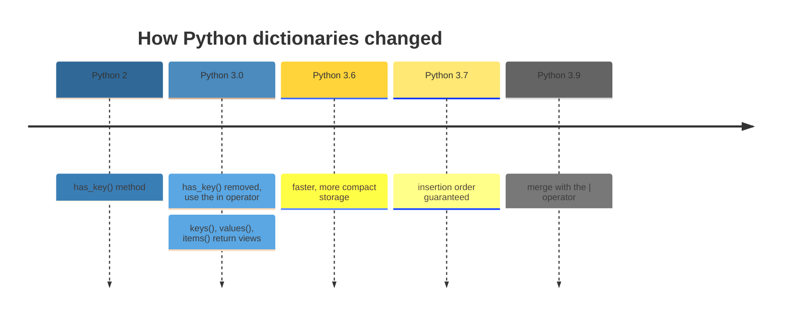
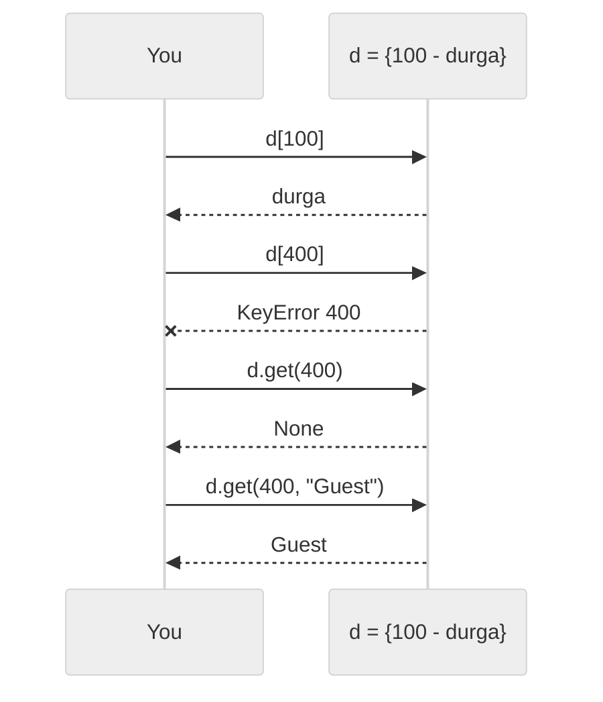
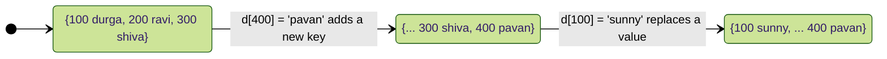
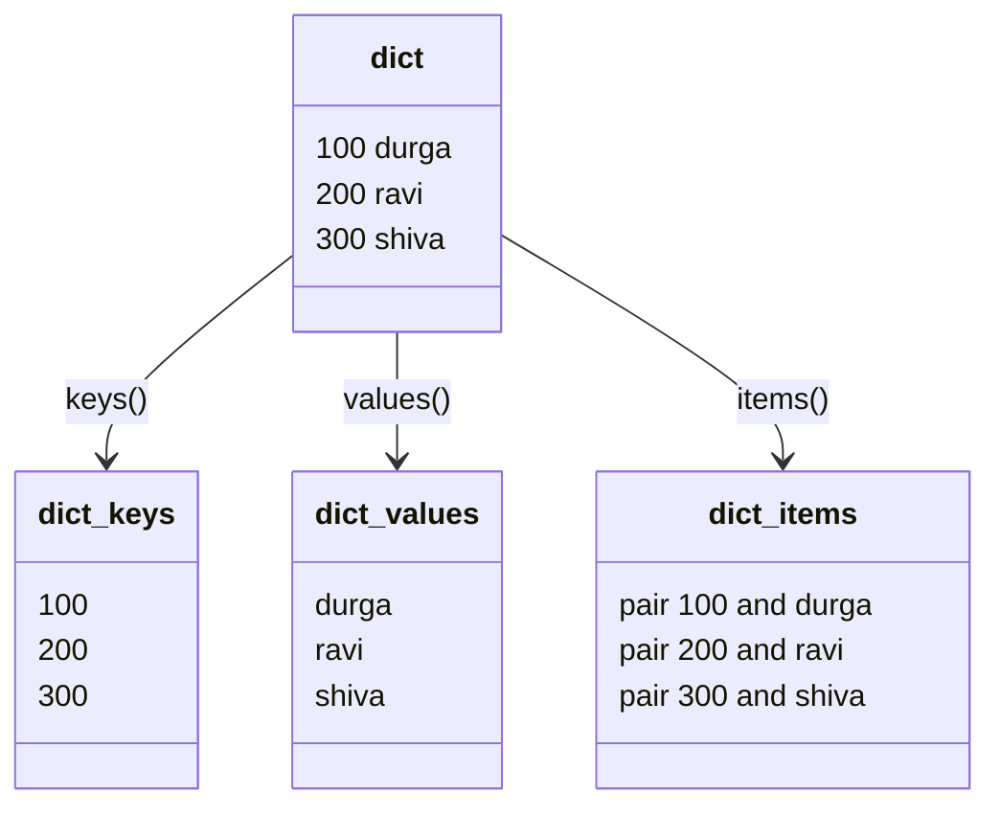
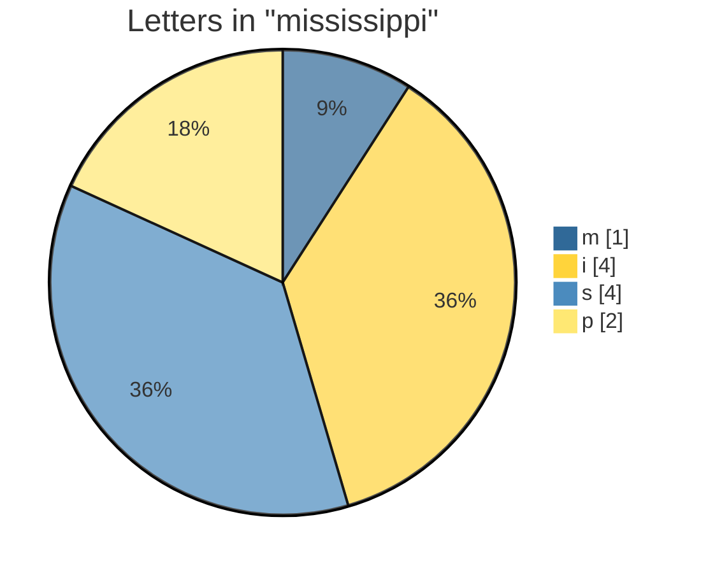
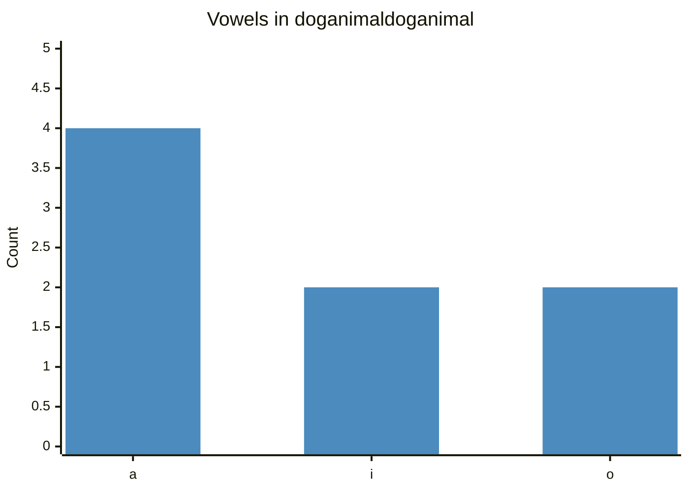
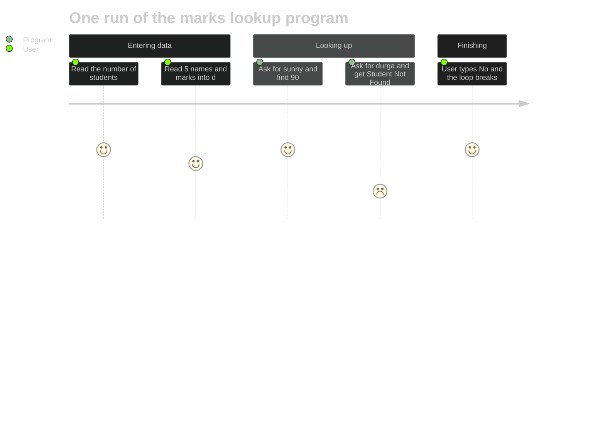
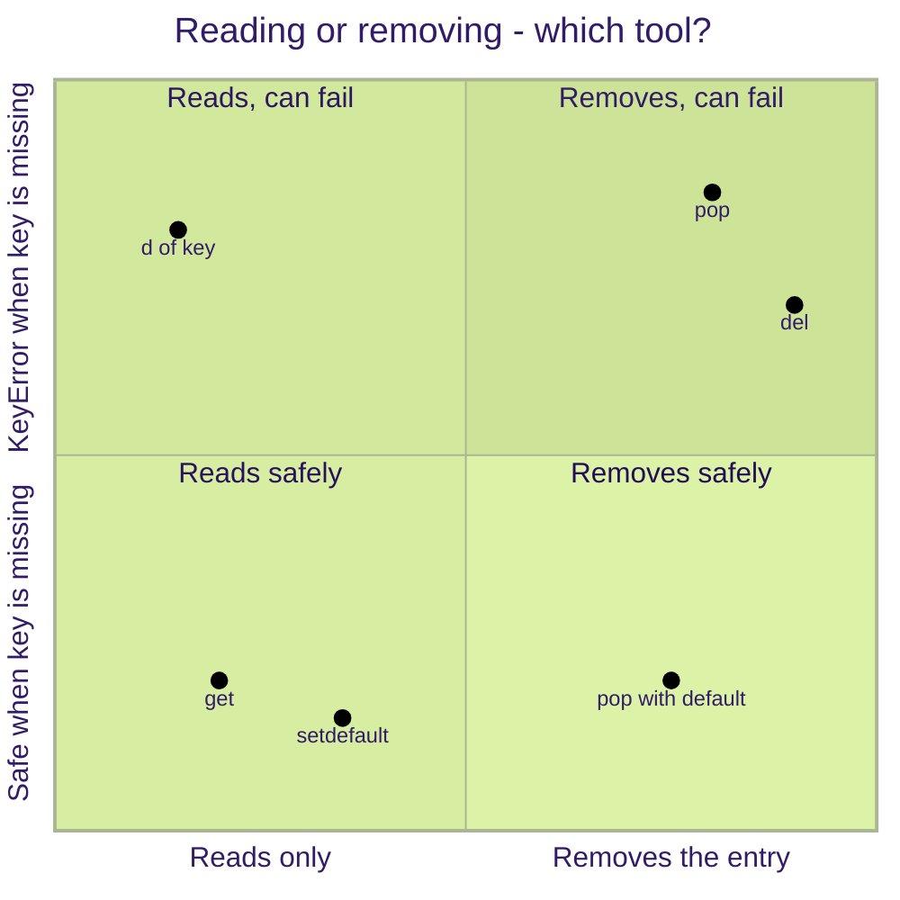

<p align="center">
  
</p>

# 09. Dictionary

Lists, tuples and sets store **individual** values. A **dictionary** (`dict`) stores values as **key-value pairs**, so you can look up a value by a meaningful key, just like looking up a word in a real dictionary to find its meaning. Dictionaries are one of the most used data structures in Python: configuration settings, JSON data from the web, counting things, and grouping records all rely on them.

**In this topic**

1. [What is a dictionary?](#1-what-is-a-dictionary)
2. [Creating dictionaries](#2-creating-dictionaries)
3. [Accessing values](#3-accessing-values)
4. [Adding and updating entries](#4-adding-and-updating-entries)
5. [Deleting entries](#5-deleting-entries)
6. [What can be a key?](#6-what-can-be-a-key)
7. [Important functions and methods](#7-important-functions-and-methods)
8. [keys(), values() and items()](#8-keys-values-and-items)
9. [copy() and update()](#9-copy-and-update)
10. [setdefault()](#10-setdefault)
11. [Looping over a dictionary](#11-looping-over-a-dictionary)
12. [Dictionary comprehension](#12-dictionary-comprehension)
13. [Nested dictionaries](#13-nested-dictionaries)
14. [Complete programs](#14-complete-programs)
15. [All dictionary methods at a glance](#15-all-dictionary-methods-at-a-glance)
16. [Common errors](#16-common-errors)
17. [Quick revision](#17-quick-revision)
18. [Interview questions](#18-interview-questions)
19. [Practice questions](#19-practice-questions)

## 1. What is a dictionary?

> **If you want to represent a group of objects as key-value pairs, use a dictionary.**

Real-life examples of key-value pairs:

<table width="100%">
<tr>
<th align="left" width="24%">Key</th>
<th align="left" width="24%">Value</th>
<th align="left" width="52%">As a Python dictionary</th>
</tr>
<tr><td>Roll number</td><td>Student name</td><td><code>{101: "Asha", 102: "Ravi"}</code></td></tr>
<tr><td>Phone number</td><td>Address</td><td><code>{"98765": "Pune", "91234": "Mumbai"}</code></td></tr>
<tr><td>IP address</td><td>Domain name</td><td><code>{"151.101.0.223": "python.org"}</code></td></tr>
<tr><td>Word</td><td>Meaning</td><td><code>{"cat": "a small animal", "sun": "a star"}</code></td></tr>
</table>

<table width="100%">
<tr>
<th align="left" width="5%">#</th>
<th align="left" width="32%">Property</th>
<th align="left" width="63%">Meaning</th>
</tr>
<tr><td>1</td><td>Duplicate keys are not allowed</td><td>Each key appears once; values can repeat</td></tr>
<tr><td>2</td><td>Heterogeneous keys and values</td><td>Keys and values can be of different types</td></tr>
<tr><td>3</td><td>Insertion order is preserved (Python 3.7+)</td><td>Items stay in the order they were added</td></tr>
<tr><td>4</td><td>Mutable</td><td>Entries can be added, changed and removed</td></tr>
<tr><td>5</td><td>Dynamic</td><td>The size grows and shrinks as needed</td></tr>
<tr><td>6</td><td>No indexing or slicing</td><td>You access values by <b>key</b>, not by position</td></tr>
<tr><td>7</td><td>Keys must be hashable</td><td>Keys must be immutable: numbers, strings, tuples of immutable items</td></tr>
</table>

> **Correction:** the notes say "insertion order is not preserved". That was true in old versions. **Since Python 3.7, a dictionary always keeps insertion order.** Every output on this page shows it.

> **Other names:** in C++ and Java a dictionary is called a **Map**; in Perl and Ruby it is called a **Hash**.



## 2. Creating dictionaries

**Example 1: An empty dictionary with {}**

```python
# Empty curly braces create an empty dictionary
d = {}

# Print it and its type
print(d, type(d))
```

**Output**

```text
{} <class 'dict'>
```

**Example 2: An empty dictionary with dict()**

```python
# dict() with no arguments also creates an empty dictionary
d = dict()

# Print it
print(d)
```

**Output**

```text
{}
```

**Example 3: Adding entries one by one**

```python
# Start with an empty dictionary
d = {}

# Add an entry: key 100, value "durga"
d[100] = "durga"

# Add a second entry
d[200] = "ravi"

# Add a third entry
d[300] = "shiva"

# Print the dictionary
print(d)
```

**Output**

```text
{100: 'durga', 200: 'ravi', 300: 'shiva'}
```

**Example 4: Writing all entries at once**

```python
# If the data is known in advance, write it as key: value pairs
d = {100: "durga", 200: "ravi", 300: "shiva"}

# Print the dictionary
print(d)
```

**Output**

```text
{100: 'durga', 200: 'ravi', 300: 'shiva'}
```

**Example 5: dict() from another dictionary**

```python
# dict() can copy an existing dictionary
d = dict({100: "durga", 200: "ravi"})

# Print the new dictionary
print(d)
```

**Output**

```text
{100: 'durga', 200: 'ravi'}
```

**Example 6: dict() from a list of tuples**

```python
# Each tuple is one (key, value) pair
d = dict([(100, "durga"), (200, "shiva"), (300, "ravi")])

# Print the dictionary
print(d)
```

**Output**

```text
{100: 'durga', 200: 'shiva', 300: 'ravi'}
```

**Example 7: dict() with keyword arguments**

```python
# Keyword arguments become string keys
d = dict(name="Asha", age=25, city="Pune")

# Print the dictionary
print(d)
```

**Output**

```text
{'name': 'Asha', 'age': 25, 'city': 'Pune'}
```

**Example 8: dict() with zip()**

```python
# A list of keys
keys = ["a", "b", "c"]

# A list of values in the same order
values = [1, 2, 3]

# zip() pairs them up and dict() builds the dictionary
print(dict(zip(keys, values)))
```

**Output**

```text
{'a': 1, 'b': 2, 'c': 3}
```

**Example 9: dict.fromkeys()**

```python
# Every key gets the same starting value
print(dict.fromkeys(["maths", "science", "english"], 0))
```

**Output**

```text
{'maths': 0, 'science': 0, 'english': 0}
```

**Example 10: Mixed key and value types**

```python
# Keys and values can be of different types
d = {1: "one", "two": 2, (3, 4): [3, 4], 5.5: None}

# Print the dictionary
print(d)
```

**Output**

```text
{1: 'one', 'two': 2, (3, 4): [3, 4], 5.5: None}
```

**Example 11: Duplicate keys in a literal: the last one wins**

```python
# Key "a" is written twice; the second value replaces the first
d = {"a": 1, "b": 2, "a": 99}

# Print the dictionary
print(d)
```

**Output**

```text
{'a': 99, 'b': 2}
```

**Example 12: Values can repeat**

```python
# Two different keys can have the same value
d = {"Asha": "A", "Ravi": "B", "Meena": "A"}

# Print the dictionary
print(d)
```

**Output**

```text
{'Asha': 'A', 'Ravi': 'B', 'Meena': 'A'}
```

## 3. Accessing values

You get a value by giving its **key** in square brackets.

**Example 13: Reading values by key**

```python
# A dictionary of roll numbers and names
d = {100: "durga", 200: "ravi", 300: "shiva"}

# The value for key 100
print(d[100])

# The value for key 300
print(d[300])
```

**Output**

```text
durga
shiva
```

**Example 14: A missing key raises KeyError**

```python
# A dictionary of roll numbers and names
d = {100: "durga", 200: "ravi", 300: "shiva"}

# Key 400 does not exist
print(d[400])
```

**Output** (last line of the error message)

```text
KeyError: 400
```

**Example 15: Check with in before reading**

```python
# A dictionary of roll numbers and names
d = {100: "durga", 200: "ravi", 300: "shiva"}

# Read the value only if the key exists
if 400 in d:

    # This line is skipped, because 400 is not a key
    print(d[400])

# Otherwise tell the user
else:

    # Print a friendly message instead of crashing
    print("Key 400 not found")
```

**Output**

```text
Key 400 not found
```

**Example 16: has_key() does not exist in Python 3**

```python
# A dictionary of roll numbers and names
d = {100: "durga", 200: "ravi", 300: "shiva"}

# has_key() was removed in Python 3; use the in operator
print(d.has_key(400))
```

**Output** (last line of the error message)

```text
AttributeError: 'dict' object has no attribute 'has_key'
```

**Example 17: in checks keys, not values**

```python
# A dictionary of roll numbers and names
d = {100: "durga", 200: "ravi"}

# 100 is a key
print(100 in d)

# "durga" is a value, not a key
print("durga" in d)

# To search the values, use values()
print("durga" in d.values())
```

**Output**

```text
True
False
True
```

**Example 18: Indexing by position does not work**

```python
# A dictionary with string keys
d = {"a": 1, "b": 2}

# 0 is treated as a KEY, and there is no key 0
print(d[0])
```

**Output** (last line of the error message)

```text
KeyError: 0
```

**Example 19: Keys are case sensitive**

```python
# A dictionary with a capitalised key
d = {"Name": "Asha"}

# "name" with a small n is a different key
print("name" in d, "Name" in d)
```

**Output**

```text
False True
```

### get(): safe access

<table width="100%">
<tr>
<th align="left" width="28%">Code</th>
<th align="left" width="24%">Key exists</th>
<th align="left" width="24%">Key missing</th>
<th align="left" width="24%">Raises an error?</th>
</tr>
<tr><td><code>d[key]</code></td><td>The value</td><td><code>KeyError</code></td><td>Yes, when missing</td></tr>
<tr><td><code>d.get(key)</code></td><td>The value</td><td><code>None</code></td><td>Never</td></tr>
<tr><td><code>d.get(key, default)</code></td><td>The value</td><td><code>default</code></td><td>Never</td></tr>
</table>



**Example 20: get() for a key that exists**

```python
# A dictionary of roll numbers and names
d = {100: "durga", 200: "ravi", 300: "shiva"}

# get() returns the value, just like d[100]
print(d.get(100))
```

**Output**

```text
durga
```

**Example 21: get() for a missing key**

```python
# A dictionary of roll numbers and names
d = {100: "durga", 200: "ravi", 300: "shiva"}

# get() returns None instead of raising an error
print(d.get(400))
```

**Output**

```text
None
```

**Example 22: get() with a default for an existing key**

```python
# A dictionary of roll numbers and names
d = {100: "durga", 200: "ravi", 300: "shiva"}

# The key exists, so the default is ignored
print(d.get(100, "Guest"))
```

**Output**

```text
durga
```

**Example 23: get() with a default for a missing key**

```python
# A dictionary of roll numbers and names
d = {100: "durga", 200: "ravi", 300: "shiva"}

# The key is missing, so the default is returned
print(d.get(400, "Guest"))
```

**Output**

```text
Guest
```

**Example 24: get() does not add the key**

```python
# A small dictionary
d = {"a": 1}

# Ask for a missing key with a default
d.get("z", 0)

# The dictionary is unchanged
print(d)
```

**Output**

```text
{'a': 1}
```

## 4. Adding and updating entries

`d[key] = value` does two jobs:

- If the key is **new**, a new entry is **added**.
- If the key **already exists**, its old value is **replaced**.



**Example 25: Add a new key**

```python
# A dictionary of three entries
d = {100: "durga", 200: "ravi", 300: "shiva"}

# 400 is a new key, so a new entry is added
d[400] = "pavan"

# Print the dictionary
print(d)
```

**Output**

```text
{100: 'durga', 200: 'ravi', 300: 'shiva', 400: 'pavan'}
```

**Example 26: Replace the value of an existing key**

```python
# A dictionary of three entries
d = {100: "durga", 200: "ravi", 300: "shiva"}

# 100 already exists, so its value is replaced
d[100] = "sunny"

# Print the dictionary; the order of keys does not change
print(d)
```

**Output**

```text
{100: 'sunny', 200: 'ravi', 300: 'shiva'}
```

**Example 27: Add and replace together (the notes' example)**

```python
# A dictionary of three entries
d = {100: "durga", 200: "ravi", 300: "shiva"}

# Print the starting dictionary
print(d)

# Add a new entry
d[400] = "pavan"

# Print after adding
print(d)

# Replace an existing value
d[100] = "sunny"

# Print after replacing
print(d)
```

**Output**

```text
{100: 'durga', 200: 'ravi', 300: 'shiva'}
{100: 'durga', 200: 'ravi', 300: 'shiva', 400: 'pavan'}
{100: 'sunny', 200: 'ravi', 300: 'shiva', 400: 'pavan'}
```

**Example 28: Increase a number stored in a dictionary**

```python
# Stock of two items
stock = {"pens": 10, "books": 4}

# Add 5 more pens to the existing count
stock["pens"] += 5

# Print the stock
print(stock)
```

**Output**

```text
{'pens': 15, 'books': 4}
```

**Example 29: += on a missing key fails**

```python
# Stock of one item
stock = {"pens": 10}

# "erasers" has no value yet, so there is nothing to add to
stock["erasers"] += 1
```

**Output** (last line of the error message)

```text
KeyError: 'erasers'
```

**Example 30: Counting safely with get()**

```python
# Stock of one item
stock = {"pens": 10}

# get() returns 0 for a missing key, so the addition always works
stock["erasers"] = stock.get("erasers", 0) + 1

# Print the stock
print(stock)
```

**Output**

```text
{'pens': 10, 'erasers': 1}
```

## 5. Deleting entries

<table width="100%">
<tr>
<th align="left" width="20%">Code</th>
<th align="left" width="32%">Removes</th>
<th align="left" width="22%">Returns</th>
<th align="left" width="26%">If the key is missing</th>
</tr>
<tr><td><code>del d[key]</code></td><td>One entry</td><td>Nothing</td><td><code>KeyError</code></td></tr>
<tr><td><code>d.pop(key)</code></td><td>One entry</td><td>Its value</td><td><code>KeyError</code></td></tr>
<tr><td><code>d.pop(key, default)</code></td><td>One entry</td><td>Its value, or <code>default</code></td><td>No error</td></tr>
<tr><td><code>d.popitem()</code></td><td>The last inserted entry</td><td>The <code>(key, value)</code> pair</td><td><code>KeyError</code> if empty</td></tr>
<tr><td><code>d.clear()</code></td><td>All entries</td><td><code>None</code></td><td>-</td></tr>
<tr><td><code>del d</code></td><td>The whole variable</td><td>Nothing</td><td>-</td></tr>
</table>

**Example 31: del d[key]**

```python
# A dictionary of three entries
d = {100: "durga", 200: "ravi", 300: "shiva"}

# Delete the entry with key 100
del d[100]

# Print the dictionary
print(d)
```

**Output**

```text
{200: 'ravi', 300: 'shiva'}
```

**Example 32: del with a missing key**

```python
# A dictionary of three entries
d = {100: "durga", 200: "ravi", 300: "shiva"}

# Key 400 does not exist
del d[400]
```

**Output** (last line of the error message)

```text
KeyError: 400
```

**Example 33: clear()**

```python
# A dictionary of three entries
d = {100: "durga", 200: "ravi", 300: "shiva"}

# Print it first
print(d)

# Remove every entry
d.clear()

# An empty dictionary remains
print(d)
```

**Output**

```text
{100: 'durga', 200: 'ravi', 300: 'shiva'}
{}
```

**Example 34: del d deletes the whole dictionary**

```python
# A dictionary of three entries
d = {100: "durga", 200: "ravi", 300: "shiva"}

# Delete the variable itself
del d

# The name d no longer exists
print(d)
```

**Output** (last line of the error message)

```text
NameError: name 'd' is not defined
```

**Example 35: pop() returns the removed value**

```python
# A dictionary of three entries
d = {100: "durga", 200: "ravi", 300: "shiva"}

# Remove key 100 and print its value
print(d.pop(100))

# Print what is left
print(d)
```

**Output**

```text
durga
{200: 'ravi', 300: 'shiva'}
```

**Example 36: pop() with a missing key**

```python
# A dictionary of three entries
d = {100: "durga", 200: "ravi", 300: "shiva"}

# Key 400 does not exist and no default is given
print(d.pop(400))
```

**Output** (last line of the error message)

```text
KeyError: 400
```

**Example 37: pop() with a default**

```python
# A dictionary of three entries
d = {100: "durga", 200: "ravi", 300: "shiva"}

# The key is missing, so the default is returned and nothing is removed
print(d.pop(400, "not found"))
```

**Output**

```text
not found
```

**Example 38: popitem() removes the last inserted entry**

```python
# A dictionary of three entries
d = {100: "durga", 200: "ravi", 300: "shiva"}

# Print the dictionary
print(d)

# Remove the last pair and print it
print(d.popitem())

# Print what is left
print(d)
```

**Output**

```text
{100: 'durga', 200: 'ravi', 300: 'shiva'}
(300, 'shiva')
{100: 'durga', 200: 'ravi'}
```

**Example 39: popitem() follows insertion order, not key order**

```python
# Key 1 was added last, even though it is the smallest
d = {3: "c", 2: "b", 1: "a"}

# popitem() removes the most recently inserted pair
print(d.popitem())
```

**Output**

```text
(1, 'a')
```

**Example 40: popitem() on an empty dictionary**

```python
# An empty dictionary
d = {}

# There is nothing to remove
print(d.popitem())
```

**Output** (last line of the error message)

```text
KeyError: 'popitem(): dictionary is empty'
```

> **Correction:** the notes say `popitem()` removes an **arbitrary** item. Since Python 3.7 it always removes the **last inserted** item (last in, first out).

## 6. What can be a key?

Keys must be **hashable** (their value can never change). Values can be anything.

**Example 41: Valid key types**

```python
# int, str, float, bool, tuple and frozenset can all be keys
d = {1: "int", "a": "str", 2.5: "float", (1, 2): "tuple", frozenset({3}): "frozenset"}

# Print the dictionary
print(d)
```

**Output**

```text
{1: 'int', 'a': 'str', 2.5: 'float', (1, 2): 'tuple', frozenset({3}): 'frozenset'}
```

**Example 42: A list cannot be a key**

```python
# Lists can change, so they cannot be keys
d = {[1, 2]: "list"}
```

**Output** (last line of the error message)

```text
TypeError: unhashable type: 'list'
```

**Example 43: A dictionary cannot be a key**

```python
# Dictionaries can change, so they cannot be keys
d = {{"a": 1}: "dict"}
```

**Output** (last line of the error message)

```text
TypeError: unhashable type: 'dict'
```

**Example 44: 1, 1.0 and True are the same key**

```python
# 1 == 1.0 == True, so they share one key; the last value wins
d = {1: "int", 1.0: "float", True: "bool"}

# Only one entry remains, using the first key written
print(d)
```

**Output**

```text
{1: 'bool'}
```

**Example 45: Values can be anything, including lists and dicts**

```python
# Values have no restrictions
student = {"name": "Asha", "marks": [78, 85], "address": {"city": "Pune"}}

# Print the dictionary
print(student)
```

**Output**

```text
{'name': 'Asha', 'marks': [78, 85], 'address': {'city': 'Pune'}}
```

## 7. Important functions and methods

**Example 46: len()**

```python
# A dictionary of three entries
d = {100: "durga", 200: "ravi", 300: "shiva"}

# The number of key-value pairs
print(len(d))
```

**Output**

```text
3
```

**Example 47: min(), max() and sorted() work on the keys**

```python
# A dictionary of marks
marks = {"Ravi": 85, "Asha": 92, "Meena": 78}

# Smallest key, largest key and all keys sorted
print(min(marks), max(marks), sorted(marks))
```

**Output**

```text
Asha Ravi ['Asha', 'Meena', 'Ravi']
```

**Example 48: The key with the highest value**

```python
# A dictionary of marks
marks = {"Ravi": 85, "Asha": 92, "Meena": 78}

# key=marks.get compares the values instead of the keys
print(max(marks, key=marks.get))
```

**Output**

```text
Asha
```

**Example 49: sum() of the values**

```python
# A dictionary of marks
marks = {"Ravi": 85, "Asha": 92, "Meena": 78}

# Add up all the values
print(sum(marks.values()))
```

**Output**

```text
255
```

**Example 50: Sorting by value**

```python
# A dictionary of marks
marks = {"Ravi": 85, "Asha": 92, "Meena": 78}

# Sort the pairs by their value (item[1]), highest first
print(sorted(marks.items(), key=lambda item: item[1], reverse=True))
```

**Output**

```text
[('Asha', 92), ('Ravi', 85), ('Meena', 78)]
```

**Example 51: Comparing dictionaries**

```python
# The same pairs in a different order are equal
print({"a": 1, "b": 2} == {"b": 2, "a": 1})
```

**Output**

```text
True
```

## 8. keys(), values() and items()

These three methods return **views**: live windows onto the dictionary. If the dictionary changes, the view shows the change.



**Example 52: keys()**

```python
# A dictionary of three entries
d = {100: "durga", 200: "ravi", 300: "shiva"}

# All keys, as a view
print(d.keys())
```

**Output**

```text
dict_keys([100, 200, 300])
```

**Example 53: Looping over keys()**

```python
# A dictionary of three entries
d = {100: "durga", 200: "ravi", 300: "shiva"}

# Visit each key
for k in d.keys():

    # Print the key
    print(k)
```

**Output**

```text
100
200
300
```

**Example 54: values()**

```python
# A dictionary of three entries
d = {100: "durga", 200: "ravi", 300: "shiva"}

# All values, as a view
print(d.values())
```

**Output**

```text
dict_values(['durga', 'ravi', 'shiva'])
```

**Example 55: Looping over values()**

```python
# A dictionary of three entries
d = {100: "durga", 200: "ravi", 300: "shiva"}

# Visit each value
for v in d.values():

    # Print the value
    print(v)
```

**Output**

```text
durga
ravi
shiva
```

**Example 56: items()**

```python
# A dictionary of three entries
d = {100: "durga", 200: "ravi", 300: "shiva"}

# All pairs, as a view of tuples
print(d.items())
```

**Output**

```text
dict_items([(100, 'durga'), (200, 'ravi'), (300, 'shiva')])
```

**Example 57: Looping over items() with unpacking**

```python
# A dictionary of three entries
d = {100: "durga", 200: "ravi", 300: "shiva"}

# Each pair is unpacked into k and v
for k, v in d.items():

    # Print the key and the value
    print(k, "--", v)
```

**Output**

```text
100 -- durga
200 -- ravi
300 -- shiva
```

**Example 58: Views are live**

```python
# A small dictionary
d = {"a": 1}

# Take a view of the keys
keys = d.keys()

# Add a new key AFTER taking the view
d["b"] = 2

# The view already shows the new key
print(keys)
```

**Output**

```text
dict_keys(['a', 'b'])
```

**Example 59: Converting a view to a list**

```python
# A dictionary of three entries
d = {100: "durga", 200: "ravi", 300: "shiva"}

# list() makes a normal list you can index
print(list(d.keys())[0])
```

**Output**

```text
100
```

**Example 60: Views cannot be indexed directly**

```python
# A dictionary of three entries
d = {100: "durga", 200: "ravi", 300: "shiva"}

# A view is not a list, so [0] does not work
print(d.keys()[0])
```

**Output** (last line of the error message)

```text
TypeError: 'dict_keys' object is not subscriptable
```

**Example 61: Keys views support set operations**

```python
# Two dictionaries with some shared keys
a = {"x": 1, "y": 2}

# The second dictionary
b = {"y": 20, "z": 30}

# Keys found in both dictionaries
print(a.keys() & b.keys())
```

**Output**

```text
{'y'}
```

> **Correction:** the notes say `items()` "returns a list of tuples". In Python 3 it returns a **view** (`dict_items`) that contains tuples. Wrap it in `list()` if you need a real list.

## 9. copy() and update()

### copy()

**Example 62: copy() makes a new dictionary**

```python
# The original dictionary
d = {100: "durga", 200: "ravi"}

# Make a copy
d1 = d.copy()

# Change only the copy
d1[300] = "shiva"

# The original is unchanged
print(d)

# The copy has the extra entry
print(d1)
```

**Output**

```text
{100: 'durga', 200: 'ravi'}
{100: 'durga', 200: 'ravi', 300: 'shiva'}
```

**Example 63: Assignment is not a copy**

```python
# The original dictionary
d = {100: "durga"}

# A second name for the SAME dictionary
alias = d

# Change it through the second name
alias[200] = "ravi"

# The original shows the change
print(d)
```

**Output**

```text
{100: 'durga', 200: 'ravi'}
```

**Example 64: copy() is shallow**

```python
# A dictionary whose value is a list
d = {"marks": [78, 85]}

# A shallow copy shares the inner list
d1 = d.copy()

# Change the inner list through the copy
d1["marks"].append(92)

# The original's list changed too
print(d)
```

**Output**

```text
{'marks': [78, 85, 92]}
```

**Example 65: deepcopy() for nested data**

```python
# Load the copy module
import copy

# A dictionary whose value is a list
d = {"marks": [78, 85]}

# A deep copy also copies the inner list
d1 = copy.deepcopy(d)

# Change the inner list through the copy
d1["marks"].append(92)

# The original is not affected
print(d)
```

**Output**

```text
{'marks': [78, 85]}
```

> **Correction:** the notes call `copy()` an "exactly duplicate (cloned) dictionary". It is a **shallow** copy: inner lists and dictionaries are shared (Example 64). Use `copy.deepcopy()` for a fully independent copy. See [Topic 02.1](../02.1%20Variables%20and%20memory%20model/README.md#7-copying-assignment-shallow-copy-and-deep-copy).

### update()

`d.update(x)` adds every item of `x` to `d`. Existing keys get the new values.

**Example 66: update() with another dictionary**

```python
# The original dictionary
d = {100: "durga", 200: "ravi"}

# Add two entries; key 200 gets a new value
d.update({200: "RAVI", 300: "shiva"})

# Print the dictionary
print(d)
```

**Output**

```text
{100: 'durga', 200: 'RAVI', 300: 'shiva'}
```

**Example 67: update() with keyword arguments**

```python
# A settings dictionary
settings = {"theme": "light"}

# Keyword arguments become string keys
settings.update(theme="dark", font_size=14)

# Print the settings
print(settings)
```

**Output**

```text
{'theme': 'dark', 'font_size': 14}
```

**Example 68: update() with a list of pairs**

```python
# A dictionary
d = {"a": 1}

# Any iterable of (key, value) pairs works
d.update([("b", 2), ("c", 3)])

# Print the dictionary
print(d)
```

**Output**

```text
{'a': 1, 'b': 2, 'c': 3}
```

**Example 69: Merging with | (Python 3.9+)**

```python
# Default settings
defaults = {"theme": "light", "lang": "en"}

# The user's own choices
user = {"theme": "dark"}

# | builds a NEW merged dictionary; the right side wins
print(defaults | user)

# The originals are unchanged
print(defaults)
```

**Output**

```text
{'theme': 'dark', 'lang': 'en'}
{'theme': 'light', 'lang': 'en'}
```

**Example 70: In-place merge with |=**

```python
# Default settings
settings = {"theme": "light", "lang": "en"}

# |= works like update()
settings |= {"lang": "hi"}

# Print the settings
print(settings)
```

**Output**

```text
{'theme': 'light', 'lang': 'hi'}
```

**Example 71: Merging with ** unpacking**

```python
# Two dictionaries
a = {"x": 1}

# The second dictionary
b = {"y": 2}

# ** unpacks both into one new dictionary (works before 3.9 too)
print({**a, **b})
```

**Output**

```text
{'x': 1, 'y': 2}
```

## 10. setdefault()

`d.setdefault(key, value)`:

- If the key **exists**, it returns the current value and changes nothing.
- If the key is **missing**, it adds `key: value` and returns `value`.

**Example 72: setdefault() with a missing key**

```python
# A dictionary of three entries
d = {100: "durga", 200: "ravi", 300: "shiva"}

# 400 is missing, so it is added with "pavan"
print(d.setdefault(400, "pavan"))

# Print the dictionary
print(d)
```

**Output**

```text
pavan
{100: 'durga', 200: 'ravi', 300: 'shiva', 400: 'pavan'}
```

**Example 73: setdefault() with an existing key**

```python
# A dictionary of four entries
d = {100: "durga", 200: "ravi", 300: "shiva", 400: "pavan"}

# 100 exists, so its value is returned and "sachin" is ignored
print(d.setdefault(100, "sachin"))

# The dictionary is unchanged
print(d)
```

**Output**

```text
durga
{100: 'durga', 200: 'ravi', 300: 'shiva', 400: 'pavan'}
```

**Example 74: Grouping items with setdefault()**

```python
# Words to group by their first letter
words = ["apple", "avocado", "banana", "blueberry", "cherry"]

# An empty dictionary of groups
groups = {}

# Visit each word
for word in words:

    # Create an empty list for a new letter, then add the word to it
    groups.setdefault(word[0], []).append(word)

# Print the groups
print(groups)
```

**Output**

```text
{'a': ['apple', 'avocado'], 'b': ['banana', 'blueberry'], 'c': ['cherry']}
```

## 11. Looping over a dictionary

**Example 75: A plain for loop gives the keys**

```python
# A dictionary of marks
marks = {"Asha": 92, "Ravi": 85}

# Looping over the dictionary itself gives the keys
for name in marks:

    # Use the key to read the value
    print(name, marks[name])
```

**Output**

```text
Asha 92
Ravi 85
```

**Example 76: Numbered rows with enumerate()**

```python
# A dictionary of marks
marks = {"Asha": 92, "Ravi": 85, "Meena": 78}

# enumerate() numbers the pairs from 1
for number, (name, mark) in enumerate(marks.items(), start=1):

    # Print a numbered row
    print(f"{number}. {name}: {mark}")
```

**Output**

```text
1. Asha: 92
2. Ravi: 85
3. Meena: 78
```

**Example 77: Looping in sorted key order**

```python
# A dictionary of marks
marks = {"Ravi": 85, "Asha": 92, "Meena": 78}

# sorted() on the items sorts by key
for name, mark in sorted(marks.items()):

    # Print each pair
    print(name, mark)
```

**Output**

```text
Asha 92
Meena 78
Ravi 85
```

**Example 78: Changing size during a loop is an error**

```python
# A dictionary of marks
marks = {"Asha": 92, "Ravi": 35, "Meena": 78}

# Try to delete entries while looping over the same dictionary
for name in marks:

    # Delete failing students
    if marks[name] < 40:

        # This changes the dictionary's size mid-loop
        del marks[name]
```

**Output** (last line of the error message)

```text
RuntimeError: dictionary changed size during iteration
```

**Example 79: Loop over a copy of the keys instead**

```python
# A dictionary of marks
marks = {"Asha": 92, "Ravi": 35, "Meena": 78}

# list() makes a separate copy of the keys to loop over
for name in list(marks):

    # Delete failing students
    if marks[name] < 40:

        # Safe, because we loop over the copy
        del marks[name]

# Print what is left
print(marks)
```

**Output**

```text
{'Asha': 92, 'Meena': 78}
```

## 12. Dictionary comprehension

`{key_expression: value_expression for item in iterable}` builds a dictionary in one line.

**Example 80: Squares**

```python
# Each number maps to its square
squares = {x: x * x for x in range(1, 6)}

# Print the dictionary
print(squares)
```

**Output**

```text
{1: 1, 2: 4, 3: 9, 4: 16, 5: 25}
```

**Example 81: Doubles**

```python
# Each number maps to double its value
doubles = {x: 2 * x for x in range(1, 6)}

# Print the dictionary
print(doubles)
```

**Output**

```text
{1: 2, 2: 4, 3: 6, 4: 8, 5: 10}
```

**Example 82: Word lengths**

```python
# A list of words
words = ["tea", "coffee", "milk"]

# Each word maps to its length
print({word: len(word) for word in words})
```

**Output**

```text
{'tea': 3, 'coffee': 6, 'milk': 4}
```

**Example 83: With a condition**

```python
# A dictionary of marks
marks = {"Asha": 92, "Ravi": 35, "Meena": 78}

# Keep only the students who passed
print({name: mark for name, mark in marks.items() if mark >= 40})
```

**Output**

```text
{'Asha': 92, 'Meena': 78}
```

**Example 84: Swapping keys and values**

```python
# Country codes
codes = {"IN": "India", "JP": "Japan"}

# Each value becomes a key and each key a value
print({country: code for code, country in codes.items()})
```

**Output**

```text
{'India': 'IN', 'Japan': 'JP'}
```

**Example 85: Changing every value**

```python
# Prices in rupees
prices = {"tea": 20, "coffee": 30}

# Add 10 percent to every price
print({item: round(price * 1.1, 2) for item, price in prices.items()})
```

**Output**

```text
{'tea': 22.0, 'coffee': 33.0}
```

**Example 86: Pass or fail labels**

```python
# A dictionary of marks
marks = {"Asha": 92, "Ravi": 35}

# Map each name to a label
print({name: "pass" if mark >= 40 else "fail" for name, mark in marks.items()})
```

**Output**

```text
{'Asha': 'pass', 'Ravi': 'fail'}
```

## 13. Nested dictionaries

A value can itself be a dictionary. This is how JSON data from the web looks.

**Example 87: Reading a nested value**

```python
# Each student has a dictionary of details
students = {
    101: {"name": "Asha", "city": "Pune"},
    102: {"name": "Ravi", "city": "Mumbai"},
}

# The city of student 102
print(students[102]["city"])
```

**Output**

```text
Mumbai
```

**Example 88: Adding to a nested dictionary**

```python
# One student's details
students = {101: {"name": "Asha"}}

# Add a new key inside the inner dictionary
students[101]["city"] = "Pune"

# Print the dictionary
print(students)
```

**Output**

```text
{101: {'name': 'Asha', 'city': 'Pune'}}
```

**Example 89: Looping over nested dictionaries**

```python
# Each student has a dictionary of details
students = {
    101: {"name": "Asha", "city": "Pune"},
    102: {"name": "Ravi", "city": "Mumbai"},
}

# Unpack the roll number and the inner dictionary
for roll, info in students.items():

    # Read values from the inner dictionary
    print(roll, info["name"], info["city"])
```

**Output**

```text
101 Asha Pune
102 Ravi Mumbai
```

**Example 90: Safe nested lookup with get()**

```python
# One student without a city
students = {101: {"name": "Asha"}}

# get() at each level avoids KeyError
print(students.get(101, {}).get("city", "unknown"))
```

**Output**

```text
unknown
```

## 14. Complete programs

### Program 1: Enter names and percentage marks

This is the first program from the notes, using a `while` loop to read several students.

```python
# An empty dictionary for the records
rec = {}

# How many students will be entered
n = int(input("Enter number of students: "))

# Start the counter at 1
i = 1

# Repeat once for each student
while i <= n:

    # Read the student's name
    name = input("Enter Student Name: ")

    # Read the marks as text, for example 60%
    marks = input("Enter % of Marks of Student: ")

    # Store the pair in the dictionary
    rec[name] = marks

    # Move to the next student
    i = i + 1

# Print the table header
print("Name of Student", "\t", "% of marks")

# Print each name and its marks
for x in rec:

    # Tabs line up the columns
    print("\t", x, "\t\t", rec[x])
```

**Output** (user types `3`, `durga`, `60%`, `ravi`, `70%`, `shiva`, `80%`)

```text
Enter number of students: 3
Enter Student Name: durga
Enter % of Marks of Student: 60%
Enter Student Name: ravi
Enter % of Marks of Student: 70%
Enter Student Name: shiva
Enter % of Marks of Student: 80%
Name of Student 	 % of marks
	 durga 		 60%
	 ravi 		 70%
	 shiva 		 80%
```

**How this program runs:** the `while` loop runs `n` times. Each time it reads a name and marks and stores them with `rec[name] = marks`. After the loop, `for x in rec` visits each key (the names) in insertion order and prints the value `rec[x]`.

### Program 2: Sum of the values of a dictionary from the keyboard

The notes read the dictionary with `eval(input())`. We use the safe `ast.literal_eval()` instead.

```python
# Load the ast module to read Python values safely
import ast

# Read a dictionary such as {'A':100,'B':200,'C':300}
d = ast.literal_eval(input("Enter dictionary:"))

# Add up all the values
total = sum(d.values())

# Print the sum
print("Sum= ", total)
```

**Output** (user types `{'A':100,'B':200,'C':300}`)

```text
Enter dictionary:{'A':100,'B':200,'C':300}
Sum=  600
```

### Program 3: Count each letter in a word

```python
# Read a word
word = input("Enter any word: ")

# An empty dictionary of counts
d = {}

# Visit each letter
for x in word:

    # get() gives 0 the first time, so we can always add 1
    d[x] = d.get(x, 0) + 1

# Print each letter and its count
for k, v in d.items():

    # One line per letter
    print(k, "occurred ", v, " times")
```

**Output** (user types `mississippi`)

```text
Enter any word: mississippi
m occurred  1  times
i occurred  4  times
s occurred  4  times
p occurred  2  times
```



**How this program runs:** for the first `m`, `d.get("m", 0)` is 0, so `d["m"]` becomes 1. For each later `i`, `get()` returns the current count and 1 is added. Because dictionaries keep insertion order, the letters print in the order they first appear.

The standard library has a shortcut for counting:

```python
# Load Counter from the collections module
from collections import Counter

# Counter counts every item in one step
print(Counter("mississippi"))
```

**Output**

```text
Counter({'i': 4, 's': 4, 'p': 2, 'm': 1})
```

### Program 4: Count each vowel in a word

```python
# Read a word
word = input("Enter any word: ")

# The set of vowels
vowels = {"a", "e", "i", "o", "u"}

# An empty dictionary of counts
d = {}

# Visit each letter
for x in word:

    # Count only vowels
    if x in vowels:

        # Add one to this vowel's count
        d[x] = d.get(x, 0) + 1

# Print the vowels in alphabetical order
for k, v in sorted(d.items()):

    # One line per vowel
    print(k, "occurred ", v, " times")
```

**Output** (user types `doganimaldoganimal`)

```text
Enter any word: doganimaldoganimal
a occurred  4  times
i occurred  2  times
o occurred  2  times
```



### Program 5: Look up student marks by name

```python
# How many students will be entered
n = int(input("Enter the number of students: "))

# An empty dictionary of marks
d = {}

# Read each student's name and marks
for i in range(n):

    # Read the name
    name = input("Enter Student Name: ")

    # Read the marks
    marks = input("Enter Student Marks: ")

    # Store the pair
    d[name] = marks

# Keep answering questions until the user says No
while True:

    # Ask which student to look up
    name = input("Enter Student Name to get Marks: ")

    # get() returns -1 when the name is not in the dictionary
    marks = d.get(name, -1)

    # -1 means the student was not found
    if marks == -1:

        # Tell the user
        print("Student Not Found")

    # Otherwise the marks were found
    else:

        # Show the marks
        print("The Marks of", name, "are", marks)

    # Ask whether to continue
    option = input("Do you want to find another student marks[Yes|No]")

    # Stop the loop when the user types No
    if option == "No":

        # Leave the while loop
        break

# Say goodbye
print("Thanks for using our application")
```

**Output** (user types `5`, `sunny`, `90`, `banny`, `80`, `chinny`, `70`, `pinny`, `60`, `vinny`, `50`, `sunny`, `Yes`, `durga`, `No`)

```text
Enter the number of students: 5
Enter Student Name: sunny
Enter Student Marks: 90
Enter Student Name: banny
Enter Student Marks: 80
Enter Student Name: chinny
Enter Student Marks: 70
Enter Student Name: pinny
Enter Student Marks: 60
Enter Student Name: vinny
Enter Student Marks: 50
Enter Student Name to get Marks: sunny
The Marks of sunny are 90
Do you want to find another student marks[Yes|No]Yes
Enter Student Name to get Marks: durga
Student Not Found
Do you want to find another student marks[Yes|No]No
Thanks for using our application
```

**How this program runs:**



1. The `for` loop stores five name-marks pairs in `d`.
2. The `while True` loop runs until `break`. Each round uses `d.get(name, -1)`: a real name returns its marks, an unknown name returns `-1`.
3. When the user types `No`, `break` leaves the loop and the goodbye message is printed.

## 15. All dictionary methods at a glance

<table width="100%">
<tr>
<th align="left" width="24%">Method</th>
<th align="left" width="40%">What it does</th>
<th align="left" width="20%">Returns</th>
<th align="left" width="16%">Changes d?</th>
</tr>
<tr><td><code>get(k, default=None)</code></td><td>Value of k, or the default</td><td>Value</td><td>No</td></tr>
<tr><td><code>keys()</code></td><td>All keys</td><td>View</td><td>No</td></tr>
<tr><td><code>values()</code></td><td>All values</td><td>View</td><td>No</td></tr>
<tr><td><code>items()</code></td><td>All (key, value) pairs</td><td>View</td><td>No</td></tr>
<tr><td><code>pop(k[, default])</code></td><td>Remove k and return its value</td><td>Value</td><td>Yes</td></tr>
<tr><td><code>popitem()</code></td><td>Remove the last inserted pair</td><td>Tuple</td><td>Yes</td></tr>
<tr><td><code>setdefault(k, v)</code></td><td>Value of k; add k: v first if missing</td><td>Value</td><td>Sometimes</td></tr>
<tr><td><code>update(x)</code></td><td>Add or replace entries from x</td><td><code>None</code></td><td>Yes</td></tr>
<tr><td><code>copy()</code></td><td>Shallow copy</td><td>New dict</td><td>No</td></tr>
<tr><td><code>clear()</code></td><td>Remove all entries</td><td><code>None</code></td><td>Yes</td></tr>
<tr><td><code>dict.fromkeys(keys, v)</code></td><td>New dict with every key set to v</td><td>New dict</td><td>-</td></tr>
</table>



## 16. Common errors

<table width="100%">
<tr>
<th align="left" width="22%">Code</th>
<th align="left" width="36%">Error</th>
<th align="left" width="22%">Cause</th>
<th align="left" width="20%">Fix</th>
</tr>
<tr><td><code>d[400]</code></td><td><code>KeyError: 400</code></td><td>Missing key</td><td><code>d.get(400)</code></td></tr>
<tr><td><code>d.has_key(400)</code></td><td><code>AttributeError: 'dict' object has no attribute 'has_key'</code></td><td>Removed in Python 3</td><td><code>400 in d</code></td></tr>
<tr><td><code>{[1, 2]: "x"}</code></td><td><code>TypeError: unhashable type: 'list'</code></td><td>Mutable key</td><td>Use a tuple</td></tr>
<tr><td><code>d.keys()[0]</code></td><td><code>TypeError: 'dict_keys' object is not subscriptable</code></td><td>Views have no index</td><td><code>list(d)[0]</code></td></tr>
<tr><td><code>{}.popitem()</code></td><td><code>KeyError: 'popitem(): dictionary is empty'</code></td><td>Nothing to remove</td><td>Check <code>if d:</code></td></tr>
<tr><td>Deleting while looping</td><td><code>RuntimeError: dictionary changed size during iteration</code></td><td>Size changed mid-loop</td><td>Loop over <code>list(d)</code></td></tr>
<tr><td><code>d["x"] += 1</code> on a new key</td><td><code>KeyError: 'x'</code></td><td>No starting value</td><td><code>d.get("x", 0) + 1</code></td></tr>
</table>

## 17. Quick revision

<table width="100%">
<tr>
<th align="left" width="6%">#</th>
<th align="left" width="36%">Question</th>
<th align="left" width="42%">Answer</th>
<th align="left" width="16%">Read again</th>
</tr>
<tr><td>1</td><td>What does a dictionary store?</td><td>Key-value pairs</td><td><a href="#1-what-is-a-dictionary">Section 1</a></td></tr>
<tr><td>2</td><td>Are duplicate keys allowed?</td><td>No; a repeated key replaces the old value</td><td><a href="#2-creating-dictionaries">Section 2</a></td></tr>
<tr><td>3</td><td>Is insertion order preserved?</td><td>Yes, since Python 3.7</td><td><a href="#1-what-is-a-dictionary">Section 1</a></td></tr>
<tr><td>4</td><td><code>d[k]</code> vs <code>d.get(k)</code> for a missing key</td><td><code>KeyError</code> vs <code>None</code></td><td><a href="#3-accessing-values">Section 3</a></td></tr>
<tr><td>5</td><td>Check whether a key exists</td><td><code>k in d</code> (<code>has_key()</code> is gone)</td><td><a href="#3-accessing-values">Section 3</a></td></tr>
<tr><td>6</td><td><code>d[k] = v</code> when k exists</td><td>Replaces the value</td><td><a href="#4-adding-and-updating-entries">Section 4</a></td></tr>
<tr><td>7</td><td>What does <code>popitem()</code> remove?</td><td>The last inserted pair</td><td><a href="#5-deleting-entries">Section 5</a></td></tr>
<tr><td>8</td><td>Can a list be a key?</td><td>No, keys must be hashable</td><td><a href="#6-what-can-be-a-key">Section 6</a></td></tr>
<tr><td>9</td><td>What do <code>keys()</code>, <code>values()</code>, <code>items()</code> return?</td><td>Live views</td><td><a href="#8-keys-values-and-items">Section 8</a></td></tr>
<tr><td>10</td><td>Is <code>copy()</code> deep?</td><td>No, shallow</td><td><a href="#9-copy-and-update">Section 9</a></td></tr>
<tr><td>11</td><td>Merge two dictionaries</td><td><code>a | b</code>, <code>a.update(b)</code> or <code>{**a, **b}</code></td><td><a href="#9-copy-and-update">Section 9</a></td></tr>
<tr><td>12</td><td>What does <code>setdefault()</code> do?</td><td>Returns the value; adds the key first if missing</td><td><a href="#10-setdefault">Section 10</a></td></tr>
<tr><td>13</td><td>Delete entries while looping</td><td>Loop over <code>list(d)</code></td><td><a href="#11-looping-over-a-dictionary">Section 11</a></td></tr>
<tr><td>14</td><td>Dictionary comprehension</td><td><code>{k: v for ...}</code></td><td><a href="#12-dictionary-comprehension">Section 12</a></td></tr>
<tr><td>15</td><td>Count items quickly</td><td><code>d[x] = d.get(x, 0) + 1</code> or <code>Counter</code></td><td><a href="#14-complete-programs">Section 14</a></td></tr>
</table>

## 18. Interview questions

Try to answer each question aloud first, then click it to see a model answer.

<details>
<summary><b>Q1. What is a dictionary? How is it different from a list?</b></summary>

A dictionary stores key-value pairs and looks up values by key. A list stores values by position and looks them up by index. Dictionary lookups by key are fast however large the dictionary is, while finding a value in a list means checking items one by one.

</details>

<details>
<summary><b>Q2. Do dictionaries keep insertion order?</b></summary>

Yes, since Python 3.7 this is guaranteed by the language (CPython 3.6 already did it as an implementation detail). Older versions did not keep order.

</details>

<details>
<summary><b>Q3. What is the difference between <code>d[key]</code> and <code>d.get(key)</code>?</b></summary>

Both return the value when the key exists. When the key is missing, `d[key]` raises `KeyError`, while `d.get(key)` returns `None`, or the default passed as a second argument.

</details>

<details>
<summary><b>Q4. What can be used as a dictionary key?</b></summary>

Any hashable (immutable) object: numbers, strings, booleans, tuples of hashable items and frozensets. Lists, sets and dictionaries cannot be keys. Values have no restrictions.

</details>

<details>
<summary><b>Q5. How do you merge two dictionaries?</b></summary>

`a | b` (Python 3.9+) returns a new merged dictionary; `a |= b` or `a.update(b)` changes `a` in place; `{**a, **b}` works in older versions. In every case the values from `b` win for duplicate keys.

</details>

<details>
<summary><b>Q6. What do <code>keys()</code>, <code>values()</code> and <code>items()</code> return?</b></summary>

View objects (`dict_keys`, `dict_values`, `dict_items`). They are live: they reflect later changes to the dictionary. They can be looped over, and key views support set operations like `&`, but they cannot be indexed.

</details>

<details>
<summary><b>Q7. What is the difference between <code>pop()</code> and <code>popitem()</code>?</b></summary>

`pop(key)` removes the given key and returns its value (`KeyError` if missing, unless a default is given). `popitem()` takes no key, removes the last inserted pair and returns it as a tuple.

</details>

<details>
<summary><b>Q8. What does <code>setdefault()</code> do and when is it useful?</b></summary>

`d.setdefault(k, v)` returns `d[k]` if k exists; otherwise it sets `d[k] = v` and returns v. It is useful for grouping, for example `groups.setdefault(key, []).append(item)`.

</details>

<details>
<summary><b>Q9. Is <code>dict.copy()</code> a deep copy?</b></summary>

No, it is shallow. The new dictionary has its own key-value slots, but mutable values such as lists are shared with the original. Use `copy.deepcopy()` for nested data.

</details>

<details>
<summary><b>Q10. Why do you get "dictionary changed size during iteration"?</b></summary>

Adding or deleting keys while looping over the same dictionary is not allowed. Loop over a copy of the keys (`for k in list(d):`) or build a new dictionary with a comprehension.

</details>

<details>
<summary><b>Q11. How do you count how often each item appears?</b></summary>

With a dictionary: `counts[x] = counts.get(x, 0) + 1` for each item. Or use `collections.Counter(items)`, which does the same in one step and adds helpers like `most_common()`.

</details>

<details>
<summary><b>Q12. How do you sort a dictionary by its values?</b></summary>

`sorted(d.items(), key=lambda item: item[1])` gives a list of pairs sorted by value. Wrap it in `dict()` to get a dictionary in that order. Add `reverse=True` for highest first.

</details>

<details>
<summary><b>Q13. What happened to <code>has_key()</code>?</b></summary>

It was removed in Python 3. Use the `in` operator: `key in d`.

</details>

## 19. Practice questions

1. Create a dictionary of five countries and their capitals. Print the capital of the third country you added.
2. Ask the user for a country and print its capital, or `"Unknown"` if it is not in the dictionary (use `get()`).
3. Given `prices = {"tea": 20, "coffee": 30}`, add `"juice": 45`, change the price of tea to 25, and remove coffee. Print the dictionary after each step.
4. Print every key and value of a dictionary in the form `key -> value`, sorted by key.
5. Count how many times each word appears in `"the cat and the hat and the bat"`.
6. Find the student with the highest marks in `{"Asha": 92, "Ravi": 85, "Meena": 97}`.
7. Use a dictionary comprehension to map the numbers 1 to 10 to `"even"` or `"odd"`.
8. Swap the keys and values of `{"a": 1, "b": 2, "c": 3}`.
9. Merge `{"x": 1, "y": 2}` and `{"y": 20, "z": 30}` in three different ways. Which value does `y` get?
10. Remove every entry whose value is less than 40 from a marks dictionary, without a `RuntimeError`.
11. Group the words `["ant", "bee", "bat", "cow", "cat"]` into a dictionary by their first letter using `setdefault()`.
12. Store two students in a nested dictionary (roll number to details) and print each student's name and city.
13. Show with code that `copy()` is shallow, then fix it with `deepcopy()`.

<p align="center">
  <a href="../08.%20Set/README.md">Previous: 08. Set</a> &nbsp;|&nbsp; <a href="../README.md">Course home</a> &nbsp;|&nbsp; <a href="../09.1%20Comprehensions/README.md">Next: 09.1 Comprehensions</a>
</p>
