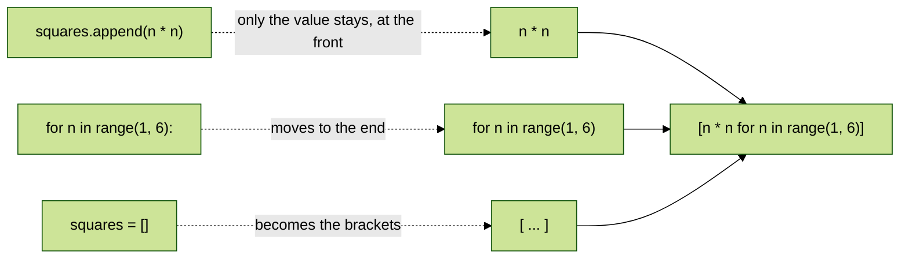
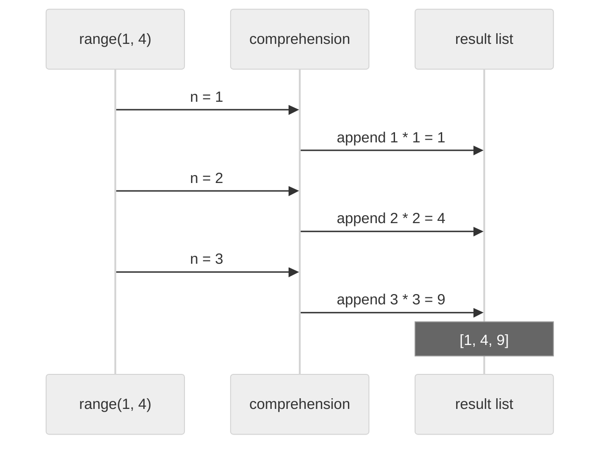
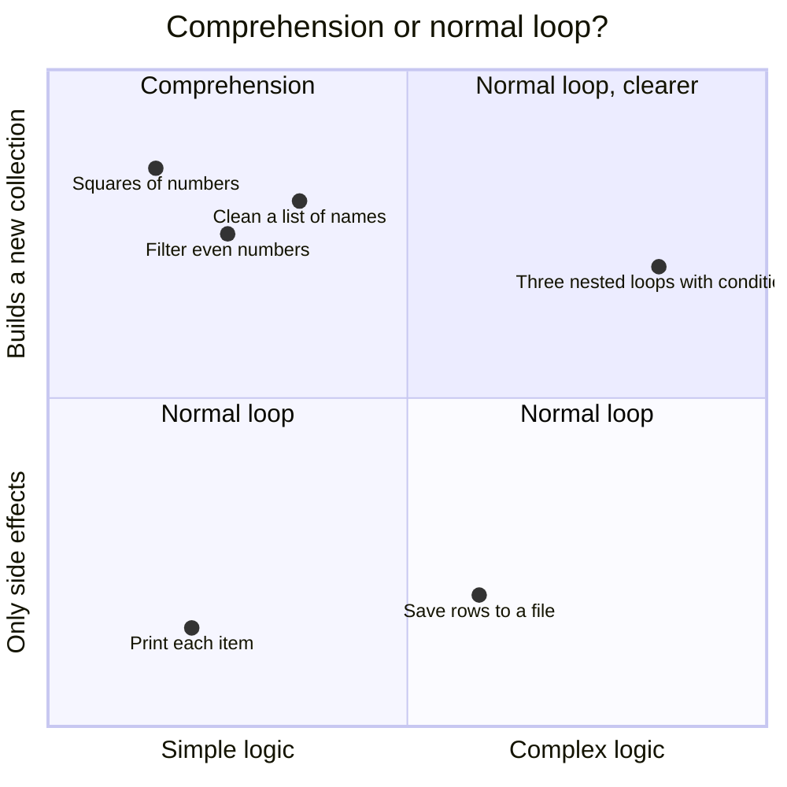
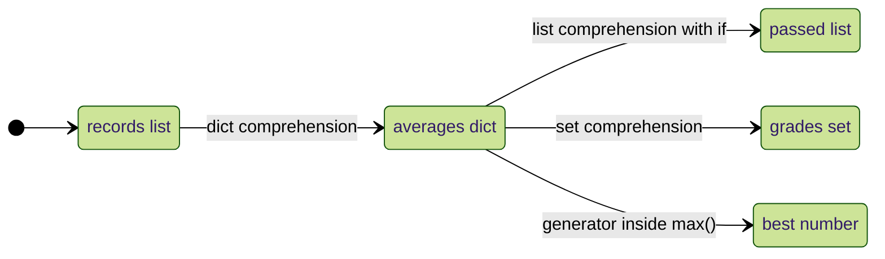

<p align="center">
  
</p>

# 09.1 Comprehensions

A **comprehension** builds a new list, set or dictionary from an existing sequence in **one readable line**. Instead of writing an empty list, a `for` loop and an `append()`, you describe the result directly: "the square of each number from 1 to 10". You have met comprehensions briefly in Topics 06, 08 and 09. This topic brings them together and goes deep.

> **Extra topic.** This topic is not part of the syllabus PDFs. Comprehensions are used everywhere in real Python code, so they get their own topic.

**In this topic**

1. [From a loop to a comprehension](#1-from-a-loop-to-a-comprehension)
2. [List comprehension: basic form](#2-list-comprehension-basic-form)
3. [Filtering with if](#3-filtering-with-if)
4. [Choosing values with if-else](#4-choosing-values-with-if-else)
5. [Comprehensions with strings](#5-comprehensions-with-strings)
6. [Nested loops in a comprehension](#6-nested-loops-in-a-comprehension)
7. [Nested comprehensions and matrices](#7-nested-comprehensions-and-matrices)
8. [Set comprehension](#8-set-comprehension)
9. [Dictionary comprehension](#9-dictionary-comprehension)
10. [Generator expressions](#10-generator-expressions)
11. [Scope: the loop variable stays inside](#11-scope-the-loop-variable-stays-inside)
12. [When not to use a comprehension](#12-when-not-to-use-a-comprehension)
13. [Complete programs](#13-complete-programs)
14. [Common errors](#14-common-errors)
15. [Quick revision](#15-quick-revision)
16. [Interview questions](#16-interview-questions)
17. [Practice questions](#17-practice-questions)

## 1. From a loop to a comprehension

Here is the same job done twice: build a list of the squares of 1 to 5.

**Example 1: With a for loop**

```python
# Start with an empty list
squares = []

# Go through the numbers 1 to 5
for n in range(1, 6):

    # Add the square of the current number
    squares.append(n * n)

# Print the result
print(squares)
```

**Output**

```text
[1, 4, 9, 16, 25]
```

**Example 2: With a list comprehension**

```python
# The same list, described in one line
squares = [n * n for n in range(1, 6)]

# Print the result
print(squares)
```

**Output**

```text
[1, 4, 9, 16, 25]
```

The parts of the loop move into the brackets:



<table width="100%">
<tr>
<th align="left" width="20%">Kind</th>
<th align="left" width="12%">Brackets</th>
<th align="left" width="36%">Form</th>
<th align="left" width="32%">Result</th>
</tr>
<tr><td>List comprehension</td><td><code>[ ]</code></td><td><code>[expr for x in items]</code></td><td>A list</td></tr>
<tr><td>Set comprehension</td><td><code>{ }</code></td><td><code>{expr for x in items}</code></td><td>A set (duplicates removed)</td></tr>
<tr><td>Dictionary comprehension</td><td><code>{ : }</code></td><td><code>{key: value for x in items}</code></td><td>A dictionary</td></tr>
<tr><td>Generator expression</td><td><code>( )</code></td><td><code>(expr for x in items)</code></td><td>A generator (values made one at a time)</td></tr>
</table>

> There is **no tuple comprehension**. Round brackets make a generator; use `tuple(expr for x in items)` to get a tuple (see [Topic 07](../07.%20Tuple/README.md#11-tuple-comprehension-does-not-exist)).

## 2. List comprehension: basic form

```text
[ expression  for item in iterable ]
```

Python takes each `item` from the `iterable`, works out `expression` for it, and collects the results in a new list.



**Example 3: Doubling numbers**

```python
# Each number from 1 to 5, multiplied by 2
print([n * 2 for n in range(1, 6)])
```

**Output**

```text
[2, 4, 6, 8, 10]
```

**Example 4: Copying a list unchanged**

```python
# The expression can be the item itself
print([n for n in [3, 1, 2]])
```

**Output**

```text
[3, 1, 2]
```

**Example 5: Powers of 2**

```python
# 2 to the power 0 up to 2 to the power 7
print([2 ** n for n in range(8)])
```

**Output**

```text
[1, 2, 4, 8, 16, 32, 64, 128]
```

**Example 6: Converting text to numbers**

```python
# Numbers read from a line of text are strings
text = "10 20 30 40"

# int() converts each piece to a whole number
print([int(piece) for piece in text.split()])
```

**Output**

```text
[10, 20, 30, 40]
```

**Example 7: Converting numbers to text**

```python
# str() converts each number to a string
print([str(n) for n in [1, 2, 3]])
```

**Output**

```text
['1', '2', '3']
```

**Example 8: Calling a function for each item**

```python
# len() of each word
print([len(word) for word in ["tea", "coffee", "milk"]])
```

**Output**

```text
[3, 6, 4]
```

**Example 9: Calling a method for each item**

```python
# upper() on each name
print([name.upper() for name in ["asha", "ravi"]])
```

**Output**

```text
['ASHA', 'RAVI']
```

**Example 10: Rounding prices**

```python
# Prices with many decimals
prices = [19.987, 5.5, 3.14159]

# Round each one to 2 decimal places
print([round(p, 2) for p in prices])
```

**Output**

```text
[19.99, 5.5, 3.14]
```

**Example 11: Pairs from two lists with zip()**

```python
# Names and marks in matching order
names = ["Asha", "Ravi"]

# The marks for each name
marks = [92, 85]

# Build a "name: mark" string for each pair
print([f"{n}: {m}" for n, m in zip(names, marks)])
```

**Output**

```text
['Asha: 92', 'Ravi: 85']
```

**Example 12: Positions with enumerate()**

```python
# Number each fruit starting from 1
print([f"{i}. {fruit}" for i, fruit in enumerate(["apple", "kiwi"], start=1)])
```

**Output**

```text
['1. apple', '2. kiwi']
```

**Example 13: Unpacking tuples**

```python
# A list of (x, y) points
points = [(1, 2), (3, 4), (5, 6)]

# Keep only the x values
print([x for x, y in points])
```

**Output**

```text
[1, 3, 5]
```

**Example 14: An expression with arithmetic**

```python
# Celsius temperatures
celsius = [0, 25, 100]

# Convert each one to Fahrenheit
print([c * 9 / 5 + 32 for c in celsius])
```

**Output**

```text
[32.0, 77.0, 212.0]
```

## 3. Filtering with if

Add `if condition` at the **end** to keep only some items.

```text
[ expression  for item in iterable  if condition ]
```

**Example 15: Even numbers**

```python
# Keep the numbers from 1 to 10 that divide by 2
print([n for n in range(1, 11) if n % 2 == 0])
```

**Output**

```text
[2, 4, 6, 8, 10]
```

**Example 16: Odd squares**

```python
# Square only the odd numbers
print([n * n for n in range(1, 11) if n % 2 == 1])
```

**Output**

```text
[1, 9, 25, 49, 81]
```

**Example 17: Positive numbers only**

```python
# A mix of positive and negative numbers
numbers = [4, -2, 0, 7, -5]

# Keep the numbers greater than zero
print([n for n in numbers if n > 0])
```

**Output**

```text
[4, 7]
```

**Example 18: Long words only**

```python
# A list of words
words = ["a", "tree", "is", "green"]

# Keep the words with more than 2 letters
print([w for w in words if len(w) > 2])
```

**Output**

```text
['tree', 'green']
```

**Example 19: Words starting with a letter**

```python
# A list of fruits
fruits = ["apple", "banana", "avocado", "cherry"]

# Keep the fruits that start with "a"
print([f for f in fruits if f.startswith("a")])
```

**Output**

```text
['apple', 'avocado']
```

**Example 20: Removing empty strings**

```python
# A list with empty strings
items = ["a", "", "b", "", "c"]

# An empty string is falsy, so "if item" drops it
print([item for item in items if item])
```

**Output**

```text
['a', 'b', 'c']
```

**Example 21: Removing None values**

```python
# A list with missing values
values = [3, None, 5, None]

# Keep only real values
print([v for v in values if v is not None])
```

**Output**

```text
[3, 5]
```

**Example 22: Two conditions with and**

```python
# Numbers between 1 and 30 that divide by both 3 and 5
print([n for n in range(1, 31) if n % 3 == 0 and n % 5 == 0])
```

**Output**

```text
[15, 30]
```

**Example 23: Two if clauses in a row**

```python
# Two ifs are the same as joining them with and
print([n for n in range(1, 31) if n % 3 == 0 if n % 5 == 0])
```

**Output**

```text
[15, 30]
```

**Example 24: Passing students**

```python
# Names and marks
marks = {"Asha": 92, "Ravi": 35, "Meena": 78}

# Names of students with 40 or more
print([name for name, mark in marks.items() if mark >= 40])
```

**Output**

```text
['Asha', 'Meena']
```

## 4. Choosing values with if-else

To **change** each value instead of dropping some, put `if ... else ...` **before** `for`. This is a conditional expression (Topic 04), not a filter.

```text
[ value_if_true if condition else value_if_false  for item in iterable ]
```

<table width="100%">
<tr>
<th align="left" width="24%">Position</th>
<th align="left" width="30%">Syntax</th>
<th align="left" width="24%">Effect</th>
<th align="left" width="22%">Result length</th>
</tr>
<tr><td>After <code>for</code></td><td><code>[x for x in s if c]</code></td><td>Filters items</td><td>Can be shorter</td></tr>
<tr><td>Before <code>for</code></td><td><code>[a if c else b for x in s]</code></td><td>Chooses a value for every item</td><td>Same length</td></tr>
</table>

**Example 25: Even or odd labels**

```python
# Label every number from 1 to 5
print(["even" if n % 2 == 0 else "odd" for n in range(1, 6)])
```

**Output**

```text
['odd', 'even', 'odd', 'even', 'odd']
```

**Example 26: Replacing negatives with zero**

```python
# A mix of positive and negative numbers
numbers = [4, -2, 0, 7, -5]

# Keep positives, turn negatives into 0
print([n if n > 0 else 0 for n in numbers])
```

**Output**

```text
[4, 0, 0, 7, 0]
```

**Example 27: Pass or fail**

```python
# A list of marks
marks = [92, 35, 78, 20]

# A label for every mark
print(["pass" if m >= 40 else "fail" for m in marks])
```

**Output**

```text
['pass', 'fail', 'pass', 'fail']
```

**Example 28: Replacing missing values**

```python
# A list with missing values
values = [3, None, 5]

# Use 0 wherever the value is None
print([v if v is not None else 0 for v in values])
```

**Output**

```text
[3, 0, 5]
```

**Example 29: if-else AND a filter together**

```python
# For numbers 1 to 10 that divide by 3, label them big or small
print(["big" if n > 5 else "small" for n in range(1, 11) if n % 3 == 0])
```

**Output**

```text
['small', 'big', 'big']
```

**Example 30: if without else before for is an error**

```python
# A conditional expression must have an else part
print([n if n > 0 for n in [1, -1]])
```

**Output** (last line of the error message)

```text
SyntaxError: expected 'else' after 'if' expression
```

## 5. Comprehensions with strings

A string is iterable, so comprehensions work on its characters.

**Example 31: Characters of a word**

```python
# Each character becomes one item
print([ch for ch in "Python"])
```

**Output**

```text
['P', 'y', 't', 'h', 'o', 'n']
```

**Example 32: Vowels in a sentence**

```python
# Keep only the vowels
print([ch for ch in "comprehension" if ch in "aeiou"])
```

**Output**

```text
['o', 'e', 'e', 'i', 'o']
```

**Example 33: Removing digits**

```python
# Keep every character that is not a digit, then join them
print("".join([ch for ch in "R2-D2 and C3PO" if not ch.isdigit()]))
```

**Output**

```text
R-D and CPO
```

**Example 34: Character codes**

```python
# ord() gives the code of each letter
print([ord(ch) for ch in "ABC"])
```

**Output**

```text
[65, 66, 67]
```

**Example 35: First letters (initials)**

```python
# Take the first letter of each word and make it capital
print("".join([word[0].upper() for word in "asha prakash patil".split()]))
```

**Output**

```text
APP
```

**Example 36: Cleaning a list of names**

```python
# Names with extra spaces and mixed case
names = ["  asha ", "RAVI", " meena"]

# strip() the spaces and title() the case for each name
print([n.strip().title() for n in names])
```

**Output**

```text
['Asha', 'Ravi', 'Meena']
```

**Example 37: Words longer than 3 letters, in capitals**

```python
# A sentence
sentence = "the quick brown fox is fast"

# Filter by length and change the case
print([w.upper() for w in sentence.split() if len(w) > 3])
```

**Output**

```text
['QUICK', 'BROWN', 'FAST']
```

## 6. Nested loops in a comprehension

You can write **more than one** `for` in a comprehension. They run in the **same order** as nested loops written normally: the first `for` is the outer loop.

**Example 38: Nested loops written normally**

```python
# Start with an empty list
pairs = []

# Outer loop over the letters
for letter in "ab":

    # Inner loop over the numbers
    for number in [1, 2]:

        # Add each combination
        pairs.append(letter + str(number))

# Print the result
print(pairs)
```

**Output**

```text
['a1', 'a2', 'b1', 'b2']
```

**Example 39: The same with a comprehension**

```python
# The first for is the outer loop, the second for is the inner loop
print([letter + str(number) for letter in "ab" for number in [1, 2]])
```

**Output**

```text
['a1', 'a2', 'b1', 'b2']
```

**Example 40: Coordinate pairs**

```python
# Every (x, y) pair for x and y from 0 to 2
print([(x, y) for x in range(3) for y in range(3)])
```

**Output**

```text
[(0, 0), (0, 1), (0, 2), (1, 0), (1, 1), (1, 2), (2, 0), (2, 1), (2, 2)]
```

**Example 41: Pairs where x is less than y**

```python
# The inner loop can use the outer variable
print([(x, y) for x in range(1, 4) for y in range(x + 1, 4)])
```

**Output**

```text
[(1, 2), (1, 3), (2, 3)]
```

**Example 42: Flattening a list of lists**

```python
# A list of rows
rows = [[1, 2], [3, 4], [5, 6]]

# For each row, then for each number in that row
print([n for row in rows for n in row])
```

**Output**

```text
[1, 2, 3, 4, 5, 6]
```

**Example 43: All dice totals of 7**

```python
# Every way two dice can add up to 7
print([(a, b) for a in range(1, 7) for b in range(1, 7) if a + b == 7])
```

**Output**

```text
[(1, 6), (2, 5), (3, 4), (4, 3), (5, 2), (6, 1)]
```

**Example 44: A small times table as text**

```python
# Every product line for 1 to 3 times 1 to 2
print([f"{a}x{b}={a * b}" for a in range(1, 4) for b in range(1, 3)])
```

**Output**

```text
['1x1=1', '1x2=2', '2x1=2', '2x2=4', '3x1=3', '3x2=6']
```

## 7. Nested comprehensions and matrices

A comprehension can be the **expression** of another comprehension. This builds lists of lists.

**Example 45: A 3 x 3 grid of zeros**

```python
# The inner comprehension builds one row; the outer one builds 3 rows
grid = [[0 for col in range(3)] for row in range(3)]

# Print the grid
print(grid)
```

**Output**

```text
[[0, 0, 0], [0, 0, 0], [0, 0, 0]]
```

**Example 46: The rows are separate lists**

```python
# Build the grid with a nested comprehension
grid = [[0 for col in range(3)] for row in range(3)]

# Change one cell
grid[0][0] = 5

# Only the first row changes (unlike [[0] * 3] * 3)
print(grid)
```

**Output**

```text
[[5, 0, 0], [0, 0, 0], [0, 0, 0]]
```

**Example 47: A multiplication table**

```python
# Row r holds r * 1, r * 2, r * 3
table = [[r * c for c in range(1, 4)] for r in range(1, 4)]

# Print each row on its own line
for row in table:

    # Print the row
    print(row)
```

**Output**

```text
[1, 2, 3]
[2, 4, 6]
[3, 6, 9]
```

**Example 48: Transposing a matrix (rows become columns)**

```python
# A 2 x 3 matrix
matrix = [[1, 2, 3], [4, 5, 6]]

# For each column index, collect that item from every row
print([[row[c] for row in matrix] for c in range(3)])
```

**Output**

```text
[[1, 4], [2, 5], [3, 6]]
```

**Example 49: Doubling every value in a matrix**

```python
# A 2 x 2 matrix
matrix = [[1, 2], [3, 4]]

# Double each value, keeping the row structure
print([[value * 2 for value in row] for row in matrix])
```

**Output**

```text
[[2, 4], [6, 8]]
```

**Example 50: Row totals**

```python
# A 3 x 3 matrix
matrix = [[1, 2, 3], [4, 5, 6], [7, 8, 9]]

# sum() of each row
print([sum(row) for row in matrix])
```

**Output**

```text
[6, 15, 24]
```

**Example 51: The diagonal**

```python
# A 3 x 3 matrix
matrix = [[1, 2, 3], [4, 5, 6], [7, 8, 9]]

# Items where the row index equals the column index
print([matrix[i][i] for i in range(len(matrix))])
```

**Output**

```text
[1, 5, 9]
```

## 8. Set comprehension

Curly braces with a single expression make a **set**, so duplicates disappear automatically.

**Example 52: Squares as a set**

```python
# The squares of 0 to 4
print({n * n for n in range(5)})
```

**Output**

```text
{0, 1, 4, 9, 16}
```

**Example 53: Remainders**

```python
# Remainders when 0 to 9 are divided by 4; only 4 different values exist
print({n % 4 for n in range(10)})
```

**Output**

```text
{0, 1, 2, 3}
```

**Example 54: Distinct word lengths**

```python
# A sentence with repeated word lengths
sentence = "the cat sat on the warm mat"

# Each length appears once
print({len(w) for w in sentence.split()})
```

**Output**

```text
{2, 3, 4}
```

**Example 55: Unique domains from email addresses**

```python
# Email addresses with a repeated domain
emails = ["a@gmail.com", "b@yahoo.com", "c@gmail.com"]

# Take the part after @ and keep each domain once, sorted
print(sorted({e.split("@")[1] for e in emails}))
```

**Output**

```text
['gmail.com', 'yahoo.com']
```

**Example 56: Distinct lower-case letters**

```python
# Letters in mixed case
word = "Banana"

# lower() makes B and b the same, sorted for a fixed order
print(sorted({ch.lower() for ch in word}))
```

**Output**

```text
['a', 'b', 'n']
```

**Example 57: List vs set comprehension**

```python
# The same expression in square and curly brackets
values = [1, 2, 2, 3, 3, 3]

# List: keeps every item
print([v * 10 for v in values])

# Set: keeps each result once
print({v * 10 for v in values})
```

**Output**

```text
[10, 20, 20, 30, 30, 30]
{10, 20, 30}
```

## 9. Dictionary comprehension

Curly braces with `key: value` make a **dictionary**.

```text
{ key_expression: value_expression  for item in iterable  if condition }
```

**Example 58: Numbers and their squares**

```python
# Each number maps to its square
print({n: n * n for n in range(1, 6)})
```

**Output**

```text
{1: 1, 2: 4, 3: 9, 4: 16, 5: 25}
```

**Example 59: Words and their lengths**

```python
# Each word maps to its length
print({w: len(w) for w in ["tea", "coffee", "milk"]})
```

**Output**

```text
{'tea': 3, 'coffee': 6, 'milk': 4}
```

**Example 60: From two lists with zip()**

```python
# Keys and values in matching order
subjects = ["maths", "science"]

# The marks for each subject
marks = [88, 92]

# Pair them into a dictionary
print({s: m for s, m in zip(subjects, marks)})
```

**Output**

```text
{'maths': 88, 'science': 92}
```

**Example 61: Filtering a dictionary**

```python
# Stock levels
stock = {"pens": 0, "books": 12, "bags": 3}

# Keep only items that are in stock
print({item: qty for item, qty in stock.items() if qty > 0})
```

**Output**

```text
{'books': 12, 'bags': 3}
```

**Example 62: Changing every value**

```python
# Prices in rupees
prices = {"tea": 20, "coffee": 30}

# Add 5 to every price
print({item: price + 5 for item, price in prices.items()})
```

**Output**

```text
{'tea': 25, 'coffee': 35}
```

**Example 63: Swapping keys and values**

```python
# Codes and countries
codes = {"IN": "India", "JP": "Japan"}

# Values become keys and keys become values
print({country: code for code, country in codes.items()})
```

**Output**

```text
{'India': 'IN', 'Japan': 'JP'}
```

**Example 64: Counting letters**

```python
# A word
word = "banana"

# For each distinct letter, count it in the word
print({ch: word.count(ch) for ch in sorted(set(word))})
```

**Output**

```text
{'a': 3, 'b': 1, 'n': 2}
```

**Example 65: Grade labels**

```python
# Marks by name
marks = {"Asha": 92, "Ravi": 64, "Meena": 35}

# A label for every student
print({n: "A" if m >= 85 else "B" if m >= 50 else "C" for n, m in marks.items()})
```

**Output**

```text
{'Asha': 'A', 'Ravi': 'B', 'Meena': 'C'}
```

**Example 66: Keys that repeat keep the last value**

```python
# Words grouped by first letter: later words overwrite earlier ones
print({w[0]: w for w in ["apple", "avocado", "banana"]})
```

**Output**

```text
{'a': 'avocado', 'b': 'banana'}
```

## 10. Generator expressions

Round brackets make a **generator expression**. It does **not** build the whole result in memory. It produces one value at a time, when asked. This is ideal when the result is only used once, for example by `sum()`, `max()` or `any()`.

**Example 67: A generator is not a list**

```python
# Round brackets create a generator object
squares = (n * n for n in range(5))

# Check the type
print(type(squares))
```

**Output**

```text
<class 'generator'>
```

**Example 68: Getting values from a generator**

```python
# A generator of squares
squares = (n * n for n in range(5))

# list() pulls out every value
print(list(squares))
```

**Output**

```text
[0, 1, 4, 9, 16]
```

**Example 69: A generator can be used only once**

```python
# A generator of squares
squares = (n * n for n in range(5))

# The first sum uses up all the values
print(sum(squares))

# Nothing is left for a second sum
print(sum(squares))
```

**Output**

```text
30
0
```

**Example 70: Passing a generator straight to a function**

```python
# When the generator is the only argument, the extra brackets can be dropped
print(sum(n * n for n in range(1, 11)))
```

**Output**

```text
385
```

**Example 71: max() with a generator**

```python
# The length of the longest word
print(max(len(w) for w in ["tea", "coffee", "milk"]))
```

**Output**

```text
6
```

**Example 72: any() and all() with generators**

```python
# A list of marks
marks = [92, 35, 78]

# Did anyone fail?
print(any(m < 40 for m in marks))

# Did everyone pass?
print(all(m >= 40 for m in marks))
```

**Output**

```text
True
False
```

**Example 73: next() takes one value at a time**

```python
# A generator of the first three even numbers
evens = (n for n in range(0, 6, 2))

# Take the first value
print(next(evens))

# Take the next value
print(next(evens))
```

**Output**

```text
0
2
```

**Example 74: Memory used by a list and a generator**

```python
# Load the sys module to measure size in bytes
import sys

# A list of 100000 numbers
as_list = [n for n in range(100000)]

# A generator that can produce the same numbers
as_gen = (n for n in range(100000))

# The list stores every item; the generator stores only its recipe
print(sys.getsizeof(as_list), sys.getsizeof(as_gen))
```

**Output**

```text
800984 192
```



```mermaid
%%{init: {"theme": "base", "themeVariables": {"fontFamily": "Segoe UI", "xyChart": {"plotColorPalette": "#306998, #ffd43b"}}}}%%
xychart-beta
    title "Memory in bytes: list comprehension vs generator expression"
    x-axis "Number of items" ["10", "1000", "100000"]
    y-axis "Bytes" 0 --> 820000
    bar [184, 8856, 800984]
    bar [192, 192, 192]
```

The blue bars (list) grow with the number of items. The yellow bars (generator) stay the same size, because a generator never stores its values. You will learn generators fully in [Topic 21](../21.%20Generator%20functions/README.md).

## 11. Scope: the loop variable stays inside

In Python 3, the loop variable of a comprehension exists **only inside** the comprehension. It does not overwrite a variable with the same name outside.

**Example 75: The outer variable is not changed**

```python
# A variable named x outside the comprehension
x = "outside"

# The comprehension uses its own x
squares = [x * x for x in range(3)]

# The outer x is unchanged
print(x)
```

**Output**

```text
outside
```

**Example 76: A normal loop does change it**

```python
# A variable named x before the loop
x = "outside"

# A normal for loop reuses the name x
for x in range(3):

    # Do nothing in the body
    pass

# After the loop, x holds the last loop value
print(x)
```

**Output**

```text
2
```

**Example 77: The loop variable is not available afterwards**

```python
# Build a list with the loop variable n
squares = [n * n for n in range(3)]

# n only existed inside the comprehension
print(n)
```

**Output** (last line of the error message)

```text
NameError: name 'n' is not defined
```

## 12. When not to use a comprehension

Comprehensions are great for **building a new collection**. They are a poor choice in some cases:



<table width="100%">
<tr>
<th align="left" width="32%">Situation</th>
<th align="left" width="34%">Why a comprehension is wrong</th>
<th align="left" width="34%">Use instead</th>
</tr>
<tr><td>You only want side effects (print, save, send)</td><td>It builds a list you never use</td><td>A normal <code>for</code> loop</td></tr>
<tr><td>The logic needs many conditions or steps</td><td>One long line is hard to read and debug</td><td>A loop, or a helper function</td></tr>
<tr><td>Three or more nested loops</td><td>The order becomes confusing</td><td>Normal nested loops</td></tr>
<tr><td>The result is used only once by <code>sum</code>, <code>max</code>, <code>any</code></td><td>The list wastes memory</td><td>A generator expression</td></tr>
</table>

**Example 78: Bad style: a comprehension used only to print**

```python
# This prints, but also builds a useless list of None values
result = [print(n) for n in range(3)]

# The list that was built and never needed
print(result)
```

**Output**

```text
0
1
2
[None, None, None]
```

**Example 79: Good style: a plain loop for side effects**

```python
# A loop is the right tool when you only want to print
for n in range(3):

    # Print each number
    print(n)
```

**Output**

```text
0
1
2
```

## 13. Complete programs

### Program 1: Student report with comprehensions

```python
# Each record is (name, marks in three subjects)
records = [("Asha", [92, 88, 95]), ("Ravi", [45, 38, 52]), ("Meena", [78, 81, 69])]

# Dictionary comprehension: name to average mark
averages = {name: round(sum(m) / len(m), 1) for name, m in records}

# List comprehension with a filter: names with an average of 50 or more
passed = [name for name, avg in averages.items() if avg >= 50]

# Set comprehension: the distinct grades given
grades = {"A" if avg >= 85 else "B" if avg >= 60 else "C" for avg in averages.values()}

# Generator expression inside max(): the best average
best = max(avg for avg in averages.values())

# Print the averages
print("Averages:", averages)

# Print who passed
print("Passed  :", passed)

# Print the grades in a fixed order
print("Grades  :", sorted(grades))

# Print the best average
print("Best    :", best)
```

**Output**

```text
Averages: {'Asha': 91.7, 'Ravi': 45.0, 'Meena': 76.0}
Passed  : ['Asha', 'Meena']
Grades  : ['A', 'B', 'C']
Best    : 91.7
```

**How this program runs:**



1. The dictionary comprehension unpacks each record into `name` and `m` and stores the rounded average.
2. The list comprehension keeps names whose average is at least 50, so Ravi (45.0) is dropped.
3. The set comprehension gives each distinct grade once.
4. The generator expression feeds averages to `max()` without building a list.

### Program 2: Word statistics

```python
# A short paragraph
text = "Python is easy. Python is fun. Learning Python is useful!"

# Remove punctuation and split into lower-case words
words = [w.strip(".!").lower() for w in text.split()]

# Count each distinct word
counts = {w: words.count(w) for w in sorted(set(words))}

# Words that appear more than once
repeated = [w for w, c in counts.items() if c > 1]

# Print the counts
print(counts)

# Print the repeated words
print("Repeated:", repeated)
```

**Output**

```text
{'easy': 1, 'fun': 1, 'is': 3, 'learning': 1, 'python': 3, 'useful': 1}
Repeated: ['is', 'python']
```

**How this program runs:** the first list comprehension cleans every word with `strip(".!")` and `lower()`. `sorted(set(words))` gives each distinct word once, in order, and the dictionary comprehension counts it. The last list comprehension keeps the words with a count above 1.

## 14. Common errors

<table width="100%">
<tr>
<th align="left" width="30%">Code</th>
<th align="left" width="30%">Problem</th>
<th align="left" width="40%">Fix</th>
</tr>
<tr><td><code>[n if n &gt; 0 for n in s]</code></td><td><code>SyntaxError</code>: an <code>if</code> before <code>for</code> needs <code>else</code></td><td><code>[n for n in s if n &gt; 0]</code> to filter, or add <code>else</code></td></tr>
<tr><td><code>(n for n in s)</code> expected to be a tuple</td><td>It is a generator</td><td><code>tuple(n for n in s)</code></td></tr>
<tr><td>Using a generator twice</td><td>The second use is empty</td><td>Make a list, or create the generator again</td></tr>
<tr><td><code>[print(x) for x in s]</code></td><td>Builds a useless list</td><td>Use a normal <code>for</code> loop</td></tr>
<tr><td><code>{}</code> expected to be a set comprehension with no items</td><td><code>{}</code> is an empty dict</td><td><code>set()</code></td></tr>
<tr><td>Wrong loop order in nested comprehensions</td><td>Unexpected result</td><td>Write the <code>for</code> parts in the same order as normal nested loops</td></tr>
</table>

## 15. Quick revision

<table width="100%">
<tr>
<th align="left" width="6%">#</th>
<th align="left" width="36%">Question</th>
<th align="left" width="42%">Answer</th>
<th align="left" width="16%">Read again</th>
</tr>
<tr><td>1</td><td>Basic list comprehension</td><td><code>[expr for x in items]</code></td><td><a href="#2-list-comprehension-basic-form">Section 2</a></td></tr>
<tr><td>2</td><td>Where does a filter <code>if</code> go?</td><td>At the end, after <code>for</code></td><td><a href="#3-filtering-with-if">Section 3</a></td></tr>
<tr><td>3</td><td>Where does <code>if-else</code> go?</td><td>At the front, before <code>for</code></td><td><a href="#4-choosing-values-with-if-else">Section 4</a></td></tr>
<tr><td>4</td><td>Order of two <code>for</code> parts</td><td>Outer loop first, inner loop second</td><td><a href="#6-nested-loops-in-a-comprehension">Section 6</a></td></tr>
<tr><td>5</td><td>Flatten a list of lists</td><td><code>[x for row in rows for x in row]</code></td><td><a href="#6-nested-loops-in-a-comprehension">Section 6</a></td></tr>
<tr><td>6</td><td>Build a grid safely</td><td><code>[[0 for c in range(3)] for r in range(3)]</code></td><td><a href="#7-nested-comprehensions-and-matrices">Section 7</a></td></tr>
<tr><td>7</td><td>Set comprehension</td><td><code>{expr for x in items}</code></td><td><a href="#8-set-comprehension">Section 8</a></td></tr>
<tr><td>8</td><td>Dictionary comprehension</td><td><code>{k: v for x in items}</code></td><td><a href="#9-dictionary-comprehension">Section 9</a></td></tr>
<tr><td>9</td><td>What do round brackets make?</td><td>A generator expression</td><td><a href="#10-generator-expressions">Section 10</a></td></tr>
<tr><td>10</td><td>Why use a generator expression?</td><td>Saves memory; values are made one at a time</td><td><a href="#10-generator-expressions">Section 10</a></td></tr>
<tr><td>11</td><td>Does the loop variable leak out?</td><td>No, not in Python 3</td><td><a href="#11-scope-the-loop-variable-stays-inside">Section 11</a></td></tr>
<tr><td>12</td><td>When to avoid a comprehension?</td><td>Side effects only, or complex logic</td><td><a href="#12-when-not-to-use-a-comprehension">Section 12</a></td></tr>
</table>

## 16. Interview questions

Try to answer each question aloud first, then click it to see a model answer.

<details>
<summary><b>Q1. What is a list comprehension?</b></summary>

A compact way to build a new list from an iterable: `[expression for item in iterable if condition]`. It replaces the pattern "empty list, for loop, append" with one readable expression, and is usually a little faster than the loop.

</details>

<details>
<summary><b>Q2. What is the difference between <code>if</code> at the end and <code>if-else</code> at the front?</b></summary>

An `if` at the end is a **filter**: items that fail the test are left out, so the result can be shorter. An `a if c else b` at the front is a **conditional expression**: every item produces a value, so the result has the same length as the input.

</details>

<details>
<summary><b>Q3. What kinds of comprehension does Python have?</b></summary>

List `[ ]`, set `{ }` and dictionary `{k: v}` comprehensions, plus generator expressions `( )`. There is no tuple comprehension.

</details>

<details>
<summary><b>Q4. What is the difference between a list comprehension and a generator expression?</b></summary>

A list comprehension builds the whole list in memory at once. A generator expression produces values one at a time on demand, uses a tiny fixed amount of memory, and can be consumed only once.

</details>

<details>
<summary><b>Q5. How do you flatten a nested list with a comprehension?</b></summary>

`[item for sub in nested for item in sub]`. The `for` parts appear in the same order as in nested loops: outer first, inner second.

</details>

<details>
<summary><b>Q6. Does a comprehension's loop variable leak into the surrounding scope?</b></summary>

Not in Python 3. A comprehension has its own scope, so its loop variable does not overwrite or create a variable outside. (In Python 2, list comprehension variables did leak.)

</details>

<details>
<summary><b>Q7. Why is <code>[[0] * 3 for _ in range(3)]</code> correct but <code>[[0] * 3] * 3</code> wrong for a grid?</b></summary>

The comprehension runs `[0] * 3` three times, creating three separate rows. `[[0] * 3] * 3` creates one row and repeats the reference to it three times, so changing one cell changes every row.

</details>

<details>
<summary><b>Q8. When should you not use a comprehension?</b></summary>

When you only want side effects (printing, writing to a file), when the logic is complex enough to need several statements, or when there are many nested loops. A normal loop is clearer in those cases.

</details>

<details>
<summary><b>Q9. How do you build a dictionary from two lists?</b></summary>

`{k: v for k, v in zip(keys, values)}`, or simply `dict(zip(keys, values))`.

</details>

<details>
<summary><b>Q10. What is the output of <code>{x % 3 for x in range(10)}</code>?</b></summary>

`{0, 1, 2}`. It is a set comprehension, so each remainder is kept only once.

</details>

## 17. Practice questions

1. Use a list comprehension to build the cubes of 1 to 10.
2. From `range(1, 51)`, keep the numbers that divide by 7.
3. Turn `["  apple ", "BANANA", " Cherry"]` into `["Apple", "Banana", "Cherry"]`.
4. Label the numbers 1 to 15 as `"Fizz"`, `"Buzz"`, `"FizzBuzz"` or the number itself, in one comprehension.
5. Flatten `[[1, 2, 3], [4, 5], [6]]` into one list.
6. Build every pair `(x, y)` with `x` from `[1, 2, 3]` and `y` from `["a", "b"]`.
7. Transpose the matrix `[[1, 2], [3, 4], [5, 6]]`.
8. Use a set comprehension to find the distinct first letters of a list of words.
9. Build a dictionary that maps each number from 1 to 10 to `"even"` or `"odd"`.
10. From `{"Asha": 92, "Ravi": 35, "Meena": 78}`, build a dictionary of only the passing students (40 or more).
11. Use a generator expression to find the total length of all words in a sentence.
12. Rewrite this loop as a comprehension: `result = []`, then for each `w` in `words`, if `len(w) > 3`, append `w.upper()`.

<p align="center">
  <a href="../09.%20Dictionary/README.md">Previous: 09. Dictionary</a> &nbsp;|&nbsp; <a href="../README.md">Course home</a> &nbsp;|&nbsp; <a href="../10.%20Functions/README.md">Next: 10. Functions</a>
</p>
