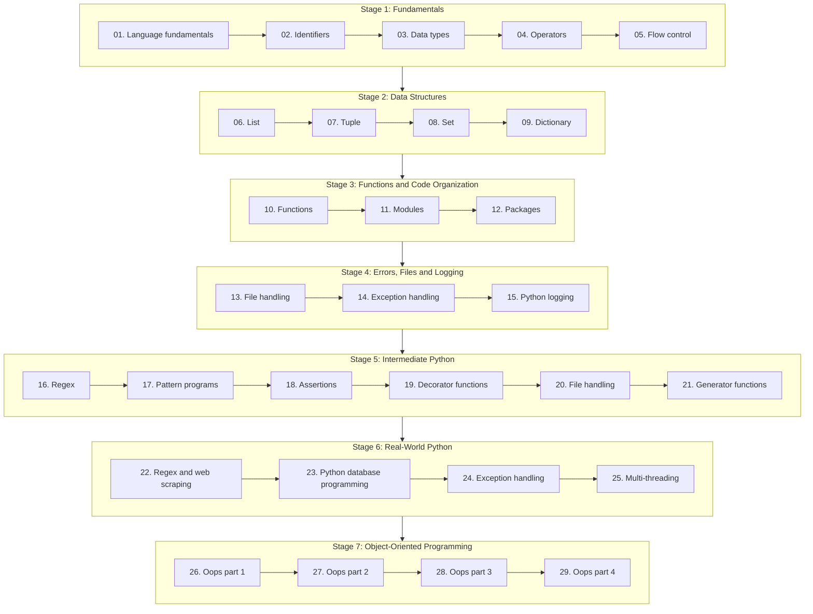

# Python Learning

A topic-by-topic Python course that follows the syllabus in this repo. It starts with language fundamentals and goes up to object-oriented programming.

- **Python version:** 3.12+
- **Prerequisites:** none. Topic 01 starts from zero.

---

## Learning Path

Work through the topics in order. Each stage builds on the one before it.



---

## Notes

Each topic folder has a `README.md` with the notes for that topic.

### Stage 1: Fundamentals

- [01. Language fundamentals](./01.%20Language%20fundamentals/README.md)
- [02. Identifiers](./02.%20Identifiers/README.md)
- [03. Data types](./03.%20Data%20types/README.md)
- [04. Operators](./04.%20Operators/README.md)
- [05. Flow control](./05.%20Flow%20control/README.md)

### Stage 2: Data Structures

- [06. List](./06.%20List/README.md)
- [07. Tuple](./07.%20Tuple/README.md)
- [08. Set](./08.%20Set/README.md)
- [09. Dictionary](./09.%20Dictionary/README.md)

### Stage 3: Functions and Code Organization

- [10. Functions](./10.%20Functions/README.md)
- [11. Modules](./11.%20Modules/README.md)
- [12. Packages](./12.%20Packages/README.md)

### Stage 4: Errors, Files and Logging

- [13. File handling](./13.%20File%20handling/README.md)
- [14. Exception handling](./14.%20Exception%20handling/README.md)
- [15. Python logging](./15.%20Python%20logging/README.md)

### Stage 5: Intermediate Python

- [16. Regex](./16.%20Regex/README.md)
- [17. Pattern programs](./17.%20Pattern%20programs/README.md)
- [18. Assertions](./18.%20Assertions/README.md)
- [19. Decorator functions](./19.%20Decorator%20functions/README.md)
- [20. File handling](./20.%20File%20handling/README.md)
- [21. Generator functions](./21.%20Generator%20functions/README.md)

### Stage 6: Real-World Python

- [22. Regex and web scraping](./22.%20Regex%20and%20web%20scraping/README.md)
- [23. Python database programming](./23.%20Python%20database%20programming/README.md)
- [24. Exception handling](./24.%20Exception%20handling/README.md)
- [25. Multi-threading](./25.%20Multi-threading/README.md)

### Stage 7: Object-Oriented Programming

- [26. Oops part 1](./26.%20Oops%20part%201/README.md)
- [27. Oops part 2](./27.%20Oops%20part%202/README.md)
- [28. Oops part 3](./28.%20Oops%20part%203/README.md)
- [29. Oops part 4](./29.%20Oops%20part%204/README.md)

---

## Setup

```bash
# create and activate a virtual environment
python -m venv .venv
source .venv/bin/activate        # Windows: .venv\Scripts\activate
```

---

## Folder Layout

```text
Python/
├── README.md                ← this file
├── 01. Language fundamentals/
│   └── README.md            ← topic notes
├── 02. Identifiers/
│   └── README.md
├── ...
└── 29. Oops part 4/
    └── README.md
```

Note: some topics have two parts with the same name (13 and 20 are file handling, 14 and 24 are exception handling). Each one is a separate part of the syllabus.
