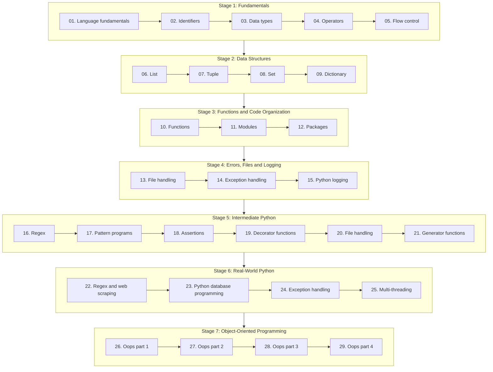

# Python Learning

A structured, hands-on Python curriculum that takes a learner from first principles to professional-grade programming. The course is organised into 29 topics across 7 progressive stages: core language fundamentals, data structures, modular code, error handling, file and data processing, concurrency, and object-oriented design.

Each topic has its own folder with focused notes and examples. Concepts are introduced in a logical order, so every stage builds directly on the skills from the stage before it. The goal is practical fluency: write clean, readable and reliable Python for scripting, automation, data work and application development.

- **Python version:** 3.12+
- **Prerequisites:** none. Topic 01 starts from zero.
- **Audience:** beginners who want a complete path, and developers who want to fill gaps in their Python knowledge.

## Learning Path

Work through the topics in order. Each stage builds on the one before it.

---

## Notes

Each topic folder has a `README.md` with the notes for that topic.

<table width="100%">
  <thead>
    <tr>
      <th align="left">#</th>
      <th align="left">Topic</th>
      <th align="left">Stage</th>
      <th align="left">Level</th>
      <th align="left">Key Concepts</th>
      <th align="left">Status</th>
      <th align="left">Notes</th>
    </tr>
  </thead>
  <tbody>
    <tr>
      <td>01</td>
      <td><b>Language fundamentals</b></td>
      <td>Stage 1: Fundamentals</td>
      <td>Beginner</td>
      <td>Python features, history, versions, how code runs</td>
      <td>Not started</td>
      <td><a href="./01.%20Language%20fundamentals/README.md">Open notes</a></td>
    </tr>
    <tr>
      <td>02</td>
      <td><b>Identifiers</b></td>
      <td>Stage 1: Fundamentals</td>
      <td>Beginner</td>
      <td>Naming rules, reserved words, conventions</td>
      <td>Not started</td>
      <td><a href="./02.%20Identifiers/README.md">Open notes</a></td>
    </tr>
    <tr>
      <td>03</td>
      <td><b>Data types</b></td>
      <td>Stage 1: Fundamentals</td>
      <td>Beginner</td>
      <td>int, float, complex, bool, str, type casting</td>
      <td>Not started</td>
      <td><a href="./03.%20Data%20types/README.md">Open notes</a></td>
    </tr>
    <tr>
      <td>04</td>
      <td><b>Operators</b></td>
      <td>Stage 1: Fundamentals</td>
      <td>Beginner</td>
      <td>Arithmetic, relational, logical, bitwise, precedence</td>
      <td>Not started</td>
      <td><a href="./04.%20Operators/README.md">Open notes</a></td>
    </tr>
    <tr>
      <td>05</td>
      <td><b>Flow control</b></td>
      <td>Stage 1: Fundamentals</td>
      <td>Beginner</td>
      <td>if/elif/else, for, while, break, continue, pass</td>
      <td>Not started</td>
      <td><a href="./05.%20Flow%20control/README.md">Open notes</a></td>
    </tr>
    <tr>
      <td>06</td>
      <td><b>List</b></td>
      <td>Stage 2: Data Structures</td>
      <td>Beginner</td>
      <td>Creation, indexing, slicing, methods, comprehensions</td>
      <td>Not started</td>
      <td><a href="./06.%20List/README.md">Open notes</a></td>
    </tr>
    <tr>
      <td>07</td>
      <td><b>Tuple</b></td>
      <td>Stage 2: Data Structures</td>
      <td>Beginner</td>
      <td>Immutability, packing, unpacking, tuple methods</td>
      <td>Not started</td>
      <td><a href="./07.%20Tuple/README.md">Open notes</a></td>
    </tr>
    <tr>
      <td>08</td>
      <td><b>Set</b></td>
      <td>Stage 2: Data Structures</td>
      <td>Beginner</td>
      <td>Uniqueness, set operations, set methods</td>
      <td>Not started</td>
      <td><a href="./08.%20Set/README.md">Open notes</a></td>
    </tr>
    <tr>
      <td>09</td>
      <td><b>Dictionary</b></td>
      <td>Stage 2: Data Structures</td>
      <td>Beginner</td>
      <td>Key-value pairs, methods, nested dictionaries</td>
      <td>Not started</td>
      <td><a href="./09.%20Dictionary/README.md">Open notes</a></td>
    </tr>
    <tr>
      <td>10</td>
      <td><b>Functions</b></td>
      <td>Stage 3: Functions and Code Organization</td>
      <td>Intermediate</td>
      <td>Arguments, return values, scope, lambda</td>
      <td>Not started</td>
      <td><a href="./10.%20Functions/README.md">Open notes</a></td>
    </tr>
    <tr>
      <td>11</td>
      <td><b>Modules</b></td>
      <td>Stage 3: Functions and Code Organization</td>
      <td>Intermediate</td>
      <td>import, aliasing, built-in and custom modules</td>
      <td>Not started</td>
      <td><a href="./11.%20Modules/README.md">Open notes</a></td>
    </tr>
    <tr>
      <td>12</td>
      <td><b>Packages</b></td>
      <td>Stage 3: Functions and Code Organization</td>
      <td>Intermediate</td>
      <td>Package structure, __init__.py, imports</td>
      <td>Not started</td>
      <td><a href="./12.%20Packages/README.md">Open notes</a></td>
    </tr>
    <tr>
      <td>13</td>
      <td><b>File handling</b></td>
      <td>Stage 4: Errors, Files and Logging</td>
      <td>Intermediate</td>
      <td>Open, read, write, file modes, with statement</td>
      <td>Not started</td>
      <td><a href="./13.%20File%20handling/README.md">Open notes</a></td>
    </tr>
    <tr>
      <td>14</td>
      <td><b>Exception handling</b></td>
      <td>Stage 4: Errors, Files and Logging</td>
      <td>Intermediate</td>
      <td>try/except/else/finally, built-in exceptions</td>
      <td>Not started</td>
      <td><a href="./14.%20Exception%20handling/README.md">Open notes</a></td>
    </tr>
    <tr>
      <td>15</td>
      <td><b>Python logging</b></td>
      <td>Stage 4: Errors, Files and Logging</td>
      <td>Intermediate</td>
      <td>Log levels, handlers, formatting, log files</td>
      <td>Not started</td>
      <td><a href="./15.%20Python%20logging/README.md">Open notes</a></td>
    </tr>
    <tr>
      <td>16</td>
      <td><b>Regex</b></td>
      <td>Stage 5: Intermediate Python</td>
      <td>Intermediate</td>
      <td>re module, patterns, character classes, quantifiers</td>
      <td>Not started</td>
      <td><a href="./16.%20Regex/README.md">Open notes</a></td>
    </tr>
    <tr>
      <td>17</td>
      <td><b>Pattern programs</b></td>
      <td>Stage 5: Intermediate Python</td>
      <td>Intermediate</td>
      <td>Nested loops, star and number patterns</td>
      <td>Not started</td>
      <td><a href="./17.%20Pattern%20programs/README.md">Open notes</a></td>
    </tr>
    <tr>
      <td>18</td>
      <td><b>Assertions</b></td>
      <td>Stage 5: Intermediate Python</td>
      <td>Intermediate</td>
      <td>assert statement, debugging checks</td>
      <td>Not started</td>
      <td><a href="./18.%20Assertions/README.md">Open notes</a></td>
    </tr>
    <tr>
      <td>19</td>
      <td><b>Decorator functions</b></td>
      <td>Stage 5: Intermediate Python</td>
      <td>Intermediate</td>
      <td>Closures, wrapping functions, decorator chaining</td>
      <td>Not started</td>
      <td><a href="./19.%20Decorator%20functions/README.md">Open notes</a></td>
    </tr>
    <tr>
      <td>20</td>
      <td><b>File handling</b></td>
      <td>Stage 5: Intermediate Python</td>
      <td>Intermediate</td>
      <td>Binary files, CSV, zip, directories, pickling</td>
      <td>Not started</td>
      <td><a href="./20.%20File%20handling/README.md">Open notes</a></td>
    </tr>
    <tr>
      <td>21</td>
      <td><b>Generator functions</b></td>
      <td>Stage 5: Intermediate Python</td>
      <td>Intermediate</td>
      <td>yield, lazy evaluation, memory efficiency</td>
      <td>Not started</td>
      <td><a href="./21.%20Generator%20functions/README.md">Open notes</a></td>
    </tr>
    <tr>
      <td>22</td>
      <td><b>Regex and web scraping</b></td>
      <td>Stage 6: Real-World Python</td>
      <td>Advanced</td>
      <td>Advanced regex, extracting data from web pages</td>
      <td>Not started</td>
      <td><a href="./22.%20Regex%20and%20web%20scraping/README.md">Open notes</a></td>
    </tr>
    <tr>
      <td>23</td>
      <td><b>Python database programming</b></td>
      <td>Stage 6: Real-World Python</td>
      <td>Advanced</td>
      <td>DB connections, SQL queries, CRUD operations</td>
      <td>Not started</td>
      <td><a href="./23.%20Python%20database%20programming/README.md">Open notes</a></td>
    </tr>
    <tr>
      <td>24</td>
      <td><b>Exception handling</b></td>
      <td>Stage 6: Real-World Python</td>
      <td>Advanced</td>
      <td>Custom exceptions, nested handling, best practices</td>
      <td>Not started</td>
      <td><a href="./24.%20Exception%20handling/README.md">Open notes</a></td>
    </tr>
    <tr>
      <td>25</td>
      <td><b>Multi-threading</b></td>
      <td>Stage 6: Real-World Python</td>
      <td>Advanced</td>
      <td>Threads, synchronization, locks, thread communication</td>
      <td>Not started</td>
      <td><a href="./25.%20Multi-threading/README.md">Open notes</a></td>
    </tr>
    <tr>
      <td>26</td>
      <td><b>Oops part 1</b></td>
      <td>Stage 7: Object-Oriented Programming</td>
      <td>Advanced</td>
      <td>Classes, objects, constructors, variables, methods</td>
      <td>Not started</td>
      <td><a href="./26.%20Oops%20part%201/README.md">Open notes</a></td>
    </tr>
    <tr>
      <td>27</td>
      <td><b>Oops part 2</b></td>
      <td>Stage 7: Object-Oriented Programming</td>
      <td>Advanced</td>
      <td>Inheritance, super(), method resolution order</td>
      <td>Not started</td>
      <td><a href="./27.%20Oops%20part%202/README.md">Open notes</a></td>
    </tr>
    <tr>
      <td>28</td>
      <td><b>Oops part 3</b></td>
      <td>Stage 7: Object-Oriented Programming</td>
      <td>Advanced</td>
      <td>Polymorphism, overloading, overriding</td>
      <td>Not started</td>
      <td><a href="./28.%20Oops%20part%203/README.md">Open notes</a></td>
    </tr>
    <tr>
      <td>29</td>
      <td><b>Oops part 4</b></td>
      <td>Stage 7: Object-Oriented Programming</td>
      <td>Advanced</td>
      <td>Abstraction, encapsulation, abstract classes, interfaces</td>
      <td>Not started</td>
      <td><a href="./29.%20Oops%20part%204/README.md">Open notes</a></td>
    </tr>
  </tbody>
</table>

Note: some topics have the same name (13 and 20 are file handling, 14 and 24 are exception handling). Each one is a separate part of the syllabus.
