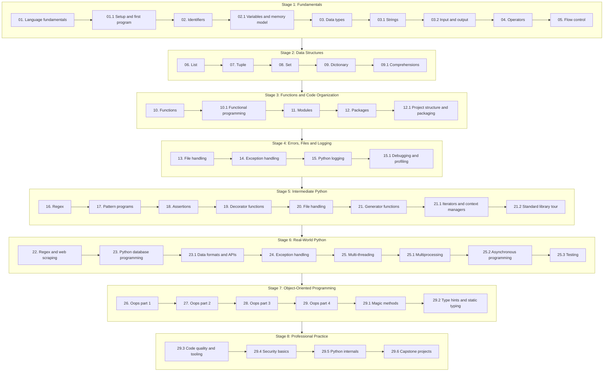

# Python Learning

A structured, hands-on Python curriculum that takes a learner from first principles to professional-grade programming. The course is organised into 49 topics across 8 progressive stages: core language fundamentals, data structures, modular code, error handling, file and data processing, concurrency, object-oriented design and professional practice.

Each topic has its own folder with focused notes and examples. Concepts are introduced in a logical order, so every stage builds directly on the skills from the stage before it. The goal is practical fluency: write clean, readable and reliable Python for scripting, automation, data work and application development.

- **Python version:** 3.12+
- **Prerequisites:** none. Topic 01 starts from zero.
- **Audience:** beginners who want a complete path, and developers who want to fill gaps in their Python knowledge.

## Learning Path

Work through the topics in order. Each stage builds on the one before it.

## Notes

Each topic folder has a `README.md` with the notes for that topic. Topics marked **Extra** are not in the syllabus PDFs; they fill gaps in the course.

### Beginner

Core syntax, data types, control flow and built-in data structures.

<table width="100%">
<tr>
<th align="center" width="6%">#</th>
<th align="left" width="20%">Topic</th>
<th align="left" width="16%">Stage</th>
<th align="left" width="34%">Key Concepts</th>
<th align="center" width="8%">Source</th>
<th align="center" width="8%">Status</th>
<th align="center" width="8%">Notes</th>
</tr>
<tr><td align="center"><b>01</b></td><td align="left">Language fundamentals</td><td align="left">Stage 1: Fundamentals</td><td align="left">Python features, history, versions, how code runs</td><td align="center">Syllabus</td><td align="center">Completed</td><td align="center"><a href="./01.%20Language%20fundamentals/README.md">Open</a></td></tr>
<tr><td align="center"><b>01.1</b></td><td align="left">Setup and first program</td><td align="left">Stage 1: Fundamentals</td><td align="left">Installing Python, REPL, editors, venv, pip, first script</td><td align="center">Extra</td><td align="center">Completed</td><td align="center"><a href="./01.1%20Setup%20and%20first%20program/README.md">Open</a></td></tr>
<tr><td align="center"><b>02</b></td><td align="left">Identifiers</td><td align="left">Stage 1: Fundamentals</td><td align="left">Naming rules, reserved words, conventions</td><td align="center">Syllabus</td><td align="center">Completed</td><td align="center"><a href="./02.%20Identifiers/README.md">Open</a></td></tr>
<tr><td align="center"><b>02.1</b></td><td align="left">Variables and memory model</td><td align="left">Stage 1: Fundamentals</td><td align="left">Names, objects, references, id(), mutability, garbage collection</td><td align="center">Extra</td><td align="center">Completed</td><td align="center"><a href="./02.1%20Variables%20and%20memory%20model/README.md">Open</a></td></tr>
<tr><td align="center"><b>03</b></td><td align="left">Data types</td><td align="left">Stage 1: Fundamentals</td><td align="left">int, float, complex, bool, str, type casting</td><td align="center">Syllabus</td><td align="center">Completed</td><td align="center"><a href="./03.%20Data%20types/README.md">Open</a></td></tr>
<tr><td align="center"><b>03.1</b></td><td align="left">Strings</td><td align="left">Stage 1: Fundamentals</td><td align="left">Indexing, slicing, string methods, f-strings, Unicode</td><td align="center">Extra</td><td align="center">Not started</td><td align="center"><a href="./03.1%20Strings/README.md">Open</a></td></tr>
<tr><td align="center"><b>03.2</b></td><td align="left">Input and output</td><td align="left">Stage 1: Fundamentals</td><td align="left">input(), print(), formatting output, command-line arguments</td><td align="center">Extra</td><td align="center">Not started</td><td align="center"><a href="./03.2%20Input%20and%20output/README.md">Open</a></td></tr>
<tr><td align="center"><b>04</b></td><td align="left">Operators</td><td align="left">Stage 1: Fundamentals</td><td align="left">Arithmetic, relational, logical, bitwise, precedence</td><td align="center">Syllabus</td><td align="center">Not started</td><td align="center"><a href="./04.%20Operators/README.md">Open</a></td></tr>
<tr><td align="center"><b>05</b></td><td align="left">Flow control</td><td align="left">Stage 1: Fundamentals</td><td align="left">if/elif/else, for, while, break, continue, pass</td><td align="center">Syllabus</td><td align="center">Not started</td><td align="center"><a href="./05.%20Flow%20control/README.md">Open</a></td></tr>
<tr><td align="center"><b>06</b></td><td align="left">List</td><td align="left">Stage 2: Data Structures</td><td align="left">Creation, indexing, slicing, list methods</td><td align="center">Syllabus</td><td align="center">Not started</td><td align="center"><a href="./06.%20List/README.md">Open</a></td></tr>
<tr><td align="center"><b>07</b></td><td align="left">Tuple</td><td align="left">Stage 2: Data Structures</td><td align="left">Immutability, packing, unpacking, tuple methods</td><td align="center">Syllabus</td><td align="center">Not started</td><td align="center"><a href="./07.%20Tuple/README.md">Open</a></td></tr>
<tr><td align="center"><b>08</b></td><td align="left">Set</td><td align="left">Stage 2: Data Structures</td><td align="left">Uniqueness, set operations, frozenset</td><td align="center">Syllabus</td><td align="center">Not started</td><td align="center"><a href="./08.%20Set/README.md">Open</a></td></tr>
<tr><td align="center"><b>09</b></td><td align="left">Dictionary</td><td align="left">Stage 2: Data Structures</td><td align="left">Key-value pairs, methods, nested dictionaries</td><td align="center">Syllabus</td><td align="center">Not started</td><td align="center"><a href="./09.%20Dictionary/README.md">Open</a></td></tr>
<tr><td align="center"><b>09.1</b></td><td align="left">Comprehensions</td><td align="left">Stage 2: Data Structures</td><td align="left">List, set and dict comprehensions, generator expressions</td><td align="center">Extra</td><td align="center">Not started</td><td align="center"><a href="./09.1%20Comprehensions/README.md">Open</a></td></tr>
</table>

### Intermediate

Reusable code, error handling, files, logging and advanced function features.

<table width="100%">
<tr>
<th align="center" width="6%">#</th>
<th align="left" width="20%">Topic</th>
<th align="left" width="16%">Stage</th>
<th align="left" width="34%">Key Concepts</th>
<th align="center" width="8%">Source</th>
<th align="center" width="8%">Status</th>
<th align="center" width="8%">Notes</th>
</tr>
<tr><td align="center"><b>10</b></td><td align="left">Functions</td><td align="left">Stage 3: Functions and Code Organization</td><td align="left">Arguments, return values, scope, lambda</td><td align="center">Syllabus</td><td align="center">Not started</td><td align="center"><a href="./10.%20Functions/README.md">Open</a></td></tr>
<tr><td align="center"><b>10.1</b></td><td align="left">Functional programming</td><td align="left">Stage 3: Functions and Code Organization</td><td align="left">map, filter, reduce, functools, higher-order functions</td><td align="center">Extra</td><td align="center">Not started</td><td align="center"><a href="./10.1%20Functional%20programming/README.md">Open</a></td></tr>
<tr><td align="center"><b>11</b></td><td align="left">Modules</td><td align="left">Stage 3: Functions and Code Organization</td><td align="left">import, aliasing, built-in and custom modules</td><td align="center">Syllabus</td><td align="center">Not started</td><td align="center"><a href="./11.%20Modules/README.md">Open</a></td></tr>
<tr><td align="center"><b>12</b></td><td align="left">Packages</td><td align="left">Stage 3: Functions and Code Organization</td><td align="left">Package structure, __init__.py, imports</td><td align="center">Syllabus</td><td align="center">Not started</td><td align="center"><a href="./12.%20Packages/README.md">Open</a></td></tr>
<tr><td align="center"><b>12.1</b></td><td align="left">Project structure and packaging</td><td align="left">Stage 3: Functions and Code Organization</td><td align="left">Project layout, pyproject.toml, building and publishing</td><td align="center">Extra</td><td align="center">Not started</td><td align="center"><a href="./12.1%20Project%20structure%20and%20packaging/README.md">Open</a></td></tr>
<tr><td align="center"><b>13</b></td><td align="left">File handling</td><td align="left">Stage 4: Errors, Files and Logging</td><td align="left">Open, read, write, file modes, with statement</td><td align="center">Syllabus</td><td align="center">Not started</td><td align="center"><a href="./13.%20File%20handling/README.md">Open</a></td></tr>
<tr><td align="center"><b>14</b></td><td align="left">Exception handling</td><td align="left">Stage 4: Errors, Files and Logging</td><td align="left">try/except/else/finally, built-in exceptions</td><td align="center">Syllabus</td><td align="center">Not started</td><td align="center"><a href="./14.%20Exception%20handling/README.md">Open</a></td></tr>
<tr><td align="center"><b>15</b></td><td align="left">Python logging</td><td align="left">Stage 4: Errors, Files and Logging</td><td align="left">Log levels, handlers, formatting, log files</td><td align="center">Syllabus</td><td align="center">Not started</td><td align="center"><a href="./15.%20Python%20logging/README.md">Open</a></td></tr>
<tr><td align="center"><b>15.1</b></td><td align="left">Debugging and profiling</td><td align="left">Stage 4: Errors, Files and Logging</td><td align="left">pdb, breakpoints, tracebacks, cProfile, timeit</td><td align="center">Extra</td><td align="center">Not started</td><td align="center"><a href="./15.1%20Debugging%20and%20profiling/README.md">Open</a></td></tr>
<tr><td align="center"><b>16</b></td><td align="left">Regex</td><td align="left">Stage 5: Intermediate Python</td><td align="left">re module, patterns, character classes, quantifiers</td><td align="center">Syllabus</td><td align="center">Not started</td><td align="center"><a href="./16.%20Regex/README.md">Open</a></td></tr>
<tr><td align="center"><b>17</b></td><td align="left">Pattern programs</td><td align="left">Stage 5: Intermediate Python</td><td align="left">Nested loops, star and number patterns</td><td align="center">Syllabus</td><td align="center">Not started</td><td align="center"><a href="./17.%20Pattern%20programs/README.md">Open</a></td></tr>
<tr><td align="center"><b>18</b></td><td align="left">Assertions</td><td align="left">Stage 5: Intermediate Python</td><td align="left">assert statement, debugging checks</td><td align="center">Syllabus</td><td align="center">Not started</td><td align="center"><a href="./18.%20Assertions/README.md">Open</a></td></tr>
<tr><td align="center"><b>19</b></td><td align="left">Decorator functions</td><td align="left">Stage 5: Intermediate Python</td><td align="left">Closures, wrapping functions, decorator chaining</td><td align="center">Syllabus</td><td align="center">Not started</td><td align="center"><a href="./19.%20Decorator%20functions/README.md">Open</a></td></tr>
<tr><td align="center"><b>20</b></td><td align="left">File handling</td><td align="left">Stage 5: Intermediate Python</td><td align="left">Binary files, CSV, zip, directories, pickling</td><td align="center">Syllabus</td><td align="center">Not started</td><td align="center"><a href="./20.%20File%20handling/README.md">Open</a></td></tr>
<tr><td align="center"><b>21</b></td><td align="left">Generator functions</td><td align="left">Stage 5: Intermediate Python</td><td align="left">yield, lazy evaluation, memory efficiency</td><td align="center">Syllabus</td><td align="center">Not started</td><td align="center"><a href="./21.%20Generator%20functions/README.md">Open</a></td></tr>
<tr><td align="center"><b>21.1</b></td><td align="left">Iterators and context managers</td><td align="left">Stage 5: Intermediate Python</td><td align="left">Iterator protocol, __iter__, __next__, with, contextlib</td><td align="center">Extra</td><td align="center">Not started</td><td align="center"><a href="./21.1%20Iterators%20and%20context%20managers/README.md">Open</a></td></tr>
<tr><td align="center"><b>21.2</b></td><td align="left">Standard library tour</td><td align="left">Stage 5: Intermediate Python</td><td align="left">collections, itertools, datetime, os, pathlib, sys</td><td align="center">Extra</td><td align="center">Not started</td><td align="center"><a href="./21.2%20Standard%20library%20tour/README.md">Open</a></td></tr>
</table>

### Advanced

Real-world integrations, concurrency, object-oriented design and professional tooling.

<table width="100%">
<tr>
<th align="center" width="6%">#</th>
<th align="left" width="20%">Topic</th>
<th align="left" width="16%">Stage</th>
<th align="left" width="34%">Key Concepts</th>
<th align="center" width="8%">Source</th>
<th align="center" width="8%">Status</th>
<th align="center" width="8%">Notes</th>
</tr>
<tr><td align="center"><b>22</b></td><td align="left">Regex and web scraping</td><td align="left">Stage 6: Real-World Python</td><td align="left">Advanced regex, extracting data from web pages</td><td align="center">Syllabus</td><td align="center">Not started</td><td align="center"><a href="./22.%20Regex%20and%20web%20scraping/README.md">Open</a></td></tr>
<tr><td align="center"><b>23</b></td><td align="left">Python database programming</td><td align="left">Stage 6: Real-World Python</td><td align="left">DB connections, SQL queries, CRUD operations</td><td align="center">Syllabus</td><td align="center">Not started</td><td align="center"><a href="./23.%20Python%20database%20programming/README.md">Open</a></td></tr>
<tr><td align="center"><b>23.1</b></td><td align="left">Data formats and APIs</td><td align="left">Stage 6: Real-World Python</td><td align="left">JSON, CSV, YAML, HTTP requests, REST APIs</td><td align="center">Extra</td><td align="center">Not started</td><td align="center"><a href="./23.1%20Data%20formats%20and%20APIs/README.md">Open</a></td></tr>
<tr><td align="center"><b>24</b></td><td align="left">Exception handling</td><td align="left">Stage 6: Real-World Python</td><td align="left">Custom exceptions, nested handling, best practices</td><td align="center">Syllabus</td><td align="center">Not started</td><td align="center"><a href="./24.%20Exception%20handling/README.md">Open</a></td></tr>
<tr><td align="center"><b>25</b></td><td align="left">Multi-threading</td><td align="left">Stage 6: Real-World Python</td><td align="left">Threads, synchronization, locks, thread communication</td><td align="center">Syllabus</td><td align="center">Not started</td><td align="center"><a href="./25.%20Multi-threading/README.md">Open</a></td></tr>
<tr><td align="center"><b>25.1</b></td><td align="left">Multiprocessing</td><td align="left">Stage 6: Real-World Python</td><td align="left">Processes, pools, shared state, the GIL</td><td align="center">Extra</td><td align="center">Not started</td><td align="center"><a href="./25.1%20Multiprocessing/README.md">Open</a></td></tr>
<tr><td align="center"><b>25.2</b></td><td align="left">Asynchronous programming</td><td align="left">Stage 6: Real-World Python</td><td align="left">async/await, asyncio, event loop, tasks</td><td align="center">Extra</td><td align="center">Not started</td><td align="center"><a href="./25.2%20Asynchronous%20programming/README.md">Open</a></td></tr>
<tr><td align="center"><b>25.3</b></td><td align="left">Testing</td><td align="left">Stage 6: Real-World Python</td><td align="left">unittest, pytest, fixtures, mocking, coverage</td><td align="center">Extra</td><td align="center">Not started</td><td align="center"><a href="./25.3%20Testing/README.md">Open</a></td></tr>
<tr><td align="center"><b>26</b></td><td align="left">Oops part 1</td><td align="left">Stage 7: Object-Oriented Programming</td><td align="left">Classes, objects, constructors, variables, methods</td><td align="center">Syllabus</td><td align="center">Not started</td><td align="center"><a href="./26.%20Oops%20part%201/README.md">Open</a></td></tr>
<tr><td align="center"><b>27</b></td><td align="left">Oops part 2</td><td align="left">Stage 7: Object-Oriented Programming</td><td align="left">Inheritance, super(), method resolution order</td><td align="center">Syllabus</td><td align="center">Not started</td><td align="center"><a href="./27.%20Oops%20part%202/README.md">Open</a></td></tr>
<tr><td align="center"><b>28</b></td><td align="left">Oops part 3</td><td align="left">Stage 7: Object-Oriented Programming</td><td align="left">Polymorphism, overloading, overriding</td><td align="center">Syllabus</td><td align="center">Not started</td><td align="center"><a href="./28.%20Oops%20part%203/README.md">Open</a></td></tr>
<tr><td align="center"><b>29</b></td><td align="left">Oops part 4</td><td align="left">Stage 7: Object-Oriented Programming</td><td align="left">Abstraction, encapsulation, abstract classes, interfaces</td><td align="center">Syllabus</td><td align="center">Not started</td><td align="center"><a href="./29.%20Oops%20part%204/README.md">Open</a></td></tr>
<tr><td align="center"><b>29.1</b></td><td align="left">Magic methods</td><td align="left">Stage 7: Object-Oriented Programming</td><td align="left">Dunder methods, operator overloading, __repr__, __eq__</td><td align="center">Extra</td><td align="center">Not started</td><td align="center"><a href="./29.1%20Magic%20methods/README.md">Open</a></td></tr>
<tr><td align="center"><b>29.2</b></td><td align="left">Type hints and static typing</td><td align="left">Stage 7: Object-Oriented Programming</td><td align="left">Annotations, typing module, dataclasses, mypy</td><td align="center">Extra</td><td align="center">Not started</td><td align="center"><a href="./29.2%20Type%20hints%20and%20static%20typing/README.md">Open</a></td></tr>
<tr><td align="center"><b>29.3</b></td><td align="left">Code quality and tooling</td><td align="left">Stage 8: Professional Practice</td><td align="left">PEP 8, linters, formatters, pre-commit</td><td align="center">Extra</td><td align="center">Not started</td><td align="center"><a href="./29.3%20Code%20quality%20and%20tooling/README.md">Open</a></td></tr>
<tr><td align="center"><b>29.4</b></td><td align="left">Security basics</td><td align="left">Stage 8: Professional Practice</td><td align="left">Input validation, secrets, safe dependencies</td><td align="center">Extra</td><td align="center">Not started</td><td align="center"><a href="./29.4%20Security%20basics/README.md">Open</a></td></tr>
<tr><td align="center"><b>29.5</b></td><td align="left">Python internals</td><td align="left">Stage 8: Professional Practice</td><td align="left">Bytecode, CPython, memory management, the GIL</td><td align="center">Extra</td><td align="center">Not started</td><td align="center"><a href="./29.5%20Python%20internals/README.md">Open</a></td></tr>
<tr><td align="center"><b>29.6</b></td><td align="left">Capstone projects</td><td align="left">Stage 8: Professional Practice</td><td align="left">End-to-end projects that combine all stages</td><td align="center">Extra</td><td align="center">Not started</td><td align="center"><a href="./29.6%20Capstone%20projects/README.md">Open</a></td></tr>
</table>
